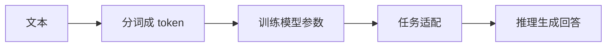

# 第一章：大模型入门——训练、推理与岗位

阅读方式：这是本章的完整学习文件，按知识链路合并原仓库文章。先读每节的解释与例子，再读技术细节；每节末尾闭卷做复述和闪卡。原文镜像仅供核对，不是必需的第二教材。

## 本章主线

先建立“模型怎样训练出来、怎样产生一次回答”的心智模型，再区分模型训练、应用研发与部署岗位。读完能解释 token、参数、预训练、SFT、推理、幻觉和成本之间的关系。

本章动手证据： 闭卷画出数据→token→预训练→SFT/偏好对齐→推理；用同一个问题对比模型无资料回答和给资料回答；记录一次调用的输入/输出 token 与费用。

## 本章目录

- 1.1 应用算法岗位：能力地图与完成证据

- 1.2 应用落地链路：输入、模型、证据与交付

- 1.3 从训练到推理：token、BPE 与模型适配

- 1.4 应用概念与生成采样：温度、top-k、top-p

- 1.5 蒸馏：教师、学生与软目标

- 1.6 Token 用量：上下文、工具与缓存口径

- 1.7 API 成本：输入、缓存与输出分项

- 1.8 学习路线：复述、手写、排障与复习

- 1.9 模型、应用与工具运行环境：以 Claude Code 为例

## 与面试、代码的关系

面试串联： 面试问“大模型为什么能回答指令”时，先解释预训练学会预测 token 的规律，再说明 SFT/偏好训练如何改变回答行为。问“为什么会幻觉”时，说明生成目标与事实核验的差别，给出检索或工具核验方案。

需要亲手写的代码： 记住训练与推理的区别、交叉熵的输入/目标、token ID→Embedding→logits 的形状；现阶段不需背具体厂商 API 参数。

<a id="s1"></a>

## 1.1 应用算法岗位：能力地图与完成证据【🔥 必会】

〔融合 GitHub 教程的问题引导〕

### 先说结论：三者是并列关系，不是替代关系

**大模型应用开发不会替代 C++/Java/Go 开发，它是一个新岗位，和传统开发是并列的。**

为什么大模型应用开发岗位看起来这么多？不是因为传统开发岗位没了，是因为这是一个**新物种**，行业在吸纳人员。

业务框架依然要 SpringBoot，高性能 RPC 依然要 C++，高并发服务依然要用 Go。这些需求没有消失，只是这些岗位已经发展了很多年，人员已经够用了。

而大模型应用开发是这两年才冒出来的，自然需要大量招人。

**不是旧岗位被淘汰了，是新岗位在补人。**

我再给大家举一个例子，算法岗是早汽车发动机，大模型应用开发是做智能驾驶的，而C++/Go/Java开发是造车的。

不是说，有了智驾，车都不用造了，框架构架，通信协议，业务逻辑 要有开发来做。

而C++/Go/Java开发 + LLM，就是现在造车的，最好也要懂点智驾，这么比喻够形象了吧。


〔补充自原仓库镜像〕〔本次新补，参考当前面试趋势〕

目标 + 例子。 面向 LLM/多模态应用算法和 Applied ML 岗位，把“知道名词”转成可复述、可运行、可排障的证据；例如对 RAG 不只会搭链路，还要能解释召回失败和评测。

**原教程图解：**


### 概念与数据流

| 五要素 | 能力证据检查 |
| --- | --- |
| 输入 | 能力名称、优先级、复述/代码/排障的证据描述。 |
| 做什么 | 检查字段合法性，列出尚未填写的证据。 |
| 输出 | 每个能力仍缺哪些证据；填写过的内容不自动证明能力真实。 |
| 哪里出错 | 只写框架名称、夸大团队贡献、把一次成功 demo 当作稳定系统。 |
| 参数影响 | 岗位 JD、项目阶段和可用时间影响学习优先级；不同团队职责不完全相同。 |

核心能力链包括数据处理、模型调用、检索或工具、模型适配、离线/线上评测、部署和故障分析；Transformer 基础用于解释数据流和边界。具体 JD 可能偏算法、工程或产品，应结合实际岗位判断。用户的安全隐患图片项目可以围绕视觉模型、制度检索和展示组织，但公司数据和个人贡献必须按真实情况描述。

### 面试追问

【🔥 必会】应用算法工程师的核心价值是什么？ 结论：把模型能力变成可评测的应用。说明需求、数据、模型或检索选择、评测、上线约束及故障处理，并给出本人实际承担的部分。

【🔥 必会】项目效果下降怎么定位？ 结论：沿数据和模型链路分层排查。对照输入质量、模型输出、检索结果、提示与评测样本，先找首个偏差，再设计回归。

【⭐ 理解】是否必须会从头训练基座？ 结论：取决于岗位，但本学习路线不以此为主。重点是理解核心组件并完成适配、评测和交付；具体要求以目标 JD 为准。

### 故障模式与排障

- 简历只列技术名词：对每个能力补输入、处理、输出、故障和参数的说明，并保存真实代码或实验记录。

- 项目指标无法解释：核对任务、基线、测试集和个人贡献；没有真实实验时如实说明待验证，不编造数字。

- 会跑 demo 但不会排障：主动构造空输入、错误参数或召回失败，记录定位和修复，再闭卷复述。

### 工程 trick 与坑

- 能力记录必须以本人实际经历为准；示例里的文字均为虚构，不代表用户已完成。

- 保密项目可描述获准公开的流程、职责和脱敏结果；不能公开公司敏感数据。

- 岗位名称与职责因公司而异，不能仅凭名称断言薪酬或工作时间。

### Toy code：检查能力证据缺项

运行前提：Python 3.10+，标准库。程序只检查文字是否填写，不评估真实求职能力。

```python
"""核查应用岗能力条目的练习证据；不自动判断求职资格。"""
from dataclasses import dataclass


@dataclass(frozen=True)
class Capability:
    """能力名、优先级及复述、代码、排障证据的简要描述。"""
    name: str
    priority: str
    explanation: str
    code: str
    debugging: str


def missing_evidence(items: list[Capability]) -> dict[str, list[str]]:
    """列出每项尚未填写的证据；已填写不等于能力已核验。"""
    if not items:
        raise ValueError('能力清单不能为空')
    seen: set[str] = set()
    gaps: dict[str, list[str]] = {}
    for item in items:
        if not item.name.strip() or item.name in seen:
            raise ValueError('能力名必须非空且唯一')
        if item.priority not in {'必会', '理解', '按需'}:
            raise ValueError('未知优先级')
        seen.add(item.name)
        fields = {'复述': item.explanation, '代码': item.code, '排障': item.debugging}
        if any(not isinstance(value, str) for value in fields.values()):
            raise ValueError('证据描述必须是字符串')
        missing = [name for name, value in fields.items() if not value.strip()]
        if missing:
            gaps[item.name] = missing
    assert set(gaps) <= seen
    return gaps


def main() -> None:
    """验证缺证据、已填写以及非法输入。"""
    examples = [Capability('检索评测', '必会', '能解释 Recall', '运行虚构评测', ''),
                Capability('工具调用', '必会', '解释 schema', '本地调用示例', '处理参数错误')]
    assert missing_evidence(examples) == {'检索评测': ['排障']}
    assert missing_evidence(examples[1:]) == {}
    for bad in ([], [examples[0], examples[0]], [Capability('X', '未知', '', '', '')]):
        try:
            missing_evidence(bad)
        except ValueError:
            pass
        else:
            raise AssertionError('非法清单必须拒绝')
    print('虚构能力记录缺项:', missing_evidence(examples))
    print('文本是否真实、是否能闭卷完成仍需本人检查。')


if __name__ == '__main__':
    main()

```

逐段理解。 Capability 记录三个证据字段；missing_evidence 校验名称和优先级，列出空白项；自检覆盖缺项、重复和非法优先级。

### 这段代码怎么在面试里讲

- 不变量：能力名唯一，优先级来自限定集合，证据字段为字符串。

- 关键过程：逐项检查复述、代码和排障描述，返回尚未填写的字段。

- 边界与坑：非空不代表真实或熟练，必须通过本人闭卷复述、运行与故障演练核验。

### 本节收尾：费曼自述与闪卡

费曼自述： 应用岗位要把数据、模型、评测和交付串起来；每项能力需要真实的复述、代码和排障证据，项目贡献如实说明。

- 问：只会调用模型 API 就够吗？答：还应能评测、排障并处理数据和交付约束。

- 问：如何证明会 RAG？答：解释数据流，运行链路并定位召回或生成失败。

- 问：团队成果如何写进简历？答：区分本人贡献与团队成果，不能夸大。

- 问：代码里字段有内容就证明能力吗？答：不证明，需要实际演练和核验。

### 原文核对 / 来源

[原仓库应用开发岗位区别](原仓库Markdown/docs/llm/intro/application_development.md)。

<a id="s2"></a>

## 1.2 应用落地链路：输入、模型、证据与交付【🔥 必会】

〔融合 GitHub 教程的问题引导〕

### 一、大模型应用开发是什么？

很多初学者有一个误区：认为大模型开发岗位是为那些高学历、强科研能力的同学设立的，要用“强大的数学算法能力”去训练、微调模型。联想到自己的大学数学“三件套”：微积分、线性代数、概率论早都忘光了，连最基础的神经网络反向传播的原理用到的偏导、梯度下降都看不懂，还怎么拥抱变革？

**错**。那是高级算法岗的事。

**大模型“应用”开发**（LLM Application Development），本质上是利用已经被“调教”好的、现成的大模型能力，加之自己公司的业务逻辑、私有数据和外部工具，构建解决实际问题的软件系统，是人人都能掌握的新时代技术核心竞争力，而不是需要你去科研模型的底层细节。

〔补充自原仓库镜像〕〔本次新补，参考当前面试趋势〕

目标 + 例子。 以工业安全隐患图片问答为例，串起输入校验、视觉识别、制度检索、回答、展示与评测；任何阶段的输出都需要明确数据契约和失败状态。

**原教程图解：**


### 概念与数据流

| 五要素 | 图片问答应用 |
| --- | --- |
| 输入 | 图片及其访问权限、用户问题、可用制度资料与配置。 |
| 做什么 | 解析/识别图片，按任务检索证据，生成或拒答，并记录可评测的阶段结果。 |
| 输出 | 回答、可追溯来源、错误或人工复核状态；具体展示由产品设计。 |
| 哪里出错 | 图片质量差、模型识别错误、检索遗漏、证据过期、生成结论无依据。 |
| 参数影响 | 视觉分辨率、检索条数、阈值和模型设置影响质量、成本与延迟。 |

应用工程的重点是将各模块串成可验证流程，并区分模型输出、检索证据和最终业务判断。真实系统需要按业务管理权限、来源与错误；本节的固定函数只是阶段交接模拟，视觉、RAG 和评测的实际实现分别见第 7、3 章和[系统设计与评测](横切-系统设计与评测.md)。

### 面试追问

【🔥 必会】图片问答结果错误怎么排查？ 结论：沿链路定位首个错误阶段。检查图片输入、识别结果、检索来源和最终结论，分别对照人工标注或原始证据。

【🔥 必会】没有检索证据时怎么办？ 结论：明确无法确认或转人工。不要把模型猜测包装成制度依据；根据任务要求决定是否追问或重试。

【⭐ 理解】模型调用成功就等于应用成功吗？ 结论：不等于。还要验证事实、来源、权限、延迟和业务任务是否完成。

### 故障模式与排障

- 图片识别错：核对原图质量、预处理和标注；按失败类型抽样评估并改进数据或提示。

- 识别正确但没召回依据：查看检索 query、索引版本与候选；调整分块、检索或重排并回归。

- 有证据但回答错误：逐条对照生成结论与来源；改进提示、输出校验或人工复核。

### 工程 trick 与坑

- 本例的分类、检索和生成都是虚构函数，不读取图片、不连接模型；ok 只表示模拟流程走通，不表示业务结论可靠。

- 真实应用应记录脱敏的来源、版本和阶段状态，避免将公司敏感数据放进公开示例。

- 尽量分阶段做评测，避免仅用最终准确率掩盖问题来源。

### Toy code：模拟阶段交接和缺证据分支

运行前提：Python 3.10+，标准库；无外部服务、真实图片或法规。

```python
"""模拟图片问答的阶段交接；所有识别和证据均为虚构。"""
from dataclasses import dataclass
from typing import Callable


@dataclass(frozen=True)
class Request:
    """匿名图片标识与用户问题；本例不读取图片文件。"""
    image_id: str
    question: str


@dataclass(frozen=True)
class Result:
    """最终状态、输出和经过的阶段。"""
    status: str
    answer: str
    stages: tuple[str, ...]


def run(request: Request, classify: Callable[[str], str], retrieve: Callable[[str], list[str]],
        generate: Callable[[str, list[str]], str]) -> Result:
    """串联模拟识别、检索和回答；缺证据时不调用生成函数。"""
    if not request.image_id.strip() or not request.question.strip():
        raise ValueError('图片标识和问题不能为空')
    stages = ['input']
    category = classify(request.image_id)
    if not isinstance(category, str) or not category.strip():
        return Result('review', '识别结果不可用', tuple(stages))
    stages.append('classify')
    evidence = retrieve(category)
    if not isinstance(evidence, list) or any(not isinstance(item, str) or not item.strip() for item in evidence):
        raise ValueError('检索结果必须是非空字符串列表')
    stages.append('retrieve')
    if not evidence:
        return Result('review', '没有找到证据', tuple(stages))
    answer = generate(request.question, evidence)
    if not isinstance(answer, str) or not answer.strip():
        return Result('review', '生成结果不可用', tuple(stages))
    stages.append('generate')
    return Result('ok', answer, tuple(stages))


def main() -> None:
    """覆盖成功、无证据与非法请求；所有函数是内存模拟。"""
    classify = lambda image_id: '高处' if image_id == 'example' else ''
    retrieve = lambda category: ['虚构来源 A v1'] if category == '高处' else []
    generate = lambda question, evidence: '请人工核查：' + evidence[0]
    result = run(Request('example', '检查什么？'), classify, retrieve, generate)
    assert result.status == 'ok' and result.stages == ('input', 'classify', 'retrieve', 'generate')
    missing = run(Request('example', '问题'), classify, lambda _: [], generate)
    assert missing.status == 'review' and 'generate' not in missing.stages
    assert run(Request('unknown', '问题'), classify, retrieve, generate).status == 'review'
    try:
        run(Request('', '问题'), classify, retrieve, generate)
    except ValueError:
        pass
    else:
        raise AssertionError('缺少图片标识必须拒绝')
    print('虚构图片问答阶段与缺证据分支自检通过:', result)
    print('未调用视觉模型、检索服务或真实图片。')


if __name__ == '__main__':
    main()

```

逐段理解。 Request 和 Result 固定输入输出；run 串联三个可替换函数，空识别或无证据转复核；自检覆盖成功、缺证据和非法输入。

### 这段代码怎么在面试里讲

- 不变量：请求必须有图片标识和问题；无证据时不调用生成函数。

- 关键过程：依次识别、检索并生成，记录经过的阶段；缺失关键结果时返回复核。

- 边界与坑：例子不读取图片或验证证据真实性，真实系统还需来源、权限、异常处理和评测。

### 本节收尾：费曼自述与闪卡

费曼自述： 应用把输入、模型、证据和输出连成可检查的链路；出错时沿阶段定位，没有依据就明确复核。

- 问：模型调用成功是否说明任务完成？答：不一定，还要核验事实与业务目标。

- 问：没有检索证据怎么办？答：明确无法确认或转人工。

- 问：示例是否真的识别了图片？答：没有，所有阶段均为内存模拟。

- 问：如何查最终回答错误？答：依次检查图片、识别、召回、证据与生成。

### 原文核对 / 来源

[原仓库应用开发概览](原仓库Markdown/docs/llm/intro/app_dev_overview.md)。

<a id="s3"></a>

## 1.3 从训练到推理：token、BPE 与模型适配【🔥 必会】

〔融合 GitHub 教程的问题引导〕

### 先拆一个误区：大模型不是写规则写出来的

传统程序是我们熟悉的模式。

你写 if else，写 for 循环，写数据库查询，写接口逻辑。

输入 A，代码走固定路径，输出 B。

但大模型不是这样。

工程师没有写一条规则说：

“如果用户问 HashMap，就先回答数组 + 链表 + 红黑树。”

也没有写一条规则说：

“如果用户让你写简历点评，就先指出问题，再给优化版本。”

大模型的能力，主要来自训练。

训练不是写规则，而是让模型在大量样本里反复做一件事：

**根据前面的 token，预测下一个 token。**

这个任务看起来太简单了，简单到很多人第一次听会觉得离谱：

就这？

就靠预测下一个词，能学会写代码、做数学、讲道理？

关键就在于两个字：**规模**。

数据规模足够大，模型参数足够多，训练次数足够多，这个简单任务就会逼着模型去学习文本背后的各种规律。

语法、事实、代码结构、推理模板、问答习惯、领域术语，都藏在“下一个 token 应该是什么”这个任务里。



〔补充自原仓库镜像〕〔本次新补，参考当前面试趋势〕

目标 + 例子。 理解文本如何变成 token ID，并区分预训练、监督微调与推理；用真实 tokenizer 库在虚构语料上训练 byte-level BPE 并验证可逆编码。

**原教程图解：**


### 概念与数据流

| 五要素 | Tokenizer 与模型 |
| --- | --- |
| 输入 | 文本、固定的 tokenizer 词表与规则；训练 tokenizer 时还需要语料。 |
| 做什么 | 按预处理和子词规则分段、映射 ID；模型将 ID 映射为向量并预测后续 token。 |
| 输出 | token 字符串、ID 和模型输出分数；按解码规则可恢复文本。 |
| 哪里出错 | tokenizer 与模型不匹配、特殊 token 或模板错误、截断、错误估计 token 数。 |
| 参数影响 | 词表、预处理、字节回退和特殊 token 规则影响切分及上下文成本。 |

BPE 通常从较小符号单元出发，根据训练语料统计逐步合并常见相邻单元；不同实现的预处理、初始单位和合并细节不同。Byte-level BPE 先在字节层面表示文本，具备覆盖 UTF-8 文本的基础；展示的 token 字符串可能是字节映射后的可视形式，而不是原始汉字。字符数与 token 数没有统一固定换算，实际成本要按目标模型 tokenizer 及服务商计费口径核对。

预训练让模型从大规模数据中学习预测任务；SFT 利用示例调整目标行为；偏好优化进一步使用偏好信号。推理使用训练好的参数生成或打分，不等于继续更新模型。具体项目可能使用不同阶段和训练目标；应用岗重点是正确使用、评测和排障。

### 面试追问

【🔥 必会】token 和汉字是什么关系？ 结论：没有固定一对一关系。切分取决于 tokenizer 的词表和规则；英文、中文、空格及特殊符号的 token 数都需要实测。

【🔥 必会】同一文本切分后模型表现异常怎么排查？ 结论：先核对 tokenizer 与模型版本。检查特殊 token、chat template、截断和编码解码结果，再比较模型输入 ID。

【⭐ 理解】BPE 为什么合并常见相邻单元？ 结论：用有限词表表示常见组合。训练得到的合并规则会影响序列长度和覆盖；语料及具体实现都会影响结果。

### 故障模式与排障

- token ID 超出模型词表：核对 tokenizer 与模型版本及特殊 token；使用配套文件，添加 token 后按模型训练流程处理 embedding。

- 文本往返异常：检查预处理、解码器、特殊 token 和规范化；保留原文并构造中英文、空格和 emoji 测试。

- 费用或上下文估算偏差：使用目标服务的 tokenizer 和实际消息模板统计；不要按汉字数固定换算。

### 工程 trick 与坑

- 下例只用虚构短语料训练小词表，不是任何真实模型的 tokenizer；输出 token 的可视字符串可能与原始文本不同。

- 实际模型可能使用其他 tokenizer、规范化或特殊 token 规则，必须随 checkpoint 加载对应配置。

- 本例不连接模型、训练模型或计算服务费用；定价和上下文上限应以目标服务当前文档为准。

### Toy code：训练 byte-level BPE 并往返验证

运行前提：Python 3.10+、tokenizers；本次测试版本为 tokenizers==0.22.1，CPU 可运行，训练语料为虚构文本。

```python
"""用 tokenizers 在虚构语料上训练 byte-level BPE，验证编码与解码。"""
from tokenizers import Tokenizer, decoders, models, pre_tokenizers, trainers


def train_tokenizer(corpus: list[str], vocab_size: int = 280) -> Tokenizer:
    """训练包含完整字节字母表的玩具 BPE；不代表生产 tokenizer。"""
    if not corpus or any(not isinstance(line, str) or not line for line in corpus):
        raise ValueError('语料必须包含非空字符串')
    if isinstance(vocab_size, bool) or not isinstance(vocab_size, int) or vocab_size < 257:
        raise ValueError('词表容量至少包含 256 字节和一个特殊 token')
    tokenizer = Tokenizer(models.BPE(unk_token='[UNK]'))
    tokenizer.pre_tokenizer = pre_tokenizers.ByteLevel(add_prefix_space=False)
    tokenizer.decoder = decoders.ByteLevel()
    trainer = trainers.BpeTrainer(vocab_size=vocab_size, initial_alphabet=pre_tokenizers.ByteLevel.alphabet(),
                                  special_tokens=['[UNK]'], show_progress=False)
    tokenizer.train_from_iterator(corpus, trainer=trainer)
    return tokenizer


def encode_roundtrip(tokenizer: Tokenizer, text: str) -> tuple[list[int], list[str]]:
    """编码并验证 UTF-8 文本无损往返；空文本返回空序列。"""
    if not isinstance(text, str):
        raise ValueError('输入必须是字符串')
    encoded = tokenizer.encode(text, add_special_tokens=False)
    if tokenizer.decode(encoded.ids, skip_special_tokens=False) != text:
        raise RuntimeError('编码解码往返不一致')
    assert len(encoded.ids) == len(encoded.tokens)
    return encoded.ids, encoded.tokens


def main() -> None:
    """覆盖中文、英文、未见 emoji、空文本和序列化。"""
    corpus = ['安全检查：佩戴安全帽', '安全检查：佩戴安全带', 'safety check safety check']
    tokenizer = train_tokenizer(corpus)
    for text in ('安全检查：佩戴安全帽', 'unseen 🦺', ''):
        ids, tokens = encode_roundtrip(tokenizer, text)
        assert len(ids) == len(tokens)
    original = '安全检查 safety'
    ids, tokens = encode_roundtrip(tokenizer, original)
    restored = Tokenizer.from_str(tokenizer.to_str())
    assert encode_roundtrip(restored, original)[0] == ids
    for bad, size in (([], 280), ([''], 280), (['valid'], 10)):
        try:
            train_tokenizer(bad, size)
        except ValueError:
            pass
        else:
            raise AssertionError('非法语料或词表容量必须拒绝')
    print('虚构语料训练的 BPE token:', tokens)
    print('实际 token 数取决于目标模型 tokenizer，不能用字符数固定换算。')


if __name__ == '__main__':
    main()

```

逐段理解。 train_tokenizer 配置 BPE、ByteLevel 预分词和解码器；encode_roundtrip 检查编码/解码；自检覆盖中英文、未见 emoji、空文本、序列化与非法配置。

### 这段代码怎么在面试里讲

- 不变量：语料非空，词表容量覆盖字节和特殊 token；编码 ID 数与 token 数一致。

- 关键过程：先用语料训练 BPE 合并规则，再对文本编码并按对应解码器恢复。

- 边界与坑：这不是目标模型词表，也不提供通用字符/token 换算；特殊 token 和模板要按真实模型核对。

调库与手写怎么选。 使用成熟 tokenizer 库避免自行实现字节映射与规则细节；面试重点是解释 BPE 合并思路和真实模型适配，而不是手写生产 tokenizer。

### 本节收尾：费曼自述与闪卡

费曼自述： Tokenizer 根据词表和规则把文本变成 ID，模型处理 ID 而非直接处理字符；BPE 合并常见单元，实际切分必须看目标模型。

- 问：一个汉字固定等于几个 token？答：没有固定值，取决于 tokenizer。

- 问：tokenizer 与模型为何要配套？答：ID 到词表项和特殊 token 的映射必须一致。

- 问：BPE 的基本思路？答：从较小单元逐步合并常见相邻组合。

- 问：示例训练了大模型吗？答：没有，只训练了虚构小语料的 tokenizer。

### 原文核对 / 来源

[原仓库训练与推理概览](原仓库Markdown/docs/llm/intro/how_llm_trained.md)；〔本次新补，参考当前面试趋势〕BPE 与 tokenizer 实验。

<a id="s4"></a>

## 1.4 应用概念与生成采样：温度、top-k、top-p【🔥 必会】

〔融合 GitHub 教程的问题引导〕

### Prompt：你跟模型说的每一句话

Prompt 就是你输入给大模型的内容。你在聊天框里打"帮我写一封请假邮件"，这个就是 Prompt。

看起来很简单，但同样的大模型，有人用起来很强，有人用起来很弱。区别在哪？**就在于 Prompt 怎么写**。

所以有了一个专门的领域：**Prompt Engineering**，研究怎么写 Prompt 才能让模型输出更好的结果。比如给模型定角色（System Prompt）、给几个示例（Few-shot）、让它一步步想（CoT），都是 Prompt Engineering 的具体技巧。

这不是玄学，是有方法的。但不管 Prompt 写得多好，模型终究只是"在说话"，它不能做事、也不能保证说的是真的。后面的每一个概念，都是在弥补 Prompt 的某个短板。

〔补充自原仓库镜像〕〔本次新补，参考当前面试趋势〕

目标 + 例子。 生成模型输出词表 logits 后，理解采样参数如何改变候选分布，并能解释相同参数未必产生相同结果。本节还给核心链路导航，详细实现分别见对应章节。

**原教程图解：**


### 概念与数据流

| 五要素 | 单步 token 采样 |
| --- | --- |
| 输入 | 一维词表 logits、正温度、top-k 和 top-p；可选随机数生成器。 |
| 做什么 | 按温度缩放 logits，限制 top-k，再按累计概率过滤 top-p，重新归一化后抽样。 |
| 输出 | 有限概率分布和抽中的 token ID；之后仍需解码并重复模型前向。 |
| 哪里出错 | 温度为零直接相除、过滤后全为空、参数顺序与服务实现不一致、将采样结果误当事实。 |
| 参数影响 | 较高温度通常使分布更平；top-k 限制高分候选，top-p 按累计概率筛选。 |

本节固定执行“温度→top-k→top-p”的教学顺序；真实服务的参数语义、默认值和处理顺序以其文档为准。temperature=0 常被服务作为确定性解码的特殊约定，但本例只接受正温度，贪心 argmax 要单独实现。相同随机种子也不保证跨设备、框架版本或并发环境完全复现。

概念导航：外部证据检索见 [RAG](03-RAG检索增强/README.md)；受控工具决策见 [Agent](04-Agent智能体/README.md)；模型适配见[微调](05-微调选型.md)；推理缓存见[部署](06-部署推理与压测.md)。

### 面试追问

【🔥 必会】温度、top-k 和 top-p 有什么区别？ 结论：温度改变分布，top-k/p 限制候选。温度缩放 logits；top-k 依据名次，top-p 根据概率累计值；组合使用要明确顺序。

【🔥 必会】采样输出概率出现 NaN 怎么排查？ 结论：检查输入和过滤后是否有有效候选。核对温度、有限 logits、mask 与归一化；对极端数值采用稳定计算或拒绝。

【⭐ 理解】降低温度能消除幻觉吗？ 结论：不能。它改变选择分布，不验证事实；仍需可信证据、评测和必要的拒答或人工核查。

### 故障模式与排障

- 温度为零时报错或 NaN：检查参数与服务语义；本例拒绝零，确定性路径单独使用 argmax。

- 结果与库不同：核对过滤顺序、并列分数、最少保留数和版本；逐步比较 logits 与概率。

- 回答看似稳定但事实错误：检查来源和任务评测，而不是只调采样温度；必要时用 RAG 和证据核验。

### 工程 trick 与坑

- top-k 的阈值遇到并列分数时可能保留超过 k 个候选；不同库处理并列和最少保留数可能不同。

- top-p 的累计概率基于当前过滤后的分布；调整 top-k/top-p 顺序可能改变结果。

- 示例为单步虚构 logits，不连接模型；实际模型还会受重复惩罚、停止条件和服务实现影响。

### Toy code：采样过滤与库对照

运行前提：Python 3.11、PyTorch、transformers==4.57.1；CPU 可运行，无模型下载。

```python
"""手写温度、top-k、top-p 过滤，并与 Transformers logits warper 对照。"""
import math
import torch
from torch import Tensor
from transformers import TemperatureLogitsWarper, TopKLogitsWarper, TopPLogitsWarper


def distribution(logits: Tensor, temperature: float, top_k: int, top_p: float) -> Tensor:
    """输入一维 logits；依次应用温度、top-k 和 top-p，返回概率。"""
    if logits.ndim != 1 or logits.numel() == 0 or not logits.is_floating_point() or not torch.isfinite(logits).all():
        raise ValueError('logits 必须是非空有限一维浮点张量')
    if not math.isfinite(temperature) or temperature <= 0:
        raise ValueError('temperature 必须为正有限数')
    if isinstance(top_k, bool) or not isinstance(top_k, int) or not 1 <= top_k <= logits.numel():
        raise ValueError('top_k 必须在 1 和词表大小之间')
    if not math.isfinite(top_p) or not 0 < top_p <= 1:
        raise ValueError('top_p 必须在 (0,1] 内')
    scaled = logits / temperature
    if not torch.isfinite(scaled).all():
        raise ValueError('缩放后分数非有限，请检查温度和 dtype')
    threshold = torch.topk(scaled, top_k).values[-1]
    filtered = scaled.masked_fill(scaled < threshold, float('-inf'))
    sorted_logits, sorted_ids = torch.sort(filtered, descending=True)
    sorted_probs = torch.softmax(sorted_logits, dim=-1)
    remove = (sorted_probs.cumsum(dim=-1) - sorted_probs) >= top_p
    sorted_logits = sorted_logits.masked_fill(remove, float('-inf'))
    final = torch.full_like(filtered, float('-inf')).scatter(0, sorted_ids, sorted_logits)
    probs = torch.softmax(final, dim=-1)
    assert torch.isfinite(probs).all() and torch.allclose(probs.sum(), torch.ones((), device=probs.device, dtype=probs.dtype))
    return probs


def main() -> None:
    """检查过滤顺序、库一致性、确定性采样和无效参数。"""
    logits = torch.tensor([4.0, 3.0, 2.0, 1.0, 0.0])
    probs = distribution(logits, temperature=0.8, top_k=4, top_p=0.8)
    scores = logits.unsqueeze(0)
    input_ids = torch.tensor([[0]], dtype=torch.long)
    for warper in (TemperatureLogitsWarper(0.8), TopKLogitsWarper(4), TopPLogitsWarper(0.8)):
        scores = warper(input_ids, scores)
    reference = torch.softmax(scores, dim=-1).squeeze(0)
    assert torch.allclose(probs, reference, atol=1e-6)
    assert probs[-1] == 0 and torch.count_nonzero(probs) >= 1
    first = torch.multinomial(probs, 10, replacement=True, generator=torch.Generator().manual_seed(1))
    second = torch.multinomial(probs, 10, replacement=True, generator=torch.Generator().manual_seed(1))
    assert torch.equal(first, second)
    for temp, k, p in ((0.0, 4, 0.8), (1.0, 0, 0.8), (1.0, 4, 0.0)):
        try:
            distribution(logits, temp, k, p)
        except ValueError:
            pass
        else:
            raise AssertionError('非法采样参数必须拒绝')
    print('手写过滤与 Transformers 对照通过:', probs.tolist())
    print('temperature=0 的贪心解码应单独实现，不在此除法公式中使用。')


if __name__ == '__main__':
    main()

```

逐段理解。 distribution 检查参数并依次过滤、重新归一化；自检按相同顺序调用 Transformers warper 比较概率，检查随机数生成器及非法参数。

### 这段代码怎么在面试里讲

- 不变量：输入 logits 非空有限，温度为正，概率有限且和为 1，至少保留一个候选。

- 关键过程：先缩放，再 top-k 阈值过滤，按累计概率保留 top-p 的最小前缀，最后重新归一化。

- 边界与坑：并列分数可能使 top-k 超过 k；零温度不直接除，服务端处理顺序和默认值需核对。

手写与调库怎么选。 手写过滤帮助理解参数因果；实际生成应使用目标模型框架或服务接口，并验证其版本与配置。

### 本节收尾：费曼自述与闪卡

费曼自述： 温度调整候选分数的相对差异，top-k 和 top-p 决定保留哪些候选；这些设置影响生成分布，不能替代事实核验。

- 问：top-k 与 top-p 的区别？答：前者按名次，后者按累计概率筛选。

- 问：temperature=0 能直接作为除数吗？答：不能，贪心路径需单独处理。

- 问：降低温度能保证真实答案吗？答：不能，需证据和评测。

- 问：过滤顺序一定不影响结果吗？答：不一定，必须核对具体实现。

### 原文核对 / 来源

[原仓库大模型关键词](原仓库Markdown/docs/llm/intro/llm_keywords.md)；〔本次新补，参考当前面试趋势〕采样机制与代码。

<a id="s5"></a>

## 1.5 蒸馏：教师、学生与软目标【⭐ 理解】

〔融合 GitHub 教程的问题引导〕

### 蒸馏到底在蒸什么？

先说清楚一个误区。

**蒸馏不是把大模型压缩一下，就变成小模型。**

它不是把 1000 亿参数模型直接压成 70 亿参数模型。

如果真能这么压，那大模型训练公司都不用烧钱了，大家直接点一下"压缩"按钮就行。

真实的蒸馏，是这样一个过程：

1. 准备一批问题
2. 让强模型回答这些问题
3. 把强模型的答案整理成训练数据
4. 用这些数据训练一个小模型
5. 看小模型有没有学到强模型的能力

所以蒸馏学的不是参数，而是**行为**。

比如老师模型面对一个问题，会怎么回答、怎么解释、怎么推理、怎么拒答、怎么判断哪个答案更好。

学生模型通过大量样本去模仿这些行为。

这就是知识蒸馏的核心。


〔补充自原仓库镜像〕〔本次新补，参考当前面试趋势〕

目标 + 例子。 需要更小的模型满足成本或延迟目标时，可以评估让学生模型学习教师输出；先用分类 logits 理解软目标，再在真实任务上比较效果和资源。

**原教程图解：**


### 概念与数据流

| 五要素 | 分类知识蒸馏 |
| --- | --- |
| 输入 | 教师和学生 logits [B,C]、可选硬标签、温度和混合权重。 |
| 做什么 | 将教师与学生分数按温度转为分布，计算软目标差异，可与硬标签交叉熵组合。 |
| 输出 | 标量 loss 与学生梯度；本例明确阻断教师梯度。 |
| 哪里出错 | 类别或词表不对齐、KL 方向错误、温度不合理、教师错误或数据分布不匹配。 |
| 参数影响 | 温度、软硬损失权重和训练数据影响学习信号；学生容量影响效果上限。 |

硬标签蒸馏可使用教师生成的离散答案；软目标蒸馏还利用教师分布中各候选的相对权重。示例采用常见的 T² × KL(teacher || student) 与硬标签交叉熵混合，缩放是该损失设计的常见约定，并不保证不同温度下训练效果相同。真实生成模型还需处理词表、序列、模板与目标位置对齐。

### 面试追问

【⭐ 理解】软目标和硬标签有什么不同？ 结论：软目标保留候选间的相对概率。硬标签只指定离散目标；软目标是否带来收益要看教师质量、任务和训练设置。

【🔥 必会】蒸馏后学生效果差怎么排查？ 结论：先查教师质量与数据对齐。核对输入分布、类别或词表映射、KL 方向、温度和梯度，再与不蒸馏的学生基线比较。

【⭐ 理解】更小模型一定更快吗？ 结论：不一定。实际延迟还取决于硬件、算子、批次、量化与服务配置，应在目标负载下测量。

### 故障模式与排障

- 蒸馏 loss 非有限：检查 logits、温度和 dtype；使用稳定的 softmax/log-softmax，排查极端数值。

- 教师参数意外收到梯度：检查前向与优化器参数，本例对教师输出 detach 并断言无梯度。

- 离线指标无提升或退化：检查教师错误、数据覆盖和标签对齐；在固定测试集按场景比较学生基线。

### 工程 trick 与坑

- KL 的方向和框架 API 参数顺序易混淆；示例计算 KL(teacher || student)。

- 生成模型蒸馏并不天然支持不同 tokenizer 的逐 token 分布对齐；需要明确对齐或使用其他训练方式。

- 教师输出使用权限与数据处理需按具体模型和业务约定核对；本例只用虚构张量。

### Toy code：分类软目标蒸馏 loss

运行前提：Python 3.10+、PyTorch；CPU 可运行，随机分类 logits 不代表语言模型训练。

```python
"""演示分类蒸馏的软目标 KL 与硬标签交叉熵；不训练语言模型。"""
import math
import torch
from torch import Tensor
from torch.nn import functional as F


def distillation_loss(student: Tensor, teacher: Tensor, labels: Tensor,
                      temperature: float, alpha: float) -> Tensor:
    """计算 alpha*T²*KL(teacher||student)+(1-alpha)*CE。"""
    if student.ndim != 2 or student.shape != teacher.shape or student.shape[0] == 0 or student.shape[1] < 2:
        raise ValueError('教师和学生 logits 必须是相同非空 (B,C)')
    if not student.is_floating_point() or student.dtype != teacher.dtype or student.device != teacher.device:
        raise ValueError('logits 必须为同设备同 dtype 浮点张量')
    if not torch.isfinite(student).all() or not torch.isfinite(teacher).all():
        raise ValueError('logits 必须有限')
    if labels.shape != (student.shape[0],) or labels.dtype != torch.long or labels.device != student.device:
        raise ValueError('labels 必须为同设备 (B,) long 张量')
    if int(labels.min()) < 0 or int(labels.max()) >= student.shape[1]:
        raise ValueError('标签越界')
    if not math.isfinite(temperature) or temperature <= 0 or not math.isfinite(alpha) or not 0 <= alpha <= 1:
        raise ValueError('温度或混合权重非法')
    teacher_probs = F.softmax(teacher.detach() / temperature, dim=-1)
    student_log_probs = F.log_softmax(student / temperature, dim=-1)
    soft = F.kl_div(student_log_probs, teacher_probs, reduction='batchmean') * temperature ** 2
    hard = F.cross_entropy(student, labels)
    result = alpha * soft + (1 - alpha) * hard
    if not torch.isfinite(result):
        raise ValueError('loss 非有限，检查数值范围')
    return result


def main() -> None:
    """验证相同分布、教师冻结、学生梯度和参数边界。"""
    teacher = torch.tensor([[3.0, 1.0, 0.0], [0.0, 2.0, 1.0]], requires_grad=True)
    student = torch.tensor([[0.0, 1.0, 1.0], [1.0, 0.0, 2.0]], requires_grad=True)
    labels = torch.tensor([0, 1], dtype=torch.long)
    equal = distillation_loss(teacher.detach(), teacher, labels, temperature=2.0, alpha=1.0)
    assert abs(float(equal)) < 1e-6
    loss = distillation_loss(student, teacher, labels, temperature=2.0, alpha=0.7)
    loss.backward()
    assert student.grad is not None and torch.isfinite(student.grad).all()
    assert teacher.grad is None
    for temp, alpha in ((0.0, 0.5), (1.0, -0.1), (1.0, 1.1)):
        try:
            distillation_loss(student.detach(), teacher, labels, temp, alpha)
        except ValueError:
            pass
        else:
            raise AssertionError('非法超参数必须拒绝')
    print('蒸馏 loss、教师冻结与学生梯度自检通过:', round(loss.item(), 6))
    print('随机分类示例不代表生成模型或实际蒸馏收益。')


if __name__ == '__main__':
    main()

```

逐段理解。 distillation_loss 验证形状与参数，冻结教师分布，组合 KL 和硬标签 loss；自检覆盖相同分布、学生梯度、教师无梯度及非法参数。

### 这段代码怎么在面试里讲

- 不变量：教师/学生 logits 都是 [B,C]，类别一致，标签在词表范围内，温度为正。

- 关键过程：教师概率与学生 log 概率计算 KL，乘 T² 后与硬标签交叉熵按权重混合。

- 边界与坑：KL 方向、教师梯度和数值范围要核对；分类样例不处理生成序列或 tokenizer 对齐。

### 本节收尾：费曼自述与闪卡

费曼自述： 蒸馏让学生学习教师输出，软分布可包含候选间关系；效果取决于教师、数据和学生，部署收益仍要实际测试。

- 问：软目标相比硬标签多了什么？答：候选之间的相对概率信息。

- 问：本例的 KL 方向是什么？答：KL(teacher || student)。

- 问：为什么阻断教师梯度？答：此例把教师作为固定目标，只训练学生。

- 问：分类示例能证明真实语言模型蒸馏收益吗？答：不能，需要真实任务和基线。

### 原文核对 / 来源

[原仓库模型蒸馏](原仓库Markdown/docs/llm/intro/model_distillation.md)。

<a id="s6"></a>

## 1.6 Token 用量：上下文、工具与缓存口径【🔥 必会】

〔融合 GitHub 教程的问题引导〕

### 一、模型没有记忆

很多人对 AI 的想象是这样的：它记得我们刚才聊了什么，我发新的一句，它接着上文回我就行。

**错。大模型本身是没有记忆的。**

它不是一个一直在线、记着你的助理。它更像一个每次都失忆的专家——你每问一次，它就被叫醒一次，回答完立刻忘光。

那它怎么能接着上文聊？

靠的是：**每一轮请求，都把前面所有该知道的东西，重新完整地发给它一遍。**

你以为你只发了「你好」。

实际上发过去的，是「一大坨它必须先读完才能干活的上下文」 + 你那句「你好」。

那句你好确实只值几十个 token（就是后台那个 88 和 61）。剩下十万,全是你看不见的那一大坨。

〔补充自原仓库镜像〕〔本次新补，参考当前面试趋势〕

目标 + 例子。 用户只输入一句话，应用实际请求仍可能包含系统指令、历史对话、检索文档与工具结果；要按服务返回的 usage 和实际计费口径统计，而不是只数当前输入文字。

### 概念与数据流

| 五要素 | 请求用量统计 |
| --- | --- |
| 输入 | 每次请求的输入 token、缓存命中输入 token、输出 token 与请求 ID。 |
| 做什么 | 校验非负和唯一性，按本例约定把缓存输入视为总输入子集并汇总。 |
| 输出 | 请求数、输入/输出、缓存命中、未命中输入和总 token 数。 |
| 哪里出错 | 重复记录请求、重复加缓存子集、遗漏工具结果或把不同供应商字段当成同一口径。 |
| 参数影响 | 历史轮次、工具调用、检索内容、系统提示与输出长度会影响用量和延迟。 |

上下文不只有当前用户消息，还可能包含历史、系统约束和工具观察；具体是否发送以及哪些内容计费由应用和服务决定。示例假设缓存命中输入包含在输入总量内；不同服务可能有不同字段、缓存写入或计费定义，必须按真实 API 文档映射，不能直接套用。

### 面试追问

【🔥 必会】为什么一句话可能产生大量输入 token？ 结论：请求可能携带大量上下文。检查系统提示、历史、检索和工具输出，按请求实际 payload 与 usage 定位。

【🔥 必会】缓存命中数为什么不能直接加到输入总数？ 结论：若它是输入子集会重复计算。先确认服务的字段定义；本例以命中输入属于输入总量为假设。

【⭐ 理解】如何降低上下文成本？ 结论：保留任务所需信息并测质量。限制无关历史与检索结果，合理摘要或缓存，同时评估信息丢失和正确性。

### 故障模式与排障

- token 统计异常偏高：按请求 ID 检查重试、历史及工具输出；核对是否重复记录或重复累计缓存。

- 账单与估算不一致：对照服务实际 usage 字段、缓存读写、单价和计费单位，逐请求核账。

- 压缩上下文后质量下降：比较压缩前后的关键证据和任务成功率；保留必要约束并按场景调节。

### 工程 trick 与坑

- 本例假设 cached_input_tokens <= input_tokens；其他服务的定义可能不同，适配前必须查文档。

- 多次请求和重试应分别计数并关联同一业务任务；缓存与模型 KV cache 不能简单当作完全相同的计费概念。

- 成本计算见 1.7；上下文裁剪与工具配对见第 4.5 节。

### Toy code：缓存输入不重复计数

运行前提：Python 3.10+，标准库；用量均为虚构，不访问供应商 API。

```python
"""汇总虚构 API 用量；缓存命中 token 是输入 token 的子集。"""
from dataclasses import dataclass


@dataclass(frozen=True)
class Usage:
    """一次请求的 ID、输入、缓存命中输入和输出 token。"""
    request_id: str
    input_tokens: int
    cached_input_tokens: int
    output_tokens: int


def summarize(records: list[Usage]) -> dict[str, int]:
    """校验并汇总 token，避免把缓存子集再次加进输入总量。"""
    if not records:
        raise ValueError('至少需要一条请求记录')
    ids: set[str] = set()
    for r in records:
        if not r.request_id.strip() or r.request_id in ids:
            raise ValueError('请求 ID 必须非空且唯一')
        ids.add(r.request_id)
        counts = (r.input_tokens, r.cached_input_tokens, r.output_tokens)
        if any(isinstance(v, bool) or not isinstance(v, int) or v < 0 for v in counts):
            raise ValueError('token 数必须为非负整数')
        if r.cached_input_tokens > r.input_tokens:
            raise ValueError('缓存输入不能超过总输入')
    inputs = sum(r.input_tokens for r in records)
    cached = sum(r.cached_input_tokens for r in records)
    outputs = sum(r.output_tokens for r in records)
    assert 0 <= cached <= inputs
    return {'requests': len(records), 'input_tokens': inputs, 'cached_input_tokens': cached,
            'uncached_input_tokens': inputs - cached, 'output_tokens': outputs,
            'total_tokens': inputs + outputs}


def main() -> None:
    """验证缓存子集、重复请求和非法计数。"""
    data = [Usage('a', 100, 60, 20), Usage('b', 80, 0, 10)]
    result = summarize(data)
    assert result['input_tokens'] == 180 and result['cached_input_tokens'] == 60
    assert result['uncached_input_tokens'] == 120 and result['total_tokens'] == 210
    for bad in ([], [data[0], data[0]], [Usage('c', 1, 2, 0)], [Usage('d', 1, 0, -1)]):
        try:
            summarize(bad)
        except ValueError:
            pass
        else:
            raise AssertionError('错误用量必须拒绝')
    print('虚构请求用量统计自检通过:', result)
    print('具体服务的 usage、缓存和计费口径以其文档为准。')


if __name__ == '__main__':
    main()

```

逐段理解。 Usage 保存一次请求；summarize 校验唯一 ID 和缓存子集关系，分别统计命中与未命中输入；自检覆盖重复和越界计数。

### 这段代码怎么在面试里讲

- 不变量：每条请求 ID 唯一，计数非负，命中输入不超过总输入。

- 关键过程：总 token 是输入加输出，缓存命中只用于拆分输入而不额外重复相加。

- 边界与坑：子集关系是本例假设，供应商 usage、缓存写入和重试计费可能不同。

### 本节收尾：费曼自述与闪卡

费曼自述： 当前用户文字只是请求的一部分，系统提示、历史和工具结果也可能计入输入；统计前要确认缓存字段是否为输入子集。

- 问：只输入一句话为什么 token 可能很多？答：请求还可能携带历史、检索和工具内容。

- 问：缓存命中 token 一定要再加到输入总量吗？答：不一定；若已包含在输入中，重复相加会高估。

- 问：不同服务的 usage 字段必然相同吗？答：不一定，要查实际文档。

- 问：减少上下文是否必然不影响质量？答：不是，应同时验证信息完整性与任务结果。

### 原文核对 / 来源

[原仓库 token 消耗分析](原仓库Markdown/docs/llm/intro/why_hello_costs_tokens.md)。

<a id="s7"></a>

## 1.7 API 成本：输入、缓存与输出分项【⭐ 理解】

〔融合 GitHub 教程的问题引导〕

### 2. GLM-5.1 的定价结构拆解


我们以 [GLM-5.1](https://www.bigmodel.cn/invite?icode=h5645fTH07PKdN0cj%2FTnKmczbXFgPRGIalpycrEwJ28%3D) 为例，给大家拆解一下，各个指标以及费用（下面在和 gpt、opus做对比）


#### 输入单价（每百万 tokens）

| 上下文长度 | 价格 |
|-----------|------|
| 0 ~ 32K tokens | ¥6 |
| 32K tokens 及以上 | ¥8 |

#### 输出单价（每百万 tokens）

| 上下文长度 | 价格 |
|-----------|------|
| 0 ~ 32K tokens | ¥24 |
| 32K tokens 及以上 | ¥28 |

#### 缓存相关

| 项目 | 价格 |
|------|------|
| 缓存存储（每百万 tokens / 小时） | 限时免费 |
| 缓存命中（0~32K） | ¥1.3 / 百万tokens |
| 缓存命中（32K+） | ¥2 / 百万tokens |

看到这个表，你可能有两个疑问：**为什么输入和输出价格差这么多？为什么上下文越长越贵？** 下面逐个讲。

〔补充自原仓库镜像〕〔本次新补，参考当前面试趋势〕

目标 + 例子。 当服务按 token 分项计价时，分别估算未缓存输入、缓存命中输入和输出的费用；本节使用虚构单价，实际价格和口径以服务商当前文档与合同为准。

### 概念与数据流

| 五要素 | 简化费用估算 |
| --- | --- |
| 输入 | 输入总 token、缓存命中输入、输出 token，以及同货币的每百万 token 单价。 |
| 做什么 | 输入减去缓存子集，分别乘对应价格，再汇总。 |
| 输出 | 输入、缓存、输出分项和总估算费用。 |
| 哪里出错 | 单位不统一、缓存子集重复计费、遗漏重试或其他服务费用、使用过期单价。 |
| 参数影响 | 请求量、输入输出长度、缓存命中率和各项价格影响总成本。 |

本例假定缓存命中输入包含在输入总量中，且每项线性计价。真实服务可能存在缓存写入、阶梯定价、批处理、图像 token、最低收费或税费等差异；应核对实际 usage、合同和账单。字符数与 token 数不能固定换算，见 1.3。

### 面试追问

【🔥 必会】如何估算每次请求成本？ 结论：先按计费项拆分实际用量。使用目标服务的输入、缓存、输出及其他项目价格，核对单位与重试，再结合流量估算。

【🔥 必会】估算和账单差很多怎么查？ 结论：逐项核对用量、价格与时间。检查缓存字段、重试、图像/工具等费用和汇率税费；不要只比较当前消息字符数。

【⭐ 理解】缓存命中一定免费吗？ 结论：不一定。缓存读取、写入和折扣规则取决于服务和合同，应按实际计费项计算。

### 故障模式与排障

- 价格高出预期：检查每千还是每百万 token，以及货币和小数点；统一单位后重算。

- 缓存重复计算：核对命中 token 是否包含在输入总数；按供应商字段定义拆分。

- 离线估算低于账单：逐请求核对失败重试、额外模态、工具及税费；补齐实际计费项。

### 工程 trick 与坑

- 价格是示例常数，不是任何真实模型报价；真实价格会变化，使用时应查当前文档。

- 本例用 Decimal 避免常见十进制浮点表示误差，但最终舍入规则仍由账单系统决定。

- 本例不包括阶梯定价、并发预留、缓存写入或图像等费用。

### Toy code：虚构 token 分项估算

运行前提：Python 3.10+，标准库；无网络和实际账单。

```python
"""按虚构单价估算 token 费用；不访问供应商、不代表实际报价。"""
from dataclasses import dataclass
from decimal import Decimal, InvalidOperation


@dataclass(frozen=True)
class Usage:
    """一次请求：总输入、其中的缓存命中输入和输出 token。"""
    input_tokens: int
    cached_input_tokens: int
    output_tokens: int


@dataclass(frozen=True)
class Rates:
    """每百万 token 的虚构价格，按同一种货币计。"""
    uncached_input: Decimal
    cached_input: Decimal
    output: Decimal


def cost(usage: Usage, rates: Rates) -> dict[str, Decimal]:
    """缓存命中按输入子集处理；返回分项与总费用。"""
    counts = (usage.input_tokens, usage.cached_input_tokens, usage.output_tokens)
    if any(isinstance(n, bool) or not isinstance(n, int) or n < 0 for n in counts):
        raise ValueError('token 数必须为非负整数')
    if usage.cached_input_tokens > usage.input_tokens:
        raise ValueError('缓存输入不能超过输入总数')
    prices = (rates.uncached_input, rates.cached_input, rates.output)
    if any(not isinstance(p, Decimal) or not p.is_finite() or p < 0 for p in prices):
        raise ValueError('价格必须是非负有限 Decimal')
    million = Decimal(1_000_000)
    normal = Decimal(usage.input_tokens - usage.cached_input_tokens) * rates.uncached_input / million
    cached = Decimal(usage.cached_input_tokens) * rates.cached_input / million
    output = Decimal(usage.output_tokens) * rates.output / million
    total = normal + cached + output
    assert total >= 0 and total.is_finite()
    return {'uncached': normal, 'cached': cached, 'output': output, 'total': total}


def main() -> None:
    """检查分项、缓存边界、零用量及非法数值。"""
    rates = Rates(Decimal('2'), Decimal('0.5'), Decimal('4'))
    result = cost(Usage(1_000_000, 400_000, 250_000), rates)
    assert result['uncached'] == Decimal('1.2') and result['cached'] == Decimal('0.2')
    assert result['output'] == Decimal('1') and result['total'] == Decimal('2.4')
    assert cost(Usage(0, 0, 0), rates)['total'] == 0
    for bad in (Usage(-1, 0, 0), Usage(3, 4, 0)):
        try:
            cost(bad, rates)
        except ValueError:
            pass
        else:
            raise AssertionError('非法用量必须拒绝')
    try:
        cost(Usage(1, 0, 0), Rates(Decimal('NaN'), Decimal('0'), Decimal('0')))
    except (ValueError, InvalidOperation):
        pass
    else:
        raise AssertionError('非法单价必须拒绝')
    print('虚构费用估算自检通过:', result)
    print('实际报价、计费字段和税费请核对服务协议。')


if __name__ == '__main__':
    main()

```

逐段理解。 Usage 和 Rates 固定用量与价格口径；cost 验证缓存子集和非负单价，再按百万 token 计算分项；自检覆盖零用量和非法数据。

### 这段代码怎么在面试里讲

- 不变量：用量为非负整数、缓存不超过输入、价格为非负有限十进制数。

- 关键过程：先拆分未缓存与缓存输入，再分别乘单价并汇总输出费用。

- 边界与坑：公式不覆盖所有计费项，必须使用真实服务的字段、单价和舍入规则。

### 本节收尾：费曼自述与闪卡

费曼自述： 成本估算先对齐计费项目和单位，再把实际输入、缓存和输出分别计价；真实账单可能还有其他费用。

- 问：缓存命中一定免费吗？答：不一定，按服务实际规则计费。

- 问：本例的单价是真实报价吗？答：不是，全部为虚构数字。

- 问：为什么检查每千还是每百万？答：单位错误会造成数量级偏差。

- 问：估算是否包含所有实际费用？答：不包含，需补阶梯、税费和其他服务项目。

### 原文核对 / 来源

[原仓库 API 计费](原仓库Markdown/docs/llm/intro/llm_pricing.md)。

<a id="s8"></a>

## 1.8 学习路线：复述、手写、排障与复习【⭐ 理解】

〔融合 GitHub 教程的问题引导〕

### 先说一个最常见的误区

很多人一上来就扎进 Transformer 推导、注意力公式、反向传播，啃了两周，啃不动，劝退了。

**顺序反了。**

你现在用的大模型，是别人已经训练好的。你要做的是"用它 + 接业务 + 上工程"，而不是"造它"。所以正确的顺序是**先应用、后原理**：先把它当黑盒用起来、用顺手，建立起整套链路的直觉，再回头拆开看里面是什么。等你做过 RAG、踩过 Agent 的坑，再去看 Transformer，会发现"哦原来那个东西是为了解决我遇到的问题"——这时候才学得进去。

所以下面这条路线，是按**依赖关系**排的：前一步是后一步的地基，缺了走不动。

〔补充自原仓库镜像〕〔本次新补，参考当前面试趋势〕

目标 + 例子。 每学一个组件，先讲清输入、变换、输出、故障与参数，再独立写小程序并注入错误；之后安排复习日期，以实际演练结果更新掌握情况。

### 概念与数据流

| 五要素 | 间隔复习计划 |
| --- | --- |
| 输入 | 首次完成日期和一组正整数复习间隔。 |
| 做什么 | 计算每次复习日期，并可查询某日的待复习练习。 |
| 输出 | 日期列表或练习名称；不会自动创建日历提醒。 |
| 哪里出错 | 间隔重复或非法、日期溢出、把计划日期误记为实际完成。 |
| 参数影响 | 间隔与每次投入时间影响复习负担；应结合遗忘情况和工作安排调整。 |

学习顺序可先补 Python、Linux 和 Transformer 基础，再贯通模型调用、RAG、微调、部署、Agent 和多模态；重点按目标岗位调整。建议用 D+1、3、7、14、30 作可调整的初始复习安排，不是保证记忆效果的固定规律。完成证据应包括闭卷讲解、代码运行与故障定位，而不是只读完笔记。

### 面试追问

【⭐ 理解】学完一个组件怎样确认会了？ 结论：检查复述、实现和排障。闭卷说明五要素，独立运行核心代码，并模拟常见错误解释定位与修复。

【⭐ 理解】复习计划总是完成不了怎么办？ 结论：按实际时间和薄弱点调整。检查任务粒度与间隔，把核心能力放在前面，并记录真正的完成证据。

【◻ 按需】复习日期到了是否说明已经掌握？ 结论：不说明。日期只是提示，仍要实际复述、运行并根据结果调整。

### 故障模式与排障

- 只看代码无法独立写出：从空文件重写小组件，先写输入输出不变量，再补边界与自检。

- 复习日期重复或超出范围：检查间隔是否严格递增以及日期是否可表示；显式报错并修正。

- 计划与实际进度不一致：记录实际完成情况，区分待复习、已完成和需要重练。

### 工程 trick 与坑

- 本例只计算本地日期，不访问日历、不创建提醒，也不跟踪是否真的复习。

- 间隔只是学习计划参数；不同任务难度和个人时间安排可能需要调整。

- 项目成果要保存真实、脱敏的实验记录；不要把计划写成已完成经历。

### Toy code：计算间隔复习日期

运行前提：Python 3.10+，标准库；日期为虚构示例。

```python
"""为已完成练习生成间隔复习日期，不连接日历或跟踪用户。"""
from datetime import date, timedelta


def review_dates(completed: date, intervals: tuple[int, ...]) -> tuple[date, ...]:
    """输入完成日期和严格递增的正整数天数，返回复习日期。"""
    if type(completed) is not date:
        raise ValueError('完成日期必须是 date')
    if not intervals:
        raise ValueError('复习间隔不能为空')
    if any(isinstance(n, bool) or not isinstance(n, int) or n <= 0 for n in intervals):
        raise ValueError('间隔必须是正整数天')
    if any(left >= right for left, right in zip(intervals, intervals[1:])):
        raise ValueError('间隔必须严格递增')
    try:
        result = tuple(completed + timedelta(days=days) for days in intervals)
    except OverflowError as exc:
        raise ValueError('复习日期超出 date 范围') from exc
    assert len(result) == len(intervals) and all(day > completed for day in result)
    return result


def due_on(schedule: dict[str, tuple[date, ...]], day: date) -> list[str]:
    """返回指定日期应复习的非空练习名；不判断实际是否完成。"""
    if type(day) is not date:
        raise ValueError('查询日期必须是 date')
    if any(not isinstance(name, str) or not name.strip() for name in schedule):
        raise ValueError('练习名不能为空')
    if any(type(d) is not date for dates in schedule.values() for d in dates):
        raise ValueError('复习日期必须是 date')
    return sorted(name for name, dates in schedule.items() if day in dates)


def main() -> None:
    """验证跨月、到期查询、重复间隔和日期溢出。"""
    dates = review_dates(date(2026, 1, 30), (1, 3, 7, 14, 30))
    assert dates[0] == date(2026, 1, 31) and dates[1] == date(2026, 2, 2)
    schedule = {'注意力': dates, 'RAG': review_dates(date(2026, 2, 1), (1, 3))}
    assert due_on(schedule, date(2026, 2, 2)) == ['RAG', '注意力']
    for start, intervals in ((date.today(), ()), (date.today(), (1, 1)), (date.max, (1,))):
        try:
            review_dates(start, intervals)
        except ValueError:
            pass
        else:
            raise AssertionError('非法间隔或日期溢出必须拒绝')
    print('示例复习日期:', dates)
    print('结果是计划，不代表已完成复述、代码或排障。')


if __name__ == '__main__':
    main()

```

逐段理解。 review_dates 验证间隔并逐个计算日期；due_on 查找某日的练习；自检覆盖跨月、重复间隔和日期溢出。

### 这段代码怎么在面试里讲

- 不变量：间隔为严格递增的正整数，计算出的日期晚于完成日期。

- 关键过程：用 timedelta 计算各日期，再按目标日期筛选练习。

- 边界与坑：日期溢出需显式处理；计划不证明实际完成，也不自动发送提醒。

### 本节收尾：费曼自述与闪卡

费曼自述： 学习先理解数据流，再独立实现和排障；复习日期是提醒安排，是否掌握要靠真实练习验证。

- 问：本节代码会创建日历提醒吗？答：不会，只计算本地日期。

- 问：到期是否说明已经掌握？答：不是，要实际复述和动手检查。

- 问：间隔为什么要严格递增？答：避免重复或无序的计划日期。

- 问：项目计划能写成已完成成果吗？答：不能，要如实区分计划与实际证据。

### 原文核对 / 来源

[原仓库学习路线](原仓库Markdown/docs/llm/intro/llm_learning_roadmap.md)。

<a id="s9"></a>

## 1.9 模型、应用与工具运行环境：以 Claude Code 为例【◻ 按需】

〔融合 GitHub 教程的问题引导〕

### 第一层：模型

最容易理解的一层。Claude Opus、Claude Sonnet、GPT-5-Codex、Cursor 家的 Composer——这些是模型。

**你可以把模型想成一个纯函数：给输入，返回输出。** 当然，现在的模型（Claude、GPT-5 这些）本身也有 tool use 能力——模型可以决定"我要读这个文件""我要跑这个命令"。但模型只是**发出指令**，真正去执行这些指令、把结果喂回来、再让模型继续推理，这个循环不在模型里。

模型的能力边界很清楚：**一次推理，输入一段文本，输出一段文本（可能包含工具调用指令）。** 你完全可以通过 API 直接调模型——发请求、拿响应、自己处理。很多人早期用 Claude 写代码就是这么干的：把代码贴进 API 请求，让它返回修改后的代码，然后自己复制出来。

但这样用很低效。模型要改三个文件，你就得贴三次、复制三次。模型说"我要跑一下测试"，它自己跑不了——得有人去执行这个命令，把结果贴回来，它才能继续。

这种"读文件 → 推理 → 写文件 → 跑工具 → 再推理"的循环，就是 agent loop。**模型负责决定做什么，内核负责执行和编排循环。** 这两层有重叠，不是完全解耦的——后面会讲到。


〔补充自原仓库镜像〕〔本次新补，参考当前面试趋势〕

目标 + 例子。 区分模型、面向用户的应用，以及负责工作区、工具调用和权限的运行环境。用虚构轨迹检查一次工具调用与结果是否匹配；完整工具循环见第 4.4 节。

### 概念与数据流

| 五要素 | 编程工具的简化运行轨迹 |
| --- | --- |
| 输入 | 用户任务、模型请求、工具调用、工具结果及后续模型回答。 |
| 做什么 | 模型提出动作，运行环境按产品规则执行或拒绝，并把结果反馈给模型。 |
| 输出 | 面向用户的回答或代码变更，以及可用于排查的执行轨迹。 |
| 哪里出错 | 工具未执行却声称成功、调用和结果 ID 不配对、工具权限或上下文错误。 |
| 参数影响 | 可用工具、权限、上下文和停止条件影响能完成的动作与成本。 |

Claude 是模型家族名称，Claude.ai 是面向用户的应用，Claude Code 是面向编程任务的工具环境；具体功能、平台和权限策略会变化，使用时以 [Claude Code 官方文档](https://code.claude.com/docs/en/overview)为准。模型输出提出工具调用不等于工具已经执行，真实行为由运行环境及权限配置决定。

### 面试追问

【⭐ 理解】模型与 Agent 运行环境有什么区别？ 结论：模型生成决策或内容，运行环境管理交互。实际应用还需管理工具、状态、权限和失败；产品边界以具体实现为准。

【🔥 必会】模型说已运行测试，但实际没有结果怎么查？ 结论：核对工具调用及对应返回。检查轨迹中的调用 ID、执行状态和测试输出；没有执行证据就不能声称测试通过。

【⭐ 理解】工具结果出现错误后怎么办？ 结论：先保留错误并决定恢复或停止。区分参数、权限和暂时故障，按预算处理；不要把失败结果当成功输出。

### 故障模式与排障

- 调用与结果不匹配：核对 ID 和事件顺序；保留完整配对，按接口协议处理。

- 工具未执行却报告完成：检查运行日志和实际状态；只报告已验证的结果与未完成项。

- 工具执行失败后继续编造：检查错误状态是否传回模型或上层；失败时停止、恢复或明确转人工。

### 工程 trick 与坑

- 下例只检查虚构的四事件轨迹，不调用 Claude、执行命令或验证权限，也不是完整真实协议。

- 真实产品可能有并行调用、重试、多个模型回合和不同事件结构，需按目标版本处理。

- 更完整的工具 schema、循环与终止条件见第 4 章；本节不重复实现。

### Toy code：检查虚构调用轨迹

运行前提：Python 3.10+，标准库，无账户、模型和网络。

```python
"""检查虚构 AI 编程会话轨迹；不调用 Claude 或运行工具。"""
from dataclasses import dataclass


@dataclass(frozen=True)
class Event:
    """事件类型、调用 ID 与简短状态；均为模拟值。"""
    kind: str
    call_id: str = ''
    status: str = ''


def check_trace(events: list[Event]) -> dict[str, object]:
    """验证单次模型请求、单次工具调用、结果和模型回答的顺序。"""
    if len(events) != 4:
        raise ValueError('示例轨迹必须包含四个事件')
    if [event.kind for event in events] != ['model_request', 'tool_call', 'tool_result', 'model_response']:
        raise ValueError('事件顺序不符合示例约定')
    call, result = events[1], events[2]
    if not call.call_id.strip() or call.call_id != result.call_id:
        raise ValueError('工具调用与结果 ID 不匹配')
    if result.status not in {'ok', 'error'}:
        raise ValueError('工具结果状态必须为 ok 或 error')
    if any(event.call_id for event in (events[0], events[3])):
        raise ValueError('模型请求与回答不应声明工具调用 ID')
    return {'events': len(events), 'tool_status': result.status,
            'needs_review': result.status == 'error'}


def main() -> None:
    """检查正常、工具失败、调用 ID 错误和缺事件。"""
    good = [Event('model_request'), Event('tool_call', 'c1'),
            Event('tool_result', 'c1', 'ok'), Event('model_response')]
    assert check_trace(good) == {'events': 4, 'tool_status': 'ok', 'needs_review': False}
    failed = [good[0], good[1], Event('tool_result', 'c1', 'error'), good[3]]
    assert check_trace(failed)['needs_review']
    bad_id = [good[0], good[1], Event('tool_result', 'c2', 'ok'), good[3]]
    for invalid in ([], good[:3], bad_id):
        try:
            check_trace(invalid)
        except ValueError:
            pass
        else:
            raise AssertionError('缺事件或调用 ID 不匹配必须拒绝')
    print('模拟工具轨迹检查通过:', check_trace(good))
    print('此示例不执行工具，也不检查真实授权或产品功能。')


if __name__ == '__main__':
    main()

```

逐段理解。 Event 表示模拟事件；check_trace 检查固定顺序、调用 ID 与工具状态；自检覆盖失败、缺事件和 ID 不匹配。

### 这段代码怎么在面试里讲

- 不变量：示例恰有四个事件，工具调用和结果的 ID 一致，工具状态属于限定值。

- 关键过程：按顺序检查事件，再判断结果状态是否需要复核。

- 边界与坑：没有执行工具或验证授权，也不覆盖并行和多轮；真实产品需要自己的协议和状态管理。

### 本节收尾：费曼自述与闪卡

费曼自述： 模型负责生成内容或动作建议，运行环境管理工具和状态；是否完成任务要看真实执行结果，而不是只看模型文字。

- 问：模型提出工具调用等于已经执行吗？答：不等于，需检查运行环境返回。

- 问：如何配对工具调用和结果？答：按接口规定使用调用 ID 和事件顺序。

- 问：本例是否实际调用 Claude？答：没有，只检查虚构轨迹。

- 问：产品功能和权限规则是否永远不变？答：不是，应查目标版本官方文档。

### 原文核对 / 来源

[原仓库 AI 编程三层结构](原仓库Markdown/docs/llm/intro/ai-coding-three-layers.md)；[Claude Code 官方概览](https://code.claude.com/docs/en/overview)。

## 本章完成标准

闭卷画出数据→token→预训练→SFT/偏好对齐→推理；用同一个问题对比模型无资料回答和给资料回答；记录一次调用的输入/输出 token 与费用。

能闭卷解释本章 A/B 内容，并拿出代码、测试或实验记录后，才把本章标成“已学会”。

