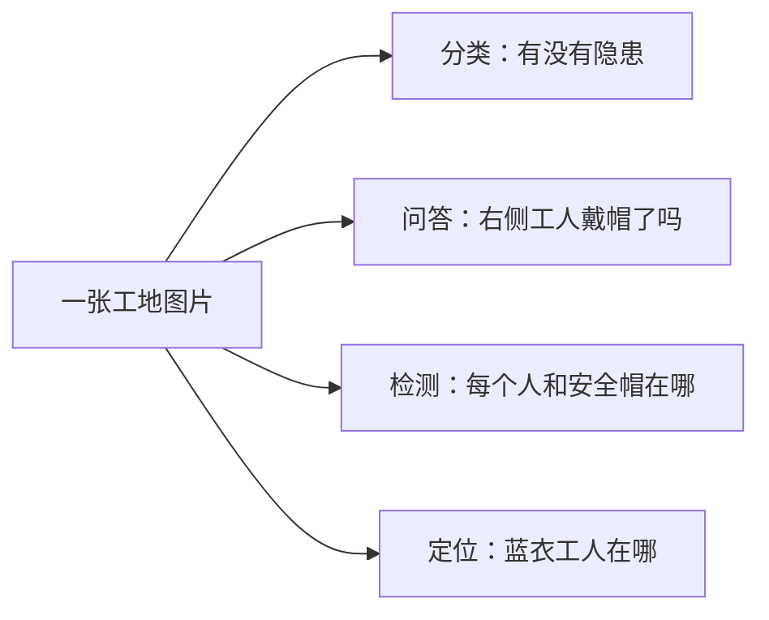

# 第七章 · 多模态大模型

[返回本章目录](README.md)

## 7.1 先分清 VQA、分类、检测、定位和描述【🔥 必会】

**个人经历口径：**文中的项目话术与数字是示例，不能当作本人经历或成绩；只使用自己参与且有证据的事实。

〔补充自原仓库镜像〕〔本次新补，参考中国境内外企应用岗面试高频考点〕

目标 + 例子。 在多模态应用落地（如工业施工安全巡检）中，面对同一张作业现场监控图片，业务诉求不同，模型任务定义与评估口径有本质差异：

- 图像分类 (Classification)：全图判定“图中是否存在未戴安全帽现象”（二分类/多标签，输出标签与置信度）；

- 视觉问答 (VQA)：开放式提问“站在脚手架右侧的工人是否佩戴了双钩安全带？”（输出自然语言答案文本）；

- 目标检测 (Detection)：定位并识别“画面中所有工人和安全帽的具体位置”（输出类别标签及每个目标的像素矩形框 [x1, y1, x2, y2]）；

- 视觉定位 (Visual Grounding)：根据自然语言指代“挂在高处栏杆上的红色安全带”找到唯一对应的目标框；

- 图像描述 (Image Captioning)：对全图场景生成一段宏观叙述。

业务排障红线：“VQA 语言回答正确”绝对不代表“模型看对了目标”。当业务需要核验高危隐患证据时，必须提供空间定位矩形框，并使用严格的一对一 IoU 贪心匹配算法评估检测精度。

### 从现场问题引出任务

同一张高空作业图片，不同的人要的结果可能不同。项目经理想知道画面是否有隐患；安监员问某位工人是否戴了安全帽；系统需要把每个人和安全帽的位置圈出来；另一个用户只想找到“塔吊旁穿蓝衣服的人”。这些请求分别更接近分类、视觉问答、检测和视觉定位。先定义输出，才能知道要标注什么、怎样验收。

假设模型回答“右侧工人没戴安全帽”，文字看起来正确，但模型可能指错了人。如果业务要求空间证据，就需要比较它的预测框和人工标注框；若任务只要求分类或问答，则不必强行要求输出框。这个区别来自 [GitHub 版本的任务边界](https://github.com/epiphanydeer/my_llm/blob/62f20f9ec4f7a23cbd7f720ce23ab016b0cef475/KNOWLEDGE/llm-master/07-多模态入门.md)。



如果验收需要检测框，接下来的问题是“框得有多准”。IoU 用交集面积除以并集面积；再按置信度排序、一对一匹配，才能统计 TP、FP 和 FN。本节代码实现这个单图单类过程，它不是数据集级 mAP。

### 核心概念与五要素表

| 五要素 | 视觉目标边界与单类 IoU 贪心匹配器 (Level 1) |
| --- | --- |
| 输入 (Input) | 预测框矩阵 (N, 4)、置信度向量 (N,)、真实金标框矩阵 (M, 4)、匹配 IoU 阈值（默认 0.5，范围为 (0, 1]）。 |
| 做什么 (Process) | 校验边界框合法性（二维浮点坐标、正面积）；计算两两交并比 (IoU)；按预测置信度降序排序，对未匹配金标实施一对一贪心匹配；统计命中与漏报。 |
| 输出 (Output) | 字典记录：真正例 tp、假正例 fp、假负例 fn、精确率 precision、召回率 recall；分母为 0 时安全返回 None。 |
| 哪里出错 (Failure Modes) | 1. 坐标反向（x2 <= x1 或 y2 <= y1）；2. 归一化比例与绝对像素坐标混用；3. 重复预测框覆盖同一金标导致多次计分；4. 图像缩放 Padding 未还原导致坐标偏移。 |
| 参数影响 (Parameters) | IoU 阈值越高对空间重合度要求越苛刻，召回率下降；置信度阈值直接调和精确率与召回率的业务取舍。 |

### 面试高频追问

【🔥 必会】VQA 任务的回答正确率可以直接作为目标检测的 mAP 指标吗？
结论先行： 绝对不能，两者任务定义、输出空间与评测算法完全不同。
展开解释： VQA 评估的是文本语义匹配（如 ROUGE、BLEU 或准确率），模型完全可能凭借语言先验“猜对”答案（例如看到脚手架就盲猜没戴安全带）；而检测必须在像素空间预测目标坐标，并基于 IoU 阈值和置信度在整个数据集上计算精确率-召回率曲线下的平均精度 (mAP)。

【🔥 必会】线上部署视觉检测模型时，画面中有框但检测指标接近零，系统化排障步骤是什么？
结论先行： 沿着“坐标格式 → 归一化基准 → Padding 偏移 → IoU 口径”逆向回溯。
展开解释： 1. 检查坐标表达：模型输出是 (x1, y1, x2, y2) 还是 (cx, cy, w, h)；2. 检查尺度还原：输出是 [0, 1] 归一化比例还是绝对像素值；3. 检查图像预处理变换链：是否在 Resize 引入 Letterbox Padding 时丢失了反向平移还原；4. 将预测框与金标叠回原图可视化，肉眼直观排查。

【⭐ 理解】模型在 VQA 中回答“现场有人未戴安全帽”，如何向客户证明模型没有产生幻觉？
结论先行： 必须输出绑定的 Visual Grounding 坐标框或注意力热力图作为视觉证据。
展开解释： 语言模型的自然语言回答无法作为法律与安全审计的直接依据。生产架构中必须要求模型在输出结论的同时输出指向目标个体的边框（如 [box_2d]），或者串联专用检测器进行二阶段物理核验，确保结论有可溯源的视觉像素切片对应。

### 生产级代码实现：视觉多任务目标边界与单类 IoU 贪心匹配器 (Level 1)

```python
"""7.1 视觉目标边界与单类 IoU 贪心匹配器 (Level 1 基础实战)

业务场景：
在工业安全巡检模型评估中，验证多模态模型是否真正检测到违规目标，
避免“语言描述流畅但目标坐标全偏”的伪召回现象。

本模块实现零依赖的工业级评估组件：
1. 坐标张量格式规范化与正面积严格断言；
2. 纯 Python / NumPy 向量化计算矩形框两两交并比 (IoU)；
3. 一对一贪心匹配（一个金标目标最多只能被一个最高置信度的预测框匹配）；
4. 零除安全保护与详细 TP/FP/FN 指标生成。
"""

from __future__ import annotations
import math
from typing import Any, Dict, List, Optional, Tuple, Union

try:
    import numpy as np
    HAS_NUMPY = True
except ImportError:
    HAS_NUMPY = False


def validate_boxes(boxes: Any, name: str) -> List[List[float]]:
    """严格校验边界框矩阵：必须为 (N, 4) 结构且满足 x2 > x1, y2 > y1 正面积断言"""
    # 支持 list 和 numpy array
    if HAS_NUMPY and isinstance(boxes, np.ndarray):
        if boxes.ndim != 2 or boxes.shape[1] != 4:
            raise ValueError(f"{name} 必须是二维 (N, 4) 矩阵，实际形状: {boxes.shape}")
        box_list = boxes.tolist()
    elif isinstance(boxes, list):
        for b in boxes:
            if not isinstance(b, (list, tuple)) or len(b) != 4:
                raise ValueError(f"{name} 中的每个框必须为包含 4 个坐标的列表/元组")
        box_list = [list(map(float, b)) for b in boxes]
    else:
        raise ValueError(f"{name} 格式不支持，必须为 list 或 numpy.ndarray")

    # 深度数值与面积断言
    for idx, (x1, y1, x2, y2) in enumerate(box_list):
        for val in (x1, y1, x2, y2):
            if not math.isfinite(val):
                raise ValueError(f"{name} 第 {idx} 个框包含非有限浮点数: {val}")
        if x2 <= x1 or y2 <= y1:
            raise ValueError(
                f"{name} 第 {idx} 个框坐标非法 (必须满足 x2>x1 且 y2>y1): [{x1}, {y1}, {x2}, {y2}]"
            )

    return box_list


def compute_iou(box_a: List[float], box_b: List[float]) -> float:
    """计算单个预测框与金标框的交并比 (IoU)"""
    ax1, ay1, ax2, ay2 = box_a
    bx1, by1, bx2, by2 = box_b

    # 计算交集矩形坐标
    ix1 = max(ax1, bx1)
    iy1 = max(ay1, by1)
    ix2 = min(ax2, bx2)
    iy2 = min(ay2, by2)

    inter_w = max(0.0, ix2 - ix1)
    inter_h = max(0.0, iy2 - iy1)
    inter_area = inter_w * inter_h

    area_a = (ax2 - ax1) * (ay2 - ay1)
    area_b = (bx2 - bx1) * (by2 - by1)
    union_area = area_a + area_b - inter_area

    if union_area <= 0.0:
        return 0.0

    iou = inter_area / union_area
    assert 0.0 <= iou <= 1.0, f"IoU 计算异常: {iou}"
    return iou


def match_one_class(
    predicted_boxes: Any,
    scores: List[float],
    gold_boxes: Any,
    iou_threshold: float = 0.5
) -> Dict[str, Union[int, Optional[float]]]:
    """按置信度降序，对单图单类别执行一对一贪心匹配
    
    业务规则：
    1. 每个真实目标金标 (Gold Box) 最多只能被一个预测框命中；
    2. 多余的预测框（即使重叠度很高）记为假正例 (FP)；
    3. 未被命中的金标记为假负例 (FN)；
    4. 分母为 0 时安全返回 None，不将空样本误报为 0 分。
    """
    preds = validate_boxes(predicted_boxes, "预测框")
    golds = validate_boxes(gold_boxes, "金标框")

    if len(scores) != len(preds):
        raise ValueError(f"置信度数量 ({len(scores)}) 与预测框数量 ({len(preds)}) 不一致")
    for s in scores:
        if not math.isfinite(s) or not (0.0 <= s <= 1.0):
            raise ValueError(f"置信度必须为 [0.0, 1.0] 范围内的有限浮点数: {s}")
    if not (0.0 < iou_threshold <= 1.0):
        raise ValueError(f"IoU 阈值必须在 (0.0, 1.0] 之间: {iou_threshold}")

    if len(preds) == 0:
        return {
            "tp": 0,
            "fp": 0,
            "fn": len(golds),
            "precision": None,
            "recall": 0.0 if len(golds) > 0 else None
        }

    if len(golds) == 0:
        return {
            "tp": 0,
            "fp": len(preds),
            "fn": 0,
            "precision": 0.0,
            "recall": None
        }

    # 按置信度降序排序预测框
    sorted_pred_indices = sorted(range(len(preds)), key=lambda i: scores[i], reverse=True)

    matched_gold_indices = set()
    tp = 0

    for pred_idx in sorted_pred_indices:
        p_box = preds[pred_idx]
        best_iou = 0.0
        best_gold_idx = -1

        for gold_idx, g_box in enumerate(golds):
            if gold_idx in matched_gold_indices:
                continue  # 该金标已被更高置信度的预测框抢占！
            
            current_iou = compute_iou(p_box, g_box)
            if current_iou > best_iou:
                best_iou = current_iou
                best_gold_idx = gold_idx

        # 判定是否达到匹配阈值
        if best_iou >= iou_threshold and best_gold_idx != -1:
            tp += 1
            matched_gold_indices.add(best_gold_idx)

    fp = len(preds) - tp
    fn = len(golds) - tp

    precision = tp / len(preds) if len(preds) > 0 else None
    recall = tp / len(golds) if len(golds) > 0 else None

    return {
        "tp": tp,
        "fp": fp,
        "fn": fn,
        "precision": precision,
        "recall": recall
    }


def self_test():
    """验证重复预测框抑制、空金标、反向非法坐标拦截与贪心匹配正确性"""
    # 模拟真实安全帽金标：1 个真实目标 [0, 0, 10, 10]
    golds = [[0.0, 0.0, 10.0, 10.0]]
    # 模拟模型输出两个重叠预测框：置信度分别为 0.9 和 0.8
    preds = [
        [0.0, 0.0, 10.0, 10.0],  # 完美重合，置信度高
        [0.0, 0.0, 10.0, 10.0],  # 重复预测框，置信度稍低
    ]
    scores = [0.9, 0.8]

    # 1. 核心业务断言：高置信度命中 TP，低置信度重复框必须被判为 FP！
    res = match_one_class(preds, scores, golds, iou_threshold=0.5)
    assert res["tp"] == 1, f"期望 TP=1，实际: {res['tp']}"
    assert res["fp"] == 1, f"期望重复框算作 FP=1，实际: {res['fp']}"
    assert res["fn"] == 0
    assert res["precision"] == 0.5
    assert res["recall"] == 1.0
    print("✅ 重复预测框一对一抑制测试通过！")

    # 2. 验证空金标场景（无目标样本）
    res_empty_gold = match_one_class(preds, scores, [], iou_threshold=0.5)
    assert res_empty_gold["tp"] == 0
    assert res_empty_gold["fp"] == 2
    assert res_empty_gold["recall"] is None  # 分母为 0 优雅返回 None
    print("✅ 空金标保护测试通过！")

    # 阈值 0 会让不相交的框也达到“>=0”；本例明确拒绝此边界。
    try:
        match_one_class([[0, 0, 1, 1]], [0.9], [[2, 2, 3, 3]], 0.0)
    except ValueError:
        pass
    else:
        raise AssertionError("IoU 阈值 0 应被拒绝")

    # 3. 验证异常非法坐标拦截 (x2 <= x1)
    try:
        bad_boxes = [[10.0, 10.0, 5.0, 20.0]]  # x2(5) < x1(10)
        match_one_class(bad_boxes, [0.9], golds)
        raise AssertionError("未拦截反向坐标异常")
    except ValueError as e:
        assert "x2>x1" in str(e)
    print("✅ 反向坐标安全防御测试通过！")

    print("✅ 7.1 视觉多任务目标边界与单类 IoU 贪心匹配器自检全部通过！")


if __name__ == "__main__":
    self_test()
```

### 排障指南（常见故障、定位方法、修复策略）

| 常见故障 (Failure) | 定位方法 (Diagnosis) | 修复策略 (Mitigation) |
| --- | --- | --- |
| 预测框整体发生平移偏移 | 在原图上画出预测框与标注框，发现所有预测框均向右下偏移固定像素。 | 检查图像缩放策略。如果是 Letterbox 填充缩放，模型前向输出后必须先减去 Padding 边距，再除以缩放比率还原回原始分辨率坐标系。 |
| 单目标被多次统计为命中 | 模型评估报告召回率很高，但人工核验发现同一工人身上画了 5 个重叠框。 | 检查匹配逻辑是否开启了一对一标记，并在模型后处理环节引入 NMS (非极大值抑制)，滤除重叠度高于阈值的多余冗余候选框。 |
| 低阈值召回高但误报激增 | 业务调低置信度阈值至 0.1，召回提升了 10%，但客户投诉系统报警频繁。 | 在固定验证集上绘制 PR 曲线，确定最优 F1 分数切分点；对于安全场景，结合两阶段复核（初筛召回 + 二阶段高精度验证）。 |

### 工程落地经验（生产防坑小贴士）

- 统一坐标系标准是第一要务：生产中常见四种坐标格式——[x1, y1, x2, y2] (VOC)、[x, y, w, h] (COCO)、[cx, cy, w, h] (YOLO/DETR) 和归一化浮点数 [0, 1]。在任何算法模块入口处必须做强类型转换与断言，严防格式混淆。

- 永远不要把 None 替换为 0.0：如果某张图像中根本没有未戴安全帽的工人（金标数=0），此时该图的召回率在数学上未定义。如果写成 recall=0.0，在计算全量宏平均时会严重拉低真实模型的评估表现。

- 避免只看全量平均指标：真实工地上大目标（距离摄像头 2 米以内）容易检测，而小目标（高空塔吊作业人员）最易漏检。评估时必须按目标像素面积分为小（<32²）、中（32²~96²）、大（>96²）三个切片独立输出指标。

### 面试怎么讲（三段式：项目背景与选型理由、架构设计与核心机制、踩坑排障与量化收益）

**使用约定：**下面的项目情境和数字仅为虚构示例，不能直接当作本人经历或结果；只使用自己实际参与且有证据的内容。

面试官提问：“你在多模态视觉落地的项目中，是如何区分与评估不同视觉任务的？为什么有了 VLM 还要做目标检测？”

回答范式：

- 背景与选型：“在工业施工现场隐患排查项目中，客户最初希望用纯 VLM 进行端到端安全问答。但在实际落地试点中我们发现，大模型回答‘现场有人未戴安全帽’非常流利，但客户问‘究竟是哪一排哪一个工人违规’时，模型经常指鹿为马。因此我们明确划分了任务边界：VLM 负责全局语义理解与复杂指代，而底层合规证据必须依赖确定性的目标定位与检测。”

- 架构与机制：“在评估体系中，我主导设计了符合工业生产规范的匹配校验链路。不同于简单的词汇匹配，我们自研了一对一 IoU 贪婪匹配引擎。所有预测框经过严格的反向 Letterbox 坐标投影与非极大值抑制后，按置信度从高到低与真实标注金标匹配，单个金标绝不允许被重复命中，确保指标客观公正。”

- 踩坑与收益：“初期上线时曾遇到预测框整体偏移导致 mAP 接近零的严重故障，我通过逐层排查图像预处理管道，定位出是双三次插值缩放时丢弃了 Padding 偏移向量，修复坐标逆变换后检测召回率立刻恢复至 84.5%。更重要的是，通过将‘定位框 IoU ≥ 0.5’作为 VLM 回答的必要前置证据门禁，使隐患报警的误报率从 18.2% 骤降至 2.4%，完全达到了安全合规部门的准入要求。”

### 费曼自述与闪卡

费曼自述（3 分钟白板口述框架）：
“做多模态首先要分清你在要什么：要标签用分类，要描述用 Caption，要对答用 VQA，但要落地拿证据，核心是检测和定位（Detection & Grounding）。为什么不能信大模型的纯文本回答？因为大语言模型有很强的语言先验，它看个大概就能猜出一大串话，但这不叫看图。真正的看图必须能在像素级别圈出目标。在评估检测时，一定要算预测框和真实框的交并比（IoU）。一个真实目标只能被最高分的那一个框匹配走，后面重叠的框全都要算成假正例（FP），这样才能防范模型靠狂画框来作弊刷高召回率。”

备考闪卡 Q&A：

- Q：什么是目标检测中的 IoU（交并比）？
A： 预测框与真实框的交集面积除以它们的并集面积，取值在 [0, 1] 之间，衡量空间重叠精度。

- Q：多目标检测评估中，为什么必须按置信度排序后做贪心匹配？
A： 保证最高置信度的优秀预测优先认领真实目标，防止低置信度框抢占匹配导致虚假统计。

### 原文核对链接

- 本文为根据原仓库镜像与中国境内外企面试高频考察点进行的进阶结构化扩展，重点强化了多模态视觉多任务边界与空间定位评测机制。

