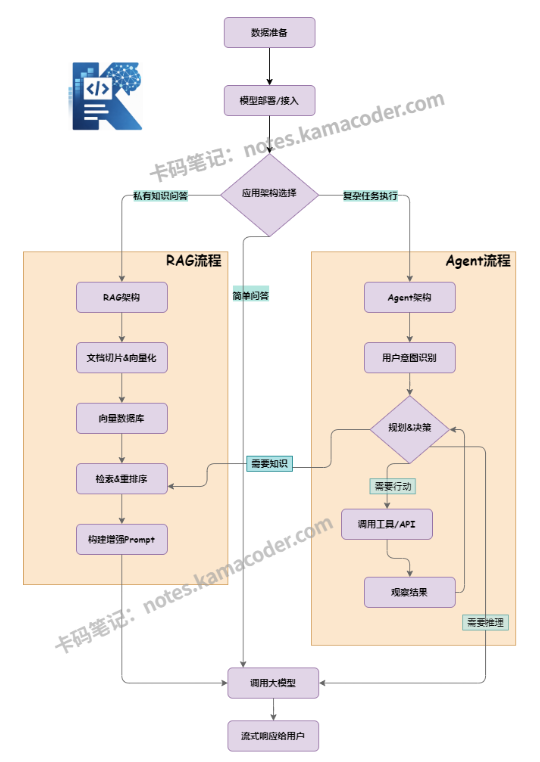

# 1.2 应用落地链路：输入、模型、证据与交付【🔥 必会】

## 1. 🎯 本节目标与大白话例子

本节目标：建立完整的“输入清洗 → 上下文/证据组装 → 模型推理 → 置信度与规则校验 → 交付/人工兜底”五段式工业落地思维。

大白话例子：大模型不是全自动印钞机，而像是一位记忆力超群但偶尔会编造细节的实习生。正式对外发报告（交付）前，必须先检查原始单据（证据），再经过主管核对印章（校验与兜底），缺证据就直接退回人工复核。

## 2. 🧠 核心原理与五维拆解



是什么（What）：企业级 AI 应用很少直接把 user_input 裸传给模型再直接吐给用户，而是由输入网关、检索/工具证据层、模型调用层、输出校验层、兜底审计层共同构成。

为什么（Why）：大模型本质是概率预测器，无法保证 100% 事实准确。在安全、金融、医疗或工业巡检场景，**“无依据不回答（Abstain）”和“低置信度转人工”**比强行挤出一个看似流畅的答案重要得多。

扩展：离线评测 vs 线上监控：离线看准确率、Recall@K、Schema 合法率；线上看端到端延迟（P95/P99）、兜底触发率、用户点赞/人工修改率。

## 3. 💻 渐进式代码实操（ch1_code/step_02_app_delivery_pipeline.py）

```python
"""1.2 应用落地链路：输入、模型、证据与交付（工业流水线校验写法）"""
from dataclasses import dataclass
from typing import Any, Callable, Dict, List


@dataclass
class DeliveryRecord:
    request_id: str
    sanitized_input: str
    model_output: Dict[str, Any]
    evidence_refs: List[str]
    status: str  # "delivered" | "fallback_human_review"


class IndustrialAppPipeline:
    """带输入清洗、证据绑定与低置信度兜底的应用交付流水线。"""

    def __init__(self, llm_fn: Callable[[str], Dict[str, Any]], min_confidence: float = 0.75) -> None:
        self.llm_fn = llm_fn
        self.min_confidence = min_confidence

    @staticmethod
    def sanitize_input(raw_text: str) -> str:
        cleaned = raw_text.strip()
        if not cleaned:
            raise ValueError("输入不能为空")
        return cleaned[:4000]

    def run(self, request_id: str, raw_text: str, retrieved_docs: List[str]) -> DeliveryRecord:
        query = self.sanitize_input(raw_text)
        if not retrieved_docs:
            return DeliveryRecord(request_id, query, {"answer": "缺少可验证依据，转人工复核"}, [], "fallback_human_review")
        resp = self.llm_fn(query)
        conf = float(resp.get("confidence", 0.0))
        status = "delivered" if conf >= self.min_confidence else "fallback_human_review"
        return DeliveryRecord(request_id, query, resp, retrieved_docs, status)


if __name__ == "__main__":
    mock_llm = lambda q: {"answer": f"已基于规程核查：{q[:12]}", "confidence": 0.91}
    pipe = IndustrialAppPipeline(mock_llm, min_confidence=0.8)
    ok_rec = pipe.run("req-001", "  皮带机检修前必须断电挂牌吗？ ", ["《安全规程》第4.2条"])
    assert ok_rec.status == "delivered" and len(ok_rec.evidence_refs) == 1
    no_ev = pipe.run("req-002", "未检索到规程的问题", [])
    assert no_ev.status == "fallback_human_review"
    print("[1.2 PASS]", ok_rec.status, no_ev.status)
```

## 4. 🗣️ 面试官视角：这段代码怎么讲

我在设计工业安全巡检或规程问答链路时，在代码里强制加了两道硬闸门：第一道是无检索证据直接走 fallback_human_review，绝不让模型凭空作答；第二道是输出置信度低于阈值时自动转人工签字闭环。

## 5. 🔧 生产排障指南

坑 1：用户输入超长或包含控制字符导致上下文溢出 → 解法：入口统一做 strip()、长度截断与敏感词/注入特征预检。

坑 2：只记录最终回答，没记录当时检索到的证据版本 → 解法：每次 DeliveryRecord 必须绑定 request_id 与 evidence_refs，方便事后追溯审计。

## 6. ❓ 高频面试追问与参考答法

Q1：如果检索阶段没找到相关文档，应该让模型用自身参数知识回答吗？ 答：在严肃业务场景（规程、客服、法务、矿山安全）绝对不行。模型参数知识可能过时或产生幻觉。正确做法是触发拒答/澄清模板，或返回“缺少可验证依据，已转人工复核”。

Q2：如何设计大模型应用的灰度发布与线上回滚机制？ 答：通过网关层按流量比例切分新旧链路（Prompt/模型/检索策略），同步记录 Bad Case 与成本延迟；一旦拒答率突增或 Schema 解析失败率超过阈值，立即自动切回稳定基线版本。

### 📝 节末费曼自检

工业级应用落地链路的五个核心阶段分别是什么？

为什么说“证据绑定（Grounding）”与“兜底拒答”比单纯调高准确率更关键？

