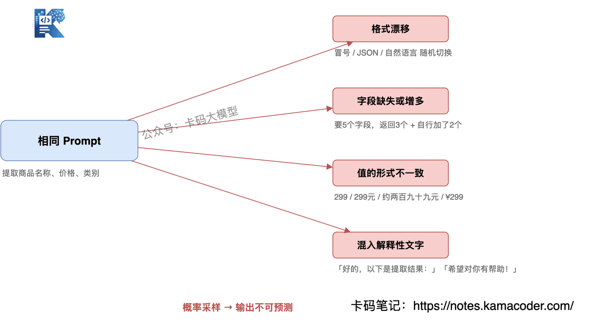

# 2.4 结构化输出：JSON、Schema 与业务校验【🔥 必会】

## 1. 🎯 本节目标与大白话例子

本节目标：掌握结构化输出的三层防线：底层约束解码（Structured Outputs）→ Schema 类型校验 → 跨字段业务规则校验与错误回传自修复。

大白话例子：Schema 校验就像填表格时检查“姓名是不是文字、年龄是不是数字”；但“高风险隐患整改时限不能超过 4 小时”这种跨字段业务规矩，表格格式本身查不出来，必须靠后端代码二次校验，发现冲突就把报错原因退回给模型重写。

## 2. 🧠 核心原理与五维拆解



三种实现层级：

Prompt 提示：无硬约束，易出现 Markdown 代码块包裹或尾随解释废话。

JSON Mode (response_format={"type": "json_object"})：保证语法合法，但不保证字段名与类型完全符合预期。

Strict Schema / Constrained Decoding：通过有限状态机（FSM）在解码每一步屏蔽非法 Token，100% 保证符合 JSON Schema。

业务校验不可省略：即使 Schema 100% 合法，模型仍可能输出“逻辑自相矛盾”的值（如 hazard_level="high" 却配 rectify_hours=24），必须由业务规则校验器兜底。

## 3. 💻 渐进式代码实操（ch2_code/step_04_structured_output_validator.py）

```python
"""2.4 结构化输出：JSON Schema 校验 + 业务规则二次校验与自修复"""
import json
from typing import Any, Callable, Dict, Tuple


def validate_hazard_json(raw_text: str) -> Tuple[bool, Dict[str, Any], str]:
    """同时校验 JSON 语法、字段类型以及跨字段业务规则。"""
    try:
        data = json.loads(raw_text)
    except json.JSONDecodeError as e:
        return False, {}, f"JSON语法错误: {e}"

    required = {"hazard_level", "location", "rectify_hours"}
    if not required.issubset(data.keys()):
        return False, data, f"缺少必填字段: {required - set(data.keys())}"

    if data["hazard_level"] not in {"high", "medium", "low"}:
        return False, data, "hazard_level 必须为 high/medium/low"

    # 业务规则校验：高风险隐患整改时限不得超过 4 小时（Schema 往往查不出这种跨字段逻辑）
    if data["hazard_level"] == "high" and int(data["rectify_hours"]) > 4:
        return False, data, "业务规则冲突：high 级别隐患 rectify_hours 必须 <= 4"

    return True, data, "OK"


def extract_with_repair(llm_fn: Callable[[str], str], prompt: str, max_repair: int = 2) -> Dict[str, Any]:
    cur_prompt = prompt
    for _ in range(max_repair + 1):
        raw = llm_fn(cur_prompt)
        ok, parsed, err = validate_hazard_json(raw)
        if ok:
            return parsed
        cur_prompt = f"{prompt}\n上次输出校验失败，原因：{err}，请修正并仅输出合法 JSON。"
    raise ValueError("超出最大修复次数仍未通过校验")


if __name__ == "__main__":
    responses = iter([
        '{"hazard_level": "high", "location": "破碎站", "rectify_hours": 24}',  # Schema对但业务错
        '{"hazard_level": "high", "location": "破碎站", "rectify_hours": 2}',
    ])
    result = extract_with_repair(lambda _: next(responses), "提取隐患")
    assert result["rectify_hours"] == 2
    print("[2.4 PASS]", result)
```

## 4. 🗣️ 面试官视角：这段代码怎么讲

在矿山隐患结构化抽取模块里，我实现了‘JSON语法 + 字段类型 + 跨字段业务规则’三层校验，并配了 max_repair=2 的错误回传闭环——把具体冲突原因拼进下一轮 Prompt，实测能把大部分逻辑越界自动修回来。

## 5. 🔧 生产排障指南

坑 1：开了 JSON Mode 却忘了在 Prompt 里提 “JSON” 字样 → 解法：部分 API 会直接报 400 错误，或输出无限空格直到 max_tokens 耗尽。

坑 2：Schema 嵌套过深或 enum 过多 → 解法：约束解码编译 FSM 耗时暴增，尽量扁平化 Schema 并控制可选字段数量。

## 6. ❓ 高频面试追问与参考答法

Q1：约束解码（Constrained Decoding）是怎么做到 100% 输出合法 JSON 的？ 答：在推理采样前，根据 JSON Schema 编译出合法字符/Token 的有限状态机（FSM）或正则掩码；每生成一步，将当前状态下不合法的候选 Token 的 Logits 设为 $-\infty$，从根本上杜绝语法错误。

### 📝 节末费曼自检

JSON Mode 和 Strict JSON Schema 约束解码有什么本质区别？

为什么过了 Pydantic/JSON Schema 校验的数据依然可能把线上业务搞挂？

