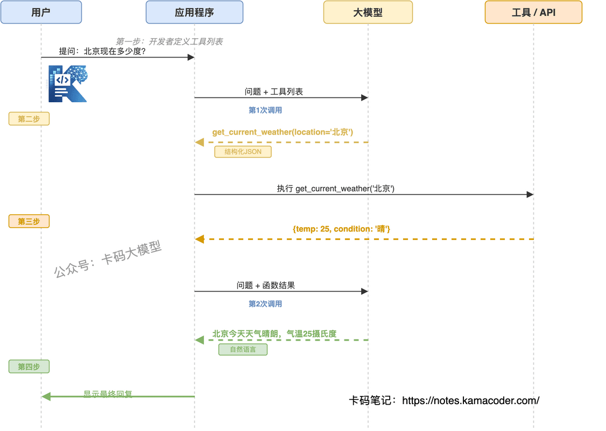

# 2.5 Function Calling：参数、结果与调用 ID【🔥 必会】

## 1. 🎯 本节目标与大白话例子

本节目标：吃透 Function Calling 的完整协议闭环：模型只负责生成调用意图与参数，本地应用执行后必须按 tool_call_id 严格配对回传。

大白话例子：大模型就像坐在调度室里的指挥官，他不能自己下矿井拧阀门（没有执行权限），只能开出带编号的派工单（call_01: 查A号破碎机温度）；外勤人员（你的应用代码）查完后，必须把结果贴回同一张编号的回执单（tool_call_id: call_01）交回调度室，指挥官才能继续决策。

## 2. 🧠 核心原理与五维拆解



协议四步闭环：

请求携带 tools（函数名、清晰描述、JSON Schema 参数）。

模型返回 finish_reason="tool_calls" 及包含 id、function.name、function.arguments 的列表（可能一次并行多个）。

本地执行与异常捕获：解析参数、校验工具是否存在、执行并把异常也序列化为可读 JSON（不要直接崩溃）。

严格配对回传：每条 tool_calls 必须对应一条 role="tool" 且 tool_call_id 完全一致的消息，缺一不可。

## 3. 💻 渐进式代码实操（ch2_code/step_05_function_calling_loop.py）

```python
"""2.5 Function Calling：参数校验、并行执行与 tool_call_id 严格配对闭环"""
import json
from typing import Any, Callable, Dict, List


def execute_tool_calls(
    assistant_msg: Dict[str, Any],
    registry: Dict[str, Callable[..., Dict[str, Any]]],
) -> List[Dict[str, str]]:
    """按 OpenAI Tool Calling 协议执行全部 tool_calls，并按 tool_call_id 逐一回传。"""
    tool_messages: List[Dict[str, str]] = []
    for tc in assistant_msg.get("tool_calls", []):
        call_id = tc["id"]
        fn_name = tc["function"]["name"]
        try:
            args = json.loads(tc["function"]["arguments"])
            if fn_name not in registry:
                payload = {"error": f"未知工具: {fn_name}"}
            else:
                payload = registry[fn_name](**args)
        except Exception as exc:
            payload = {"error": f"参数或执行异常: {exc}"}

        tool_messages.append({
            "role": "tool",
            "tool_call_id": call_id,
            "content": json.dumps(payload, ensure_ascii=False),
        })
    return tool_messages


if __name__ == "__main__":
    tools = {"get_device_temp": lambda device_id: {"device_id": device_id, "temp_c": 68.5}}
    assistant_turn = {
        "role": "assistant",
        "tool_calls": [
            {"id": "call_01", "function": {"name": "get_device_temp", "arguments": '{"device_id": "crusher-A"}'}},
            {"id": "call_02", "function": {"name": "nonexistent_tool", "arguments": "{}"}},
        ],
    }
    outputs = execute_tool_calls(assistant_turn, tools)
    assert len(outputs) == 2
    assert outputs[0]["tool_call_id"] == "call_01" and "68.5" in outputs[0]["content"]
    assert outputs[1]["tool_call_id"] == "call_02" and "未知工具" in outputs[1]["content"]
    print("[2.5 PASS]", outputs)
```

## 4. 🗣️ 面试官视角：这段代码怎么讲

在多工具并发调用（Parallel Tool Calling）场景下，我的执行器会遍历全部 tool_calls 并严格按 tool_call_id 逐一生成 role: tool 回执；哪怕遇到未知工具或参数解析报错，也会把结构化错误信息回传给模型自纠，而不是让接口直接 500 崩溃。

## 5. 🔧 生产排障指南

坑 1：只执行了 tool_calls[0] 忽略了并行返回的其余调用 → 解法：OpenAI 协议要求所有 tool_call_id 必须全部有对应的 role: tool 回复，漏一个下一轮请求必报 400。

坑 2：工具参数描述模糊导致模型幻觉编造参数 → 解法：在 parameters.properties 里写清格式示例、单位和 enum 枚举值。

## 6. ❓ 高频面试追问与参考答法

Q1：如果一次对话中工具数量达到 50 个以上，Function Calling 会遇到什么问题？怎么优化？ 答：Tools Schema 会消耗海量 Input Token 并导致模型选择准确率急剧下降。工程上通常做工具检索（Tool Retrieval）：先用向量/BM25 召回与当前问题最相关的 Top-K 个工具再注入上下文，或采用分层路由。

### 📝 节末费曼自检

Function Calling 过程中，工具究竟是在模型服务端执行还是在业务应用端执行？

漏回传其中一个 tool_call_id 会导致什么后果？

