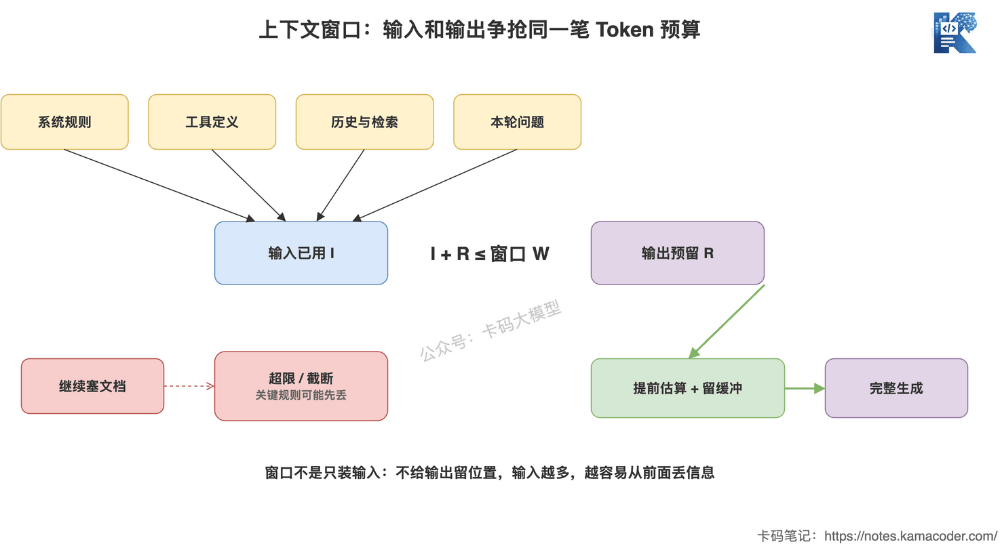

# 2.7 上下文窗口：预算与完整轮次【🔥 必会】

## 1. 🎯 本节目标与大白话例子

本节目标：学会按固定预算管理上下文窗口：为输出留足余量、保护 System Prompt，并按“原子轮次”裁剪历史，绝不拆散 tool_calls 调用链。

大白话例子：上下文窗口就像一个固定大小的登机箱，里面同时要装长期身份证（System）、最新要处理的文件（当前提问+检索资料）、给回程留的空位（max_tokens 输出预算）和旧照片（历史对话）。箱子快满时只能整本相册往外拿（按完整轮次淘汰），绝对不能把“问了工具”和“工具回答”撕成两半只留一半。

## 2. 🧠 核心原理与五维拆解



共享预算公式：可用历史预算 = Context_Limit - System - Tools - 当前输入 - 预留输出(max_tokens) - 安全余量。

原子轮次（Atomic Turn）裁剪：一轮包含 user → assistant(tool_calls) → tool → assistant(final)。裁剪时必须整轮保留或整轮淘汰，切忌按固定消息条数切片（如 messages[-6:]），否则极易留下孤立的 role: tool 消息导致 API 直接报 400。

Lost in the Middle（中间迷失效应）：模型对上下文开头和结尾的信息注意力最强，中间部分容易遗忘，因此高价值检索证据宜放在靠前或紧邻末尾提问的位置。

## 3. 💻 渐进式代码实操（ch2_code/step_07_context_window_trimmer.py）

```python
"""2.7 上下文窗口：预算分配与完整轮次（不拆散 tool_calls）裁剪器"""
from typing import Dict, List


def count_msg_tokens(msg: Dict[str, str]) -> int:
    return max(4, len(msg.get("content", "")) // 2 + 4)


def trim_history_atomic_turns(
    system_msg: Dict[str, str],
    turns: List[List[Dict[str, str]]],
    max_input_tokens: int,
) -> List[Dict[str, str]]:
    """保留 System，按原子轮次（user + assistant/tool）从最新往回装入窗口。"""
    budget = max_input_tokens - count_msg_tokens(system_msg)
    kept_turns: List[List[Dict[str, str]]] = []
    for turn in reversed(turns):
        turn_cost = sum(count_msg_tokens(m) for m in turn)
        if turn_cost <= budget:
            kept_turns.append(turn)
            budget -= turn_cost
        else:
            break
    result = [system_msg]
    for turn in reversed(kept_turns):
        result.extend(turn)
    return result


if __name__ == "__main__":
    sys_m = {"role": "system", "content": "系统规则"}
    t1 = [{"role": "user", "content": "第1轮很长的历史消息" * 5}, {"role": "assistant", "content": "收到"}]
    t2 = [
        {"role": "user", "content": "查温度"},
        {"role": "assistant", "content": "call_1"},
        {"role": "tool", "content": "68C"},
        {"role": "assistant", "content": "正常"},
    ]
    trimmed = trim_history_atomic_turns(sys_m, [t1, t2], max_input_tokens=60)
    assert trimmed[0]["role"] == "system"
    assert len(trimmed) == 5  # 完整保留第2轮(含tool)，未拆散任何调用链
    print("[2.7 PASS] kept messages:", len(trimmed))
```

## 4. 🗣️ 面试官视角：这段代码怎么讲

我在做长会话裁剪时踩过 messages[-N:] 的坑——把 assistant(tool_calls) 截掉了却留下了 role: tool，直接触发 400 报错。后来我改成了按完整原子轮次从最新往回装入预算的 Trimmer，彻底消除了这类协议异常。

## 5. 🔧 生产排障指南

坑 1：上下文窗口写着 128k，就真把 128k 塞满 → 解法：不仅推理速度骤降、Lost in the Middle 严重，还会挤占 max_tokens 输出空间，工程上建议有效工作负载控制在上限的 50%~70% 并辅以摘要压缩。

## 6. ❓ 高频面试追问与参考答法

Q1：除了直接丢弃早期轮次，长对话上下文工程还有哪些主流方案？ 答：1）滚动摘要（Rolling Summary）：把早期轮次压缩成结构化状态摘要；2）按需检索历史（Episodic Memory）：把旧对话存入向量库按相关性召回；3）工具结果折叠：旧轮次里动辄几千行的工具原始输出只保留一句结论摘要。

### 📝 节末费曼自检

为什么不能用简单的 messages[-10:] 来截断含 Function Calling 的多轮对话？

什么是“Lost in the Middle”现象，编排检索文档位置时该如何应对？

