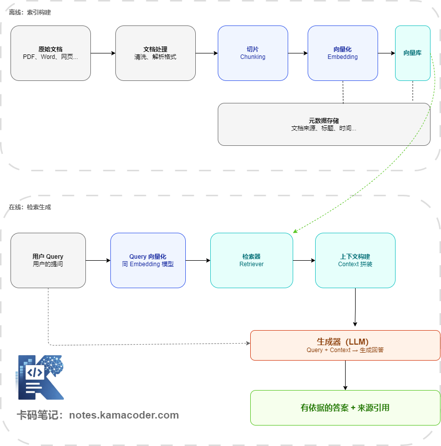
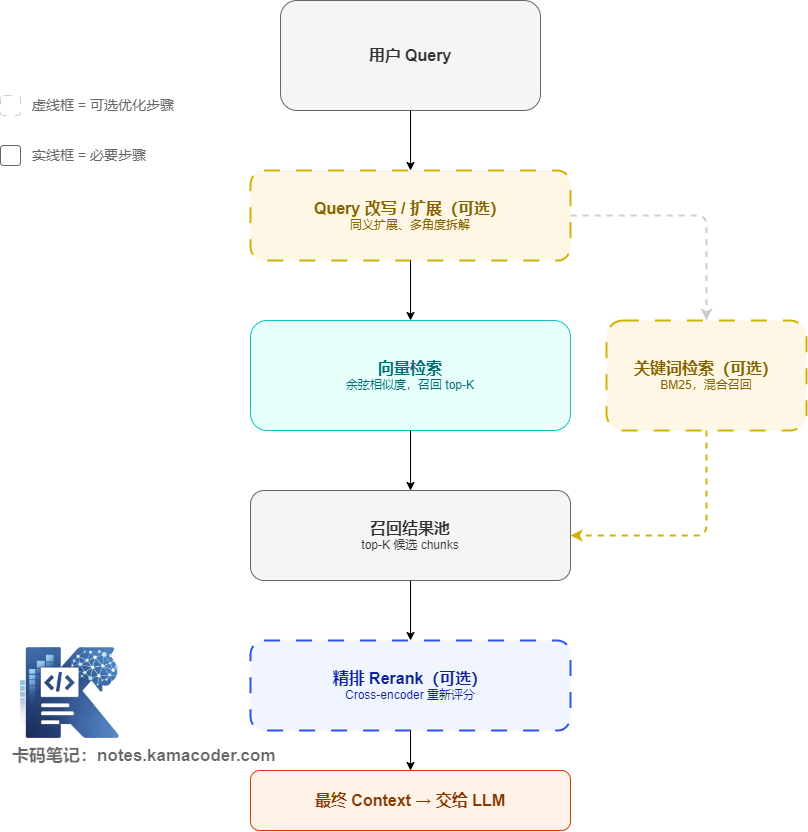

# 3.2 RAG 完整链路拆解：离线阶段和在线阶段到底做了什么 【🔥 必会】

[返回本章目录](http://readme.md) · 融合 llm-master/docs/llm/app/chain_of_rag.md 完整推理与原图 + 端到端流水线封装

## 1. 🎯 本节目标与大白话例子

本节目标：闭卷画出 RAG“离线建库 + 在线问答”的完整工程流水线，理解数据在每一环的形态变化，并在 Step 1 基础上封装出包含离线切片入库、防先验 Prompt 组装与后置正则引用校验的端到端 MiniRAGPipeline。

大白话例子： 开一家图书馆，不可能等读者走到前台问“哪本书讲了动火审批”，管理员才临时去印刷厂拉一卡车书从第一页翻起。

离线阶段就是图书馆上架备货：把散落的 PDF/Word 拆箱、去掉废纸页眉（清洗）、按章节贴上小卡片（Chunking）、给每张卡片编上语义坐标并贴好“仅限内部/2026有效”标签（Embedding + 元数据）、放进高速书架（向量库）。

在线阶段就是前台接待读者：读者提问（Query）-> 翻译成标准检索词（Query 改写）-> 去书架快速捞出最像的 20 张卡片（粗召回）-> 精挑细选出最切题的 3 张（Rerank）-> 把这 3 张卡片摆在助手面前让它照着念并标明出处（Context + 生成 + 引用校验）。

## 2. 🧠 核心原理与五维拆解

### 一、RAG 完整链路总览（原文档脉络）

先用一张图把整条链路建立起来：整条链路分两段——离线侧负责**"把知识存进去"，在线侧负责"把相关知识找出来、组合出答案"**。



### 二、离线阶段（Offline Ingestion）

文档加载（Document Loading）：解析 PDF、Word、网页、Markdown、数据库、邮件等异构来源。这一步直接决定系统上限——如果扫描件 OCR 乱码或 PDF 表格被打散，后续所有环节都会受损（"垃圾进，垃圾出"）。

文档清洗与预处理：去掉页眉页脚（如"第 3 页 共 15 页"）、无意义格式符号、重复内容；保留标题层级结构；将表格归一化为 Markdown 或 HTML 结构。实际项目中，预处理往往占 80% 的工程量。

切片（Chunking）：一篇 20 页的文档不能整篇塞进向量库，必须切成更小的片段（Chunk）。切太粗会淹没答案并稀释注意力，切太细会撕裂上下文。

向量化（Embedding）：把每个 Chunk 转换成高维浮点数向量来表达语义，并同步保存元数据（Metadata）（来源文档、页码、版本、生效时间、ACL 权限）。

存入向量数据库：向量和元数据分别存入向量数据库（如 Milvus、Qdrant、Chroma）和文档存储，利用 ANN（近似最近邻） 索引实现百万级毫秒召回。

### 三、在线阶段（Online Retrieval & Generation）

下面这张图单独展示在线检索链路的各个环节，以及常见的优化分叉点：



Query 处理：可选做 Query 改写（口语转书面、复杂问题拆子问题）和 Query 扩展（同义词补全）。

检索（Retrieval）：Query 向量化后与库内向量算相似度（常取 Top-K=3~10），生产级常采用混合检索（Hybrid Search）——同时跑向量检索（语义）与 BM25（精确关键词）再融合。

Rerank（精排）：用 Cross-Encoder 对 (Query, Chunk) 联合打分重排，把真正回答问题的少数几条推到最前。

上下文构建（Context）：将筛选出的 Chunk 连同来源锚点 [来源: chunk_id] 按固定模板拼装进 Prompt。

生成（Generation）：LLM 在低温度（如 temperature=0）与强约束指令下生成回答，并附带引用标注。

### 四、组件五维拆解（闭卷背诵标准）

| 维度 | 核心内容（面试闭卷复述标准） |
| --- | --- |
| ① 输入什么 | 离线：原始非结构化文档 list[Document]；在线：用户 query、鉴权角色 user_role、当前时间 today。 |
| ② 做什么 | 离线：加载 -> 清洗 -> 切片 -> 存元数据；在线：前置过滤 -> 召回 Top-K -> Prompt 锚点拼装 -> 生成 -> 后置正则引用校验。 |
| ③ 输出什么 | 带合法来源 [来源: chunk_id] 的受控回答、完整注入的 prompt 以及 citation_valid 校验位。 |
| ④ 关键参数影响 | chunk_size 控制检索粒度；top_k 控制上下文信噪比；temperature=0 抑制生成阶段随机发散。 |
| ⑤ 工程选型 Trade-off | 离线与在线必须严格同构：清洗规则与 Embedding 模型必须一致；检索目标不是越多越好，Top-3 高质量片段远胜 Top-20 混杂噪声。 |

### 五、知识点扩展：离线/在线对齐铁律与引用防伪

校正一个容易背错的细节：Query 和 Document 向量化 原文说"Query 和文档必须用同一个 Embedding 模型"。更严谨的表达是：两者的向量必须处在同一个对齐的几何坐标系里。例如中文常用的 BGE 系列模型，文档入库时直接编码原文，而在线 Query 编码时必须加上非对称检索前缀；如果离线/在线版本不一致或漏加前缀，向量空间就会错位。

后置引用校验（Citation Guard）的必要性 即使在 Prompt 里写了“只能引用提供的来源”，中小参数模型（如 7B/14B）仍可能凭记忆编造出 [来源: DOC_999]。因此必须在代码后置层用正则提取所有引用 ID，核验其是否为本次注入 Context 的 chunk_id 子集。

## 3. 💻 渐进式代码实操（Step 2：封装 MiniRAGPipeline 端到端闭环）

相比 Step 1 新增/修改了什么： 在 Step 1 的 Document 与权限过滤基础上，将单函数升级封装为 MiniRAGPipeline 类，新增了三块核心积木：① Chunk 数据结构与离线 ingest() 切片入库；② build_prompt() 防先验模板拼装；③ verify_citations() 后置正则引用真伪拦截器。

### 【从零手写核心链路】

```python
"""3.2 Step 2: 在 Step 1 基础上封装 MiniRAGPipeline，打通离线切片、Prompt 组装与后置引用核验"""
from dataclasses import dataclass
from datetime import date
import re


@dataclass(frozen=True)
class Document:
    doc_id: str
    title: str
    content: str
    version: str
    effective_date: date
    expire_date: date
    roles: tuple[str, ...] = ("employee",)


@dataclass(frozen=True)
class Chunk:
    """【Step 2 新增】切片数据结构：携带原文归属与权限元数据。"""
    chunk_id: str
    doc_id: str
    version: str
    content: str
    effective_date: date
    expire_date: date
    roles: tuple[str, ...]


class MiniRAGPipeline:
    """【Step 2 新增】离线建库 + 在线检索 + Prompt 装配 + 引用守卫闭环。"""
    def __init__(self, chunk_size: int = 40) -> None:
        if chunk_size <= 0:
            raise ValueError("chunk_size 必须为正整数")
        self.chunk_size = chunk_size
        self.chunks: list[Chunk] = []

    def ingest(self, docs: list[Document]) -> None:
        """离线阶段：清洗并切分为 Chunk（继承文档权限与时效）。"""
        if not docs:
            raise ValueError("文档列表不能为空")
        self.chunks.clear()
        for doc in docs:
            text = re.sub(r"\s+", " ", doc.content).strip()
            for idx, start in enumerate(range(0, len(text), self.chunk_size)):
                piece = text[start : start + self.chunk_size]
                self.chunks.append(Chunk(
                    chunk_id=f"{doc.doc_id}_c{idx:02d}",
                    doc_id=doc.doc_id,
                    version=doc.version,
                    content=piece,
                    effective_date=doc.effective_date,
                    expire_date=doc.expire_date,
                    roles=doc.roles,
                ))
        assert len(self.chunks) > 0, "入库切片总数必须大于 0"

    def retrieve(self, query: str, user_role: str, today: date, top_k: int = 2) -> list[Chunk]:
        """在线检索：沿用 Step 1 前置过滤 + 双字滑窗打分。"""
        if not query.strip():
            raise ValueError("查询不能为空")
        q = query.strip().lower()
        q_bigrams = {q[i : i + 2] for i in range(len(q) - 1) if q[i : i + 2].strip()} or {q}
        scored: list[tuple[int, Chunk]] = []
        for ch in self.chunks:
            if user_role not in ch.roles or not (ch.effective_date <= today <= ch.expire_date):
                continue
            hits = sum(1 for bg in q_bigrams if bg in ch.content.lower())
            if hits > 0:
                scored.append((hits, ch))
        scored.sort(key=lambda x: (-x[0], x[1].chunk_id))
        return [c for _, c in scored[:top_k]]

    @staticmethod
    def build_prompt(query: str, contexts: list[Chunk]) -> str:
        """组装防先验 Prompt，显式注入来源锚点标签。"""
        evidence_block = "\n".join(f"[来源: {c.chunk_id}] {c.content}" for c in contexts)
        return (
            "系统指令：仅依据以下参考资料作答，严禁使用先验记忆推测，并在句末标注 [来源: chunk_id]。\n"
            f"参考资料：\n{evidence_block}\n用户问题：{query}"
        )

    @staticmethod
    def verify_citations(answer: str, allowed_chunks: list[Chunk]) -> bool:
        """后置引用核验：拦截模型捏造未注入上下文的虚假引用 ID。"""
        cited = set(re.findall(r"\[来源:\s*([^\]]+)\]", answer))
        allowed = {c.chunk_id for c in allowed_chunks}
        return bool(cited) and cited.issubset(allowed)

    def answer(self, query: str, user_role: str = "employee", today: date = date(2026, 11, 13)) -> dict[str, object]:
        hits = self.retrieve(query, user_role, today, top_k=2)
        if not hits:
            return {"status": "REFUSED", "answer": "依据不足，无法回答。", "prompt": "", "citation_valid": False}
        prompt = self.build_prompt(query, hits)
        mock_llm_output = f"根据规章：{hits[0].content} [来源: {hits[0].chunk_id}]"
        is_valid = self.verify_citations(mock_llm_output, hits)
        assert is_valid, "受控生成必须通过引用真实性校验"
        return {"status": "SUCCESS", "answer": mock_llm_output, "prompt": prompt, "citation_valid": is_valid}


if __name__ == "__main__":
    docs = [
        Document("DOC_SAFE", "安全规范", "高处作业人员必须佩戴全身式五点安全带，并高挂低用。", "v2", date(2026, 1, 1), date(2027, 12, 31)),
    ]
    pipe = MiniRAGPipeline(chunk_size=30)
    pipe.ingest(docs)
    out = pipe.answer("高处作业怎么戴安全带")
    assert out["status"] == "SUCCESS" and out["citation_valid"] is True
    assert pipe.verify_citations("罚款一万 [来源: FAKE_999]", pipe.chunks) is False, "必须拦截虚假引用"
    print("Step 2 self-test passed!")
```

### 【工业级调库对照】

生产中调用大模型生成时，除了 Prompt 约束，还会用 OpenAI SDK 的 Structured Outputs（Pydantic Schema）强制模型把答案和 cited_chunk_ids 分字段返回，降低正则解析失败率：

```python
from pydantic import BaseModel
# from openai import OpenAI

class GroundedAnswer(BaseModel):
    answer: str
    cited_chunk_ids: list[str]
    is_answerable: bool

# resp = client.beta.chat.completions.parse(
#     model="gpt-4o-mini", temperature=0.0,
#     messages=[{"role": "user", "content": prompt}],
#     response_format=GroundedAnswer,
# )
```

何时手写 vs 何时调库：核心流水线编排（检索、Prompt 拼装、引用核验）建议自己用纯 Python 清晰掌控，不要过度封装在 LangChain 的黑盒 Chain 里，方便单步 Trace 排障；LLM 调用和结构化解析直接用官方 SDK + Pydantic。

## 4. 🗣️ 面试官视角：这段代码怎么讲

① 声明不变量：MiniRAGPipeline 保证了两个核心闭环不变量——切片阶段元数据继承不丢失（每个 Chunk 严格继承原 Document 的 roles 与有效期），输出阶段引用可审计（cited 必须是 allowed_chunks 的非空真子集）。

② 关键行解析：ingest 负责把长文档降维为带 chunk_id 锚点的颗粒；build_prompt 明确分隔“系统指令”、“参考资料”和“用户问题”，并要求模型在句末回填 [来源: chunk_id]；verify_citations 在第 83~86 行执行后置拦截，哪怕模型偶发幻觉编出 FAKE_999 也能立刻识别阻断。

③ 主动点出工程细节（加分项）：我会主动指出，这里 ingest 暂时用了最简单的定长切片（只为跑通骨架），这在真实文本中容易把一句话腰斩；下一节（3.3）就会升级为带重叠和标点吸附的滑窗切片。此外，temperature=0.0 和后置引用校验是低成本防幻觉的标配组合。

## 5. 🔧 生产排障指南（实现 -> 排障）

| 故障现象 | 定位方法 | 修复方案 |
| --- | --- | --- |
| 1. 模型在回答中捏造不存在的引用编号（如 [来源: DOC_999]） | 检查生成日志：模型受预训练记忆影响“脑补”了编号，或小模型未严格遵循指令。 | 增加后置校验器 verify_citations()，用集合比对 cited.issubset(allowed)；不通过则自动触发重试或降级拒答。 |
| 2. 检索到了正确切片，但 LLM 回答时完全忽略 | 检查 build_prompt() 拼接顺序：如果把最核心的切片塞在 10 个片段的正中间，易触发 Lost in the Middle。 | 采用首尾倒置拼接（最相关放最前，次相关放最后紧贴用户问题），并用分隔符 --- 明确隔离指令与资料。 |
| 3. 更换 Embedding 模型后检索结果瞬间变乱 | 核对离线建库脚本与在线查询服务的配置，确认是否“离线用了模型 A，在线用了模型 B”或在线漏加了 Query 前缀。 | 将 Embedding 模型 ID 与版本写入向量集合元数据，服务启动时强制执行离线/在线模型签名一致性校验。 |

## 6. ❓ 高频面试追问与参考答法 + 📝 节末费曼自检

### 高频面试追问

Q1：请完整描述一个工业级 RAG 的离线与在线链路，每一步数据怎么流转？

参考答法：分两段讲。离线侧是知识入库：原始文档（PDF/Word/MD）-> 解析清洗去噪 -> 按结构/滑窗切分为 Chunk 并挂载版本与 ACL 元数据 -> Embedding 向量化（同时建 BM25 词表）-> 写入向量库。在线侧是问答推理：用户 Query（可选改写/扩写）-> 权限与时效前置过滤 -> 混合检索召回 Top-20 -> Cross-Encoder 重排取 Top-3~5 -> 拼装带来源锚点的 Prompt -> 零温 LLM 生成 -> 后置引用核验与拒答兜底。

Q2：RAG 链路里哪些环节最影响最终效果？

参考答法：离线侧最核心的是文档解析质量（垃圾进垃圾出）和 Chunking 策略（决定了信息是否完整）；在线侧最核心的是混合召回覆盖率和 Prompt 引用约束。其中文档质量与切片是地基，如果检索根本没捞到正确答案，下游再强的 Rerank 和大模型也无能为力。

Q3：为什么说“离线和在线必须在同一个对齐的语义空间”？只用同一个模型就够了吗？

参考答法：不够。第一，模型版本必须严格一致，不同模型哪怕维度同为 768，坐标轴基底也完全不同；第二，文本清洗规则要一致；第三，如果用的是 BGE、E5 等非对称检索模型，在线 Query 必须拼接官方要求的指令前缀，而文档绝对不能加，否则两者依然存在空间偏移。

Q4：你们线上 Rerank 是一定要加的吗？什么情况可以不加？

参考答法：不是无条件必加。Rerank 是典型的“用延迟和 GPU 算力换排序精度”。如果文档量较小、问题模式简单（如高频 FAQ），或业务对 P95 延迟要求极严苛（如 < 300ms），通过调优 Embedding + 混合检索 + 合理 Top-K 就已经够用了；只有当评测显示“金标进了 Top-20 但经常排不进 Top-5”时，才值得引入 Rerank。

### 📝 节末费曼自检（闭卷自测）

不看笔记，请用 1 分钟口述 RAG 离线 5 步和在线 5 步的数据流向。

如果大模型回答流畅但引用了本次上下文里根本没有的 [来源: DOC_999]，代码层面如何确定性拦截？

