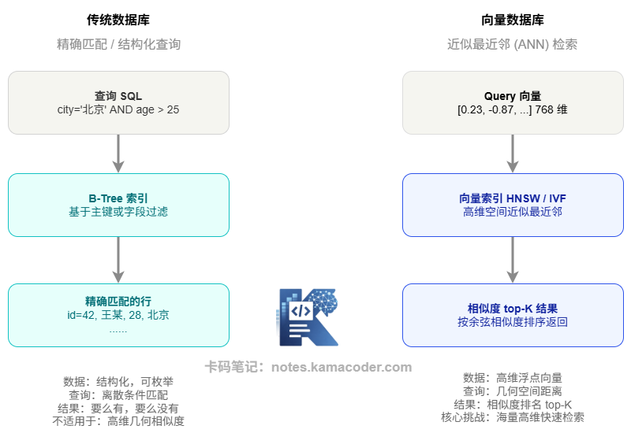
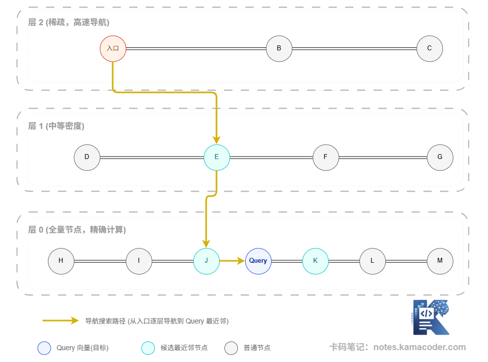

# 3.5 向量数据库解决了什么问题：为什么不能用 MySQL、ANN 索引原理 【🔥 必会】

[返回本章目录](http://readme.md) · 融合 llm-master/docs/llm/app/vector_database.md 完整推理与原图 + HNSW 超参公式与工程选型

## 1. 🎯 本节目标与大白话例子

本节目标：理解传统关系型数据库（B-Tree）为何无法胜任高维语义检索，掌握 ANN（近似最近邻） 核心算法 HNSW 与 IVF 的原理及关键超参调优，分清算法库（FAISS）与分布式向量数据库（Milvus / Qdrant / pgvector）的边界，并在 Step 4 基础上实现 Flat 精确搜索 vs 近似图索引的基准对照。

大白话例子： 在 Step 4 里，我们用 doc_matrix @ q_vec.T 把 Query 和全库所有向量逐一乘一遍（暴力搜索 Flat）。当知识库只有 500 条时这只要 1 毫秒；可一旦文档涨到 500 万条，每次提问都要做几百万次 768 维乘法，服务器直接卡死。 为什么不能用 MySQL 来查？因为 MySQL 的 B-Tree 就像新华字典的拼音目录，擅长精确找 age = 25 或范围找 age > 25，但它完全看不懂“在 768 维空间里离我最近的 5 个点在哪”。 而向量数据库里的 HNSW 索引就像全国高铁 + 城市地铁导航网：先在顶层稀疏的“全国高铁网”上跨省几大步跳到目标城市附近，再逐层下钻到密集的“市区街道网”精确定位，只需访问极少数节点就能以 95%+ 的准确率在几毫秒内找到目标！

## 2. 🧠 核心原理与五维拆解

### 一、为什么不能用 MySQL 做向量检索？（原文档脉络）

查询模型本质不同：传统关系型数据库做的是精确匹配或范围扫描（WHERE age > 25），依赖一维有序的 B-Tree / Hash 索引；而向量检索是在高维连续空间里找几何近似最近邻，B-Tree 对高维距离完全失效。

大规模算力瓶颈：即便通过扩展支持向量存储，全量扫描的复杂度是 $O(N \cdot D)$，百万级向量时单次查询耗时达数百毫秒甚至秒级，无法满足实时对话要求。



### 二、向量索引：ANN 如何在速度和精度之间取得平衡

ANN（Approximate Nearest Neighbor，近似最近邻搜索）不保证 100% 找到数学上的绝对最近邻，但能用 95%~99% 的召回精度换取数量级的速度提升（复杂度降至 $O(\log N)$）。主流两大算法：

HNSW（Hierarchical Navigable Small World）：构建多层图结构——顶层节点稀疏（高速公路），底层包含所有节点（街道网络）。查询时从顶层入口贪心跳跃，逐层下降精搜。查询极快、精度高，是 Milvus、Qdrant 默认索引；代价是邻接表内存占用较大。



IVF（Inverted File Index）：先对所有向量做 K-Means 聚类分桶（货架），检索时只找最近的几个桶做精细比对。内存占用低，适合超大规模；缺点是查询向量落在桶边界时容易漏召回（边界效应）。

### 三、向量数据库还提供了哪些工程核心能力？

元数据过滤（Metadata Filtering）：在向量搜索同时叠加部门、日期、权限等标量条件。

混合检索（Hybrid Search）：原生支持 Dense + Sparse（BM25）双路检索与 RRF 融合。

动态 CRUD 与持久化：支持增量增删改、WAL 日志落盘、分布式分片与高可用。

### 四、组件五维拆解（闭卷背诵标准）

| 维度 | 核心内容（面试闭卷复述标准） |
| --- | --- |
| ① 输入什么 | L2 归一化向量矩阵 (N, D)、文档 ID、标量元数据、查询向量 q_vec 及 top_k。 |
| ② 做什么 | 离线构建 HNSW 多层近邻图；在线从入口节点出发维护大小为 efSearch 的动态候选队列贪心收敛。 |
| ③ 输出什么 | Top-K 近似最近邻 ID 列表，以及与暴力 Flat 基准对比的 Agreement Rate（重合度）。 |
| ④ 关键参数影响 | HNSW 三大参数：① M（每节点最大双向边数，越大图越密、内存越大）；② efConstruction（建图探索宽度，影响建库耗时与图质量）；③ efSearch（在线搜索队列大小，动态权衡延迟与召回率）。 |
| ⑤ 工程选型 Trade-off | FAISS（纯内存算法库，无持久化/CRUD/分布式，适合原型或离线基准）；pgvector（已有 PG 生态且百万级以内首选，省运维）；Qdrant / Milvus（百万至亿级生产、强过滤与多租户首选）。 |

### 五、知识点扩展：HNSW 内存估算与 Pre/Post-filtering 陷阱

HNSW 内存占用估算公式（面试加分项）： $$\text{Memory} \approx N \times (D \times 4 + M \times 8 \times 2) \text{ 字节}$$ 其中 $D \times 4$ 是 Float32 裸向量大小，$M \times 8 \times 2$ 是双向邻接表指针开销。当 $D=1024, M=64$ 时，图结构开销会让总内存直接翻倍！生产降本常用 SQ8 标量量化（内存立减 70%，召回损失 <1.5%）或适当下调 M 到 16~32。

Pre-filtering vs Post-filtering 候选真空： 如果先用向量库搜出 Top-10，再在应用层过滤掉无权限的 9 条（Post-filtering），最终只剩 1 条返回给模型，造成严重漏召回。必须使用支持 Single-stage Pre-filtering 的向量库（在遍历 HNSW 图的同时用 Bitset 掩码跳过无权限节点）。

## 3. 💻 渐进式代码实操（Step 5：Flat 精确搜索 vs 近似图检索基准对照）

相比 Step 4 新增/修改了什么： 保留 Step 4 的 l2_normalize 和矩阵暴力搜索（作为 100% 精确的 Ground Truth Baseline），新增 SimpleNavigableGraphIndex 轻量近邻图索引类与 benchmark_flat_vs_ann() 评测函数，直观演示 M 与 ef_search 参数如何影响 Agreement Rate（邻居重合度）。

### 【从零手写核心链路】

```python
"""3.5 Step 5: 在 Step 4 基础上新增 Flat 精确搜索 vs 近似图搜索（HNSW 原理模拟与对齐评测）"""
import time
import numpy as np
from step_04 import l2_normalize


class SimpleNavigableGraphIndex:
    """【Step 5 新增】轻量教学版可导航小世界图索引（演示 M 与 efSearch 原理）。"""
    def __init__(self, vectors: np.ndarray, m_neighbors: int = 16, seed: int = 42) -> None:
        self.vectors = l2_normalize(vectors)
        self.n = self.vectors.shape[0]
        self.m = min(m_neighbors, max(1, self.n - 1))
        # 离线建图：为每个节点连接最相似的 M 个近邻（简化单层 NSW 图）
        sim_matrix = self.vectors @ self.vectors.T
        np.fill_diagonal(sim_matrix, -np.inf)
        self.adj: list[list[int]] = [
            np.argsort(-sim_matrix[i])[: self.m].tolist() for i in range(self.n)
        ]
        self.entry_point = int(np.random.default_rng(seed).integers(0, self.n))

    def search(self, query_vec: np.ndarray, top_k: int = 5, ef_search: int = 32) -> list[int]:
        """在线贪心波束搜索：仅访问图上局部节点，避免 O(N) 全量扫描。"""
        q = l2_normalize(query_vec.reshape(1, -1)).squeeze(0)
        visited = {self.entry_point}
        candidates = [(float(self.vectors[self.entry_point] @ q), self.entry_point)]
        best = list(candidates)
        steps = 0
        while candidates and steps < ef_search:
            candidates.sort(key=lambda x: -x[0])
            _, curr = candidates.pop(0)
            steps += 1
            for nb in self.adj[curr]:
                if nb not in visited:
                    visited.add(nb)
                    s = float(self.vectors[nb] @ q)
                    candidates.append((s, nb))
                    best.append((s, nb))
        best.sort(key=lambda x: -x[0])
        return [nid for _, nid in best[:top_k]]


def benchmark_flat_vs_ann(n_vecs: int = 400, dim: int = 32, top_k: int = 5, ef_search: int = 48) -> float:
    rng = np.random.default_rng(42)
    db = l2_normalize(rng.standard_normal((n_vecs, dim)).astype(np.float32))
    q = l2_normalize(rng.standard_normal((1, dim)).astype(np.float32))

    t0 = time.perf_counter()
    flat_scores = (db @ q.T).squeeze(1)
    flat_top = np.argsort(-flat_scores)[:top_k].tolist()
    flat_ms = (time.perf_counter() - t0) * 1000

    ann_index = SimpleNavigableGraphIndex(db, m_neighbors=16)
    t1 = time.perf_counter()
    ann_top = ann_index.search(q, top_k=top_k, ef_search=ef_search)
    ann_ms = (time.perf_counter() - t1) * 1000

    agreement = len(set(flat_top) & set(ann_top)) / top_k
    assert 0.0 <= agreement <= 1.0
    print(f"Flat={flat_ms:.3f}ms, ANN={ann_ms:.3f}ms, Agreement@{top_k}={agreement:.2%}")
    return agreement


if __name__ == "__main__":
    agr_low = benchmark_flat_vs_ann(ef_search=10)
    agr_high = benchmark_flat_vs_ann(ef_search=80)
    assert agr_high >= agr_low, "增大 ef_search 应提高或保持 ANN 召回重合度"
    assert agr_high >= 0.6, f"高 ef_search 下重合度应 >= 60%，实际 {agr_high:.2%}"
    print("Step 5 self-test passed!")
```

### 【工业级调库对照】

生产原型或离线压测可用 faiss 的 IndexFlatIP 与 IndexHNSWFlat 做对照：

```python
import faiss
import numpy as np

# dim = 768
# index_flat = faiss.IndexFlatIP(dim)               # 100% 精确内积基准
# index_hnsw = faiss.IndexHNSWFlat(dim, 32, faiss.METRIC_INNER_PRODUCT)  # M=32
# index_hnsw.hnsw.efConstruction = 200
# index_hnsw.hnsw.efSearch = 64
# index_hnsw.add(normalized_db)
# scores, ids = index_hnsw.search(normalized_query, k=5)
```

何时手写 vs 何时调库：几万条以内直接用 IndexFlatIP 或 NumPy 矩阵点积（100% 精确且无建图开销）；十万至千万级用 FAISS HNSW 或直接上 Qdrant / pgvector / Milvus。

## 4. 🗣️ 面试官视角：这段代码怎么讲

① 声明不变量：这套基准测试的黄金准则是不变量——以 Flat 暴力搜索作为 100% 精确的基准真相（Ground Truth），用 Agreement@K 量化 ANN 近似图索引相对于精确搜索的召回损失。

② 关键行解析：第 1418 行离线构建了每个节点的 Top-M 近邻图（模拟 HNSW 的局部连通性）；第 2840 行的在线波束搜索通过 steps < ef_search 严格限制了图遍历步数；在 if __name__ == "__main__": 中通过对比 ef_search=10 与 80，直接用断言证明了增大搜索队列对召回重合度的收敛作用。

③ 主动点出工程细节（加分项）：我会向面试官明确区分“ANN Recall（算法近邻重合度）”和“业务语义 Recall”。哪怕 ANN Recall 达到 99%，如果上游切片或 Embedding 选型错了，业务端依然答不准。另外，生产中 HNSW 频繁单条 DELETE 只会打 Tombstone 标记，必须依赖后台 Compaction 才能真正释放内存。

## 5. 🔧 生产排障指南（实现 -> 排障）

| 故障现象 | 定位方法 | 修复方案 |
| --- | --- | --- |
| 1. HNSW 向量库服务频繁 OOM 崩溃 | 套用内存公式 $N \times (D \times 4 + M \times 8 \times 2)$ 核对，常见于 M 设过大（如 64/128）且全量使用 Float32 存储。 | 开启 SQ8 标量量化（内存立省 70%），并将 M 调降至 16~32，同时做分片水平扩容。 |
| 2. 带权限过滤查询时，明明要求 top_k=5 却只返回 0~1 条 | 检查向量库过滤模式：是否误用了 Post-filtering（先全库搜 Top-5 再剔除无权文档）。 | 切换为支持 Single-stage Pre-filtering 的引擎（如 Qdrant Bitset），或在 Post-filtering 时动态放大初筛倍数为 top_k * 5。 |
| 3. 线上 P99 延迟随并发升高急剧抖动 | 检查在线查询参数 efSearch 是否盲目设成 256/512，导致每次请求遍历过多图节点引发 CPU 争抢。 | 在评估集上做网格搜索，绘制 efSearch vs Recall vs QPS 曲线，通常取 32~64 即可达到 98% 重合度。 |

## 6. ❓ 高频面试追问与参考答法 + 📝 节末费曼自检

### 高频面试追问

Q1：为什么不用 MySQL 做向量相似检索？PostgreSQL 的 pgvector 什么场景能用？

参考答法：MySQL 的 B-Tree 是为一维精确匹配和范围查询设计的，无法处理高维连续空间的几何近邻搜索；即便强行全表扫算余弦，百万级数据也会秒级超时。如果团队已有 PostgreSQL 且向量规模在数百万以内、并发不高，用 pgvector（带 HNSW 索引）非常划算，省去了一套独立向量库的运维成本；只有超大规模或超高并发才上 Milvus/Qdrant。

Q2：既然有了 FAISS，为什么生产环境还要上 Milvus 或 Qdrant？

参考答法：FAISS 是纯计算引擎库（Library），不是完整的数据库（Database）。它有三个生产硬伤：一是不支持向量+标量（部门、日期）联合过滤；二是对已建好的 HNSW 图做动态增删改非常困难；三是缺乏 WAL 持久化、分布式分片和多租户高可用。

Q3：HNSW 的 M、efConstruction、efSearch 三个参数分别管什么？怎么调？

参考答法：M 是每个节点的最大邻居数，决定图密度和内存；efConstruction 是离线建图时的搜索宽度，决定建图质量与耗时；efSearch 是唯一在在线查询时可动态调节的参数，决定搜索时的候选队列大小，直接控制延迟与召回的实时权衡。

Q4：线上 HNSW 的 ANN Recall 已经 98% 了，为什么业务端准确率还是很差？

参考答法：不要混淆“几何算法召回”与“业务事实召回”。ANN Recall 98% 只证明 HNSW 没漏掉暴力搜索能找到的点；如果切片切坏了、Embedding 模型不匹配或者忘了加 Query 前缀，那么几何最近邻本身就不是正确答案。

### 📝 节末费曼自检（闭卷自测）

请用“高铁网 vs 街道网”的比喻解释 HNSW 的搜索过程，并说出 M 和 efSearch 各自影响什么。

为什么向量库里的 Post-filtering 很容易导致“候选真空”？如何解决？

