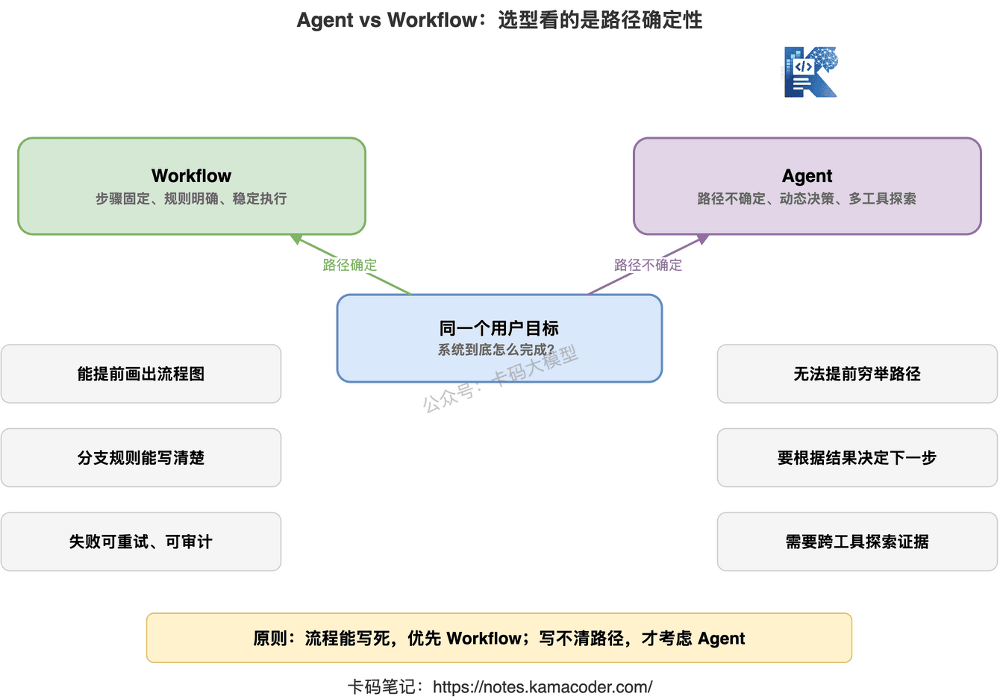
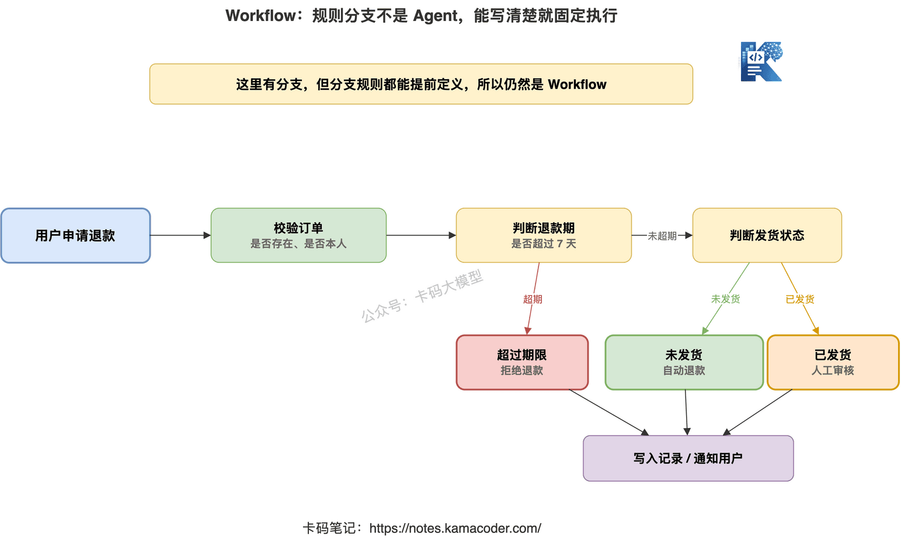
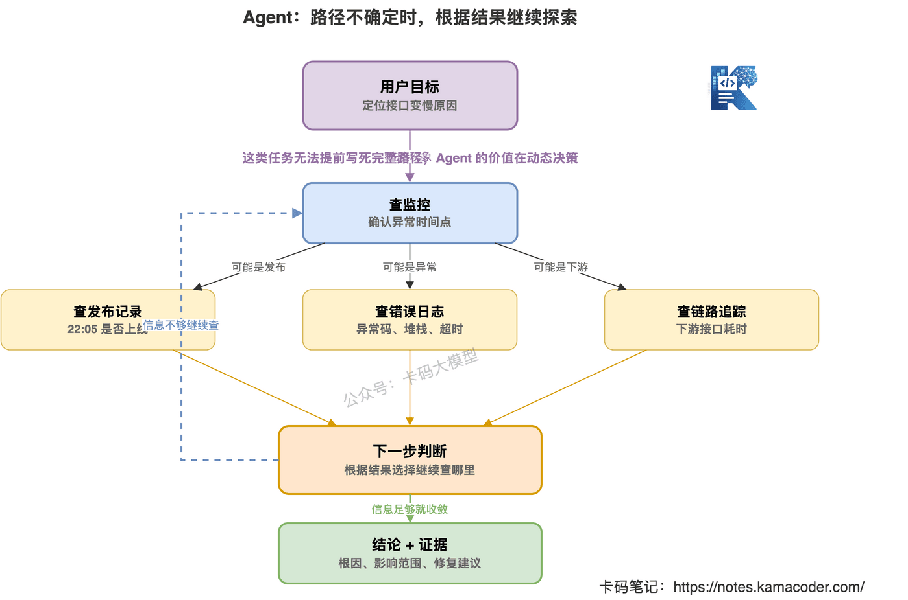
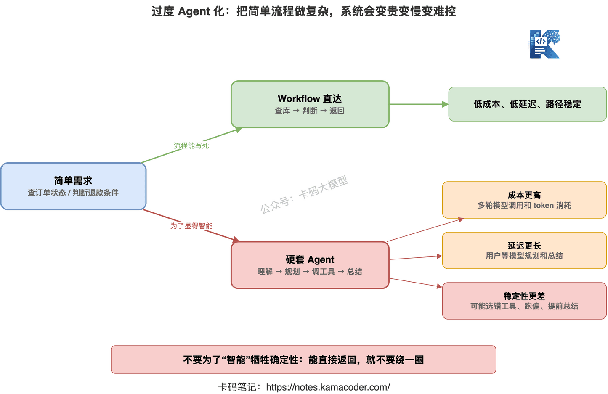
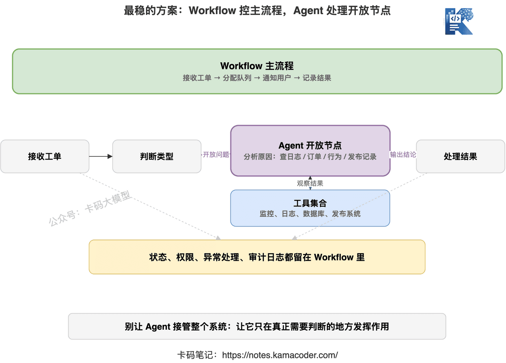

### 4.2 Agent 与 Workflow 的边界选型 【🔥 必会】

#### 1. 🎯 本节目标与大白话例子

上一步痛点：学会了 Step 1 的 O-T-A 循环后，团队很容易患上“手上有锤子看啥都是钉子”的毛病——把原本 if/else 三行代码就能搞定的退款规则也塞进 Agent 循环里，结果既慢（3 秒变 15 秒）、又贵（多烧 10 倍 Token），还会偶尔把“超过 7 天不退”的死规则给放行了。

本节解法：引入 HybridRouter 混合分诊台，明确划分 Workflow（确定性工作流） 与 Agent（动态自主智能体） 的工程边界。

大白话例子：医院看病先过“分诊台”：开常规体检单、拿药（规则 100% 确定）直接走自助机（Workflow），30 秒搞定且零差错；只有症状复杂、需要一边看化验单一边加做检查的疑难杂症（路径不确定），才挂专家门诊（Agent）。

#### 2. 🧠 核心原理与五维拆解



| 维度 | 核心内容（闭卷背诵标准） |
| --- | --- |
| ① 输入什么 | 任务类型标识 task_type 与业务载荷 payload（如订单号、发货状态、故障描述）。 |
| ② 做什么 | 前置分诊路由：若任务步骤固定、合规红线硬性明确，走确定性代码分支（Workflow）；仅当步骤数未知、需依据中间结果动态调整策略时，放行进入 Agent 循环。 |
| ③ 输出什么 | 统一格式的路由结果字典（含 route 来源标记、decision/status 及证据链）。 |
| ④ 关键参数 | 路由判定阈值 / 意图分类置信度（当意图分类置信度低或属于开放式排障时，兜底降级或转人工/Agent）。 |
| ⑤ 工程 Trade-off | 确定性、延迟、成本 vs 泛化性与灵活性。Workflow 在 90% 的标准业务流上性价比碾压 Agent；过度 Agent 化（Over-Agentization）是企业落地最常见的架构灾难。 |

典型场景对比与过度 Agent 化反例：









知识扩展（面试加分盲区）：

Anthropic 官方《Building Effective Agents》核心准则：优先使用最简单的方案（单次 LLM 调用 + 检索），其次是固定 Workflow（Prompt Chaining / Routing / Parallelization），最后只在确实需要开放式多步决策时才上 Autonomous Agent。

“外刚内柔”混合架构：生产系统最稳的形态是 Workflow 做骨架（状态流转、权限门禁、风控规则全写死在代码里），局部语义理解/总结/非结构化提取节点嵌入 LLM（即 Workflow-with-LLM-Nodes），既享受到大模型的语言能力，又守住了业务确定性底线。

#### 3. 💻 渐进式代码实操（Step 2：在 Step 1 基础上新增 HybridRouter 分诊台）

演进说明：复用 Step 1 的 run_ota_agent，在其外层新增确定性规则分支 workflow_refund_check 与总分诊函数 hybrid_dispatch。

```python
"""4.2 Step 2: 在 Step 1 基础上新增 HybridRouter 混合路由分诊台（Workflow vs Agent）"""
from step_01 import run_ota_agent


def workflow_refund_check(order_id: str, is_shipped: bool, days_since_pay: int) -> dict[str, str]:
    """确定性规则分支 Workflow：规则明确写死在代码里，不让模型自由发挥。"""
    if days_since_pay > 7:
        return {"route": "WORKFLOW", "decision": "REJECT_EXPIRED", "reason": "超过7天退货期"}
    if not is_shipped:
        return {"route": "WORKFLOW", "decision": "AUTO_REFUND", "reason": "未发货自动退款"}
    return {"route": "WORKFLOW", "decision": "MANUAL_REVIEW", "reason": "已发货转人工审核"}


def hybrid_dispatch(task_type: str, payload: dict[str, object]) -> dict[str, object]:
    """混合分诊：流程确定走 Workflow，路径不确定才放行进 Step 1 的 Agent Loop。"""
    if task_type == "REFUND_CHECK":
        return workflow_refund_check(
            str(payload["order_id"]), bool(payload["is_shipped"]), int(payload["days"])
        )
    if task_type == "OPEN_FAULT_DIAGNOSIS":
        st = run_ota_agent(str(payload["goal"]), payload["env_fn"], max_steps=4)
        return {"route": "AGENT", "status": st.status, "steps": st.step, "evidence": st.observations}
    raise ValueError(f"未知任务类型: {task_type}")


if __name__ == "__main__":
    r_wf = hybrid_dispatch("REFUND_CHECK", {"order_id": "O1", "is_shipped": False, "days": 2})
    assert r_wf["route"] == "WORKFLOW" and r_wf["decision"] == "AUTO_REFUND"
    r_ag = hybrid_dispatch("OPEN_FAULT_DIAGNOSIS", {"goal": "查慢接口", "env_fn": lambda a: "ok"})
    assert r_ag["route"] == "AGENT" and r_ag["status"] == "DONE"
    print("Agent Step 2 self-test passed!")
```

【工业级调库对照】（语义路由 + 结构化分诊）：

```python
# 何时手写：业务枚举清晰（<10类）或已有前置意图分类器时，直接用 Python if/match 分诊。
# 何时调库：面对自然语言自由输入时，可用 Pydantic + OpenAI Structured Outputs 做分类路由。
from pydantic import BaseModel
from typing import Literal

class RouteDecision(BaseModel):
    route: Literal["WORKFLOW_REFUND", "AGENT_DIAGNOSIS", "HUMAN_ESCALATION"]
    confidence: float
# 生产中：confidence < 0.8 时强制降级到人工或澄清提问，绝不盲目放进 Agent Loop。
```

#### 4. 🗣️ 面试官视角：这段代码怎么讲

先声明不变量：凡是涉及资金、风控、合规红线的规则（如“超过 7 天拒退”），必须由 workflow_refund_check 在进入 LLM 之前硬拦截，保证 100% 确定性。

讲清关键行：hybrid_dispatch 作为唯一入口，把“已知路径”和“未知路径”拆开——REFUND_CHECK 零 LLM 成本毫秒级返回；只有 OPEN_FAULT_DIAGNOSIS 才会调度 Step 1 的 run_ota_agent。

主动点出工程细节：线上监控一定要按 route 维度拆开统计 P99 延迟和 Token 成本，否则 Workflow 的低延迟会把 Agent 链路的高延迟掩盖掉。

#### 5. 🔧 生产排障指南（实现 -> 排障）

故障 1：过度 Agent 化导致简单工单 P99 延迟飙升至 12 秒、月度账单暴涨

现象：大量“查物流、查余额、7天退货”请求进入了 ReAct 循环，平均每单调 4 次大模型。

定位方法：统计线上轨迹中“实际只走固定 1~2 步且决策逻辑完全相同”的高频意图占比。

修复方案：把高频确定性路径下沉为 HybridRouter 中的 Workflow 分支，仅保留长尾复杂问题走 Agent。

故障 2：规则冲突（Prompt 写了“7天内可退”，但业务突然改成“生鲜不退”）

现象：模型依然按旧记忆或话术答应用户退款，与后端报错打架。

定位方法：业务规则散落在 System Prompt 里，导致模型自由裁量权过大。

修复方案：将硬性业务规则从 Prompt 剥离到确定性后端校验函数（Workflow 节点），LLM 只负责把校验结果润色成自然语言回复。

#### 6. ❓ 高频面试追问与参考答法 + 📝 节末费曼自检

Q1：面试官给你一个业务需求，你怎么判断该用 Workflow 还是 Agent？

参考答法：我看三个指标：① 路径是否可穷举（能画成固定流程图就用 Workflow）；② 容错率要求（金融转账/医疗合规零容错环节必须代码写死）；③ 延迟与成本预算（高并发 C 端实时接口优先 Workflow，低频高价值 B 端/运维排障才适合 Agent）。

Q2：什么是“Over-Agentization（过度 Agent 化）”？有什么危害？

参考答法：就是用多步自主循环去解决本来确定性代码或单次调用就能解决的问题。危害有三点：延迟翻倍、Token 成本指数上升、引入不必要的幻觉和越权风险（原本 100% 稳的规则变成 95% 概率正确）。

Q3：Hybrid 架构中，Workflow 和 Agent 之间通常怎么配合？

参考答法：常见两种模式：一是前置分诊（Routing），简单请求走 Workflow、复杂请求进 Agent；二是大 Workflow 嵌小 Agent，主流程（鉴权 -> 受理 -> 审批 -> 归档）用确定性状态机锁死，只在“信息收集与根因分析”这一个节点里放一个受限步数的子 Agent。

Q4：如果产品经理非要让 Agent 全权处理所有客服请求，你怎么用数据说服他？

参考答法：拿 Pass^k 稳定性指标 + 单单成本 + P99 延迟 说话：哪怕单步准确率 95%，5 步串行成功率也只剩 $0.95^5 \approx 77%$；而把高频确定性场景切回 Workflow，能把整体 SLA 拉回 99.9% 且成本降 80%。

📝 节末费曼自检：

为什么说“Workflow 管确定性、Agent 管不确定性”？举例说明一个应该用 Workflow 的场景和一个必须用 Agent 的场景。

什么是“外刚内柔”的混合架构？它在生产中解决了什么矛盾？

