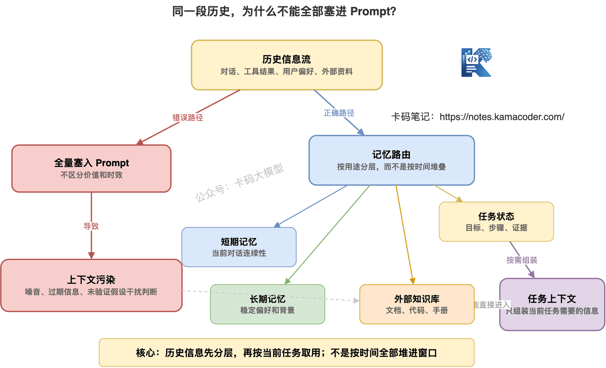
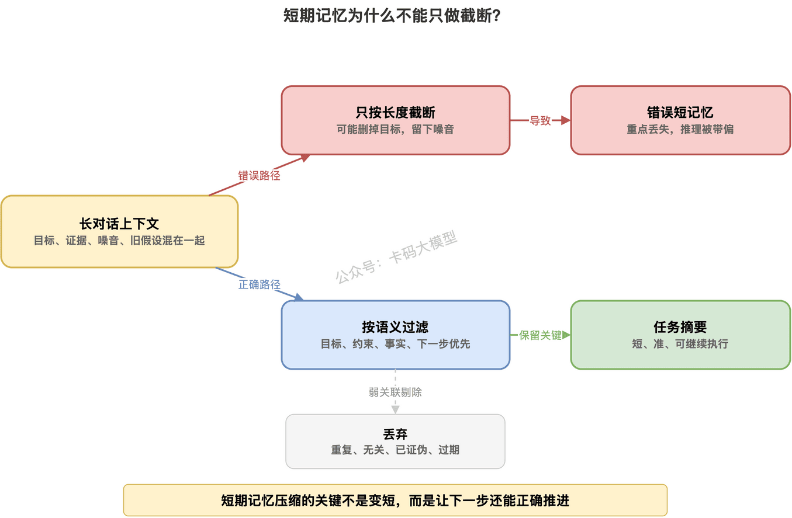
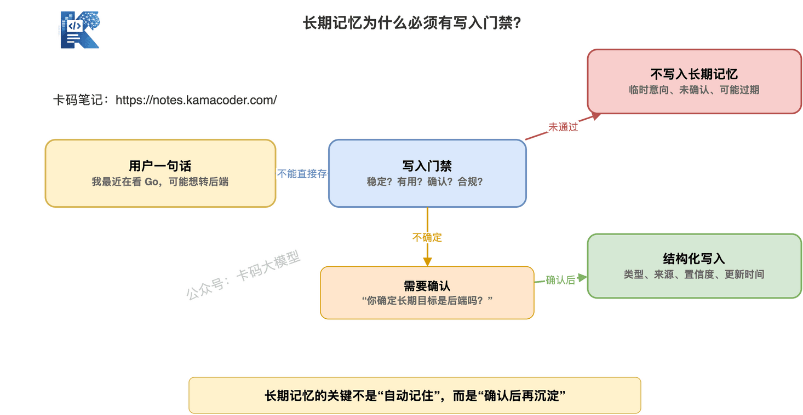

### 4.5 记忆架构与上下文工程（Context Engineering） 【🔥 必会】

#### 1. 🎯 本节目标与大白话例子

上一步痛点：在 Step 4 的 ReActEngine 中，messages 只增不减。多跑几轮工单排障（尤其日志工具动辄返回几千字），很快就会撞穿模型的 Context Window 上限；更糟的是，如果用简单的 messages[-6:] 切片裁剪，一不小心把 System Prompt 删掉了，或者把 assistant(tool_calls) 切掉一半只留 tool 消息，API 直接报 400 崩溃！

本节解法：引入 AtomicMemoryWindow（原子记忆窗口）：① 永远钉住 System Prompt；② 把 assistant(tool_calls) + 对应的所有 tool 响应 绑定为不可分割的原子轮次（Atomic Turn）；③ 超预算时按 FIFO 整组淘汰最旧轮次。

大白话例子：就像整理办公桌上的报销单：公司章程（System Prompt）必须永远压在玻璃板底下不能扔；每一笔报销的“申请单 + 发票”（assistant + tool）必须用回形针别在一起——抽屉满了要清理旧单据时，必须整套连同回形针一起归档，绝不能只扔申请单却留着孤零零的发票。

#### 2. 🧠 核心原理与五维拆解



| 维度 | 核心内容（闭卷背诵标准） |
| --- | --- |
| ① 输入什么 | 全局 Token 预算 max_tokens、不可淘汰的 system_prompt，以及逐轮加入的 user / assistant / (assistant[tool_calls] + tool_msgs) 交互组。 |
| ② 做什么 | 将每次工具交互封装为原子组 _turns.append([assistant_msg] + tool_msgs) 并断言 tool_call_id 完整配对；每次写入后检查总 Token，超限时从最旧的 _turns[0] 开始整组弹出，同时保证至少保留最新一轮。 |
| ③ 输出什么 | 随时可直接喂给 LLM API 的扁平 messages 列表，且满足“首条为 System、所有 tool_call_id 闭环无孤儿”的硬不变量。 |
| ④ 关键参数 | max_tokens（工作记忆预算，需为模型输出预留足够余量）、淘汰策略（FIFO 整组淘汰 / 摘要压缩 Compaction）。 |
| ⑤ 工程 Trade-off | 原子淘汰牺牲了一部分早期细节记忆，换来了 100% 协议安全 + 稳定的延迟与成本；对于跨会话的长期关键事实，应通过 Write Gate 写入长期记忆（如向量库/KV 存储），而非死塞在短期窗口里。 |

记忆四分类、短期过滤与长期写入门控：

> 图片待恢复：记忆四分类（工作/情景/语义/程序记忆）





知识扩展（面试加分盲区）：

Context Engineering（上下文工程） vs Prompt Engineering：Prompt Engineering 关注“怎么把指令写好”；而 Context Engineering（Karpathy / Anthropic 2025 力推概念）关注**“在有限的注意力预算内，动态编排 System、工具定义、记忆摘要、外部检索与工具返回值的最优信息密度”**——包含 Write（写入外部笔记）、Select（按需检索）、Compress（历史摘要压缩）、Isolate（多智能体上下文隔离） 四大动作。

Prefix Caching（KV Cache 前缀命中）的黄金法则：为了吃满推理引擎（vLLM / OpenAI / Anthropic）的自动前缀缓存降本提速，System Prompt 和 Tools 定义必须放在最前面且保持字节级稳定；动态变化的时间戳、用户实时状态绝对不要插在 System Prompt 头部，否则每轮都会导致整个 Prefix Cache 失效重算！

长期记忆的 Write Gate（写入门控）：不是所有对话都要存进向量库！如果把用户的“好的/谢谢”或过时的临时报错全写进长期记忆，很快就会“记忆污染”。必须经过 Write Gate（过滤噪音、提取稳定偏好/事实、做冲突覆写更新）再持久化。

#### 3. 💻 渐进式代码实操（Step 5：在 Step 4 基础上新增 AtomicMemoryWindow）

演进说明：把 Step 4 中只增不减的 messages 列表替换为 AtomicMemoryWindow，实现 System 钉住、原子轮次配对断言与超预算整组淘汰。

```python
"""Step 5: Atomic Memory Window (短期上下文窗口管理与原子轮次淘汰).

在 Step 4 (ReActEngine) 的基础上新增 AtomicMemoryWindow：
1. 钉住 System Prompt（永不淘汰）。
2. 将一次完整的工具交互 (assistant[tool_calls] + 对应的 tool 消息) 绑定为不可分割的原子组 (Atomic Turn)。
3. 当总 Token 超出预算时，从最旧的非 System 原子组开始整组淘汰，避免只删半截导致 API 400 报错。
"""

from __future__ import annotations

import json
from dataclasses import dataclass, field
from typing import Any, Dict, List


def estimate_tokens(msg: Dict[str, Any]) -> int:
    """粗略估算单条消息的 Token 数（中文按 1.5 字/token，英文按 4 字符/token 的保守上界）."""
    content = str(msg.get("content", ""))
    tool_calls = json.dumps(msg.get("tool_calls", []), ensure_ascii=False)
    total_chars = len(content) + len(tool_calls)
    return max(4, (total_chars // 2) + 4)


@dataclass
class AtomicMemoryWindow:
    """支持原子轮次分组与预算裁剪的短期记忆窗口."""

    max_tokens: int
    system_prompt: str
    _turns: List[List[Dict[str, Any]]] = field(default_factory=list)

    def __post_init__(self) -> None:
        if self.max_tokens <= 20:
            raise ValueError("max_tokens 必须大于 20 以容纳 System Prompt")

    def add_user_turn(self, content: str) -> None:
        """添加用户输入轮次."""
        if not content.strip():
            raise ValueError("用户输入不能为空")
        self._turns.append([{"role": "user", "content": content}])
        self._evict_if_needed()

    def add_assistant_text_turn(self, content: str) -> None:
        """添加纯文本助手回复轮次."""
        self._turns.append([{"role": "assistant", "content": content}])
        self._evict_if_needed()

    def add_atomic_tool_turn(
        self,
        assistant_msg: Dict[str, Any],
        tool_msgs: List[Dict[str, Any]],
    ) -> None:
        """将 assistant(tool_calls) 与所有对应的 tool 响应绑定为一个原子组."""
        tool_calls = assistant_msg.get("tool_calls", [])
        if not tool_calls:
            raise ValueError("assistant_msg 必须包含非空 tool_calls")

        expected_ids = {tc["id"] for tc in tool_calls}
        actual_ids = {tm.get("tool_call_id") for tm in tool_msgs}
        assert expected_ids == actual_ids, (
            f"原子组配对失败: expected={expected_ids}, actual={actual_ids}"
        )

        group = [assistant_msg] + list(tool_msgs)
        self._turns.append(group)
        self._evict_if_needed()

    def _system_msg(self) -> Dict[str, Any]:
        return {"role": "system", "content": self.system_prompt}

    def total_tokens(self) -> int:
        """计算当前窗口总 Token（含 System Prompt）."""
        total = estimate_tokens(self._system_msg())
        for turn in self._turns:
            total += sum(estimate_tokens(m) for m in turn)
        return total

    def _evict_if_needed(self) -> None:
        """按 FIFO 淘汰最旧的原子组，绝不拆散 tool_call 配对，且保留最新一轮."""
        while len(self._turns) > 1 and self.total_tokens() > self.max_tokens:
            self._turns.pop(0)

    def build_messages(self) -> List[Dict[str, Any]]:
        """输出可直接喂给 LLM API 的扁平消息列表，并校验 tool_call_id 完整性."""
        messages: List[Dict[str, Any]] = [self._system_msg()]
        for turn in self._turns:
            messages.extend(turn)

        # 关键不变量断言：窗口内不能出现悬空的 tool 消息或未闭合的 tool_calls
        pending_ids: set[str] = set()
        for msg in messages:
            if msg["role"] == "assistant" and msg.get("tool_calls"):
                for tc in msg["tool_calls"]:
                    pending_ids.add(tc["id"])
            elif msg["role"] == "tool":
                tid = msg.get("tool_call_id")
                assert tid in pending_ids, f"检测到孤立的 tool 消息: {tid}"
                pending_ids.remove(tid)
        assert not pending_ids, f"检测到未闭合的 tool_calls: {pending_ids}"
        return messages


if __name__ == "__main__":
    window = AtomicMemoryWindow(
        max_tokens=160,
        system_prompt="你是企业工单排障专家，严禁编造工单状态。",
    )
    window.add_user_turn("帮我查一下工单 TK-101 为什么卡住了")
    window.add_atomic_tool_turn(
        assistant_msg={
            "role": "assistant",
            "content": "",
            "tool_calls": [{"id": "call_1", "name": "query_ticket", "arguments": {"ticket_id": "TK-101"}}],
        },
        tool_msgs=[
            {"role": "tool", "tool_call_id": "call_1", "content": '{"status": "TIMEOUT", "node": "db-02"}'}
        ],
    )
    window.add_user_turn("那帮我再查一下 db-02 的 CPU 负载和连接数，看看是不是连接池打满了")
    window.add_atomic_tool_turn(
        assistant_msg={
            "role": "assistant",
            "content": "",
            "tool_calls": [{"id": "call_2", "name": "check_node", "arguments": {"node": "db-02"}}],
        },
        tool_msgs=[
            {"role": "tool", "tool_call_id": "call_2", "content": '{"cpu": 0.96, "conn": "500/500"}'}
        ],
    )

    msgs = window.build_messages()
    assert msgs[0]["role"] == "system", "System Prompt 必须始终在首位"
    assert window.total_tokens() <= 160 or len(window._turns) == 1
    assert not any(m.get("tool_call_id") == "call_1" for m in msgs), "旧原子组应被整组淘汰"
    assert any(m.get("tool_call_id") == "call_2" for m in msgs), "最新原子组必须保留"
    print(f"Step 5 self-test passed! Remaining messages={len(msgs)}, tokens={window.total_tokens()}")
```

【工业级调库对照】（LangChain trim_messages / 摘要压缩 Compaction）：

```python
# 何时手写：原生 SDK 循环下，自己维护二维 list[list[dict]] 原子轮次最轻量且零 BUG。
# 何时调库：使用 LangGraph 时，配合 `trim_messages(..., strategy="last", include_system=True)` 或
# `ConversationSummaryBufferMemory`（超长时把旧原子组异步总结成一段 Episodic Summary）。
```

#### 4. 🗣️ 面试官视角：这段代码怎么讲

先声明不变量：build_messages() 必须同时满足三个不变量：① 第 0 条永远是 system；② pending_ids 最终必须为空（无孤立 tool 或未闭合 tool_calls）；③ len(self._turns) >= 1（再怎么淘汰也不能把当前正在处理的那一轮删空）。

讲清关键行：第 5462 行在入队时就把 assistant_msg 和 tool_msgs 锁进同一个 list 原子组；第 7678 行淘汰时 pop(0) 弹出的是整组而不是单条消息。

主动点出工程细节：对于返回上万字的工具（如日志查询），仅靠轮次淘汰还不够，必须在写入 AtomicMemoryWindow 之前先做工具输出截断 + 显式 [TRUNCATED] 标记，防止单条 tool 消息就撑爆 max_tokens。

#### 5. 🔧 生产排障指南（实现 -> 排障）

故障 1：长对话突然忘记了最初的用户约束（“Lost in the Middle”或 System 被裁）

现象：聊到第 10 轮，Agent 开始违反最初“严禁编造”或“只输出 JSON”的约束。

定位方法：检查裁剪逻辑是否误把 system 移出，或者关键用户约束放在了早期 user 消息里被 FIFO 淘汰了。

修复方案：核心规则钉死在 System Prompt；对于用户会话级新约束，在淘汰旧轮次前先抽取成结构化 pinned_constraints 附在上下文锚点中。

故障 2：Prefix Cache 命中率极低，账单是预期的 4 倍

现象：明明用了支持 Prompt Caching 的模型，但缓存命中率不到 10%。

定位方法：检查是否在 System Prompt 开头拼接了 当前时间: 14:32:05 或随机 request_id，导致每轮前缀哈希全变。

修复方案：把动态变量（时间、当前状态）移到最新一条 user 消息末尾，保持 System + Tools 前缀 100% 静态不变。

#### 6. ❓ 高频面试追问与参考答法 + 📝 节末费曼自检

Q1：为什么不能用简单的 messages[-N:] 滑动窗口来裁剪 Agent 上下文？

参考答法：两个致命问题：一是容易把第 0 位的 System Prompt 滑出去导致角色和规则丢失；二是极大概率把一对 assistant(tool_calls) 和 tool(tool_call_id) 从中间腰斩，导致大模型 API 直接报 400 协议错误。必须按“原子轮次”整组裁剪。

Q2：滑动窗口淘汰和摘要压缩（Compaction）怎么选？

参考答法：高实时、短任务直接用原子滑动窗口（零额外 LLM 耗时）；长周期任务（如跨 20 步的深度调研或 Coding Agent）在触及预算 70% 时触发一次摘要压缩，把早期 10 轮的工具结论浓缩成一段“已确认事实清单”，既省 Token 又不丢关键线索。

Q3：长期记忆（Long-term Memory）存进向量库后，为什么经常搜出一堆过时甚至矛盾的信息？

参考答法：因为缺少 Write Gate（写入门控） 和 冲突更新/TTL 机制。比如用户上个月说“我在上海”，这个月说“我搬到北京了”，如果只是盲目 insert 两条向量，检索时会同时召回上海和北京。工业界需要用实体记忆（Entity/Graph Memory）或覆盖更新逻辑，并给事实打上时间戳。

Q4：Context Engineering 中怎么利用 Prefix Cache 省钱提速？

参考答法：核心是“静在前、动在后”。把不变的 System Prompt、Tool Schema、Few-Shot 示例放最前面；只把每轮新增的对话追加在末尾；如果需要淘汰旧历史，尽量以较大块（Block）为单位批量淘汰或压缩，避免每轮都微调中间内容破坏缓存前缀。

📝 节末费曼自检：

为什么在 AtomicMemoryWindow 中，即便 total_tokens() > max_tokens，也要保留 len(self._turns) > 1？

说出 Context Engineering 的四个核心动作（Write / Select / Compress / Isolate）分别对应什么工程手段。

