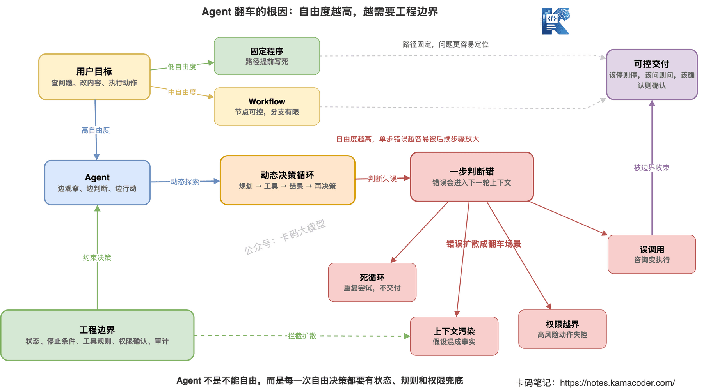
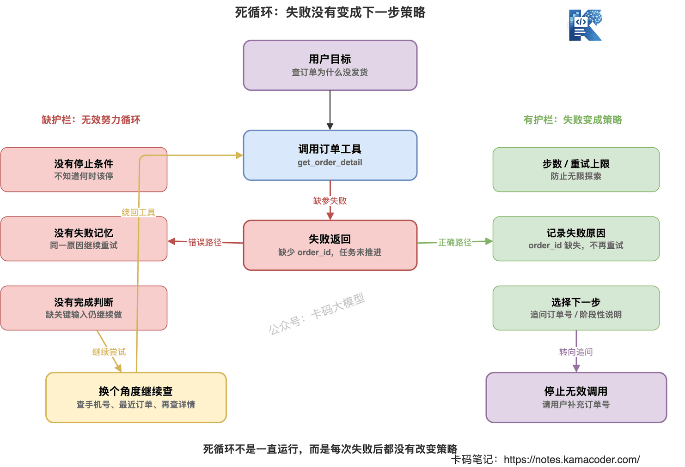
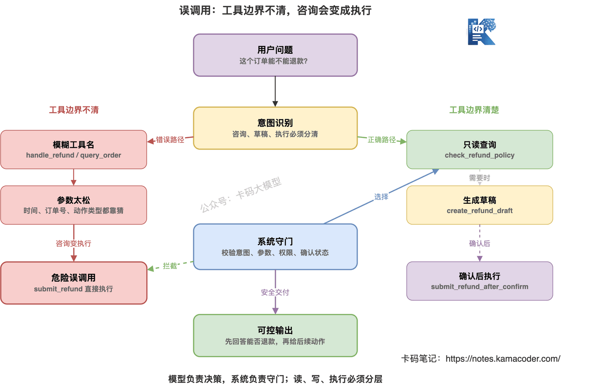

### 4.6 失败恢复、Schema 自愈与幂等控制 【🔥 必会】

#### 1. 🎯 本节目标与大白话例子

上一步痛点：线上环境不是温室——下游微服务会突然 503、模型偶尔会把 amount 写成负数触发 SchemaError、更要命的是如果 create_refund 在网络超时后直接重试，可能会给用户连续退两次款！

本节解法：引入 ResilientExecutor（韧性执行器），把错误精确分为瞬态故障（指数退避 + Jitter 重试）与参数 Schema 错误（不盲目重试，立刻转结构化纠偏提示喂回 LLM），并对所有写操作强制绑定 幂等键（Idempotency Key）。

大白话例子：就像网购付款：网络转圈圈（瞬态超时）可以等 1 秒、2 秒、4 秒再重试，但必须带上同一张订单流水号（幂等键），否则银行扣两次款；而如果报错是“收货手机号少了一位”（Schema 错误），刷新一百遍页面也没用，必须立刻弹出红字提示用户改号码。

#### 2. 🧠 核心原理与五维拆解



| 维度 | 核心内容（闭卷背诵标准） |
| --- | --- |
| ① 输入什么 | 工具名 tool_name、执行函数 fn、参数 args、写操作标记 is_write、唯一幂等键 idempotency_key。 |
| ② 做什么 | ① 若为写操作先校验幂等键是否存在且是否已执行（命中则直接返回缓存结果）；② 捕获 SchemaValidationError 立即返回结构化纠偏提示（不重试）；③ 捕获 TransientToolError 执行 base * 2^(attempt-1) + jitter 指数退避重试。 |
| ③ 输出什么 | 统一 ExecutionResult(ok, output, attempts, deduplicated, error_hint)。 |
| ④ 关键参数 | max_retries（通常 2~3 次）、base_delay_sec（退避基数 + 随机抖动 Jitter 防惊群效应）、idempotency_key（建议 session_id:step:tool:args_hash 或业务单号）。 |
| ⑤ 工程 Trade-off | 重试与自愈提升了任务最终成功率，但会拉长单步尾延迟（Tail Latency）；若不对“可重试异常”和“不可重试异常”分层，盲目重试只会把雪崩放大 3 倍。 |

死循环归因与选错工具根因：





知识扩展（面试加分盲区）：

为什么重试必须加 Jitter（随机抖动）？：如果 1000 个 Agent 并发请求下游接口同时遇到 503，大家都在整整 1s -> 2s -> 4s 后齐刷刷重试，会形成**惊群效应（Thundering Herd）**把刚恢复的下游再次打死。加随机抖动（Full Jitter）能把重试流量均匀打散。

模型层 Self-Healing（参数自愈）的边界：当 SchemaValidationError 发生时，把 error_hint 作为 tool 消息喂回模型，模型通常在 1~2 轮内就能修正格式；但如果连续 2 次自愈仍失败，必须立刻熔断或降级，防止模型在同一个 Schema 坑里无限空转。

写操作幂等键谁来生成？：绝不能让 LLM 自己编一个 idempotency_key（模型重试时可能会生成新的随机字符串导致幂等失效！），必须由宿主执行层根据 ticket_id + action_type + canonical_args_hash 确定性生成。

#### 3. 💻 渐进式代码实操（Step 6：在 Step 3~4 基础上新增 ResilientExecutor）

演进说明：为工具执行链路装上“错误分层处理 + 指数退避加抖动 + 写操作幂等缓存”。

```python
"""Step 6: Resilient Executor (失败恢复：指数退避重试 + Schema 自愈 + 幂等去重).

在 Step 3/4 工具执行层基础上新增 ResilientExecutor：
1. 瞬态故障（如 429/503/Timeout）执行指数退避 + 随机抖动重试。
2. 参数校验失败 (SchemaError) 时构造结构化纠偏提示，触发有限次自愈重调。
3. 写操作强制要求幂等键 (idempotency_key)，防止网络超时重试导致重复建单/重复退款。
"""

from __future__ import annotations

import random
import time
from dataclasses import dataclass, field
from typing import Any, Callable, Dict, Optional, Set


class TransientToolError(RuntimeError):
    """可重试的瞬态错误（如超时、限流 429）."""


class SchemaValidationError(ValueError):
    """参数 Schema 校验错误（需反馈给 LLM 自愈）."""


@dataclass
class ExecutionResult:
    """工具执行的标准化返回."""

    ok: bool
    output: Any = None
    attempts: int = 0
    deduplicated: bool = False
    error_hint: Optional[str] = None


@dataclass
class ResilientExecutor:
    """带退避重试、Schema 自愈和幂等去重的工业级工具执行器."""

    max_retries: int = 2
    base_delay_sec: float = 0.01  # 测试中使用短延迟，生产通常 0.5~1.0s
    _executed_idempotency_keys: Set[str] = field(default_factory=set)
    _idempotency_cache: Dict[str, Any] = field(default_factory=dict)

    def execute(
        self,
        tool_name: str,
        fn: Callable[[Dict[str, Any]], Any],
        args: Dict[str, Any],
        is_write: bool = False,
        idempotency_key: Optional[str] = None,
        sleep_fn: Callable[[float], None] = time.sleep,
    ) -> ExecutionResult:
        """执行工具调用，处理幂等性、瞬态重试与结构化错误反馈."""
        if is_write:
            if not idempotency_key or not idempotency_key.strip():
                return ExecutionResult(
                    ok=False,
                    attempts=0,
                    error_hint=f"写操作 {tool_name} 必须提供非空 idempotency_key",
                )
            if idempotency_key in self._executed_idempotency_keys:
                return ExecutionResult(
                    ok=True,
                    output=self._idempotency_cache[idempotency_key],
                    attempts=0,
                    deduplicated=True,
                )

        last_error: Optional[Exception] = None
        for attempt in range(1, self.max_retries + 2):
            try:
                res = fn(args)
                if is_write and idempotency_key:
                    self._executed_idempotency_keys.add(idempotency_key)
                    self._idempotency_cache[idempotency_key] = res
                return ExecutionResult(ok=True, output=res, attempts=attempt)
            except SchemaValidationError as exc:
                # Schema 错误重试无意义，必须立即返回纠偏提示让模型修正参数
                return ExecutionResult(
                    ok=False,
                    attempts=attempt,
                    error_hint=f"[SCHEMA_ERROR] 工具 {tool_name} 参数不合法: {exc}。请修正参数后重试。",
                )
            except TransientToolError as exc:
                last_error = exc
                if attempt <= self.max_retries:
                    jitter = random.uniform(0.0, self.base_delay_sec)
                    delay = self.base_delay_sec * (2 ** (attempt - 1)) + jitter
                    sleep_fn(delay)
                    continue
                break

        return ExecutionResult(
            ok=False,
            attempts=self.max_retries + 1,
            error_hint=f"[TRANSIENT_EXHAUSTED] 工具 {tool_name} 重试耗尽: {last_error}",
        )


if __name__ == "__main__":
    executor = ResilientExecutor(max_retries=2, base_delay_sec=0.005)
    call_counter = {"flaky": 0, "write": 0}

    def flaky_query(args: Dict[str, Any]) -> Dict[str, Any]:
        call_counter["flaky"] += 1
        if call_counter["flaky"] < 3:
            raise TransientToolError("503 Service Unavailable")
        return {"ticket_id": args["ticket_id"], "status": "OPEN"}

    def strict_create_refund(args: Dict[str, Any]) -> Dict[str, Any]:
        if not isinstance(args.get("amount"), (int, float)) or args["amount"] <= 0:
            raise SchemaValidationError("amount 必须为正数")
        call_counter["write"] += 1
        return {"refund_id": "RF-900", "amount": args["amount"]}

    r1 = executor.execute("query_ticket", flaky_query, {"ticket_id": "TK-101"})
    assert r1.ok and r1.attempts == 3, f"应在第 3 次重试成功: {r1}"

    r2 = executor.execute(
        "create_refund",
        strict_create_refund,
        {"amount": -50},
        is_write=True,
        idempotency_key="idem-001",
    )
    assert not r2.ok and r2.attempts == 1 and "SCHEMA_ERROR" in (r2.error_hint or "")

    r3 = executor.execute(
        "create_refund",
        strict_create_refund,
        {"amount": 50},
        is_write=True,
        idempotency_key="idem-001",
    )
    r4 = executor.execute(
        "create_refund",
        strict_create_refund,
        {"amount": 50},
        is_write=True,
        idempotency_key="idem-001",
    )
    assert r3.ok and not r3.deduplicated
    assert r4.ok and r4.deduplicated and call_counter["write"] == 1
    print("Step 6 self-test passed!")
```

【工业级调库对照】（tenacity 重试库 + Redis 分布式幂等锁）：

```python
# 何时手写：教学或单机轻量工具封装时，20 行循环即可清晰表达异常分层。
# 何时调库：生产中用 `tenacity` 的 `@retry(wait=wait_random_exponential(...), retry=retry_if_exception_type(TransientToolError))`
# 配合 Redis `SET idempotency_key result EX 86400 NX` 实现跨进程分布式幂等。
```

#### 4. 🗣️ 面试官视角：这段代码怎么讲

先声明不变量：SchemaValidationError 绝不原参重试（attempts == 1 立刻返回纠偏提示）；写操作无 idempotency_key 绝不放行，命中同一幂等键绝不重复触发底层 fn(args)。

讲清关键行：第 5267 行在进入循环前完成幂等拦截与缓存命中；第 7680 行把 SchemaValidationError 和 TransientToolError 彻底分流。

主动点出工程细节：生产中如果 fn(args) 是异步并发或分布式多实例部署，内存 Set/Dict 会失效，必须升级为 Redis 分布式锁 + 状态机（PENDING -> SUCCEEDED），防止并发请求同时穿透。

#### 5. 🔧 生产排障指南（实现 -> 排障）

故障 1：下游服务短暂抖动 2 秒，Agent 直接向用户报错“系统不可用”

现象：单次超时直接导致整条 Agent 链路失败。

定位方法：检查工具异常捕获是否一刀切，未区分 Timeout/503 与业务逻辑错误。

修复方案：为瞬态网络/限流异常配置 TransientToolError 指数退避重试（2~3 次），同时对核心只读接口配置备用数据源降级。

故障 2：用户收到两笔一模一样的退款

现象：退款接口其实后端已经处理成功，但回包超时（Read Timeout），Agent 重试后又生成了一笔新退款。

定位方法：核对写接口是否缺少强一致的 idempotency_key，或幂等键由模型每次随机生成。

修复方案：宿主层基于 业务单号 + 动作类型 确定性生成幂等键，并在下游 DB/Redis 做唯一索引约束。

#### 6. ❓ 高频面试追问与参考答法 + 📝 节末费曼自检

Q1：为什么 SchemaValidationError 不能用指数退避重试？

参考答法：因为参数本身就是错的（比如 amount=-50），你等 1 秒、2 秒、4 秒再发一模一样的参数过去，下游依然会报错，纯属浪费时间。必须立刻把具体错因包装成提示词退回给 LLM 让它改参数。

Q2：大模型调用自身遇到 429 限流或高延迟时，怎么做高可用容灾？

参考答法：三层容灾：① Key 池轮询 + 指数退避；② 异构模型 Fallback 降级（比如主模型 GPT-4o / Claude 超时，自动切到备用模型或同家族小模型保底）；**③ 语义缓存（Semantic Cache）**拦截高频重复请求。

Q3：怎么防止“雪崩重试”把本来快恢复的下游打死？

参考答法：结合 指数退避 + Full Jitter（随机抖动） + 熔断器（Circuit Breaker，当失败率超过阈值直接 Open 熔断 30 秒，不再发请求给下游）。

Q4：如果写操作在第一次执行时“卡在半路”（状态未知），重试前应该怎么做？

参考答法：遵循“先查后写（Read-Before-Write）”或“带幂等键重放”原则：先调只读查询接口确认上一笔请求到底成没成，再决定是否补发，绝不能盲目直接重发写请求。

📝 节末费曼自检：

闭卷画出异常分流逻辑：遇到 503、400 Schema、写操作超时三种情况分别怎么处理？

为什么幂等键不能让 LLM 自己生成？宿主层应该怎么构造它？

