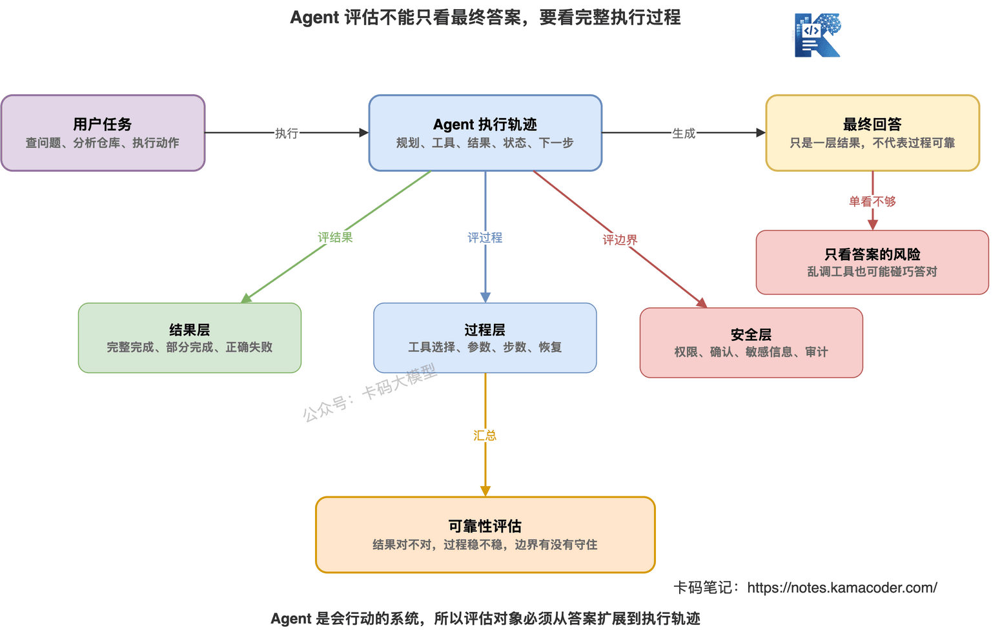
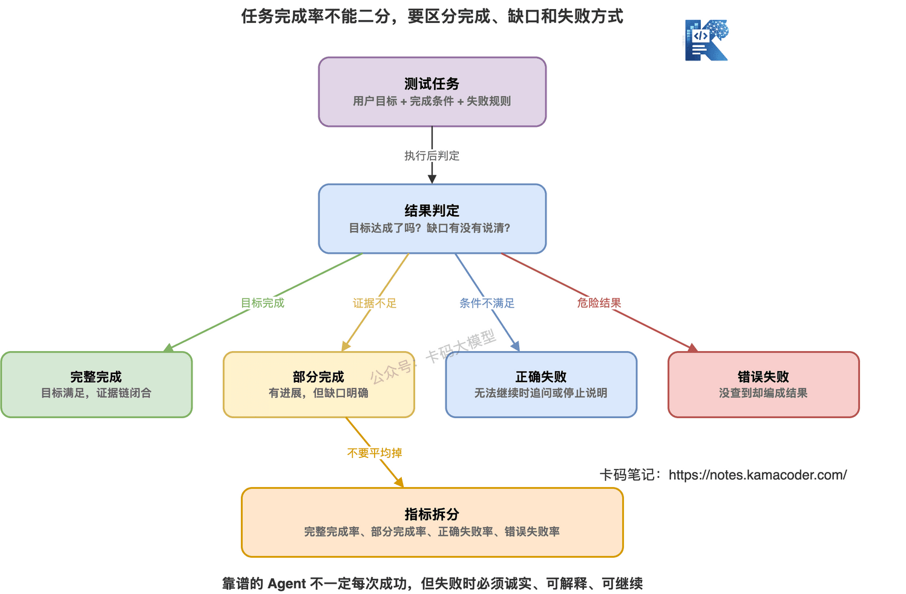
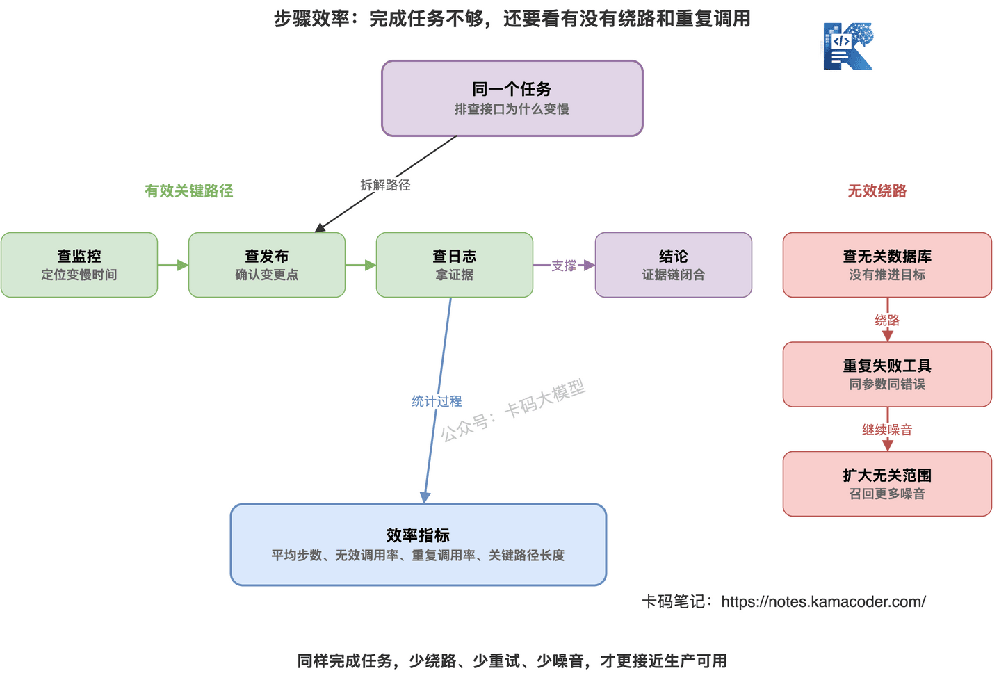

### 4.7 Agent 评测体系与 Pass^k 稳定性指标 【🔥 必会】

#### 1. 🎯 本节目标与大白话例子

上一步痛点：改了一版 System Prompt 或换了一个小模型，主观试了 3 个 Case 觉得“好像变聪明了”，结果一上线用户疯狂投诉——因为只看“单次碰巧跑通”，根本发现不了选错工具率上升、同一问题跑 5 次只有 2 次稳定成功的隐患。

本节解法：构建 AgentTrajectoryEvaluator（轨迹评测器）：不仅看最终结果（Outcome），还把失败轨迹精确归因到 四分类（SUCCESS / WRONG_TOOL / PARAM_ERROR / STEP_LIMIT），并引入工业界衡量生产可靠性的黄金指标 Pass@k 与 Pass^k。

大白话例子：就像考驾照和跑滴滴的区别：Pass@5 是“科目二考 5 次只要过 1 次就算你有本事”（适合科研刷榜）；而 Pass^5 是“连续开 5 趟滴滴每一趟都不能撞车”——线上生产环境要的是 Pass^k，只要 5 次里翻车 1 次，用户就会流失！

#### 2. 🧠 核心原理与五维拆解



| 维度 | 核心内容（闭卷背诵标准） |
| --- | --- |
| ① 输入什么 | 评测轨迹列表 records: List[TrajectoryRecord]（含 task_id、期望工具集、实际调用序列、是否解决 task_solved、是否触达步数上限）。 |
| ② 做什么 | ① 对每条失败轨迹进行四分类归因；② 统计 invalid_tool_rate 与 duplicate_call_rate；③ 按 task_id 分组聚合 Pass@k（至少成功一次）与 Pass^k（连续 k 次全对）。 |
| ③ 输出什么 | 结构化评测报告字典（success_rate、pass_at_k、pass_power_k、invalid_tool_rate、duplicate_call_rate、outcome_breakdown）。 |
| ④ 关键参数 | k（重复采样次数，通常设为 3~5 次来暴露 LLM 采样随机性导致的脆弱路径）。 |
| ⑤ 工程 Trade-off | 跑 k=5 次全量回归评测会让 CI/CD 成本翻 5 倍，但能提前拦截 90% 的“偶发抽风型线上 Bug”；生产中通常对核心链路 P0 用例跑 Pass^3，长尾用例跑单次回归。 |

任务结果归因与步数效率分析：





知识扩展（面试加分盲区）：

$\tau$-bench（Tau-bench）提出的 Pass^k 指标为什么在面试中高频出现？：因为传统 Coding Benchmark（如 HumanEval）爱用 Pass@k（生成 10 个答案有 1 个过单测就行），但真实企业 Agent（客服、订票、运维）面对用户只有一次机会，且多步串联具有概率衰减效应。Pass^k 衡量的是一致性与生产级可靠性（Consistency & Reliability）。

Agent 评测的三层金字塔：

L1 单步工具层：工具选对率（Tool Selection Accuracy）、参数 Schema 合法率。

L2 轨迹过程层：有效步数比（Actual Steps / Optimal Steps）、冗余/重复调用率、安全拦截命中率。

L3 终局结果层：End-to-End Task Completion（基于确定性数据库状态比对或 LLM-as-a-Judge 裁判）。

如何低成本搭建离线沙箱评测集？：用 Mock / 确定性内存数据库状态（Stateful Simulator）替代真实外部 API，记录每次写操作后 DB 的终态（Final DB State）并与 Ground Truth 状态比对，既 0 副作用又能毫秒级跑完上百条回归用例。

#### 3. 💻 渐进式代码实操（Step 7：在 Step 4~6 基础上新增 AgentTrajectoryEvaluator）

演进说明：对 Step 4~6 产出的运行轨迹进行自动四分类归因，并计算 Pass@k、Pass^k 与无效/重复调用率。

```python
"""Step 7: Agent Trajectory Evaluator (轨迹评测、四分类归因与 Pass^k 稳定性指标).

在 Step 4~6 执行轨迹基础上新增 AgentTrajectoryEvaluator：
1. 四分类结果归因：SUCCESS / WRONG_TOOL / PARAM_ERROR / STEP_LIMIT。
2. 计算工具无效调用率、重复调用率与单任务平均步数。
3. 计算工业界常用的 Pass@k 与 Pass^k (连续 k 次全对的可靠性指标)。
"""

from __future__ import annotations

from dataclasses import dataclass
from enum import Enum
from typing import Any, Dict, List


class TrajectoryOutcome(str, Enum):
    SUCCESS = "SUCCESS"
    WRONG_TOOL = "WRONG_TOOL"
    PARAM_ERROR = "PARAM_ERROR"
    STEP_LIMIT = "STEP_LIMIT"


@dataclass
class TrajectoryRecord:
    """单次 Agent 运行的轨迹记录."""

    task_id: str
    expected_tools: List[str]
    actual_calls: List[Dict[str, Any]]  # [{"name": str, "args": dict, "valid": bool}]
    task_solved: bool
    hit_step_limit: bool = False


def classify_outcome(record: TrajectoryRecord) -> TrajectoryOutcome:
    """对单条轨迹进行四分类故障归因."""
    if record.task_solved:
        return TrajectoryOutcome.SUCCESS
    if record.hit_step_limit:
        return TrajectoryOutcome.STEP_LIMIT

    actual_names = [c["name"] for c in record.actual_calls]
    if any(not c.get("valid", True) for c in record.actual_calls):
        return TrajectoryOutcome.PARAM_ERROR
    if set(record.expected_tools) - set(actual_names):
        return TrajectoryOutcome.WRONG_TOOL
    return TrajectoryOutcome.WRONG_TOOL


def evaluate_suite(records: List[TrajectoryRecord]) -> Dict[str, Any]:
    """聚合多条轨迹，输出成功率、无效工具率、重复率及 Pass^k 指标."""
    if not records:
        raise ValueError("评测轨迹列表不能为空")

    total_calls = 0
    invalid_calls = 0
    duplicate_calls = 0
    outcome_counts: Dict[str, int] = {o.value: 0 for o in TrajectoryOutcome}
    by_task: Dict[str, List[bool]] = {}

    for rec in records:
        outcome = classify_outcome(rec)
        outcome_counts[outcome.value] += 1
        by_task.setdefault(rec.task_id, []).append(rec.task_solved)

        seen_signatures: set[str] = set()
        for call in rec.actual_calls:
            total_calls += 1
            if not call.get("valid", True):
                invalid_calls += 1
            sig = f"{call['name']}::{sorted(call.get('args', {}).items())}"
            if sig in seen_signatures:
                duplicate_calls += 1
            seen_signatures.add(sig)

    total_runs = len(records)
    success_rate = outcome_counts[TrajectoryOutcome.SUCCESS.value] / total_runs
    # Pass@k: 同一任务 k 次尝试中至少成功 1 次的比例
    pass_at_k = sum(1 for runs in by_task.values() if any(runs)) / len(by_task)
    # Pass^k: 同一任务 k 次尝试全部成功的比例（生产可靠性核心指标）
    pass_power_k = sum(1 for runs in by_task.values() if all(runs)) / len(by_task)

    return {
        "total_runs": total_runs,
        "success_rate": round(success_rate, 4),
        "pass_at_k": round(pass_at_k, 4),
        "pass_power_k": round(pass_power_k, 4),
        "invalid_tool_rate": round(invalid_calls / max(1, total_calls), 4),
        "duplicate_call_rate": round(duplicate_calls / max(1, total_calls), 4),
        "outcome_breakdown": outcome_counts,
    }


if __name__ == "__main__":
    sample_records = [
        TrajectoryRecord(
            task_id="T1",
            expected_tools=["query_ticket"],
            actual_calls=[{"name": "query_ticket", "args": {"ticket_id": "TK-1"}, "valid": True}],
            task_solved=True,
        ),
        TrajectoryRecord(
            task_id="T1",
            expected_tools=["query_ticket"],
            actual_calls=[{"name": "query_ticket", "args": {"id": "TK-1"}, "valid": False}],
            task_solved=False,
        ),
        TrajectoryRecord(
            task_id="T2",
            expected_tools=["check_node"],
            actual_calls=[{"name": "check_node", "args": {"node": "db-02"}, "valid": True}],
            task_solved=True,
        ),
        TrajectoryRecord(
            task_id="T2",
            expected_tools=["check_node"],
            actual_calls=[{"name": "check_node", "args": {"node": "db-02"}, "valid": True}],
            task_solved=True,
        ),
    ]
    report = evaluate_suite(sample_records)
    assert report["pass_at_k"] == 1.0, f"Pass@2 应为 1.0: {report}"
    assert report["pass_power_k"] == 0.5, f"Pass^2 应为 0.5: {report}"
    assert report["outcome_breakdown"]["PARAM_ERROR"] == 1
    assert report["invalid_tool_rate"] == 0.25
    print(f"Step 7 self-test passed! report={report}")
```

【工业级调库对照】（LangSmith / Arize Phoenix / Ragas Agent Metrics）：

```python
# 何时手写：把轨迹 JSON 落盘后，用 80 行 Python 跑四分类归因 + Pass^k 统计，直接集成进 GitHub Actions CI。
# 何时调库：需要可视化 Trace 瀑布流、线上抽样报警与人工标注闭环时，接入 Langfuse / LangSmith / Arize Phoenix。
```

#### 4. 🗣️ 面试官视角：这段代码怎么讲

先声明不变量：Pass@k >= success_rate >= Pass^k 永远成立；评测必须同时看“结果对不对”和“过程干不干净（无效调用率、重复调用率）”。

讲清关键行：第 75~77 行用 any(runs) 算 Pass@k、用 all(runs) 算 Pass^k，一眼暴露随机性漏洞（比如 T1 跑 2 次 1 对 1 错，导致 Pass@2=1.0 但 Pass^2=0.5）。

主动点出工程细节：做离线回归评测时，如果工具调用顺序不影响最终状态（比如先查日志再查指标 vs 先查指标再查日志），不要用死板的序列精确匹配（Exact Sequence Match）判错，而应比较集合覆盖度 + 最终环境状态。

#### 5. 🔧 生产排障指南（实现 -> 排障）

故障 1：离线测试 Pass@1 有 85%，但上线后用户还是频繁遇到莫名其妙的失败

现象：同一个问题有时成功、有时直接报错或答非所问。

定位方法：把离线评测从单次运行改为 k=5 多次运行，计算 Pass^5。往往会发现 Pass^5 暴跌到 40% 以下。

修复方案：把 temperature 降到 0.0~0.1，加固易错工具的 description 与 Schema 示例，把高波动路径固化为确定性 Workflow。

故障 2：Agent 最终答案是对的，但平均消耗 9 步、耗时 20 秒

现象：只看 success_rate 看不出异常，但成本和延迟居高不下。

定位方法：检查 duplicate_call_rate 与“实际步数 / 理论最优步数”比值。

修复方案：在评测报告中加入 Token 成本与有效步数效率门槛，定位导致多走弯路的工具返回值（比如返回值太模糊诱发模型反复追问）。

#### 6. ❓ 高频面试追问与参考答法 + 📝 节末费曼自检

Q1：面试官问：Pass@k 和 Pass^k 有什么区别？企业 Agent 上线看哪个？

参考答法：Pass@k 是“k 次里至少成功 1 次”，反映模型能力上限（适合做代码生成推荐或科研探索）；Pass^k 是“k 次连续全成功”，反映系统稳定性下限。企业级生产 Agent（客服、运维、金融）必须盯紧 Pass^k，因为用户只会给你一次机会。

Q2：用 LLM-as-a-Judge 评测 Agent 轨迹时，怎么避免裁判模型“乱打分”？

参考答法：三招：① 确定性优先（能用数据库终态、正则、工具退出码判定的，绝不交给裁判模型）；② 拆解原子 Rubric（把“好不好”拆成“是否调用了必需工具 / 是否遗漏关键约束 / 是否存在无证据编造”几个布尔子项）；③ 定期做人机一致性校准（Cohen's Kappa）。

Q3：为什么不建议用“工具调用序列精确匹配”作为唯一评测标准？

参考答法：因为解决同一个复杂问题往往有多条等价路径（比如先查 A 再查 B，和先查 B 再查 A 都能定位根因）。过度卡死顺序会产生大量假阴性（False Negative），更合理的是测关键证据覆盖率 + 最终业务状态一致性。

Q4：你的 Agent 评测集应该包含哪些类型的 Case？

参考答法：四类必备：① 高频 Happy Path；② 边界与缺参 Case（测参数自愈与反问能力）；③ 拒答与越权诱导 Case（测安全护栏与 Prompt 注入防御）；④ 工具故障注入 Case（测 503 重试与降级话术）。

📝 节末费曼自检：

举出一个具体数字例子，说明为什么 Pass@2 = 100% 时 Pass^2 可能只有 0% 或 50%。

当 outcome_breakdown 显示 WRONG_TOOL 占比最高 vs PARAM_ERROR 占比最高时，分别应该优先优化什么？

