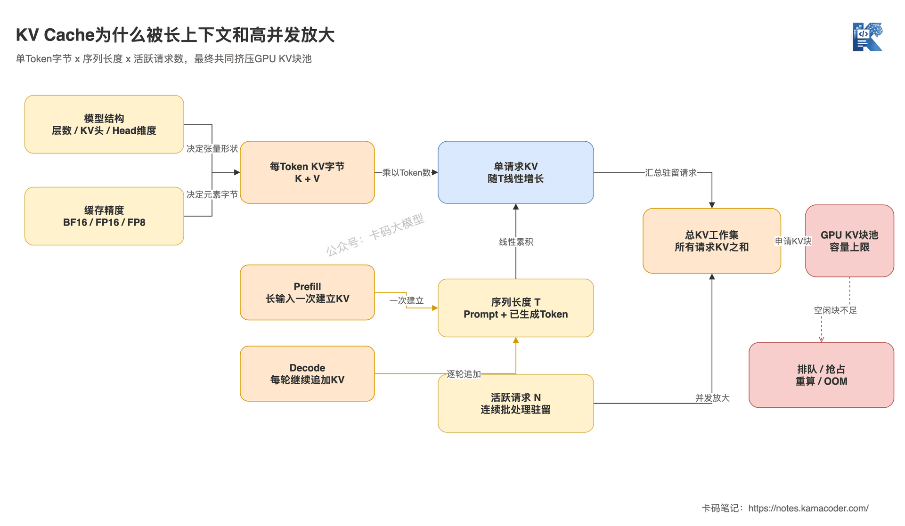
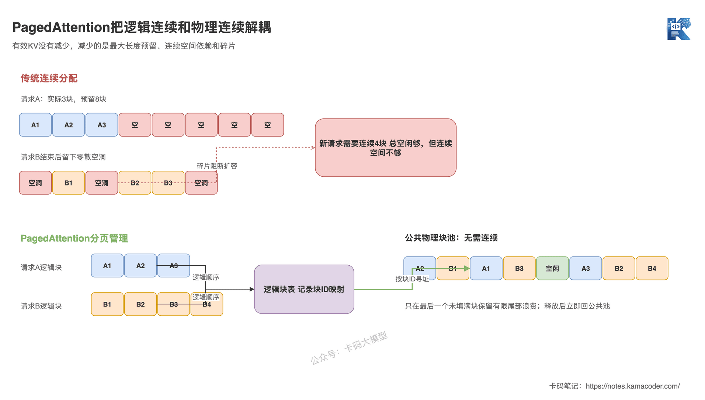
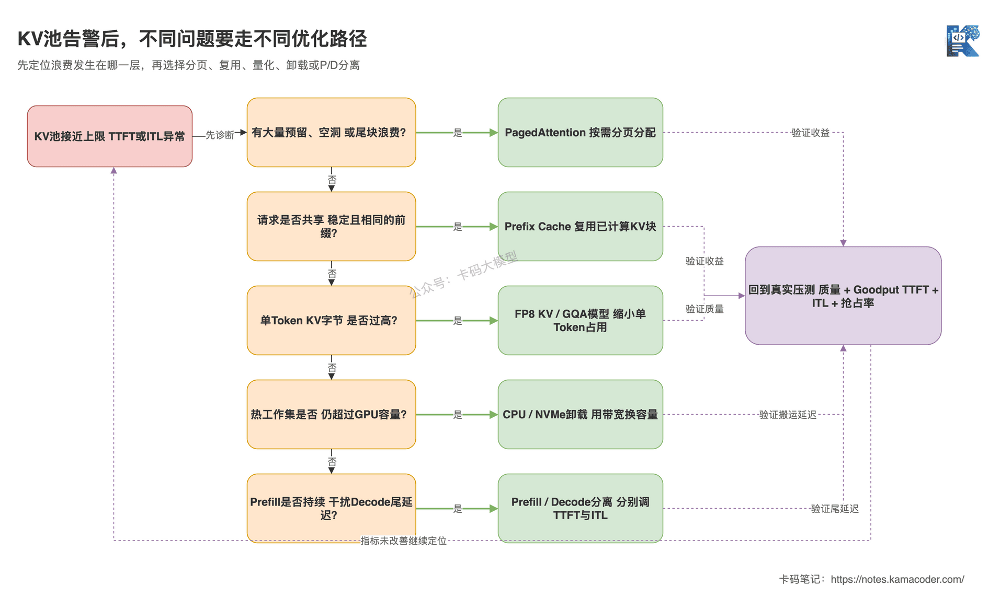

### 6.2 手写 KV Cache 增量解码与 PagedAttention 【🔥 必会】

#### 1. 🎯 本节目标与大白话例子

上一步痛点：自回归生成第 $t$ 个词时，如果不保存前面算过的 Key 和 Value，每生成一个新词就得把前面所有几千个词重新算一遍 $K, V$（单步复杂度退化为 $O(T^2)$）！而开了 KV Cache 之后，如果像传统框架那样按 max_seq_len 预先申请一整块连续显存，短请求会浪费 80% 的预留空间，请求进进出出还会留下大量无法使用的外部碎片洞！

本节解法：① 纯手写 IncrementalKVCacheAttention（Prefill 一次建池 + Decode 单步追加 $k_t, v_t$），并严格断言与无缓存全量重算在 $10^{-6}$ 精度下绝对等价；② 模拟 **PagedAttention 逻辑块表（Block Table）**按需分配固定大小物理块，彻底消除碎片。

大白话例子：KV Cache 就像做数学接力题把前面算好的草稿纸（$K, V$）留着复用，不用每步从头重算；PagedAttention 就像操作系统内存分页——不用一上来就给每个客人包下一整张 100 人的大长桌（按 max_len 预留），而是准备很多 4 人小方桌（物理 Block），客人来 5 个人就发 2 张小桌并用座位登记表（Block Table）串起来，吃完了立刻收桌腾给下一拨！

#### 2. 🧠 核心原理与五维拆解







| 维度 | 核心内容（闭卷背诵标准） |
| --- | --- |
| ① 输入什么 | Prefill 输入 x_prompt: (T_p, D)；Decode 每步仅输入新词 x_new: (1, D)；PagedAttention 传入请求 ID 与当前 Token 数。 |
| ② 做什么 | Prefill 计算全量因果注意力并缓存 k_cache, v_cache；Decode 仅对 x_new 投影 q_t, k_t, v_t，拼接到缓存尾部后只计算 (1, T_curr) 注意力；BlockAllocator 按 ceil(num_tokens / block_size) 动态分配物理块。 |
| ③ 输出什么 | 与无缓存全量因果注意力 $10^{-6}$ 等价的隐藏状态输出，以及物理块映射表 block_tables。 |
| ④ 关键参数 | block_size（vLLM 常设 16 Token/块，太小块表寻址开销大，太大最后一个块尾部浪费多）。 |
| ⑤ 工程 Trade-off | KV Cache 用显存换计算，把 Decode 单步复杂度从 $O(T^2)$ 降到 $O(T)$；PagedAttention 优化的是显存碎片与共享，并不压缩单个有效 Token 的 KV 字节数。 |

知识扩展（面试加分盲区）：

Prefill vs Decode 的硬件瓶颈本质区别（必考！）：

Prefill 阶段：一次性并行处理整段长 Prompt，核心计算是大矩阵乘大矩阵（GEMM），属于 Compute-Bound（计算密集型），瓶颈在 GPU 算力（TFLOPS），直接决定 TTFT（首字时间）。

Decode 阶段：每次只生成 1 个新 Token，每步都要把庞大的历史 KV Cache 从显存（HBM）搬到片上缓存（SRAM），核心计算是小向量乘大矩阵（GEMV），属于 Memory-Bandwidth-Bound（访存带宽密集型），瓶颈在 GPU 显存带宽（GB/s），直接决定 TPOT（字间时间）。

Prefix Cache（前缀缓存）与 PagedAttention 的关系：PagedAttention 解决“物理块怎么放得更紧、不留碎片”；Prefix Cache 解决“多个请求共享相同 System Prompt / Few-shot 前缀时，通过父块哈希匹配直接复用算好的 KV 块，跳过重复 Prefill”。注意：动态时间戳/随机 ID 千万别放 System Prompt 最前面，否则前缀哈希全失效！

#### 3. 💻 渐进式代码实操（Step 2：手写 KV Cache 增量内核与分页块表）

演进说明：从零手写因果自注意力、Prefill+Decode 增量内核及等价性断言，并模拟 PagedAttention 块表分配。

```python
"""6.2 Step 2: 手写 KV Cache 增量解码内核与 PagedAttention 块表模拟."""

from __future__ import annotations

import math
from typing import Dict, List, Optional
import numpy as np


def softmax(x: np.ndarray) -> np.ndarray:
    e = np.exp(x - np.max(x, axis=-1, keepdims=True))
    return e / np.sum(e, axis=-1, keepdims=True)


def full_causal_attention(x: np.ndarray, wq: np.ndarray, wk: np.ndarray, wv: np.ndarray) -> np.ndarray:
    """无 KV Cache 朴素全量重算 (T, D) -> (T, D)."""
    t, d = x.shape
    q, k, v = x @ wq, x @ wk, x @ wv
    scores = (q @ k.T) / math.sqrt(d)
    mask = np.triu(np.full((t, t), -1e9), k=1)
    return softmax(scores + mask) @ v


class IncrementalKVCacheAttention:
    """单头手写 KV Cache 增量注意力内核."""

    def __init__(self, d_model: int, wq: np.ndarray, wk: np.ndarray, wv: np.ndarray) -> None:
        self.d_model = d_model
        self.wq, self.wk, self.wv = wq, wk, wv
        self.k_cache: Optional[np.ndarray] = None
        self.v_cache: Optional[np.ndarray] = None

    def prefill(self, x_prompt: np.ndarray) -> np.ndarray:
        out = full_causal_attention(x_prompt, self.wq, self.wk, self.wv)
        self.k_cache = x_prompt @ self.wk
        self.v_cache = x_prompt @ self.wv
        return out

    def decode_step(self, x_new: np.ndarray) -> np.ndarray:
        assert x_new.shape == (1, self.d_model)
        assert self.k_cache is not None and self.v_cache is not None

        q_t = x_new @ self.wq
        k_t = x_new @ self.wk
        v_t = x_new @ self.wv

        self.k_cache = np.concatenate([self.k_cache, k_t], axis=0)
        self.v_cache = np.concatenate([self.v_cache, v_t], axis=0)

        scores = (q_t @ self.k_cache.T) / math.sqrt(self.d_model)
        return softmax(scores) @ self.v_cache


class PagedBlockAllocator:
    """模拟 PagedAttention 物理块池与逻辑块表按需映射."""

    def __init__(self, num_blocks: int, block_size: int) -> None:
        self.block_size = block_size
        self.free_blocks: List[int] = list(range(num_blocks))
        self.block_tables: Dict[str, List[int]] = {}

    def allocate_tokens(self, req_id: str, num_tokens: int) -> List[int]:
        needed_blocks = math.ceil(num_tokens / self.block_size)
        table = self.block_tables.setdefault(req_id, [])
        while len(table) < needed_blocks:
            if not self.free_blocks:
                raise MemoryError("KV_POOL_OOM: 物理 KV 块耗尽，触发排队或抢占")
            table.append(self.free_blocks.pop(0))
        return table

    def free_request(self, req_id: str) -> None:
        for blk in self.block_tables.pop(req_id, []):
            self.free_blocks.append(blk)


if __name__ == "__main__":
    rng = np.random.default_rng(7)
    d = 16
    wq, wk, wv = rng.normal(0, 0.2, (d, d)), rng.normal(0, 0.2, (d, d)), rng.normal(0, 0.2, (d, d))
    seq = rng.normal(0, 1.0, (6, d))

    ref_out = full_causal_attention(seq, wq, wk, wv)
    kv_attn = IncrementalKVCacheAttention(d, wq, wk, wv)
    inc_out = np.concatenate([kv_attn.prefill(seq[:4]), kv_attn.decode_step(seq[4:5]), kv_attn.decode_step(seq[5:6])], axis=0)
    assert np.allclose(ref_out, inc_out, atol=1e-6)
    print("Ch6 Step 2 self-test passed!")
```

【工业级调库对照】（vLLM / SGLang）：

```bash
# 何时手写：面试白板手撕增量解码、验证因果等价性时手写。
# 何时调库：生产高并发直接用 vLLM（PagedAttention + Automatic Prefix Caching）或 SGLang（RadixAttention）：
vllm serve Qwen/Qwen2.5-7B-Instruct --enable-prefix-caching --gpu-memory-utilization 0.9
```

#### 4. 🗣️ 面试官视角：这段代码怎么讲

先声明不变量：IncrementalKVCacheAttention 的每一步输出必须在 1e-6 内严格等于无缓存全量重算；物理块分配器中 len(free_blocks) + sum(used) == num_blocks 恒成立。

讲清关键行：decode_step 里不需要加因果掩码，因为 q_t 本身就是最新位置，它天然可以看前面所有的 k_cache；而 prefill 必须加 np.triu(..., k=1) 因果掩码防止未来词泄漏。

主动点出工程细节：真实引擎里不会每步 np.concatenate 重新拷贝整块显存（$O(T)$ 拷贝开销），而是配合 PagedBlockAllocator 提前分配好物理块指针，每步直接往对应槽位原地写入（In-place Write）。

#### 5. 🔧 生产排障指南（实现 -> 排障）

故障 1：开启 Prefix Caching 后命中率一直低于 5%

现象：明明所有请求都用了同一个 2000 字 System Prompt，但缓存命中率极低。

定位方法：检查 Prompt 头部是否拼接了动态时间、随机 trace_id 或用户昵称，导致第一个块哈希就变了，后面全盘失效。

修复方案：把绝对静态的 System Prompt 与工具定义放最前面，动态字段统一后置。

#### 6. ❓ 高频面试追问与参考答法 + 📝 节末费曼自检

Q1：为什么 Decode 阶段只生成 1 个词，却不缓存 Query（Q）而只缓存 K 和 V？

参考答法：生成第 $t$ 个词时，我们只需要当前位置 $t$ 的 $q_t$ 去和历史所有 $k_1..k_t$ 算点积权重、再对 $v_1..v_t$ 加权求和。历史位置的 $q_1..q_{t-1}$ 已经在前面步骤算完且再也不会被未来 Token 用到，所以只存 K 和 V。

Q2：PagedAttention 真的“压缩”了 KV Cache 大小吗？

参考答法：没有！对同一个模型和精度，有效 Token 的 K/V 数据字节数一分没少；PagedAttention 省掉的是连续预留浪费、外部碎片和内部碎片，让同一块 GPU 能装下更多有效 KV。

📝 节末费曼自检：

为什么 Prefill 阶段需要上三角掩码，而单步 decode_step 不需要？

比较 PagedAttention、Prefix Cache 与 FP8 KV Cache 分别解决什么问题。

