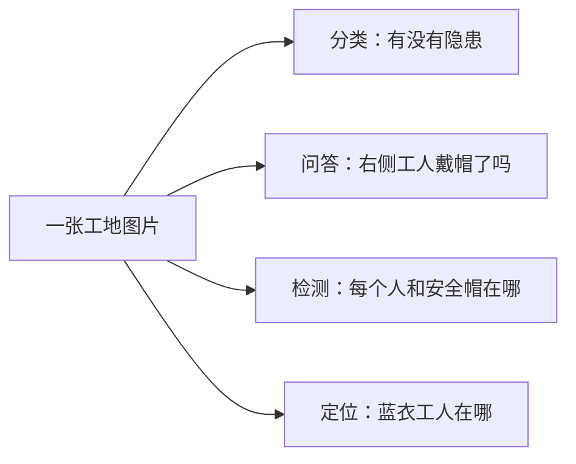

# 7.1 先分清 VQA、分类、检测、定位和描述：多模态应用场景与 IoU 评估【🔥 必会】

## 第一部分：原仓库《多模态能做什么？文档解析、图片问答、视频理解》完整原文（含全部原图）

---
title: 多模态大模型应用场景：文档解析、图片问答、视频理解与多模态RAG
description: 多模态大模型能做什么，什么时候值得用？本文围绕文档解析、图片问答和视频理解，拆解三类场景的输入输出、关键证据与工程链路，并讲清OCR、视觉语言模型、视频抽帧、时序理解和多模态RAG如何组合，帮助大模型应用开发者避免为用多模态而用多模态，并形成可复述的面试表达。
keywords: [多模态大模型应用, 多模态应用场景, 文档解析, 图片问答, 视频理解, 多模态RAG, OCR, 视觉语言模型, VLM, 视频抽帧, 时序理解, 图文检索, LLM应用开发, 多模态面试]
tags: [多模态大模型, 文档解析, 图片问答, 视频理解, 多模态RAG, 大模型应用开发]
---

# 多模态能做什么？文档解析、图片问答、视频理解

上一篇[《多模态大模型：图片和语音是怎么被模型“看懂”的？》](./multimodal_intro.md)讲了图片、语音如何被编码成模型能处理的向量。

知道模型怎么“看”，不等于知道项目里该让它看什么。

面试官很可能继续问：“你说项目用了多模态，具体解决了什么问题？为什么不能先转成文本，再交给普通大模型？”

常见回答是：“多模态能识别图片、解析PDF、理解视频，能力更强。”

方向没错，但没有说清**任务依赖哪类证据、输入输出是什么、文本方案会丢什么**。这会让人听不出你是在做工程选型，还是只把图片塞进了模型接口。

## 简要回答

- **文档解析**：输入是PDF、扫描件或截图，输出不只是文字，还包括标题层级、表格、图表、坐标和阅读顺序；
- **图片问答**：输入是图片和问题，模型要先找到与问题相关的区域，再结合文字、物体和空间关系给出答案；
- **视频理解**：输入是视频和问题，系统要联合处理关键帧、动作顺序、字幕和声音，回答“发生了什么、为什么发生”；
- **多模态RAG**：先检索相关页、图或视频片段，再让多模态模型围绕证据回答，避免把全部素材一次性塞进上下文。

判断是否该用多模态，只问一句：**任务所需的关键证据，转成纯文本后会不会丢失？**

## 详细回答

### 文档解析为什么不等于OCR？

OCR解决的是“这几个像素是什么字”，文档解析还要回答：字属于哪个标题、哪个单元格、哪张图，阅读顺序又是什么。

例如一份财报里同时有正文、双栏排版、表格和柱状图。把OCR结果从上到下拼成一段长文本，字可能一个没错，但表头和数值错位后，含义已经变了。

一个可用的文档解析结果，通常至少包含三层：

1. **内容层**：文字、公式、印章、图表和图片；
2. **结构层**：标题层级、段落、列表、表格行列和阅读顺序；
3. **定位层**：页码、坐标、区域类型和原图引用，方便回溯证据。


这张图回答的是：只抄出文字，会把页面原有的结构打散；多模态解析真正要保住的是文字、版式和图表之间的对应关系。

工程上也不要迷信“一个多模态模型包打天下”。更稳的做法往往是组合链路：

```text
PDF / 扫描件
→ 页面分类与图像预处理
→ OCR + 版面分析 + 表格识别
→ 多模态模型补充图表理解和语义校正
→ 结构化JSON / Markdown
→ 质量校验与人工复核
```

固定模板的票据，传统OCR加规则通常更便宜、更稳定；版式复杂、图文混排、模板变化大的材料，才更能体现多模态模型的价值。

### 图片问答真正难在哪里？

图片问答不是“识别完图片，再随便聊两句”。同一张图，问题不同，模型需要寻找的证据也不同。

给一张机房照片：

- 问“画面里有几台机柜”，依赖物体检测和计数；
- 问“红色告警灯在哪台设备上”，依赖颜色、位置和物体归属；
- 问“这个接线是否存在风险”，还要结合视觉证据与外部规范。

所以链路应该围绕问题来组织：

```text
图片 + 问题
→ 判断问题需要文字、物体还是空间关系
→ 定位相关区域并读取细节
→ 必要时检索业务知识
→ 基于图像证据生成答案
```

最容易翻车的是模型“看不清但敢回答”。小字、密集目标、遮挡和模糊区域都会让视觉证据不足，语言模型却可能用常识补出一个很顺的答案。

生产环境要给答案加证据锚点，例如页码、裁剪区域、检测框或原图链接。高风险场景还要允许模型明确返回“当前图片无法判断”，而不是强制它给结论。

### 视频理解为什么不能只看一张截图？

视频比图片多出来的关键维度是**时间**。

只看“杯子落在地上”这一帧，无法判断是人碰倒的、猫推下去的，还是它本来就在地上。要解释事件，必须把前后帧串起来。


这张图回答的是：单帧只能告诉模型某个瞬间有什么，连续片段才能提供前因、经过和结果。

一段视频通常会被拆成多路信息：

- 关键帧或短片段，提供人物、物体、动作和场景变化；
- 音轨，提供对话、语气、环境声和事件提示；
- 字幕与画面文字，提供可检索的文本线索；
- 时间戳，负责把不同证据重新对齐。

工程上不会默认逐帧分析。一个30分钟、每秒30帧的视频有5.4万帧，全部送进模型既慢又贵。

常见做法是先按固定间隔、镜头切换或事件检测抽取候选片段，再围绕用户问题二次加密采样。回答时必须带时间范围，例如“02:14—02:22出现设备冒烟”，否则结果很难复核。

### 多模态怎么和文本RAG结合？

多模态和RAG不是二选一。真实系统里，更常见的是**先检索缩小范围，再让模型看原始证据**。

以产品手册问答为例，可以在离线阶段保存四类信息：

- OCR文本和标题层级，用于关键词检索；
- 文本或页面Embedding，用于语义检索；
- 原始页图、图表裁剪和坐标，用于视觉复核；
- 文档版本、权限和页码，用于过滤与引用。

在线提问时，先用文本检索召回候选页；如果问题涉及接线图、表格或版式，再把候选页原图交给多模态模型。这样既保留了文本RAG便宜、可检索的优势，又没有丢掉视觉证据。

视频也一样。先用字幕、镜头摘要和时间戳建立索引，召回相关时间段后再读取原片段。**多模态模型负责精读，不负责盲看整个资料库。**

这和前面讲过的[长文档层级检索](./long_document_code_retrieval.md)是同一个工程思想：小范围检索命中，大范围证据返回，只是这里返回的不止文本，还包括页面、图片或视频片段。

### 什么时候用文本就够了？

不要看到PDF、图片、视频就默认上多模态。输入载体是视觉内容，不代表任务证据一定是视觉的。

| 场景 | 建议起点 | 判断理由 |
|---|---|---|
| 扫描合同中查公司名称 | OCR + 文本检索 | 关键证据就是文字 |
| 财报图表趋势问答 | 多模态模型 | 数值与图形、图例、位置共同决定含义 |
| 商品图片生成一句描述 | 多模态模型 | 需要直接理解物体和属性 |
| 监控录像按字幕搜索 | ASR + 文本检索 | 只需要找说过的话 |
| 监控录像判断动作先后 | 视频理解 | 时间顺序本身就是证据 |
| 固定模板发票录入 | OCR + 模板规则 | 输出字段稳定，更容易校验 |

一个实用决策顺序是：先尝试可靠的文本化方案，再检查它是否丢失任务所需证据；只有丢失真的影响结果，才引入多模态链路。

### 上线前要评估什么？

不能只拿几张效果好的图片做演示。三类场景的评估重点并不相同：

- 文档解析看字符准确率、表格结构准确率、阅读顺序和字段完整率；
- 图片问答看答案正确率、证据定位准确率和拒答质量；
- 视频理解看事件识别、时间定位误差、跨片段推理和音画一致性；
- 整条链路还要看端到端延迟、单任务成本与人工复核率。

测试集要包含低清、旋转、遮挡、密集小字、长视频和无答案样本。否则模型在Demo里“什么都能看”，一到真实数据就会暴露证据缺失和幻觉问题。

## 知识拓展

**Q1：多模态文档解析会替代OCR吗？**

短期内更像互补。OCR擅长稳定地识别字符和坐标，多模态模型擅长理解版式、图表和上下文。对精度要求高的系统，保留两者结果并做交叉校验通常更稳。

**Q2：图片问答和图片分类有什么区别？**

图片分类的输出集合通常提前固定，例如“猫、狗、汽车”；图片问答的问题和答案更开放，还可能依赖文字、计数、位置关系和外部知识。

**Q3：视频抽帧越多，理解效果一定越好吗？**

不一定。帧太少会漏事件，帧太多会增加成本和噪声。采样密度应该跟镜头变化、事件速度和问题类型一起调整，并用时间定位准确率验证。

**Q4：多模态RAG能只存图片Embedding吗？**

可以做，但通常不够。生产系统还需要保存OCR文本、结构元数据、原图坐标、版本和权限，才能兼顾召回、过滤、引用与复核。

**Q5：面试时怎么讲自己的多模态项目？**

按“关键证据—输入输出—处理链路—失败边界—评估指标”来讲。不要只说用了哪个模型，要说清楚纯文本方案丢了什么，以及多模态方案是否真的把这部分效果补回来了。

多模态不是给应用多装一双眼睛，就自动变聪明。

**真正的工程能力，是知道哪些证据必须看，哪些内容转成文本反而更稳。**


## 零基础大白话深度拆解（把本节核心概念、公式与工程坑点掰碎讲透）

### 1. 零基础一秒分清五大视觉任务：分类、VQA、检测（Detection）、视觉定位（Grounding）与描述（Captioning）
拿着同一张“南矿破碎站高空检修监控截图”，不同领导问的问题对应完全不同的底层任务：
- **图像分类（Classification）= 考卷上的判断题/单选题**：只问全图“有隐患 vs 没隐患”，输出一个标签和概率（如 `{"label": "hazard", "score": 0.92}`），**不告诉你人在哪**。
- **图像描述（Captioning）= 看图写话**：让模型泛泛地写一段话：“画面中有两名身穿蓝色工装的工人在钢结构平台上作业。”适合给图片建文本索引，但容易漏掉关键小细节。
- **视觉问答（VQA）= 自由问答题**：你问“右边那个工人系双钩安全带了吗？”，模型回答自然语言“没有系”。
  - **致命深坑**：大模型极其擅长“靠常识瞎蒙”！看到题干问“高空安全带”，哪怕它根本没看清人在哪，只要顺着题干蒙一句“没系”，字面上就答对了！所以高风险场景**绝不能只看 VQA 聊天准不准**。
- **目标检测（Object Detection，如 YOLO）= 拿红笔把所有目标全圈出来**：输出图里**每一个**工人、**每一顶**安全帽的矩形坐标框 `[x1, y1, x2, y2]`、类别和置信度。
- **视觉定位（Visual Grounding，如 Qwen-VL Grounding / Grounding DINO）= 按你的自然语言描述精准揪出那一个人**：你输入一句话“站在护栏最右边没戴红帽子的工人”，模型直接返回这**唯一指定目标**的坐标框 `[x1, y1, x2, y2]`！在你做工业合成数据校验（Seedream 生图 + Qwen-VL/Grounding 框核验）时，用的就是这个能力！

### 2. 什么是 IoU（交并比）与“一对一贪心匹配（Greedy Bipartite Matching）”？
- **IoU（Intersection over Union，交并比）= 两个框重合得有多准**：
  - 人工标注的真实框叫“金标框（Ground Truth，简称 GT）”，模型画出来的框叫“预测框（Pred）”。
  - 拿两个框重叠部分的面积（交集 Intersection），除以两个框合起来占的总地盘面积（并集 Union），算出来的比例就是 IoU（在 $0 \text{ 到 } 1$ 之间）。一般业界规定 **$\text{IoU} \ge 0.5$** 才算“框准了（命中 TP）”。
- **为什么必须做“一对一匹配（防一鱼多吃刷分）”**：
  - 如果画面里只有 1 个未戴安全帽的工人（1 个金标框），但模型在那个工人头上密密麻麻画了 5 个几乎重叠的预测框。如果不加“每个金标最多只能认领 1 个预测框”的限制，模型就会白嫖 5 次命中！正确规矩是：**按预测框的置信度从高到低排队，只有排第一的框算命中（TP = 1），后面那 4 个重复框全部算误报（FP = 4）**（工程中配合 NMS 非极大值抑制提前删掉重复框）。

## 循序渐进“搭积木”手搓代码（40 行极简 Python 版，轻松掌握核心逻辑）

```python
# 【循序渐进手搓版 Level 1（约 40 行）】：零依赖纯 Python 手写 IoU 计算与单类一对一贪心匹配
from typing import Dict, List, Set

def calc_iou(box1: List[float], box2: List[float]) -> float:
    """计算两个矩形框 [x1, y1, x2, y2] 的交并比 (IoU)"""
    ix1, iy1 = max(box1[0], box2[0]), max(box1[1], box2[1])
    ix2, iy2 = min(box1[2], box2[2]), min(box1[3], box2[3])
    inter = max(0.0, ix2 - ix1) * max(0.0, iy2 - iy1)
    area1 = (box1[2] - box1[0]) * (box1[3] - box1[1])
    area2 = (box2[2] - box2[0]) * (box2[3] - box2[1])
    union = area1 + area2 - inter
    return inter / union if union > 0 else 0.0

def match_predictions_to_gold(
    preds: List[Dict[str, object]],  # [{"box": [x1,y1,x2,y2], "score": 0.9}, ...]
    gold_boxes: List[List[float]],
    iou_thresh: float = 0.5,
) -> Dict[str, float]:
    """Level 1 核心积木：按置信度从高到低排序，每个金标框最多只能被匹配 1 次"""
    sorted_preds = sorted(preds, key=lambda x: float(x["score"]), reverse=True)
    matched_gold: Set[int] = set()
    tp = 0

    for p in sorted_preds:
        best_iou, best_j = 0.0, -1
        for j, g_box in enumerate(gold_boxes):
            if j in matched_gold:
                continue
            iou = calc_iou(p["box"], g_box)  # type: ignore
            if iou > best_iou:
                best_iou, best_j = iou, j
        if best_iou >= iou_thresh and best_j != -1:
            matched_gold.add(best_j)
            tp += 1

    fp = len(preds) - tp
    fn = len(gold_boxes) - tp
    return {"tp": tp, "fp": fp, "fn": fn, "precision": tp / len(preds), "recall": tp / len(gold_boxes)}

def self_test() -> None:
    # 两个重叠预测框去抢同一个金标框：高分框算 TP，第二个重复框必须被判为 FP！
    preds = [{"box": [0, 0, 10, 10], "score": 0.95}, {"box": [1, 1, 10, 10], "score": 0.80}]
    gold = [[0, 0, 10, 10]]
    res = match_predictions_to_gold(preds, gold, iou_thresh=0.5)
    assert res["tp"] == 1 and res["fp"] == 1 and res["fn"] == 0
    print("✅ [手搓版 Level 1] IoU 计算与一对一贪心匹配器自检通过！")

if __name__ == "__main__":
    self_test()
```

## 外企 Applied MLE 深度追问加餐（结合你的矿山安监与遥感多模态背景）

- **【🔥 外企高频加餐】在你们的工业安全巡检项目（YOLO 边缘检测 + Qwen-VL 云端复核）中，为什么不直接让 Qwen-VL 看全图做端到端目标检测，而要用“YOLO 预筛 + VLM 复核”的级联架构？**
  - **零基础大白话**：让一个年薪百万的法学博士（7B/72B 的 VLM）每秒盯 30 帧监控画面找安全帽，不仅工资付不起（显存与 Token 算力爆炸，单帧耗时 1 秒以上），而且他画矩形框的手艺还不如专门练过画框的速记员（YOLO 毫秒级检测器，单帧仅需 5 毫秒，框极准）！反过来，YOLO 只认得“人”和“安全帽”两个死框，看不懂“安全绳是不是系在牢固的横梁上、旁边有没有动火作业监护人”这种复杂语义关系。
  - **面试满分答法**：**小模型（YOLO）保高频召回与空间框精度，大模型（VLM）压低复杂语义误报**。边缘端用轻量级 YOLO 以 25 FPS 实时框出候选人员与隐患 ROI 区域（过滤掉 99% 无人的空画面），一旦触发疑似违规，再将原图与放大后的局部 ROI 切片（Crop）一并送入云端 Qwen-VL 进行细粒度空间关系核验，兼顾了毫秒级实时性、高召回与低误报。

## 完整进阶实战指南（五要素表 + 高频面试题 + 进阶工业级代码 + 排障指南 + 工程 Trick + 三段式讲法 + 费曼闪卡）

### 从现场问题引出任务

同一张高空作业图片，不同的人要的结果可能不同。项目经理想知道画面是否有隐患；安监员问某位工人是否戴了安全帽；系统需要把每个人和安全帽的位置圈出来；另一个用户只想找到“塔吊旁穿蓝衣服的人”。这些请求分别更接近分类、视觉问答、检测和视觉定位。先定义输出，才能知道要标注什么、怎样验收。

假设模型回答“右侧工人没戴安全帽”，文字看起来正确，但模型可能指错了人。如果业务要求空间证据，就需要比较它的预测框和人工标注框；若任务只要求分类或问答，则不必强行要求输出框。这个区别来自 [GitHub 版本的任务边界](https://github.com/epiphanydeer/my_llm/blob/62f20f9ec4f7a23cbd7f720ce23ab016b0cef475/KNOWLEDGE/llm-master/07-多模态入门.md)。



如果验收需要检测框，接下来的问题是“框得有多准”。IoU 用交集面积除以并集面积；再按置信度排序、一对一匹配，才能统计 TP、FP 和 FN。本节代码实现这个单图单类过程，它不是数据集级 mAP。

### 核心概念与五要素表

| 五要素 | 视觉目标边界与单类 IoU 贪心匹配器 (Level 1) |
| --- | --- |
| 输入 (Input) | 预测框矩阵 (N, 4)、置信度向量 (N,)、真实金标框矩阵 (M, 4)、匹配 IoU 阈值（默认 0.5，范围为 (0, 1]）。 |
| 做什么 (Process) | 校验边界框合法性（二维浮点坐标、正面积）；计算两两交并比 (IoU)；按预测置信度降序排序，对未匹配金标实施一对一贪心匹配；统计命中与漏报。 |
| 输出 (Output) | 字典记录：真正例 tp、假正例 fp、假负例 fn、精确率 precision、召回率 recall；分母为 0 时安全返回 None。 |
| 哪里出错 (Failure Modes) | 1. 坐标反向（x2 <= x1 或 y2 <= y1）；2. 归一化比例与绝对像素坐标混用；3. 重复预测框覆盖同一金标导致多次计分；4. 图像缩放 Padding 未还原导致坐标偏移。 |
| 参数影响 (Parameters) | IoU 阈值越高对空间重合度要求越苛刻，召回率下降；置信度阈值直接调和精确率与召回率的业务取舍。 |

### 面试高频追问

【🔥 必会】VQA 任务的回答正确率可以直接作为目标检测的 mAP 指标吗？
结论先行： 绝对不能，两者任务定义、输出空间与评测算法完全不同。
展开解释： VQA 评估的是文本语义匹配（如 ROUGE、BLEU 或准确率），模型完全可能凭借语言先验“猜对”答案（例如看到脚手架就盲猜没戴安全带）；而检测必须在像素空间预测目标坐标，并基于 IoU 阈值和置信度在整个数据集上计算精确率-召回率曲线下的平均精度 (mAP)。

【🔥 必会】线上部署视觉检测模型时，画面中有框但检测指标接近零，系统化排障步骤是什么？
结论先行： 沿着“坐标格式 → 归一化基准 → Padding 偏移 → IoU 口径”逆向回溯。
展开解释： 1. 检查坐标表达：模型输出是 (x1, y1, x2, y2) 还是 (cx, cy, w, h)；2. 检查尺度还原：输出是 [0, 1] 归一化比例还是绝对像素值；3. 检查图像预处理变换链：是否在 Resize 引入 Letterbox Padding 时丢失了反向平移还原；4. 将预测框与金标叠回原图可视化，肉眼直观排查。

【⭐ 理解】模型在 VQA 中回答“现场有人未戴安全帽”，如何向客户证明模型没有产生幻觉？
结论先行： 必须输出绑定的 Visual Grounding 坐标框或注意力热力图作为视觉证据。
展开解释： 语言模型的自然语言回答无法作为法律与安全审计的直接依据。生产架构中必须要求模型在输出结论的同时输出指向目标个体的边框（如 [box_2d]），或者串联专用检测器进行二阶段物理核验，确保结论有可溯源的视觉像素切片对应。

### 生产级代码实现：视觉多任务目标边界与单类 IoU 贪心匹配器 (Level 1)

```python
"""7.1 视觉目标边界与单类 IoU 贪心匹配器 (Level 1 基础实战)

业务场景：
在工业安全巡检模型评估中，验证多模态模型是否真正检测到违规目标，
避免“语言描述流畅但目标坐标全偏”的伪召回现象。

本模块实现零依赖的工业级评估组件：
1. 坐标张量格式规范化与正面积严格断言；
2. 纯 Python / NumPy 向量化计算矩形框两两交并比 (IoU)；
3. 一对一贪心匹配（一个金标目标最多只能被一个最高置信度的预测框匹配）；
4. 零除安全保护与详细 TP/FP/FN 指标生成。
"""

from __future__ import annotations
import math
from typing import Any, Dict, List, Optional, Tuple, Union

try:
    import numpy as np
    HAS_NUMPY = True
except ImportError:
    HAS_NUMPY = False


def validate_boxes(boxes: Any, name: str) -> List[List[float]]:
    """严格校验边界框矩阵：必须为 (N, 4) 结构且满足 x2 > x1, y2 > y1 正面积断言"""
    # 支持 list 和 numpy array
    if HAS_NUMPY and isinstance(boxes, np.ndarray):
        if boxes.ndim != 2 or boxes.shape[1] != 4:
            raise ValueError(f"{name} 必须是二维 (N, 4) 矩阵，实际形状: {boxes.shape}")
        box_list = boxes.tolist()
    elif isinstance(boxes, list):
        for b in boxes:
            if not isinstance(b, (list, tuple)) or len(b) != 4:
                raise ValueError(f"{name} 中的每个框必须为包含 4 个坐标的列表/元组")
        box_list = [list(map(float, b)) for b in boxes]
    else:
        raise ValueError(f"{name} 格式不支持，必须为 list 或 numpy.ndarray")

    # 深度数值与面积断言
    for idx, (x1, y1, x2, y2) in enumerate(box_list):
        for val in (x1, y1, x2, y2):
            if not math.isfinite(val):
                raise ValueError(f"{name} 第 {idx} 个框包含非有限浮点数: {val}")
        if x2 <= x1 or y2 <= y1:
            raise ValueError(
                f"{name} 第 {idx} 个框坐标非法 (必须满足 x2>x1 且 y2>y1): [{x1}, {y1}, {x2}, {y2}]"
            )

    return box_list


def compute_iou(box_a: List[float], box_b: List[float]) -> float:
    """计算单个预测框与金标框的交并比 (IoU)"""
    ax1, ay1, ax2, ay2 = box_a
    bx1, by1, bx2, by2 = box_b

    # 计算交集矩形坐标
    ix1 = max(ax1, bx1)
    iy1 = max(ay1, by1)
    ix2 = min(ax2, bx2)
    iy2 = min(ay2, by2)

    inter_w = max(0.0, ix2 - ix1)
    inter_h = max(0.0, iy2 - iy1)
    inter_area = inter_w * inter_h

    area_a = (ax2 - ax1) * (ay2 - ay1)
    area_b = (bx2 - bx1) * (by2 - by1)
    union_area = area_a + area_b - inter_area

    if union_area <= 0.0:
        return 0.0

    iou = inter_area / union_area
    assert 0.0 <= iou <= 1.0, f"IoU 计算异常: {iou}"
    return iou


def match_one_class(
    predicted_boxes: Any,
    scores: List[float],
    gold_boxes: Any,
    iou_threshold: float = 0.5
) -> Dict[str, Union[int, Optional[float]]]:
    """按置信度降序，对单图单类别执行一对一贪心匹配
    
    业务规则：
    1. 每个真实目标金标 (Gold Box) 最多只能被一个预测框命中；
    2. 多余的预测框（即使重叠度很高）记为假正例 (FP)；
    3. 未被命中的金标记为假负例 (FN)；
    4. 分母为 0 时安全返回 None，不将空样本误报为 0 分。
    """
    preds = validate_boxes(predicted_boxes, "预测框")
    golds = validate_boxes(gold_boxes, "金标框")

    if len(scores) != len(preds):
        raise ValueError(f"置信度数量 ({len(scores)}) 与预测框数量 ({len(preds)}) 不一致")
    for s in scores:
        if not math.isfinite(s) or not (0.0 <= s <= 1.0):
            raise ValueError(f"置信度必须为 [0.0, 1.0] 范围内的有限浮点数: {s}")
    if not (0.0 < iou_threshold <= 1.0):
        raise ValueError(f"IoU 阈值必须在 (0.0, 1.0] 之间: {iou_threshold}")

    if len(preds) == 0:
        return {
            "tp": 0,
            "fp": 0,
            "fn": len(golds),
            "precision": None,
            "recall": 0.0 if len(golds) > 0 else None
        }

    if len(golds) == 0:
        return {
            "tp": 0,
            "fp": len(preds),
            "fn": 0,
            "precision": 0.0,
            "recall": None
        }

    # 按置信度降序排序预测框
    sorted_pred_indices = sorted(range(len(preds)), key=lambda i: scores[i], reverse=True)

    matched_gold_indices = set()
    tp = 0

    for pred_idx in sorted_pred_indices:
        p_box = preds[pred_idx]
        best_iou = 0.0
        best_gold_idx = -1

        for gold_idx, g_box in enumerate(golds):
            if gold_idx in matched_gold_indices:
                continue  # 该金标已被更高置信度的预测框抢占！
            
            current_iou = compute_iou(p_box, g_box)
            if current_iou > best_iou:
                best_iou = current_iou
                best_gold_idx = gold_idx

        # 判定是否达到匹配阈值
        if best_iou >= iou_threshold and best_gold_idx != -1:
            tp += 1
            matched_gold_indices.add(best_gold_idx)

    fp = len(preds) - tp
    fn = len(golds) - tp

    precision = tp / len(preds) if len(preds) > 0 else None
    recall = tp / len(golds) if len(golds) > 0 else None

    return {
        "tp": tp,
        "fp": fp,
        "fn": fn,
        "precision": precision,
        "recall": recall
    }


def self_test():
    """验证重复预测框抑制、空金标、反向非法坐标拦截与贪心匹配正确性"""
    # 模拟真实安全帽金标：1 个真实目标 [0, 0, 10, 10]
    golds = [[0.0, 0.0, 10.0, 10.0]]
    # 模拟模型输出两个重叠预测框：置信度分别为 0.9 和 0.8
    preds = [
        [0.0, 0.0, 10.0, 10.0],  # 完美重合，置信度高
        [0.0, 0.0, 10.0, 10.0],  # 重复预测框，置信度稍低
    ]
    scores = [0.9, 0.8]

    # 1. 核心业务断言：高置信度命中 TP，低置信度重复框必须被判为 FP！
    res = match_one_class(preds, scores, golds, iou_threshold=0.5)
    assert res["tp"] == 1, f"期望 TP=1，实际: {res['tp']}"
    assert res["fp"] == 1, f"期望重复框算作 FP=1，实际: {res['fp']}"
    assert res["fn"] == 0
    assert res["precision"] == 0.5
    assert res["recall"] == 1.0
    print("✅ 重复预测框一对一抑制测试通过！")

    # 2. 验证空金标场景（无目标样本）
    res_empty_gold = match_one_class(preds, scores, [], iou_threshold=0.5)
    assert res_empty_gold["tp"] == 0
    assert res_empty_gold["fp"] == 2
    assert res_empty_gold["recall"] is None  # 分母为 0 优雅返回 None
    print("✅ 空金标保护测试通过！")

    # 阈值 0 会让不相交的框也达到“>=0”；本例明确拒绝此边界。
    try:
        match_one_class([[0, 0, 1, 1]], [0.9], [[2, 2, 3, 3]], 0.0)
    except ValueError:
        pass
    else:
        raise AssertionError("IoU 阈值 0 应被拒绝")

    # 3. 验证异常非法坐标拦截 (x2 <= x1)
    try:
        bad_boxes = [[10.0, 10.0, 5.0, 20.0]]  # x2(5) < x1(10)
        match_one_class(bad_boxes, [0.9], golds)
        raise AssertionError("未拦截反向坐标异常")
    except ValueError as e:
        assert "x2>x1" in str(e)
    print("✅ 反向坐标安全防御测试通过！")

    print("✅ 7.1 视觉多任务目标边界与单类 IoU 贪心匹配器自检全部通过！")


if __name__ == "__main__":
    self_test()
```

### 排障指南（常见故障、定位方法、修复策略）

| 常见故障 (Failure) | 定位方法 (Diagnosis) | 修复策略 (Mitigation) |
| --- | --- | --- |
| 预测框整体发生平移偏移 | 在原图上画出预测框与标注框，发现所有预测框均向右下偏移固定像素。 | 检查图像缩放策略。如果是 Letterbox 填充缩放，模型前向输出后必须先减去 Padding 边距，再除以缩放比率还原回原始分辨率坐标系。 |
| 单目标被多次统计为命中 | 模型评估报告召回率很高，但人工核验发现同一工人身上画了 5 个重叠框。 | 检查匹配逻辑是否开启了一对一标记，并在模型后处理环节引入 NMS (非极大值抑制)，滤除重叠度高于阈值的多余冗余候选框。 |
| 低阈值召回高但误报激增 | 业务调低置信度阈值至 0.1，召回提升了 10%，但客户投诉系统报警频繁。 | 在固定验证集上绘制 PR 曲线，确定最优 F1 分数切分点；对于安全场景，结合两阶段复核（初筛召回 + 二阶段高精度验证）。 |

### 工程落地经验（生产防坑小贴士）

- 统一坐标系标准是第一要务：生产中常见四种坐标格式——[x1, y1, x2, y2] (VOC)、[x, y, w, h] (COCO)、[cx, cy, w, h] (YOLO/DETR) 和归一化浮点数 [0, 1]。在任何算法模块入口处必须做强类型转换与断言，严防格式混淆。

- 永远不要把 None 替换为 0.0：如果某张图像中根本没有未戴安全帽的工人（金标数=0），此时该图的召回率在数学上未定义。如果写成 recall=0.0，在计算全量宏平均时会严重拉低真实模型的评估表现。

- 避免只看全量平均指标：真实工地上大目标（距离摄像头 2 米以内）容易检测，而小目标（高空塔吊作业人员）最易漏检。评估时必须按目标像素面积分为小（<32²）、中（32²到96²）、大（>96²）三个切片独立输出指标。

### 面试怎么讲（三段式：项目背景与选型理由、架构设计与核心机制、踩坑排障与量化收益）

**使用约定：**下面的项目情境和数字仅为虚构示例，不能直接当作本人经历或结果；只使用自己实际参与且有证据的内容。

面试官提问：“你在多模态视觉落地的项目中，是如何区分与评估不同视觉任务的？为什么有了 VLM 还要做目标检测？”

回答范式：

- 背景与选型：“在工业施工现场隐患排查项目中，客户最初希望用纯 VLM 进行端到端安全问答。但在实际落地试点中我们发现，大模型回答‘现场有人未戴安全帽’非常流利，但客户问‘究竟是哪一排哪一个工人违规’时，模型经常指鹿为马。因此我们明确划分了任务边界：VLM 负责全局语义理解与复杂指代，而底层合规证据必须依赖确定性的目标定位与检测。”

- 架构与机制：“在评估体系中，我主导设计了符合工业生产规范的匹配校验链路。不同于简单的词汇匹配，我们自研了一对一 IoU 贪婪匹配引擎。所有预测框经过严格的反向 Letterbox 坐标投影与非极大值抑制后，按置信度从高到低与真实标注金标匹配，单个金标绝不允许被重复命中，确保指标客观公正。”

- 踩坑与收益：“初期上线时曾遇到预测框整体偏移导致 mAP 接近零的严重故障，我通过逐层排查图像预处理管道，定位出是双三次插值缩放时丢弃了 Padding 偏移向量，修复坐标逆变换后检测召回率立刻恢复至 84.5%。更重要的是，通过将‘定位框 IoU ≥ 0.5’作为 VLM 回答的必要前置证据门禁，使隐患报警的误报率从 18.2% 骤降至 2.4%，完全达到了安全合规部门的准入要求。”

### 费曼自述与闪卡

费曼自述（3 分钟白板口述框架）：
“做多模态首先要分清你在要什么：要标签用分类，要描述用 Caption，要对答用 VQA，但要落地拿证据，核心是检测和定位（Detection & Grounding）。为什么不能信大模型的纯文本回答？因为大语言模型有很强的语言先验，它看个大概就能猜出一大串话，但这不叫看图。真正的看图必须能在像素级别圈出目标。在评估检测时，一定要算预测框和真实框的交并比（IoU）。一个真实目标只能被最高分的那一个框匹配走，后面重叠的框全都要算成假正例（FP），这样才能防范模型靠狂画框来作弊刷高召回率。”

备考闪卡 Q&A：

- Q：什么是目标检测中的 IoU（交并比）？
A： 预测框与真实框的交集面积除以它们的并集面积，取值在 [0, 1] 之间，衡量空间重叠精度。

- Q：多目标检测评估中，为什么必须按置信度排序后做贪心匹配？
A： 保证最高置信度的优秀预测优先认领真实目标，防止低置信度框抢占匹配导致虚假统计。

### 原文核对链接

- 本文为根据原仓库镜像与中国境内外企面试高频考察点进行的进阶结构化扩展，重点强化了多模态视觉多任务边界与空间定位评测机制。

