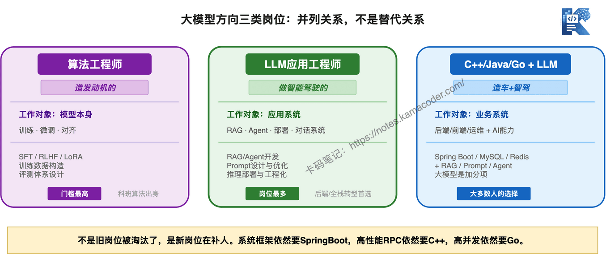

# 1.1 应用算法岗位：能力地图与完成证据【🔥 必会】

## 1. 🎯 本节目标与大白话例子

本节目标：看清大模型方向三类核心岗位（应用算法、模型微调/训练、工程落地）的能力边界，并学会用“基线→改动→评测→产物”四件套把项目经验讲成硬核证据。

大白话例子：就像去医院应聘外科医生，不能只说“我读过解剖书、切过很多菜”，而要拿出“接诊前指标、手术方案、术后恢复率、完整病历归档”四份铁证。面试官听大模型项目也一样：没基线、没对比、没复现产物的故事，一律按“调包玩具”处理。

## 2. 🧠 核心原理与五维拆解



是什么（What）：大模型岗位通常分为应用算法工程师（Prompt/RAG/Agent/评测闭环）、模型训练/微调工程师（SFT/DPO/GRPO/数据配比）、AI 系统与推理工程师（vLLM/SGLang/KV Cache/高并发压测）。

为什么（Why）：面试官最怕候选人“什么都听过，但说不清自己改了什么、提升了多少”。把每个项目拆成完成证据链（Baseline → Intervention → Metric Delta → Reproducible Artifact），能瞬间与纯调包选手拉开差距。

核心公式/口径：项目说服力 = 业务痛点明确度 × 基线可信度 × 消融实验严谨度 × 线上兜底闭环。

适用边界：即使是在传统行业做工业视觉/RAG 落地（如矿山安全巡检、规程问答），只要有真实 Bad Case 统计和可控评测集，就完全具备一线大厂/外企应用算法岗的面试竞争力。

## 3. 💻 渐进式代码实操（ch1_code/step_01_job_capability_matrix.py）

```python
"""1.1 应用算法岗位：能力地图与项目证据链校验器（工业工程校验写法）"""
from dataclasses import dataclass, field
from typing import Dict, List


@dataclass
class EvidenceItem:  # 脚手架。数据类容器定义
    """简历/面试项目中的单条可验证证据。"""
    baseline_metric: str
    intervention: str
    final_metric: str
    reproducible_artifact: str

    def is_complete(self) -> bool:
        return all([  # 四维证据闭环。基线+干预+结果+可复现产物缺一不可
            bool(self.baseline_metric.strip()),
            bool(self.intervention.strip()),
            bool(self.final_metric.strip()),
            bool(self.reproducible_artifact.strip()),
        ])


@dataclass
class RoleReadinessEvaluator:
    """面向应用算法 / 模型微调 / 工程落地岗位的证据链校验器。"""
    role_name: str
    required_pillars: List[str]
    evidences: Dict[str, EvidenceItem] = field(default_factory=dict)

    def add_evidence(self, pillar: str, item: EvidenceItem) -> None:
        self.evidences[pillar] = item

    def evaluate(self) -> Dict[str, object]:
        missing = [p for p in self.required_pillars if p not in self.evidences]  # 支柱覆盖率与缺失项校验
        incomplete = [
            p for p, ev in self.evidences.items() if not ev.is_complete()
        ]
        passed = (len(missing) == 0) and (len(incomplete) == 0)  # 双条件门禁。既不能缺支柱也不能有残缺证据
        return {
            "role": self.role_name,
            "passed": passed,
            "missing_pillars": missing,
            "incomplete_pillars": incomplete,
            "coverage": round((len(self.required_pillars) - len(missing)) / len(self.required_pillars), 2),
        }


if __name__ == "__main__":  # 脚手架。本地断言测试入口
    evaluator = RoleReadinessEvaluator(
        role_name="大模型应用算法工程师",
        required_pillars=["模型调用与结构化输出", "RAG/Agent检索编排", "评测与生产排障"],
    )
    evaluator.add_evidence(
        "模型调用与结构化输出",
        EvidenceItem("JSON解析失败率14%", "引入Schema约束+错误回传自修复", "解析失败率降至0.4%", "eval_report_v2.json"),
    )
    evaluator.add_evidence(
        "RAG/Agent检索编排",
        EvidenceItem("Recall@5=0.62", "切分重叠调优+BGE-Rerank精排", "Recall@5=0.89", "rag_benchmark.csv"),
    )
    evaluator.add_evidence(
        "评测与生产排障",
        EvidenceItem("P99延迟6.8s", "前缀缓存+异步并发流式", "P99延迟2.1s", "load_test_locust.html"),
    )
    res = evaluator.evaluate()
    assert res["passed"] is True and res["coverage"] == 1.0
    print("[1.1 PASS]", res)
```

### 示例说明与练习范围

本例的设计选择：岗位能力评估必须绑定“基线指标 + 干预动作 + 终版指标 + 可复现产物”四元组，且 passed 需同时满足无缺失支柱与无残缺证据。

**代码练习｜能讲清设计**。准备 60 秒项目开场，岗位评分脚本用于理解。

示例辅助代码：@dataclass 样板字段声明与 if __name__ == "__main__": 构造测试数据部分。

## 4. 🗣️ 面试官视角：这段代码怎么讲

在我的工业级项目中，我刻意按‘能力地图+证据链’来组织代码与实验：比如结构化输出环节，先跑出基线解析失败率 14%，再引入 Schema 约束与错误回传自修复，把失败率压到 0.4%，并保留可复现的评测报告 eval_report_v2.json。

## 5. 🔧 生产排障指南

坑 1：只汇报最终准确率，不交代基线与样本量 → 解法：任何指标必须附带 N= 样本数、测试集来源及改前 Baseline。

坑 2：把“接了某个大模型 API”当成核心难点 → 解法：重点讲清楚 API 之上的路由、上下文预算、结构化校验、检索精排和线上降级策略。

## 6. ❓ 高频面试追问与参考答法

Q1：应用算法岗和传统 NLP/CV 算法岗最大的区别是什么？ 答：传统算法岗重心在自研小模型结构与标注训练；大模型应用算法岗重心在基座能力边界判断、数据/检索链路编排（RAG/Agent）、自动化评测体系（Eval）以及必要时的轻量微调（LoRA/DPO），更强调端到端业务指标提升与成本/延迟权衡。

Q2：如果简历上的项目没有线上百万 QPS，怎么体现工程深度？ 答：用闭环深度代替流量规模：展示你是如何构造困难样本评测集（Hard Negative / Error Slicing）、如何做消融对比、如何处理边界异常（超时/幻觉/权限越界），以及如何压测单机或单卡吞吐。

### 📝 节末费曼自检

你能一口气说出自己最核心项目的 Baseline、关键改动、量化提升和可复现产物吗？

面对“为什么不用小模型而用大模型”的追问，你的业务与技术理由分别是什么？

## 面试重点｜设计、调参与排障

**面试官可能问**

你在矿山项目里具体负责什么，怎样证明做对了？

**参考回答（现场口述）**

我会先交代自己负责的环节，比如把巡检画面中的观察结果接到规程检索，并说明输入和验收要求。接着挑一个真实漏报，讲它在哪一步发生、我改了什么、用什么基线复测。数字只报实际测过的，没测过的直接说补测方案。

**系统设计怎么选**

按输入、你负责的环节、业务输出和验收标准介绍。把“识别疑似风险送复核”和“最终开单”分开，两者的责任和证据不同。

**参数或条件改变会怎样**

扩大自动化范围时，用同一批样本比较漏报、误报和人工复核量。

**系统出错怎么查、怎么验证**

被问“提升从哪来”时，拿一个真实错例或对照结果。缺少基线就说清现有证据和补测方法。
