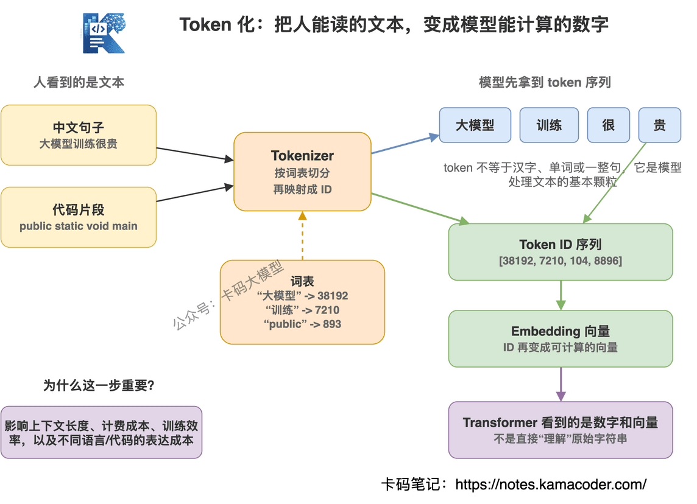

# 1.3 从训练到推理：token、BPE 与模型适配【🔥 必会】

## 1. 🎯 本节目标与大白话例子

本节目标：理解文本如何通过 BPE 变成 Token ID，以及模型如何经历 Pretrain → SFT → 对齐（RLHF/DPO/GRPO）最终适配到推理服务。

大白话例子：BPE 分词就像把长句子拆成常用积木块（常见词整块保留，生僻词拆成偏旁字母）；Pretrain 是通读万卷书打底，SFT 是做标准问答例题学会“按格式听话”，RLHF/DPO 则是老师批改作文告诉它“哪种回答更安全、更得体”。

## 2. 🧠 核心原理与五维拆解



BPE（Byte-Pair Encoding）核心机制：从字节或字符表出发，统计语料中相邻字符对的最高频次并不断合并，最终得到固定大小的词表（如 32k / 128k / 151k）。

中英文 Token 差异：英文常见词往往 1 个词 ≈ 11.3 个 Token（约 4 字符/Token）；中文在早期的英文主导词表中经常 1 个汉字占 1.53 个字节甚至多个 Token，现代多语言词表（如 Qwen）扩充了中文高频词组，压缩率才接近 1.5~1.8 汉字/Token。

训练三阶段与推理适配：Pretrain（Next-Token Prediction 学世界知识）→ SFT（学指令遵循与对话模板 ChatML）→ Preference Alignment（DPO/PPO/GRPO 学偏好与推理）→ 推理期（加载对应 Tokenizer 与 Chat Template）。

## 3. 💻 渐进式代码实操（ch1_code/step_03_token_bpe_estimator.py）

```python
"""1.3 从训练到推理：Token、BPE 压缩率对比与长度估算器"""
from typing import Dict


def estimate_tokens_and_ratio(text: str, chars_per_token_en: float = 4.0, chars_per_token_zh: float = 1.6) -> Dict[str, float]:
    """按工程经验口径估算中英混合文本 Token 数与压缩率（Bytes / Token）。"""
    if not text:
        return {"estimated_tokens": 0, "utf8_bytes": 0, "bytes_per_token": 0.0}
    zh_chars = sum(1 for ch in text if "一" <= ch <= "鿿")  # 中英文字符分桶统计。区分汉字与非汉字字符
    other_chars = len(text) - zh_chars
    est_tokens = max(1, round(zh_chars / chars_per_token_zh + other_chars / chars_per_token_en))  # 分语种压缩率估算。中文约1.6字符/token，英文约4字符/token
    utf8_bytes = len(text.encode("utf-8"))  # BPE压缩率口径。用 UTF-8 字节数除以 Token 数衡量 Bytes/Token
    return {
        "zh_chars": zh_chars,
        "other_chars": other_chars,
        "estimated_tokens": est_tokens,
        "utf8_bytes": utf8_bytes,
        "bytes_per_token": round(utf8_bytes / est_tokens, 2),
        "chars_per_token": round(len(text) / est_tokens, 2),
    }


if __name__ == "__main__":  # 脚手架。中英文对比测试用例
    en_res = estimate_tokens_and_ratio("Transformer attention mechanisms scale quadratically with sequence length.")
    zh_res = estimate_tokens_and_ratio("大模型应用在长上下文场景下需要重点关注显存与首字延迟。")
    assert en_res["chars_per_token"] > zh_res["chars_per_token"]
    print("[1.3 PASS] EN:", en_res, "ZH:", zh_res)
```

### 示例说明与练习范围

本例的设计选择：中文与英文的 Token 压缩率差异显著，工程估算须分语种折算，并用 utf8_bytes / est_tokens 统一衡量 BPE 压缩效率。

**代码练习｜能讲清设计**。会手推一个 BPE 合并例子，估算脚本不用背。

示例辅助代码：if __name__ == "__main__": 下的示例文本与断言输出。

## 4. 🗣️ 面试官视角：这段代码怎么讲

在工程估算里，我按语言分别估算 Token 消耗：英文约 4 字符对应 1 Token，中文约 1.6 汉字对应 1 Token。千万不能把字符数直接当 Token 数，否则中文长文本极易在生产环境触发 context_length_exceeded。

## 5. 🔧 生产排障指南

坑 1：推理时用错了 Chat Template（如把 Llama-3 模板喂给 Qwen） → 解法：始终使用模型自带的 tokenizer.apply_chat_template()，切勿手拼特殊标记 <|im_start|>。

坑 2：数字、空格、UUID 导致分词碎片化 → 解法：注意不同模型对数字按位切分或 3 位切分的差异，结构化编号建议加定界符。

## 6. ❓ 高频面试追问与参考答法

Q1：为什么词表（Vocab Size）不是越大越好？ 答：词表越大，Embedding 层与输出层 LM Head 的参数量（vocab_size × hidden_dim）和显存/Softmax 计算开销就越大，且低频词训练不充分；词表太小则序列变长，Attention 的 $O(T^2)$ 延迟和 KV Cache 显存上升。通常在 32k~152k 间权衡。

Q2：SFT 和 Pretrain 在 Loss 计算上有什么核心区别？ 答：Pretrain 对整个序列所有位置计算交叉熵损失；SFT 通常只对 assistant 回复部分计算 Loss，把 system 和 user 部分的标签设为 -100（ignore_index）屏蔽梯度。

### 📝 节末费曼自检

为什么同样 1000 个字，中文和英文消耗的 Token 数和费用通常不同？

为什么推理时必须严格对齐训练期的 Tokenizer 和 Chat Template？

## 面试重点｜设计、调参与排障

**面试官可能问**

同一句中文换模型后，为什么 token 数和结果变了？

**参考回答（现场口述）**

不同模型的 tokenizer 词表、归并规则和聊天模板会把同一句话切成不同 token，系统消息和角色符号也会占输入。质量变化还可能来自训练和采样。我要分别查实际 token 用量，并且固定原始输入和生成配置做对照。

**系统设计怎么选**

词表决定怎么切分。checkpoint 与 tokenizer 要匹配，Chat Template 还要保留模型预期的角色边界和特殊 token。

**参数或条件改变会怎样**

用目标 tokenizer 实测同一批文本。工具、历史、图像会占用预算，提前给输出留空间。

**系统出错怎么查、怎么验证**

遇到角色错位或突然截断，检查脱敏后的实际请求、模板版本和终止标记，别先猜是模型退化。
