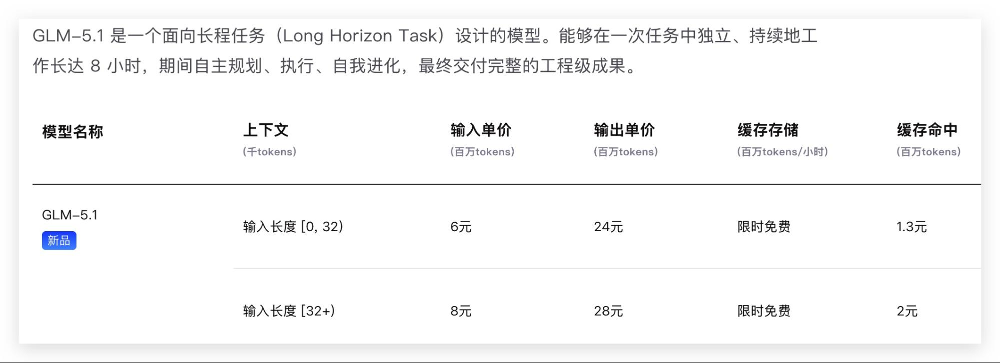

# 1.7 API 成本：输入、缓存与输出分项【⭐ 理解】

## 1. 🎯 本节目标与大白话例子

本节目标：学会拆解大模型 API 的三项计费结构（未命中输入、缓存命中输入、输出），并理解为什么输出单价远高于输入。

大白话例子：看书（输入 Prefill）可以一目十行并行扫完，电费便宜；但一个字一个字往外写报告（输出 Decode）每次都得把整本参考笔记（KV Cache）从仓库搬到桌面核对，占用硬件时间最长，所以按字收的“稿费”（输出单价）贵 3~5 倍。

## 2. 🧠 核心原理与五维拆解



实际总成本按输入、缓存和输出分别计算。

$$
\operatorname{Cost} = \frac{T_{\mathrm{uncached,in}}}{10^6} P_{\mathrm{in}} + \frac{T_{\mathrm{cached}}}{10^6} P_{\mathrm{cache}} + \frac{T_{\mathrm{out}}}{10^6} P_{\mathrm{out}}
$$

为什么输出比输入贵 3~5 倍：Prefill（处理输入）是计算密集型（Compute-bound），GPU 算力能吃满；Decode（自回归逐个生成输出）是访存带宽密集型（Memory-bandwidth-bound），每生成一个 Token 都要读取整份模型权重和 KV Cache，GPU 算力大量空转，占用卡时极长。

降本三大杠杆：1）提缓存命中率（前缀稳定）；2）控输出长度（精简 JSON 字段名、禁止废话、设 max_tokens）；3）大小模型路由（简单分流走小模型，复杂推理走旗舰）。

## 3. 💻 渐进式代码实操（ch1_code/step_07_api_cost_calculator.py）

```python
"""1.7 API 成本：输入、缓存与输出分项核算器"""
from dataclasses import dataclass
from typing import Dict


@dataclass
class ModelPricingPerMillion:  # 脚手架。百万 Token 单价配置类
    input_usd: float
    cached_input_usd: float
    output_usd: float


def compute_call_cost_usd(
    uncached_input_tokens: int,
    cached_input_tokens: int,
    output_tokens: int,
    pricing: ModelPricingPerMillion,
) -> Dict[str, float]:
    """按百万 Token 单价拆分核算未命中输入、缓存命中输入与输出费用。"""
    in_cost = uncached_input_tokens * pricing.input_usd / 1_000_000  # 未命中输入计费。按标准输入单价折算
    cache_cost = cached_input_tokens * pricing.cached_input_usd / 1_000_000  # 缓存折价分项。缓存命中输入单独按折扣价核算
    out_cost = output_tokens * pricing.output_usd / 1_000_000  # 输出高单价分项。输出单价通常显著高于输入
    return {
        "input_cost": round(in_cost, 6),
        "cache_cost": round(cache_cost, 6),
        "output_cost": round(out_cost, 6),
        "total_cost": round(in_cost + cache_cost + out_cost, 6),
    }


if __name__ == "__main__":  # 脚手架。有无缓存成本对比测试
    pricing = ModelPricingPerMillion(input_usd=2.0, cached_input_usd=0.5, output_usd=8.0)
    no_cache = compute_call_cost_usd(10_000, 0, 1_000, pricing)
    with_cache = compute_call_cost_usd(2_000, 8_000, 1_000, pricing)
    assert with_cache["total_cost"] < no_cache["total_cost"]
    print("[1.7 PASS] no_cache:", no_cache["total_cost"], "with_cache:", with_cache["total_cost"])
```

### 示例说明与练习范围

本例的设计选择：API 成本不能只按总 Token 估算，必须拆成未命中输入、缓存命中输入（折价）和输出（高单价）三项独立核算。

**代码练习｜能讲清设计**。能手算一次请求和一次成功任务的成本，不背价格脚本。

示例辅助代码：ModelPricingPerMillion 配置类与 __main__ 对比断言。

## 4. 🗣️ 面试官视角：这段代码怎么讲

算账不能只看官网标的“输入每百万 Token 多少钱”，必须按 uncached_in、cached_in、output 三项分摊。比如在 RAG 多轮问答里，把 8000 Token 知识前缀命中缓存后，单次调用总成本能直接压低 40% 以上。

## 5. 🔧 生产排障指南

坑 1：用总 Token 数乘以单一平均单价估算预算 → 解法：输出占成本大头，必须分别统计平均输入与平均输出长度。

坑 2：结构化输出让模型输出冗长的自然语言解释字段 → 解法：不需要解释的线上接口直接省掉 reason 字段，或用枚举码代替长文本。

## 6. ❓ 高频面试追问与参考答法

Q1：为什么同样是 1000 个 Token，生成（Output）的收费通常是读取（Input）的 3 到 5 倍？ 答：底层硬件瓶颈不同。Input 阶段可高度并行矩阵乘（Compute-bound），吞吐极高；Output 阶段是串行自回归解码（Memory-bound），每次前向传播只算 1 个 Token 却要搬运全量模型权重和 KV Cache，单 Token 占用 GPU 时间远高于 Prefill。

Q2：如果一个长文档总结任务每天调用量很大，有哪些立竿见影的省钱手段？ 答：开启 Context Caching 复用文档前缀、限制输出摘要字数、对简单分类/抽取路由到低价轻量模型（如 Flash/Mini 系列），以及对高频重复问题加语义缓存（Semantic Cache）。

### 📝 节末费曼自检

从 GPU 硬件瓶颈角度解释，为什么 Output Token 比 Input Token 贵？

业务上线后发现 API 账单超支，你按什么优先级排查和压降成本？

## 面试重点｜设计、调参与排障

**面试官可能问**

A 单价更低，为什么单次成功任务反而更贵？

**参考回答（现场口述）**

我按成功完成任务算成本。把请求实际的未缓存输入、缓存输入、输出和重试费用都加起来，再除以达标成功数。A 可能因为输出更长、缓存更少或修复次数更多而更贵，对比时要用相同的任务和验收标准。

**系统设计怎么选**

把输入、输出、缓存、工具和失败重试计进同一个任务。廉价模型若频繁返工，总成本可能更高。

**参数或条件改变会怎样**

比较输出预算、重试上限和缓存命中率。定价看供应商，不能由硬件特性推出固定倍率。

**系统出错怎么查、怎么验证**

在同一批任务用总费用除以成功数，同时报告失败率和 P95。先查输出变长、缓存下降或重试增加。
