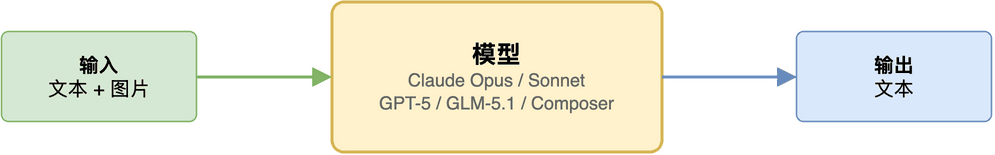

# 1.9 模型、应用与工具运行环境：以 Claude Code 为例【◻ 按需】

## 1. 🎯 本节目标与大白话例子

本节目标：以 Claude Code 为典型代表，分清“模型层（大脑）、应用编排层（调度循环）、工具运行环境（沙箱与权限边界）”三层职责。

大白话例子：模型层像建筑设计师，只负责看图纸提方案；应用层像项目经理，负责派单、收结果、控制预算；工具运行环境就是带门禁和围栏的施工现场——设计师不能直接拆承重墙，危险操作（如删库、执行未知命令）必须经业主（用户）刷卡授权。

## 2. 🧠 核心原理与五维拆解



三层解耦架构：

模型层：纯无状态推理（收 Messages + Tools Schema，吐文本或 tool_calls）。

应用编排层：维护对话状态、上下文压缩（Compaction）、并发工具调度、失败重试与成本统计。

工具运行环境（Runtime / Sandbox）：真正执行 read_file、bash、git 的隔离容器，提供目录白名单、网络策略和高危命令人工审批（Human-in-the-Loop）。

安全底线：模型本身不可信（可能被外部网页/文件中的 Prompt 注入诱导），因此权限边界必须在运行环境层硬编码强制执行，绝不能靠 Prompt 里的“请你不要删文件”来保证安全。

## 3. 💻 渐进式代码实操（ch1_code/step_09_runtime_sandbox_boundary.py）

```python
"""1.9 模型、应用与工具运行环境：沙箱与权限边界模拟器"""
from dataclasses import dataclass
from typing import Set


@dataclass
class ToolRuntimeGuard:  # [无需死背-脚手架] 权限守卫配置类
    allowed_roots: Set[str]
    require_approval_tools: Set[str]

    def authorize(self, tool_name: str, target_path: str, user_approved: bool = False) -> str:
        if not any(target_path.startswith(root) for root in self.allowed_roots):  # [必背手撕-沙箱路径白名单校验] 越界路径直接拒绝
            return "DENY_OUT_OF_SANDBOX"
        if tool_name in self.require_approval_tools and not user_approved:  # [必记设计决策-高危工具二次确认] 读写越界外，执行/推送需人工审批
            return "REQUIRE_USER_APPROVAL"
        return "ALLOW"


if __name__ == "__main__":  # [无需死背-脚手架] 四种权限路径断言
    guard = ToolRuntimeGuard(allowed_roots={"/workspace/project"}, require_approval_tools={"shell_exec", "git_push"})
    assert guard.authorize("read_file", "/workspace/project/app.py") == "ALLOW"
    assert guard.authorize("read_file", "/etc/passwd") == "DENY_OUT_OF_SANDBOX"
    assert guard.authorize("shell_exec", "/workspace/project/run.sh", user_approved=False) == "REQUIRE_USER_APPROVAL"
    assert guard.authorize("shell_exec", "/workspace/project/run.sh", user_approved=True) == "ALLOW"
    print("[1.9 PASS] sandbox boundary verified")
```

### 🧠 代码区记忆清单：背什么 vs 不背什么

🔒 不可替代的系统设计决策：Agent 工具运行环境必须先校验路径是否在沙箱根目录白名单内，再对高危工具（如 shell_exec、git_push）强制人工审批。

✍️ 面试手撕/默写范围：authorize() 中的白名单前缀匹配与高危工具审批门禁判断。

🗑️ 无需死背的脚手架代码：ToolRuntimeGuard dataclass 与 __main__ 权限测试矩阵。

## 4. 🗣️ 面试官视角：这段代码怎么讲

在 Agent 工程实践里，我把权限校验放在 Runtime 层而不是 Prompt 层：所有路径先做沙箱根目录白名单校验，越界直接 DENY_OUT_OF_SANDBOX；像 shell_exec、git_push 这类有副作用的工具必须经过 REQUIRE_USER_APPROVAL 人工确认门禁。

## 5. 🔧 生产排障指南

坑 1：把安全限制全写在 System Prompt 里，以为模型绝对听话 → 解法：一旦读取的外部代码或网页里藏了恶意注入文本，模型仍可能越权；必须在代码层做路径白名单与高危操作审批。

坑 2：长会话不断读大文件把上下文撑爆 → 解法：应用层需限制单次工具返回行数/字节数，并在接近窗口上限时触发历史摘要压缩。

## 6. ❓ 高频面试追问与参考答法

Q1：像 Claude Code 这类 Coding Agent，为什么强调“确定性权限边界”必须落在应用/沙箱层而非模型层？ 答：大模型是概率模型，无法从数学上杜绝 Prompt 注入或误操作；只有沙箱目录隔离、只读/读写分离、以及高危动作的显式人工确认（Confirmation Card）才是确定性的安全防线。

### 📝 节末费曼自检

在 Coding Agent 中，模型层、应用编排层、工具运行环境层各自负责什么？

为什么不能只靠 System Prompt 来防止 Agent 删除系统文件？
