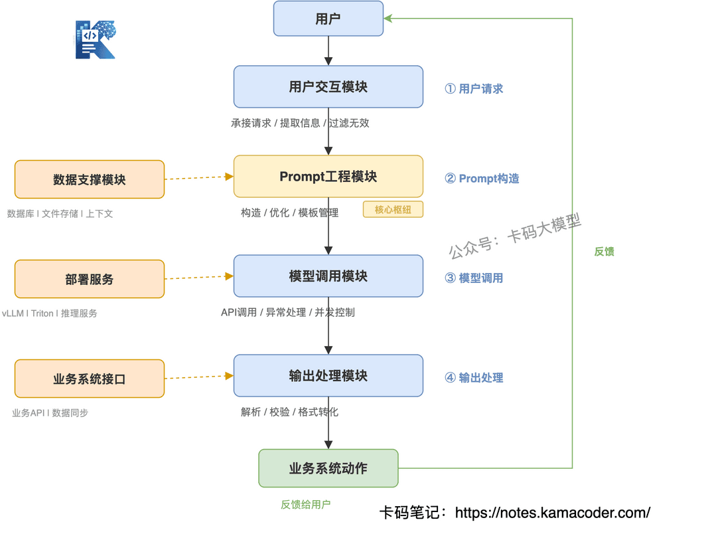

# 2.1 接入模型：请求、响应与失败状态【🔥 必会】

## 1. 🎯 本节目标与大白话例子

本节目标：掌握生产级大模型 API 调用的请求封装、HTTP 状态码分级重试（指数退避+抖动）以及 finish_reason 的完整状态机处理。

大白话例子：调用模型 API 就像快递寄件：400/401（地址写错或没贴邮票）重寄一万次也没用，必须立刻报错修正；429/503（驿站爆仓或临时停电）才需要隔一会儿指数退避重试；收到包裹后还得看签收单（finish_reason）是正常签收（stop）还是半路被剪断（length）。

## 2. 🧠 核心原理与五维拆解



HTTP 状态码分级策略：

可重试（Transient）：429（限流）、500/502/503/504（服务端瞬时故障）、网络超时 → 指数退避 + Jitter（随机抖动防惊群）。

不可重试（Fatal）：400（参数/超长/JSON 语法错）、401/403（鉴权失败）、404（模型名不存在） → 立即失败并告警。

finish_reason 四大终态：stop（正常结束）、length（触发 max_tokens 截断，JSON 极可能不完整）、tool_calls（模型请求调用外部工具）、content_filter（触发安全合规过滤）。

## 3. 💻 渐进式代码实操（ch2_code/step_01_client_retry_wrapper.py）

```python
"""2.1 接入模型：OpenAI 兼容请求封装与指数退避重试客户端"""
from dataclasses import dataclass
from typing import Callable, Dict, Set


RETRYABLE_STATUS: Set[int] = {429, 500, 502, 503, 504}  # 可重试状态码集合。仅限流与服务端瞬时故障允许重试
NON_RETRYABLE_STATUS: Set[int] = {400, 401, 403, 404}  # 不可重试状态码。参数/鉴权/路径错误立即熔断


@dataclass
class ModelResponse:  # 脚手架。响应封装数据类
    status_code: int
    content: str
    finish_reason: str  # "stop" | "length" | "tool_calls" | "content_filter"
    attempts: int


def call_with_backoff(
    api_fn: Callable[[], Dict[str, object]],
    max_retries: int = 3,
    base_delay: float = 0.5,
) -> ModelResponse:
    """按 HTTP 状态码分级重试，并记录最终 finish_reason 与尝试次数。"""
    delays = []
    for attempt in range(1, max_retries + 2):
        resp = api_fn()
        code = int(resp["status_code"])
        if code == 200:
            return ModelResponse(code, str(resp["content"]), str(resp["finish_reason"]), attempt)
        if code in NON_RETRYABLE_STATUS or attempt > max_retries:  # 快速失败与重试上限控制
            raise RuntimeError(f"请求终止: status={code}, attempts={attempt}, delays={delays}")
        if code in RETRYABLE_STATUS:
            delays.append(base_delay * (2 ** (attempt - 1)))  # 指数退避等待。2^(attempt-1) 倍增退避
    raise RuntimeError("Unreachable")


if __name__ == "__main__":  # 脚手架。模拟 429/503/400 序列测试
    seq = iter([
        {"status_code": 429, "content": "", "finish_reason": ""},
        {"status_code": 503, "content": "", "finish_reason": ""},
        {"status_code": 200, "content": "OK", "finish_reason": "stop"},
    ])
    res = call_with_backoff(lambda: next(seq), max_retries=3)
    assert res.status_code == 200 and res.attempts == 3 and res.finish_reason == "stop"

    try:
        call_with_backoff(lambda: {"status_code": 400, "content": "", "finish_reason": ""}, max_retries=3)
        assert False, "400 不应重试"
    except RuntimeError as exc:
        assert "attempts=1" in str(exc)
    print("[2.1 PASS]", res)
```

### 示例说明与练习范围

本例的设计选择：HTTP 状态码必须分级处理：429/5xx 走指数退避重试，400/401/403/404 属于确定性错误必须立即终止，禁止盲目重试。

**代码练习｜给片段能读改**。能读改重试分支并举两个反例，SDK 接口不背。

示例辅助代码：ModelResponse dataclass 与 __main__ 中的 iter 模拟序列。

## 4. 🗣️ 面试官视角：这段代码怎么讲

在我的接入层封装里，绝对不会写无脑 while True 重试，而是严格区分 RETRYABLE_STATUS 与 NON_RETRYABLE_STATUS，并对每次成功响应强制检查 finish_reason，避免把 length 截断的半成品直接喂给下游。

## 5. 🔧 生产排障指南

坑 1：对 400 Bad Request（如超上下文窗口）做重试 → 解法：白白浪费延迟与配额，4xx（除 429/408 外）必须直接快速失败。

坑 2：只看 HTTP 200 就认为业务成功 → 解法：HTTP 200 可能是 finish_reason="length" 或 content_filter，必须在业务层判别。

## 6. ❓ 高频面试追问与参考答法

Q1：指数退避重试为什么要加随机抖动（Jitter）？ 答：当上游限流或短暂抖动时，如果成百上千个客户端按完全相同的 1s -> 2s -> 4s 节奏重试，会在同一毫秒再次打爆服务端（惊群效应 Thundering Herd），加随机抖动可将重试流量打散。

Q2：遇到 finish_reason == "length" 时线上应该怎么处理？ 答：如果是文本摘要可提示“内容已截断”；如果是结构化 JSON 或代码生成，截断产物必定语法损坏，应触发降级提示或自动缩减上下文/增大 max_tokens 后重跑。

### 📝 节末费曼自检

哪些 HTTP 状态码可以重试，哪些绝不能重试？

HTTP 200 返回时，为什么还要检查 finish_reason？

## 面试重点｜设计、调参与排障

**面试官可能问**

接口返回 200、429 或超时时，下一步分别是什么？

**参考回答（现场口述）**

200 先看终止原因和输出是否完整。429 在总时限内遵循 Retry-After，配合带抖动退避。超时先分清结果未知还是已明确失败，读请求可按预算重试，有副作用的请求先查询状态或复用幂等键。参数与鉴权错误按原因改。

**系统设计怎么选**

200 后还要看业务是否完成。限流、永久参数错误、瞬态故障和写入结果未知要分别处理。写入结果未知时先查权威状态或走幂等。

**参数或条件改变会怎样**

设单次超时、总截止时间和重试上限。瞬态错误可看 Retry-After，再用退避与抖动，避免集体重试。

**系统出错怎么查、怎么验证**

按状态、错误类型和尝试次数聚类，区分配额耗尽、后端过载和客户端参数错误。
