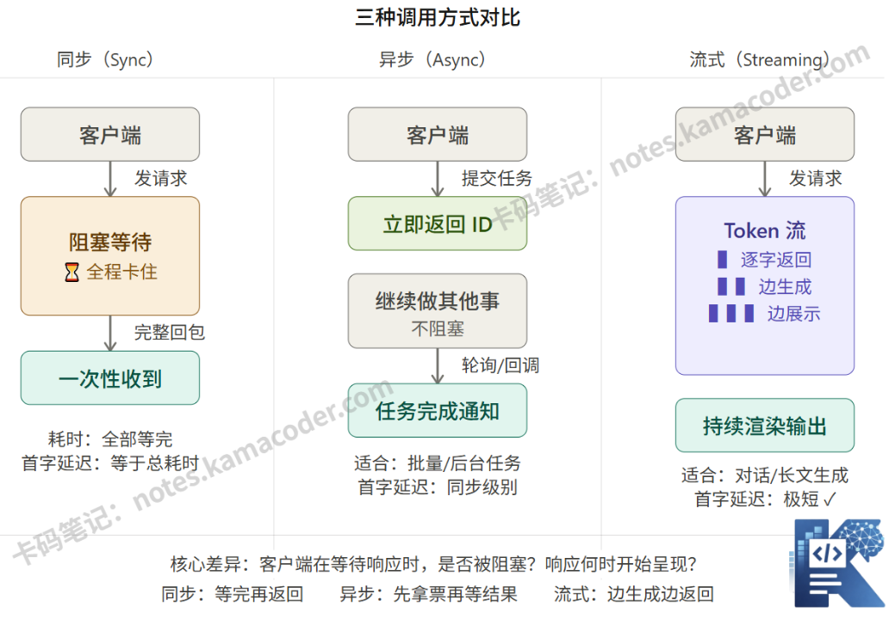

# 2.6 同步、异步与流式：完成状态和异常【🔥 必会】

## 1. 🎯 本节目标与大白话例子

本节目标：理解同步、异步并发与 SSE 流式传输（Streaming）的工程选型，掌握流式模式下 TTFT 监控、断流识别与完成状态校验。

大白话例子：同步调用就像点完餐干等厨师做好整桌菜才端上来，客人容易等急超时；流式（SSE）则是上一道吃一道（打字机效果），大幅降低首字等待焦虑（TTFT）；但菜上到一半厨房停电（中途断流），如果没看到最后一张“上菜完毕”小票（finish_reason），千万别以为整桌菜齐了。

## 2. 🧠 核心原理与五维拆解



三种模式选型：

同步阻塞：脚本测试或极短 JSON 抽取。

异步并发（asyncio / Batch）：离线大批量跑评测集、数据清洗合成，配合信号量（Semaphore）控并发防 429。

流式传输（SSE, stream=True）：面向终端用户的对话界面，核心指标为 TTFT（Time to First Token，首字延迟） 和 TPOT（每 Token 生成耗时）。

流式异常坑点：网络断开时可能已经收到前 80% 文本却没有收到终态 finish_reason，必须在客户端显式校验 complete 状态，否则半截内容会污染数据库与历史记录。

## 3. 💻 渐进式代码实操（ch2_code/step_06_streaming_sse_parser.py）

```python
"""2.6 同步、异步与流式：SSE 流式块解析与完成状态校验"""
from dataclasses import dataclass
from typing import Iterable, Optional


@dataclass
class StreamResult:  # 脚手架。流式聚合结果类
    text: str
    finish_reason: Optional[str]
    chunk_count: int
    complete: bool


def consume_sse_stream(chunks: Iterable[dict]) -> StreamResult:
    """聚合流式 Delta，只有观测到有效 finish_reason 才视为完整交付。"""
    buf = []
    finish_reason = None
    count = 0
    for ch in chunks:  # SSE增量块聚合。逐块拼接 delta 并追踪最新 finish_reason
        count += 1
        delta = ch.get("delta", "")
        if delta:
            buf.append(delta)
        if ch.get("finish_reason"):
            finish_reason = ch["finish_reason"]
    return StreamResult(
        text="".join(buf),
        finish_reason=finish_reason,
        chunk_count=count,
        complete=(finish_reason in {"stop", "tool_calls"}),  # 流式完整性门禁。仅凭断流不算成功，必须观测到有效 finish_reason
    )


if __name__ == "__main__":  # 脚手架。正常流与断流对比测试
    ok_stream = [
        {"delta": "请检查", "finish_reason": None},
        {"delta": "安全阀。", "finish_reason": "stop"},
    ]
    broken_stream = [{"delta": "请检查", "finish_reason": None}]
    r1 = consume_sse_stream(ok_stream)
    r2 = consume_sse_stream(broken_stream)
    assert r1.complete is True and r1.text == "请检查安全阀。"
    assert r2.complete is False
    print("[2.6 PASS] complete:", r1.complete, "broken:", r2.complete)
```

### 示例说明与练习范围

本例的设计选择：SSE 流式输出不能只看连接是否关闭，必须校验 finish_reason 是否为 stop 或 tool_calls，否则视为不完整断流。

**代码练习｜给片段能读改**。能读改一个最小聚合器，能画状态转移。

示例辅助代码：StreamResult dataclass 与 __main__ 测试流列表。

## 4. 🗣️ 面试官视角：这段代码怎么讲

做流式交互时，我不会收到一个 Chunk 就立刻落库，而是先实时推送给前端降 TTFT，同时在后端聚合器里盯紧 finish_reason——只有观测到 stop 或 tool_calls 才标记 complete=True 并持久化，中途断流则触发不完整提示或重连。

## 5. 🔧 生产排障指南

坑 1：流式模式下拿不到 Token 用量统计 → 解法：OpenAI 兼容接口需显式传入 stream_options={"include_usage": True}，并在最后一个带 usage 的 Chunk 提取。

坑 2：反向代理（如 Nginx）默认开启缓冲导致流式变成伪流式 → 解法：关闭 proxy_buffering off; 并设置 X-Accel-Buffering: no。

## 6. ❓ 高频面试追问与参考答法

Q1：如何同时优化大模型对话产品的 TTFT（首字延迟）和端到端总延迟？ 答：TTFT 主要取决于 Prefill 耗时与网络排队：可通过缩短上下文、命中 Prompt Cache、使用异步非阻塞网关和流式输出优化；总延迟还受 Decode 速度和输出长度影响，可通过限制冗长输出、投机解码（Speculative Decoding）和大小模型路由优化。

### 📝 节末费曼自检

为什么流式输出能显著改善用户体验，但它能缩短模型生成完整文本的总耗时吗？

客户端如何判断一条 SSE 流式响应是“完整正常结束”还是“半路异常断流”？

## 面试重点｜设计、调参与排障

**面试官可能问**

流式显示了一半后断开，服务器能记成功吗？

**参考回答（现场口述）**

中途断开只能说客户端收到部分输出。我会按接口保留已收片段用于诊断，结合结束事件、终止原因和本地校验确认是否完整。若此前可能执行过写工具，另外查后端回执，防止把重连当成新的业务动作。

**系统设计怎么选**

分开聚合文本和工具参数，按接口终止事件判断完成。断线、取消、截断有各自状态。

**参数或条件改变会怎样**

首块等待、空闲超时和总时限要匹配 SLA。超时更短能快失败，也可能误杀慢请求。

**系统出错怎么查、怎么验证**

用原始事件序列回放，检查收到结束事件没有、参数拼齐没有。半截 JSON 不执行。
