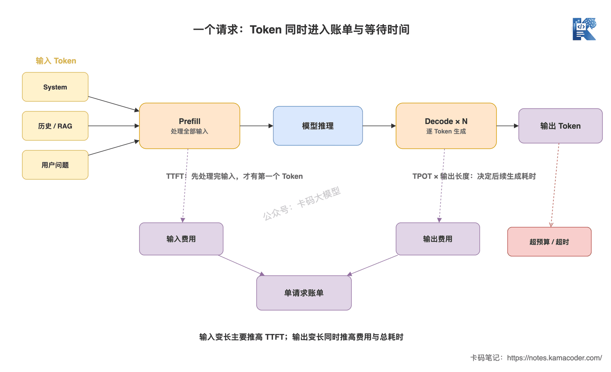

# 2.8 Token、成本与延迟：重试也要计入【🔥 必会】

## 1. 🎯 本节目标与大白话例子

本节目标：建立真实端到端（E2E）成本与延迟核算口径：将超时、失败重试、结构化修复重跑以及主备模型降级的开销全部计入单次用户请求。

大白话例子：做一单外卖，第一份骑手半路洒了（超时失败），重做第二份才送到客人手里。核算这单的真实成本和送达时间，不能只算成功那一份，两份食材钱（Token）和两趟路程时间（延迟）全得算在账上。

## 2. 🧠 核心原理与五维拆解



有效成本（Effective Cost）：$\text{Cost}{\text{eff}} = \sum{i=1}^{k} (\text{In}i \cdot P{\text{in}} + \text{Out}i \cdot P{\text{out}})$。包含首次超时/校验失败的重试开销。

有效延迟（E2E Latency）：包含前置检索、多次重试耗时及后置校验修复耗时，重点盯 P95 / P99 长尾延迟而非均值。

稳定性架构三板斧：超时控制（Read Timeout）+ 熔断器（Circuit Breaker，主模型连续失败自动切备模型）+ 语义/结果缓存（降低重复高频请求）。

## 3. 💻 渐进式代码实操（ch2_code/step_08_effective_cost_latency.py）

```python
"""2.8 Token、成本与延迟：含重试与降级的真实有效成本统计器"""
from dataclasses import dataclass
from typing import List


@dataclass
class AttemptTrace:  # [无需死背-脚手架] 单次尝试追踪记录
    latency_ms: float
    input_tokens: int
    output_tokens: int
    succeeded: bool


def summarize_effective_request(traces: List[AttemptTrace], in_rate_per_1k: float, out_rate_per_1k: float) -> dict:
    """将失败重试的延迟与 Token 成本一并计入单次用户请求的真实开销。"""
    total_latency = sum(t.latency_ms for t in traces)  # [必记设计决策-全链路延迟口径] 失败重试耗时必须累加进端到端延迟
    total_in = sum(t.input_tokens for t in traces)
    total_out = sum(t.output_tokens for t in traces)
    total_cost = (total_in / 1000) * in_rate_per_1k + (total_out / 1000) * out_rate_per_1k  # [必背手撕-含重试有效成本核算] 失败请求的 Token 同样计费
    final_ok = any(t.succeeded for t in traces)  # [必背手撕-最终成功状态判定]
    return {
        "attempts": len(traces),
        "final_ok": final_ok,
        "e2e_latency_ms": round(total_latency, 2),
        "effective_cost": round(total_cost, 6),
    }


if __name__ == "__main__":  # [无需死背-脚手架] 超时后重试成功的账单模拟
    traces = [
        AttemptTrace(1200, 1000, 50, False),  # 超时截断
        AttemptTrace(850, 1000, 200, True),   # 重试成功
    ]
    rep = summarize_effective_request(traces, in_rate_per_1k=0.002, out_rate_per_1k=0.006)
    assert rep["attempts"] == 2 and rep["e2e_latency_ms"] == 2050.0 and rep["final_ok"] is True
    print("[2.8 PASS]", rep)
```

### 🧠 代码区记忆清单：背什么 vs 不背什么

🔒 不可替代的系统设计决策：单次用户请求的真实延迟与成本必须把所有失败重试的耗时和 Token 全部计入，不能只统计最后一次成功请求。

✍️ 面试手撕/默写范围：summarize_effective_request() 的延迟累加、分项成本计算与状态聚合。

🗑️ 无需死背的脚手架代码：AttemptTrace dataclass 与 __main__ 模拟轨迹。

## 4. 🗣️ 面试官视角：这段代码怎么讲

在我的链路监控器 summarize_effective_request 里，每次用户请求都会串联起所有 AttemptTrace：一旦触发 JSON 自修复或超时重试，所有尝试的 Token 费用和延迟都会累加到这次请求名下，这样算出来的 P99 和单次请求成本才是真实可信的。

## 5. 🔧 生产排障指南

坑 1：只统计成功响应的日志算账，导致月底实际账单比监控报表高出一大截 → 解法：失败重试、流式中断前已生成的 Token 同样会被计费，必须在网关层按每次底层 API 调用记账。

## 6. ❓ 高频面试追问与参考答法

Q1：线上遇到大模型 API 偶发长尾超时（如某次突然卡住 30 秒），怎么把 P99 压下来？ 答：1）设置合理的单次请求超时（而非无限等）；2）使用 Hedged Requests（对冲请求） 或快速熔断切换备用模型/备用渠道；3）高并发非实时任务转异步队列。

### 📝 节末费曼自检

为什么线上监控不能只看单次成功调用的延迟均值和 Token 数？

主力模型突发高延迟或限流时，网关层该如何自动降级？
