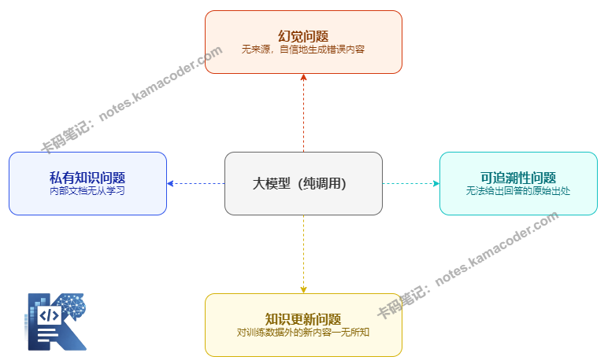
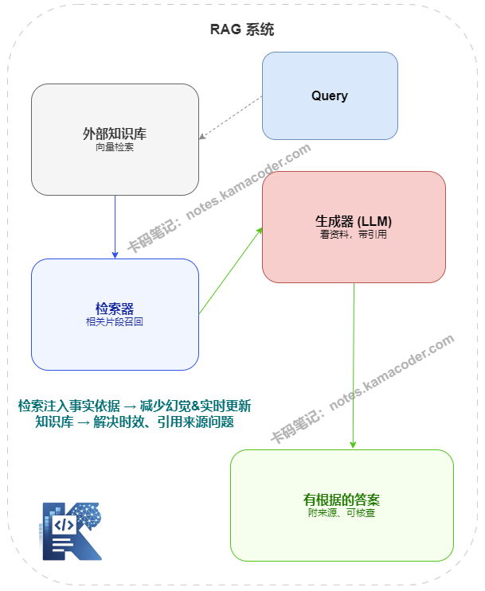
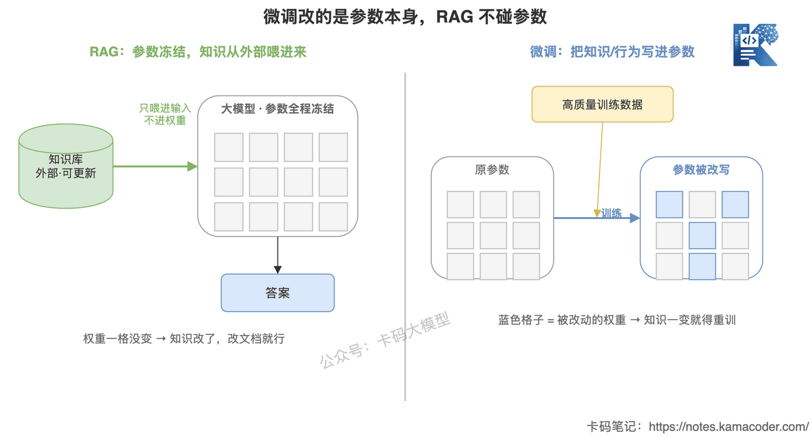

# 3.1 为什么有了大模型还需要 RAG？幻觉、私有知识、时效性四大问题 【🔥 必会】

[返回本章目录](README.md) · 融合 llm-master/docs/llm/app/why_rag.md 完整推理与原图 + finetuning_vs_rag.md 选型框架 + 工业级权限守卫原型

## 1. 🎯 本节目标与大白话例子

本节目标：彻底讲清大模型在知识层面的四大内生天花板，建立“RAG 是大模型外置数据库（Cheat Sheet），核心在于动态补知识、可溯源与权限隔离”的第一性原理，并能从零写出带权限前置过滤与无证据确定性拒答的最小 RAG 原型。

大白话例子： 假设你们公司有几千份内部文档：产品手册、操作规范、客户合同，还有刚发布的《2026 版差旅报销规定》（其中把旧版“飞机不可报销”改成了“飞机经济舱须提前审批后可报销”）。 如果你直接把员工的问题“出差坐飞机能报销吗”丢给纯大模型，就像让一个只背过去年公开教材的学霸闭卷考试——他没见过你们公司的内部手册，也不知道上周刚改的规定，但他又不敢交白卷，于是只能凭概率“编”出一个语气坚定、格式工整的错误答案。 而 RAG（检索增强生成） 就是允许学霸在答题前先翻阅最新、且他有权限看的公司规章小抄（Cheat Sheet），看着白纸黑字再作答；如果小抄里压根没写，就直接老实说“未找到有效依据”，绝不瞎编。

## 2. 🧠 核心原理与五维拆解

### 一、从一个真实的困境说起（原文档脉络）

假设你们公司有几千份内部文档：产品手册、操作规范、历史项目经验、客户合同……领导想做一个 AI 问答系统，让员工随时可以问"我们的退款政策是什么"、"这个客户签了哪些条款"，系统能直接给出准确答案。

你直接用大模型来做，第一轮测试效果还不错——但很快发现几个绕不开的问题：

模型对公司内部文档一无所知，回答全靠"编"

产品文档上周刚更新，但模型说的还是老版本的内容

模型回答得很流畅，但根本无法知道它说的是真是假，也无法追溯来源

文档加载到 Prompt 里，token 成本高到无法接受

这不是模型能力不够的问题，而是大模型作为一种技术，有几个根本性的天花板——而 RAG 就是为了突破这些天花板而诞生的。

### 二、大模型的四大内生局限性

下面这张图展示了纯大模型在知识层面存在的几个边界：



幻觉问题（Hallucination）：大模型的本质是一个概率语言模型，它在生成每个 token 时做的是"预测下一个最可能的词"，而不是"从知识库里查询正确答案"。当它不知道答案时，不会主动说"我不知道"，而是生成一个"听起来最合理"的答案。在企业场景里，幻觉会以极其可信的语气传播错误信息。

私有知识问题：大模型是在公开数据上训练的，公司的内部文档、客户合同、会议记录它从未见过。有人想把全部文档塞进 Prompt，但文档达到几百上千份时，不仅 token 成本和上下文长度成为瓶颈，模型在极长上下文中的注意力也会严重稀释（Lost in the Middle）。

知识更新问题：模型训练存在截止日期（通常落后现实 6~12 个月）。价格变了、政策修订了，你不可能每隔几天就重新训练一次模型来更新知识，成本和时间都不可接受。

可追溯性问题：纯模型无法告诉你"这句话来自哪份文档的第几页"。对于法律、医疗、金融、工业安全等高合规场景，没有来源引用的答案是不可接受的。

### 三、RAG 是怎么应对大模型的缺点的？

RAG 的全称是 Retrieval-Augmented Generation（检索增强生成）。它的核心思路非常直觉：在让模型回答之前，先去知识库里检索出最相关的内容，把这些内容作为上下文一起喂给模型，让模型"看着资料"来回答。

下面这张图展示了 RAG 如何对应地解决上面四个问题：



对幻觉问题：检索到的原文片段作为事实锚点传入模型，配合 Prompt 约束"仅根据以下资料回答"，大幅降低凭空捏造的概率（注意：是显著缓解，不是归零）。

对私有知识问题：知识库完全由企业自己构建和维护，模型只需要在被检索到的局部片段上推理和组织语言。

对知识更新问题：更新知识只需增删改知识库文档并刷新索引，秒级/分钟级生效，彻底与模型参数解耦。

对可追溯性问题：每次检索都能精确定位命中的 doc_id、版本号和页码，可以在答案末尾附上可核查的引用来源。

### 四、组件五维拆解（闭卷背诵标准）

| 维度 | 核心内容（面试闭卷复述标准） |
| --- | --- |
| ① 输入什么 | 用户自然语言 query、服务端认证后的用户角色 user_role、带版本/生效期/权限标签的知识文档列表 docs、召回上限 top_k。 |
| ② 做什么 | 1. 前置过滤（Pre-filtering）：在检索前剔除无权限及已过期文档；<br>2. 相关性召回：计算 query 与合法文档的匹配分，取 top_k；<br>3. 确定性拒答：若无匹配或低于置信度阈值，直接拦截返回拒答，不调 LLM。 |
| ③ 输出什么 | 结构化决策结果：包含状态（SUCCESS / REFUSED）、带 doc_id:version 引用的回答或标准拒答话术。 |
| ④ 关键参数影响 | top_k 太小会漏掉多条件证据，太大则引入噪声并推高 Token 成本；min_overlap / 置信度阈值决定宁缺毋滥的拒答边界。 |
| ⑤ 工程选型 Trade-off | RAG 不是万能的：知识密集、频繁更新、需溯源、需行级权限隔离的场景必须用 RAG；创意写作、通用常识推理或固定格式/语气控制（微调/Prompt 即可），硬上 RAG 只会白增延迟和成本。 |

### 五、知识点扩展：面试高频盲区补全

为什么 1M（100 万）Token 超长上下文也替代不了 RAG？

账单成本：每次问“早上几点打卡”都要把 50 万字制度全量输入，Token 费用呈百倍级暴涨（即便有 Prefix Cache，跨文档动态组合依然昂贵）。

首字延迟（TTFT）：Prefill 阶段计算量随上下文长度呈超线性增长，塞入几十万 Token 会导致用户等待数秒甚至十几秒才吐出第一个字。

Lost in the Middle（中间遗失）：Transformer 注意力呈 U 型分布，对上下文开头和结尾关注度高，夹在长文正中间的关键条款极易被漏看。

ACL 权限隔离失效：全量塞进上下文无法实现“普通实习生问不出高管薪酬”，而 RAG 可以在检索存储层按用户身份做物理隔离。

RAG vs 微调（Fine-Tuning）选型铁律：

缺知识，找 RAG；缺行为（语气、固定 JSON 格式、领域推理风格），才考虑微调。把频繁变动的事实强行训进权重，不仅更新慢，还会引发灾难性遗忘（Catastrophic Forgetting）。



## 3. 💻 渐进式代码实操（Step 1：最小权限守卫与拒答原型）

演进定位：这是全章代码底座的第一块积木（仅约 55 行，纯 Python 标准库），聚焦 RAG 的第一道安全防线——前置权限过滤、时效性核验与无证据确定性拒答。

### 【从零手写核心链路】

```python
"""3.1 Step 1: 权限前置过滤与无证据确定性拒答的最小 RAG 原型（纯标准库）"""
from dataclasses import dataclass
from datetime import date


# [无需死背-脚手架] @dataclass 语法可随时查，但下面 4 个“受控元数据字段”必须记住！
@dataclass(frozen=True)
class Document:
    """受控企业知识文档（含版本、时效与权限元数据）。"""
    doc_id: str
    title: str
    content: str
    # [必记设计决策-字段] 生产知识库切片不能只有 text+vector，必须带版本、生效/失效时间窗、角色权限(ACL)
    version: str
    effective_date: date
    expire_date: date
    roles: tuple[str, ...] = ("employee",)


def safety_guard_rag(
    docs: list[Document],
    query: str,
    user_role: str = "employee",
    today: date = date(2026, 11, 13),
    top_k: int = 2,
    min_overlap: int = 2,
) -> dict[str, object]:
    """先执行权限与时效前置过滤（Pre-filtering），再按双字滑窗匹配，无证据时确定性拒答。"""
    # [必记设计决策-边界] 入口先拦截空查询与非法超参，防止无效流量打穿下游检索与 LLM
    if not isinstance(query, str) or not query.strip():
        raise ValueError("查询问题不能为空")
    if top_k <= 0 or min_overlap <= 0:
        raise ValueError("top_k 与 min_overlap 必须为正整数")

    # [无需死背-脚手架] 双字滑窗切分仅作最小检索演示，面试无需背切片语法
    q = query.strip().lower()
    q_bigrams = {q[i : i + 2] for i in range(len(q) - 1) if q[i : i + 2].strip()} or {q}

    candidates: list[tuple[int, Document]] = []
    for doc in docs:
        # [必记设计决策-顺序铁律] 权限与时效过滤(Pre-filtering)必须写在算分之前！
        # 若先算分取 Top-K 再过滤(Post-filtering)，过期/无权文档会挤占名额甚至造成越权泄漏
        if user_role not in doc.roles:
            continue
        if not (doc.effective_date <= today <= doc.expire_date):
            continue
        c_lower = doc.content.lower()
        hits = sum(1 for bg in q_bigrams if bg in c_lower)
        if hits >= min_overlap:
            candidates.append((hits, doc))

    # [无需死背-脚手架] 排序与截断写法不用死背
    candidates.sort(key=lambda x: (-x[0], x[1].doc_id))
    selected = [doc for _, doc in candidates[:top_k]]
    assert len(selected) <= top_k, "返回结果数不能超过 top_k"

    # [必记设计决策-兜底分支] 无证据时由代码层确定性拒答(REFUSED)，绝不把空上下文丢给大模型自由发挥
    if not selected:
        return {"status": "REFUSED", "answer": "未找到您权限范围内且当前有效的相关依据，无法回答。", "citations": []}

    # [必记设计决策-审计溯源] 返回答案必须绑定 doc_id:version 级引用，方便事后核查与追责
    citations = [f"{d.doc_id}:{d.version}" for d in selected]
    context_summary = " | ".join(d.content for d in selected)
    return {"status": "SUCCESS", "answer": f"依据有效制度：{context_summary}", "citations": citations}


if __name__ == "__main__":
    # [必记设计决策-测试用例] 面试被问“怎么测权限与版本隔离”，直接说这 3 类对照样本：
    # 1) 已过期旧版 V1  2) 生效中新版 V2  3) 越权高管文档 hr_director
    kb = [
        Document("DOC_TRAVEL_V1", "差旅制度V1", "出差乘坐飞机不可报销。", "v1", date(2024, 1, 1), date(2025, 12, 31), ("employee",)),
        Document("DOC_TRAVEL_V2", "差旅制度V2", "出差乘坐飞机经济舱须提前审批后方可报销。", "v2", date(2026, 1, 1), date(2027, 12, 31), ("employee",)),
        Document("DOC_EXEC_PAY", "高管薪酬", "高管年度奖金与股票期权方案。", "v1", date(2026, 1, 1), date(2027, 12, 31), ("hr_director",)),
    ]
    res_ok = safety_guard_rag(kb, "出差坐飞机能报销吗", user_role="employee")
    assert res_ok["status"] == "SUCCESS" and res_ok["citations"] == ["DOC_TRAVEL_V2:v2"]

    res_deny = safety_guard_rag(kb, "高管年度奖金怎么发", user_role="employee")
    assert res_deny["status"] == "REFUSED", "普通员工绝不能越权检索高管薪酬"
    print("Step 1 self-test passed!")
```

### 【工业级调库对照】

在生产环境中，权限与时效前置过滤不会用 Python for 循环遍历，而是直接下推到向量数据库（如 Qdrant / Milvus）的索引层过滤表达式中（Single-stage Pre-filtering）：

```python
# 工业级对照：Qdrant 前置元数据过滤写法（仅示意核心 Filter 结构）
from qdrant_client.models import Filter, FieldCondition, MatchAny, Range

query_filter = Filter(
    must=[
        FieldCondition(key="roles", match=MatchAny(any=["employee"])),
        FieldCondition(key="effective_ts", range=Range(lte=1794556800)),  # <= today
        FieldCondition(key="expire_ts", range=Range(gte=1794556800)),     # >= today
    ]
)
# search_result = client.search(collection_name="corp_kb", query_vector=q_vec, query_filter=query_filter, limit=5)
```

何时手写 vs 何时调库：几千条以内的小型本地规则校验或单元测试可用纯 Python 过滤；一旦上生产且文档超万级、需多租户隔离，必须使用支持 Bitset 原生前置过滤的向量数据库，严禁“先全局搜出 Top-10 再用 Python 删无权限文档”（会导致返回条数不足甚至空窗）。

### 🧠 代码区记忆清单：背什么 vs 不背什么

🔒 不可替代的系统设计决策（必须记住，面试直接讲思路）：

过滤顺序铁律（Pre-filtering > Post-filtering）：权限校验（user_role not in doc.roles）与时效校验（effective_date <= today <= expire_date）必须写在匹配算分之前。先算分取 Top-K 再过滤会导致过期/无权文档挤占名额甚至引发越权泄漏。

核心元数据字段设计：企业级知识切片不能只有 text 和 vector，必须携带 version、effective_date、expire_date、roles。

确定性拒答与审计契约：无有效候选时代码层直接返回 status="REFUSED"，绝不把空上下文丢给大模型自由发挥；成功响应必须绑定 doc_id:version 级 citations。

边界对照测试集：记住测试里刻意构造的三类对照样本——已过期旧版 V1、生效中新版 V2、越权高管文档 hr_director。

✍️ 面试手撕/默写范围：

本节定位：系统设计原型（无需死背整段代码）。白板只需写清 for doc in docs: 先判权限与时间窗 -> 再算分排序 -> 空集直接 return REFUSED 主干逻辑即可。

🗑️ 无需死背的脚手架代码：

@dataclass(frozen=True) 语法、q_bigrams 双字滑窗切片、candidates.sort(key=lambda x: ...) 排序语法。

## 4. 🗣️ 面试官视角：这段代码怎么讲

① 声明不变量：我在这段最小原型里守住了两个核心系统不变量——权限与时效前置隔离（无权或过期文档绝对不进入候选打分池）和无证据确定性拒答（只要有效命中为空，直接阻断并返回 REFUSED，绝不透传给大模型自由发挥）。

② 关键行解析：第 3538 行在计算任何相似度之前先校验 user_role in doc.roles 和日期区间，这是 Pre-filtering 思想的最小体现；第 4447 行通过 min_overlap 设定准入门槛，低于阈值直接返回统一拒答结构，并用 doc_id:version 绑定可追溯来源。

③ 主动点出工程细节（加分项）：我会主动向面试官说明，这里特意把“无权限”和“知识库没收录”统一返回相同的拒答话术，是为了防止恶意用户通过探测差异进行盲枚举攻击（Blind Enumeration Attack）；同时在真实生产中，user_role 必须从服务端鉴权网关的 JWT Token 解析，绝不能信任前端传入的参数。

## 5. 🔧 生产排障指南（实现 -> 排障）

| 故障现象 | 定位方法 | 修复方案 |
| --- | --- | --- |
| 1. 越权信息泄漏：普通员工问出了高管薪酬或未公开并购草案 | 检查检索日志：确认 Filter 是下推在检索前（Pre-filtering），还是放在了 LLM 生成后的文本正则脱敏，或是“先搜 Top-K 再过滤”却在调试日志/缓存中泄露。 | 强制在存储引擎检索前注入服务端鉴权上下文（tenant_id / roles），并确保语义缓存（Semantic Cache）的 Key 也包含权限签名。 |
| 2. 过期旧制度幽灵召回：公司上周废止了 V1 制度，但用户提问仍答出 V1 内容 | 沿“源头标记 -> 增量同步 -> 检索过滤 -> 缓存失效”四步排查，核对旧文档是否只做了逻辑标记而检索查询漏加 is_active == True 或日期过滤。 | 在文档元数据强制绑定 effective_date 与 expire_date，索引查询默认拼接有效期过滤，文档废止时同步清理或失效历史缓存。 |
| 3. 知识库无答案时模型一本正经瞎编 | 检查检索打分分布与 Prompt：当最高相似度远低于正常区间（如余弦 < 0.35）时，系统依然把无关切片塞进 Prompt 逼模型回答。 | 在网关层设立置信度底线（Cut-off Score），低于阈值直接在代码层拦截拒答，不触发 LLM 调用，既防幻觉又省钱。 |

## 6. ❓ 高频面试追问与参考答法 + 📝 节末费曼自检

### 高频面试追问

Q1：为什么不能直接把所有公司文档塞进 1M（100 万）长上下文大模型里，而一定要做 RAG？

参考答法：长上下文解决的是“一次能看多少”，但替代不了 RAG 的四个工程刚需：第一是成本，每次提问都带几十万字输入，Token 账单不可接受；第二是首字延迟（TTFT），Prefill 计算海量文本会让用户等好几秒；第三是 Lost in the Middle，模型对长文中间段落注意力严重稀释；第四是权限隔离，全量塞进上下文无法做到“不同职级只看授权文档”。

Q2：RAG 真的能 100% 解决大模型的幻觉问题吗？

参考答法：不能，RAG 只能显著缓解知识匮乏型幻觉（外在幻觉），但无法根治两类问题：一是检索侧召回了错误或过期的切片，导致“垃圾进、垃圾出”；二是即便检索完全正确，模型在因果推演、否定句理解或数字汇总时仍可能篡改上下文（内在幻觉）。所以生产环境还必须配合引用校验和低温度采样。

Q3：什么场景下该用 RAG，什么场景下该用微调（Fine-Tuning）？

参考答法：一句话原则——补知识用 RAG，改行为用微调。如果需求是接入私有文档、政策频繁更新、要求答案可溯源和权限隔离，必须选 RAG；如果知识本身稳定，痛点是模型输出格式不稳（如 JSON Schema 报错）、语气不够专业或特定领域推理风格不对，才考虑微调。很多生产系统是“微调控制输出规范 + RAG 实时注入知识”。

Q4：如果用户问“你们公司 CEO 薪酬是多少”，但知识库里有这份文档只是该员工无权查看，系统应该怎么提示？

参考答法：不能提示“您无权查看《高管薪酬制度》”，而应该和“知识库没有相关内容”一样，统一返回“未检索到相关有效依据”。否则攻击者可以通过批量试探问题，利用“无权查看”的提示反推出企业内部存在哪些机密文件（盲枚举攻击）。

### 📝 节末费曼自检（闭卷自测）

请闭卷说出纯大模型在企业知识问答中的四大天花板，以及 RAG 是如何逐一对应的？

为什么说“在 RAG 里，权限过滤必须前置到检索存储层，而不能放在大模型生成之后”？
