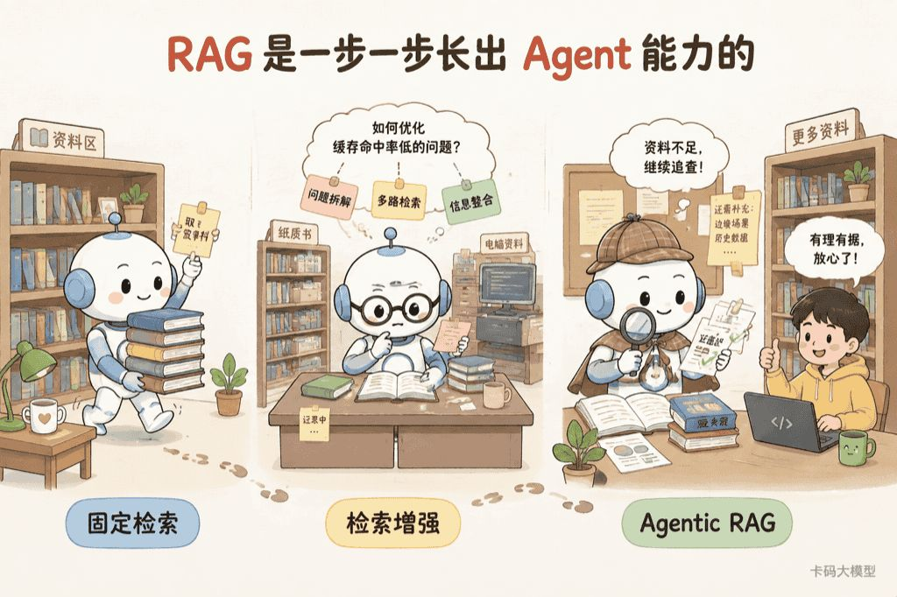

# 3.10 Agentic RAG：从传统 RAG、Advanced RAG 到智能体检索的演进与原理 【⭐ 理解】

[返回本章目录](README.md) · 融合 llm-master/docs/llm/intro/agentic_rag.md 完整推理与原图 + 自适应检索状态机与三层防死循环熔断

## 1. 🎯 本节目标与大白话例子

本节目标：理解传统固定流水线 RAG 的结构性困境，掌握从 Naive RAG -> Advanced RAG -> Self-RAG/CRAG -> Agentic RAG 的四代演进逻辑，理清“多 Query 并发”与“多跳依赖（Multi-hop）”的差异，并在 Step 9 基础上把单向检索升级为带三层死循环熔断的 AgenticRAGController。

大白话例子： 传统 RAG 和 Advanced RAG 就像一条写死的工厂流水线：不管来什么问题，都要先改写 3 次 Query、再查 2 个库、再做一次 Rerank，最后生成答案。

如果用户只是说“把上一段改得更口语化”，根本不用查库，流水线却照跑不误，白白浪费延迟和钱；

如果用户问“对比 2025 和 2026 两版差旅政策，找出华东区的例外条款”，一次 Top-5 检索往往只捞回 2026 版，2025 版全漏了，固定流水线也不会自己回头补查，只能硬着头皮瞎编。 而 Agentic RAG 就像把检索工具交给了会看结果再做决定的研究员：先判断是否需要查库 -> 拆分子问题分别查 -> 检查查回来的证据够不够、有没有冲突 -> 不够就换个词或换个数据源继续查，最多查 3 轮就收手交卷。

## 2. 🧠 核心原理与五维拆解

### 一、RAG 的四代演进逻辑（原文档脉络）



传统 RAG（Naive RAG）：Query -> 检索 Top-K -> 拼接 -> 生成。隐含假设是“一句话一次就能查全”，现实中经常失效。

Advanced RAG：加入 Query 改写、混合检索、Rerank、父子块。单步变准了，但流水线本身依然是开发者写死的。

自适应与纠错 RAG（Self-RAG / CRAG / Adaptive-RAG）：

Self-RAG：按需决定是否检索，并对检索结果和生成结果自我反思；

CRAG（Corrective RAG）：先用轻量评分器把检索结果判为 Correct / Ambiguous / Incorrect，若不可靠则触发纠正（如改写或转网页搜索）；

Adaptive-RAG：按问题复杂度在“免检索 / 单步检索 / 多步检索”间路由。

Agentic RAG：把向量库、BM25、SQL 数据库、API 全部包装成 Agent 工具，由大模型基于当前状态动态决策“查不查、拆几步、查哪个源、何时停”。

### 二、Agentic RAG 到底解决哪五大痛点？


一个 Query 装不下复杂对比问题（可拆成多个独立子问题并发查）；

第一次检索错了固定流程不会自救（可评估证据后改写重试）；

不同问题需要不同数据源（制度查向量库、订单查 SQL、最新动态查 API）；

不是所有问题都值得检索（改写/翻译/闲聊类直接走 DIRECT_LLM 省延迟）；

多跳问题需要带着新线索继续查（第一跳查出“新政 7 月生效”，第二跳才能查“7 月后订单”）。


### 三、组件五维拆解（闭卷背诵标准）

| 维度 | 核心内容（面试闭卷复述标准） |
| --- | --- |
| ① 输入什么 | 用户复杂 query、受控检索工具集 search_fn、全局步数硬预算 max_steps。 |
| ② 做什么 | 1. 意图路由（免检索 vs 检索）；<br>2. 状态循环：Query 哈希去重 -> 调用工具收集证据 -> CRAG 证据充分性评估 -> 不足则绑定原意图改写重试；<br>3. 触发硬上限或震荡时优雅降级。 |
| ③ 输出什么 | 状态标记（DIRECT_LLM / SUFFICIENT / DEGRADED_FALLBACK）、聚合证据列表与全生命周期 trace 轨迹。 |
| ④ 关键参数影响 | max_steps（生产绝对硬顶，通常 2~3 步）与 max_sub_queries（并发子查询限制 <=3，防打崩向量库）。 |
| ⑤ 工程选型 Trade-off | 单文档/简单 FAQ 绝不上 Agentic RAG（白增 1.5~3s 延迟和数倍 Token 费用）；先把传统/Advanced RAG 做好，只有多跳、多源任务才引入动态循环。 |

### 四、知识点扩展：Agentic RAG 不等于多 Agent + 生产三层熔断网

Agentic RAG $\neq$ Multi-Agent：一个单 Agent 配几个受控检索工具 + 明确的状态机，就已经是 Agentic RAG。盲目拆成多个 Agent 只会引入大量上下文复制、通信延迟和调试灾难。

生产防死循环三层熔断网：

硬步数上限：max_steps = 3，到点强制跳出循环；

Query 历史哈希去重：对每次改写的 Query 算 SHA-256，一旦重复直接判定为“震荡死循环”并打断；

降级兜底：熔断后把已累积的证据拼进 Prompt 提示“证据可能不完整”，或安全拒答。

## 3. 💻 渐进式代码实操（Step 10：自适应动态检索循环与三层熔断）

相比 Step 9 新增/修改了什么： 将前面单次固定检索的入口，升级为 agentic_rag_loop() 状态机控制器，新增意图路由免检索、多跳证据充分性反思，以及基于 max_steps 和 SHA-256 哈希去重的死循环熔断保护。

### 【从零手写核心链路】

```python
"""3.10 Step 10: 在 Step 7/9 基础上新增 Agentic RAG 动态检索循环（含 CRAG 评估与三层死循环熔断）"""
import hashlib


def agentic_rag_loop(
    query: str,
    search_fn,
    max_steps: int = 3,
) -> dict[str, object]:
    """
    【Step 10 新增】动态检索状态机：
    1. 意图路由（闲聊/改写类免检索）；
    2. CRAG 证据评估（Insufficient 时改写 Query 重试）；
    3. 三层熔断（max_steps 硬上限 + Query SHA-256 去重防震荡 + 降级兜底）。
    """
    # 意图路由。非知识类改写/闲聊请求直接走 DIRECT_LLM，免去无意义的检索延迟与噪声
    if "改得更口语化" in query:
        return {"status": "DIRECT_LLM", "steps": 0, "evidences": [], "trace": ["route:skip_rag"]}

    seen_hashes: set[str] = set()
    curr_query = query
    collected: list[str] = []
    trace: list[str] = []

    # 三层熔断。1) max_steps 硬上限；2) Query SHA-256 去重防改写震荡；3) 耗尽降级 DEGRADED_FALLBACK
    for step in range(1, max_steps + 1):
        q_hash = hashlib.sha256(curr_query.strip().encode("utf-8")).hexdigest()
        # 循环去重。改写后的 Query 若与历史哈希重复，立即 break 熔断，防止死循环烧钱
        if q_hash in seen_hashes:
            trace.append(f"step{step}:cycle_broken")
            break
        seen_hashes.add(q_hash)

        hits = search_fn(curr_query)
        collected.extend(hits)
        trace.append(f"step{step}:query='{curr_query}'->hits={len(hits)}")

        # 模拟 CRAG 证据充分性评估：需同时覆盖两个对比维度才算充分
        if any("登高" in h for h in collected) and any("密闭" in h for h in collected):
            return {"status": "SUFFICIENT", "steps": step, "evidences": list(dict.fromkeys(collected)), "trace": trace}

        # 证据不足时触发 Query 改写（严格绑定原始意图，防 Context Drift）
        # 防意图漂移。Query 改写必须锚定原始 query，防止多轮改写偏离用户初始问题 (Context Drift)
        curr_query = f"{query} 补充检索:密闭空间" if step == 1 else curr_query

    return {"status": "DEGRADED_FALLBACK", "steps": len(trace), "evidences": list(dict.fromkeys(collected)), "trace": trace}


if __name__ == "__main__":
    def mock_search(q: str) -> list[str]:
        if "补充检索:密闭空间" in q:
            return ["密闭空间作业监护人须持有限空间证。"]
        return ["登高作业监护人须持高处作业证。"]

    r1 = agentic_rag_loop("对比登高与密闭空间监护人资质", mock_search, max_steps=3)
    assert r1["status"] == "SUFFICIENT" and r1["steps"] == 2

    r2 = agentic_rag_loop("对比登高与密闭空间监护人资质", lambda q: ["无关片段"], max_steps=3)
    assert r2["status"] == "DEGRADED_FALLBACK" and "cycle_broken" in r2["trace"][-1]
    assert agentic_rag_loop("把这段话改得更口语化", mock_search)["status"] == "DIRECT_LLM"
    print("Step 10 self-test passed!")
```

### 【工业级调库对照】

生产环境常用 LangGraph 的 StateGraph 编排带条件跳转和步数限制的 Agentic RAG 循环：

```python
# from langgraph.graph import StateGraph, END
# graph = StateGraph(AgentRAGState)
# graph.add_node("retrieve", retrieve_node)
# graph.add_node("grade_docs", crag_grade_node)
# graph.add_node("rewrite", rewrite_query_node)
# graph.add_conditional_edges("grade_docs", decide_next, {"generate": "generate", "rewrite": "rewrite"})
```

何时手写 vs 何时调库：简单 2~3 步固定条件跳转用纯 Python for 循环状态机即可，调试成本远低于框架；需要持久化 Checkpoint、人工中断审批（Human-in-the-loop）的复杂长任务再用 LangGraph。

### 示例说明与练习范围

本例的设计选择：

自适应触发：不是所有请求都要进检索，纯润色/闲聊意图由路由直接分流到 DIRECT_LLM。

三层防死循环熔断：max_steps 硬上限 + SHA-256 历史 Query 去重防震荡 + 超限后 DEGRADED_FALLBACK 兜底返回已有证据或转人工。

防 Context Drift：每次改写 Query 必须绑定原始问题约束，不能让 LLM 越改越偏。

**代码练习｜给片段能读改**。写得出停止条件，整套循环复用 4.4。

示例辅助代码：

hashlib.sha256(...).hexdigest() 具体 API 拼写与 list(dict.fromkeys(collected)) 保序去重技巧。

## 4. 🗣️ 面试官视角：这段代码怎么讲

① 声明不变量：agentic_rag_loop 守住了有界终止不变量——无论外部模型怎么改写 Query，循环次数绝对不超过 max_steps，且重复 Query 会在执行检索前被 seen_hashes 瞬间拦截，彻底消除线上死循环风险。

② 关键行解析：第 16 行实现了低成本意图路由，非知识类请求直接跳过向量库；第 25~29 行用 SHA-256 哈希做环路检测；第 40 行改写时强制拼接原始 query，这是为了防止多跳过程出现上下文漂移（Context Drift）。

③ 主动点出工程细节（加分项）：我会向面试官强调两点生产安全红线：第一，Agent 调用多数据源工具时，必须把用户的真实身份 JWT Token 向下透传给每个工具执行行级权限校验，绝不能给 Agent 配超级管理员工具池；第二，决策输出（RETRIEVE / GENERATE / REFUSE）必须用 JSON Schema 严格模式，不能靠正则猜自然语言。

## 5. 🔧 生产排障指南（实现 -> 排障）

| 故障现象 | 定位方法 | 修复方案 |
| --- | --- | --- |
| 1. Agent 卡在检索循环里反复改写但就是不生成答案 | 打印 trace 轨迹：模型在两个近义 Query 之间来回震荡，且缺少历史动作去重与步数硬顶。 | 引入三层熔断：max_steps=3 硬上限 + Query SHA-256 哈希去重 + 触发熔断时强制带现有证据降级生成或拒答。 |
| 2. 第二跳检索开始跑偏，完全脱离用户原始问题（Context Drift） | 检查改写 Prompt：只把上一轮返回的嘈杂文档塞给了改写器，没把原始 query 钉死在 Prompt 顶部。 | 在改写模板中强制绑定原始用户意图（Pin User Intent），要求每轮改写必须服务于回答初始问题。 |
| 3. 并发子查询瞬间把后端向量库打满超时 | 检查任务拆解逻辑：未限制单次生成的 Sub-query 数量，模型一口气拆出 10 个子问题并发查库。 | 在网关与代码层硬限制 max_sub_queries <= 3，超出部分截断或串行排队。 |

## 6. ❓ 高频面试追问与参考答法 + 📝 节末费曼自检

### 高频面试追问

Q1：Agentic RAG 和传统 RAG 的本质区别是什么？什么时候坚决不上 Agentic RAG？

参考答法：本质区别在于控制流：传统 RAG 的检索路径是开发者写死的，而 Agentic RAG 把检索包装成工具，由模型根据中间证据质量动态决定“查不查、查几次、查哪个源、何时停”。如果业务主要是简单单跳问答（FAQ/产品手册）、数据源单一且对首字延迟极敏感，坚决不上 Agentic RAG，因为多轮调用会让延迟飙升 2~3 秒且成本翻倍。

Q2：“多 Query 检索（Multi-Query）”和“多跳检索（Multi-hop）”有什么区别？

参考答法：Multi-Query 是把同一个问题换三种问法并行查，彼此独立；而 Multi-hop 是串行依赖，第二跳检索用到的实体或条件必须来自第一跳查回来的证据（比如先查出某项目对应的文档 ID，第二跳再去查该文档的审批条款）。

Q3：CRAG（Corrective RAG）的核心思想是什么？

参考答法：在检索和生成之间插一个轻量级质量裁判，把召回证据分成 Correct（直接生成）、Incorrect（丢弃结果，转外部搜索或拒答）、Ambiguous（内部切片与外部补充合并），从源头阻止垃圾上下文污染大模型。

Q4：生产环境怎么防止 Agentic RAG 出现死循环和费用失控？

参考答法：靠确定性规则兜底：一设硬性 max_steps=3 和总超时；二做 Query 历史哈希去重防震荡；三限制单轮最多拆 3 个子查询；四是把用户 Token 透传给每个检索工具防越权。

### 📝 节末费曼自检（闭卷自测）

请闭卷说出 RAG 从 Naive -> Advanced -> 自适应/纠错 -> Agentic 四代演进的各自痛点与解决思路。

如果线上 Agentic RAG 的多跳检索第二跳跑偏了，代码和 Prompt 上如何防范“上下文漂移”？

## 面试重点｜设计、调参与排障

**面试官可能问**

第一次检索找不到，什么时候让 Agent 再搜一次？

**参考回答（现场口述）**

如果第一次是搜错词或问题包含明确的多跳缺口，可以带着缺口改写后再搜一次。可靠证据已经足够就直接回答，超预算、权限不足或重复搜索无进展时停止。用难题对照多轮带来的新增正确答案与 P95。

**系统设计怎么选**

先判断缺搜索表达、缺一个中间事实，还是确实无证据。前两种分别试 Query 改写或多跳取证。单 Agent 配受控状态和工具就能做。

**参数或条件改变会怎样**

为步数、耗时和 token 分别设预算。加步数可能提高复杂问题覆盖，也会推高 P95；普通 FAQ 可直接走固定检索。

**系统出错怎么查、怎么验证**

除了重复 Query，检查证据和任务状态有没有实际变化。无进展、超预算或关键服务故障时，进入拒答、降级或人工分支。
