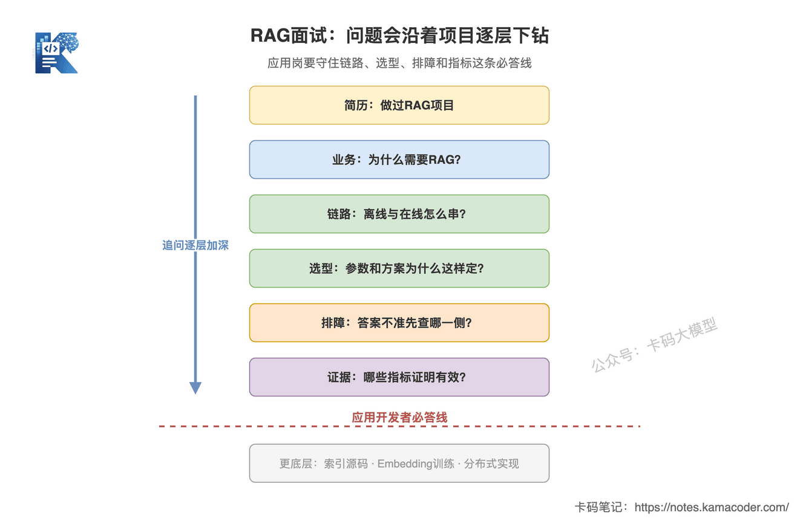
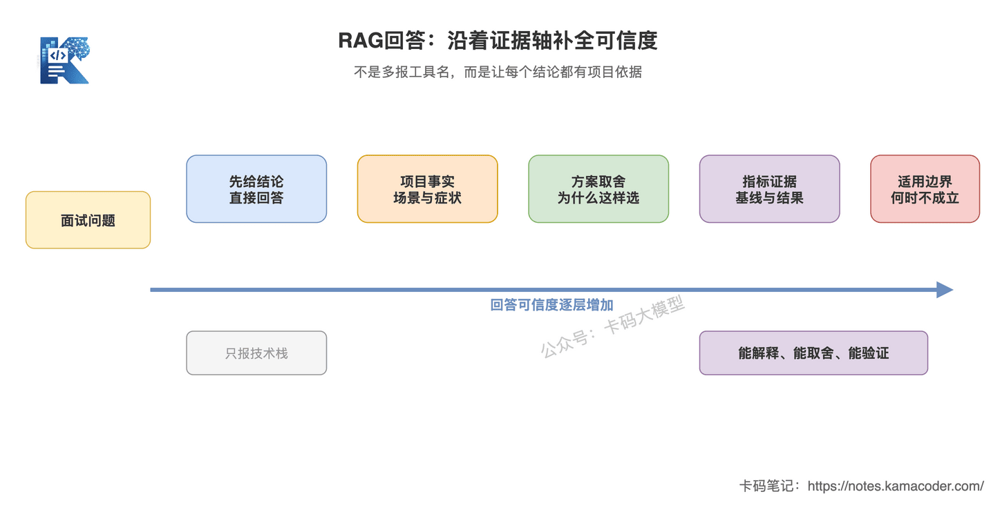
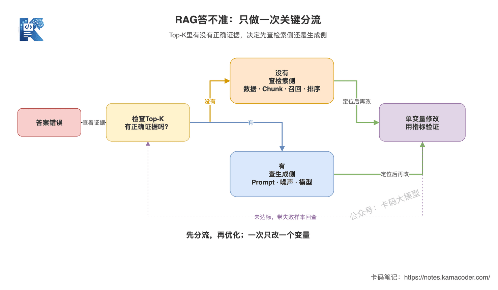

# 3.11 面试官怎么问 RAG？高频问题、回答框架与项目证据链 【⭐ 理解】

[返回本章目录](README.md) · 融合 llm-master/docs/llm/app/rag_interview_framework.md 完整推理与原图 + STAR 项目表达与指标防虚构审计

## 1. 🎯 本节目标与大白话例子

本节目标：告别“把工具箱倒在桌上”的技术栈报菜名式回答，掌握外企/大厂 Applied MLE 面试官最认可的五步证据链回答框架（结论 -> 项目事实 -> 方案取舍 -> 指标证据 -> 适用边界），学会涉密数据合规脱敏话术，并在 Step 9 评测基础上新增 ProjectClaimAuditor 防止简历/口述指标失真。

大白话例子： 面试官问：“你这个 RAG 项目做了哪些优化？”

工具人答法：“我们用了 LangChain、Milvus、BGE、混合检索和 Rerank，效果提升很明显。”——这就像修车工说“我用了扳手、千斤顶和电脑诊断仪，车修得很好”，面试官根本不知道原本坏在哪、为什么要换这个零件、花了多少代价。

工程师答法：“针对企业规章编号漏召回、旧版废止文档混入的问题，我们在 200 条黄金评测集上测得单路向量 Recall@20 只有 68%；引入 BM25+BGE 加权 RRF 后提到 81%，再接 Cross-Encoder 精排使忠实度达到 85%，代价是增加了约 45ms 的 P95 延迟。”——症状、判断、方案、指标、代价全齐了！

## 2. 🧠 核心原理与五维拆解

### 一、面试官会沿着项目一直往下挖（原文档脉络）

面试官不会随机抽十个名词让你背，而是从你简历上的一句“负责企业知识库 RAG 系统”顺着一条链不断下钻：为什么做 -> 链路是什么 -> 参数怎么定 -> 效果差怎么排 -> 收益怎么证明。



### 二、通用五步证据链回答框架



结论：先直接给出核心判断（1 句话）；

项目事实：说清数据规模、业务场景、当时的症状或约束；

方案取舍：为什么选 A 不选 B，付出了什么延迟/算力代价；

指标证据：固定评测集上的基线和改后数据对比；

适用边界：什么情况下这套方案不成立（体现工程边界感）。

### 三、答不准时的单变量闭环话术图



### 四、组件五维拆解（闭卷背诵标准）

| 维度 | 核心内容（面试闭卷复述标准） |
| --- | --- |
| ① 输入什么 | 业务背景与痛点、个人 RACI 核心职责边界、带实验 ID 的基线/优化指标记录。 |
| ② 做什么 | 校验指标是否有基线与实验编号支撑；计算相对提升比例；显式隔离未实测项。 |
| ③ 输出什么 | 合规脱敏、数据可回溯、经得起 Deep Dive 追问的项目叙述与审计报告。 |
| ④ 关键参数影响 | 黄金评测集分布与样本量、Baseline 定义（没有基线就无法证明优化幅度）。 |
| ⑤ 工程选型 Trade-off | 诚实讲清边界（如“仅做过离线评测，未压测高并发”）远比编造线上数据更受外企面试官认可。 |

### 五、知识点扩展：外企面试高频合规与真实性加分项

数据脱敏原则：遇到涉密公司项目，绝不透露真实客户名或内部敏感规章全文，而是抽象为业务领域（如“工业安全生产与合规问答系统”），保留技术架构 + 相对提升比例（如“Recall@20 相对提升 23.5%”），外企极看重工程师的合规意识。

随身携带 1 个真实 Bad Case 排障故事：提前准备好“如何发现问题 -> Trace 定位在哪一层 -> 单变量修复 -> 回归门禁”的完整故事（如 3.6 节的 PDF 表格错行或 3.1 节的旧版未失效）。

## 3. 💻 渐进式代码实操（Step 11：面试项目指标与证据防虚构审计器）

相比 Step 10 新增/修改了什么： 针对 Step 9 产出的评测指标，新增 MetricRecord 与 audit_interview_claims() 审计器，自动区分“有基线+实验编号的实测项”与“尚未测量的待测项”，在写简历和面试复盘前拦截无出处的数据吹嘘。

### 【从零手写核心链路】

```python
"""3.11 Step 11: 在 Step 9 基础上新增面试项目实验指标与证据防虚构审计器"""
from dataclasses import dataclass
from typing import Optional


@dataclass(frozen=True)
# [无需死背-脚手架] 实验指标记录数据结构，重点记住必须绑定 baseline / optimized / evidence_id 三要素
class MetricRecord:
    name: str
    baseline: Optional[float]
    optimized: Optional[float]
    evidence_id: Optional[str]


def audit_interview_claims(records: list[MetricRecord]) -> dict[str, object]:
    """区分有可回溯实验证据的指标与待测项，拦截无出处吹嘘。"""
    if not records:
        raise ValueError("实验指标记录不能为空")
    verified: list[str] = []
    pending: list[str] = []
    max_lift = 0.0
    for r in records:
        # [必记设计决策-证据门禁] 任何简历或面试声称的指标提升，必须同时具备基线值、优化值与可回溯实验编号
        if r.baseline is not None and r.optimized is not None and r.evidence_id and r.evidence_id.strip():
            lift = (r.optimized - r.baseline) / r.baseline if r.baseline > 0 else 0.0
            max_lift = max(max_lift, lift)
            verified.append(f"{r.name}: {r.baseline:.2f} -> {r.optimized:.2f} (相对变化 {lift:+.1%}, 证据:{r.evidence_id})")
        else:
            # [必记设计决策-诚实边界] 缺证据项直接归入待测清单并给出补测方案，杜绝面试口头虚构数据被追问穿帮
            pending.append(f"{r.name}: 尚未实测（面试时需如实说明边界与补测方案）")
    return {"verified": verified, "pending": pending, "max_relative_lift": max_lift}


if __name__ == "__main__":
    report = audit_interview_claims([
        MetricRecord("Recall@20", 0.68, 0.84, "EXP_2026_RRF"),
        MetricRecord("P95_Latency_50QPS", None, None, None),
    ])
    assert len(report["verified"]) == 1 and len(report["pending"]) == 1
    assert abs(report["max_relative_lift"] - (0.84 - 0.68) / 0.68) < 1e-6
    print("Step 11 self-test passed!")
```

说明：本节为工程方法论与项目复盘工具，无重型第三方库依赖；生产中对应 MLflow / Weights & Biases 实验追踪平台。

### 🧠 代码区记忆清单：背什么 vs 不背什么

🔒 不可替代的系统设计决策（必须记住，面试直接讲思路）：

实验可追溯三要素：所有优化声明必须有 baseline、optimized、evidence_id（实验追踪编号），否则不写进简历主结论。

待测项坦诚策略：如实区分已验证提升与未压测项（如 50 QPS 压测），并主动给出补测方法，面试官更看重工程严谨性。

✍️ 面试手撕/默写范围：

本节为项目复盘与防虚构审计脚本，无需在白板手撕代码，重点掌握指标汇报的“基线 -> 改动 -> 实测 -> 边界”四步叙事结构。

🗑️ 无需死背的脚手架代码：

MetricRecord 的 Optional[float] 类型注解与字符串格式化模板。

## 4. 🗣️ 面试官视角：这段代码怎么讲

① 声明不变量：audit_interview_claims 强迫简历上的每一个数字都必须同时具备三个要素——baseline、optimized 与可回溯的 evidence_id，缺一不可。

② 关键行解析：第 21~26 行自动计算相对提升幅度并归档为已验证项；第 27 行把缺失项显式标为 pending，提醒自己面试时坦诚边界并给出补测方案（如“当时 QPS<5 未做 50 并发压测，后续计划用 Locust 分别压测检索网关和重排 GPU 服务”）。

③ 主动点出工程细节（加分项）：面试官最讨厌“准确率 95%”这种没有基线的孤立数字；用这套“基线 -> 改动 -> 提升幅度 -> 延迟代价”的模板去讲，即使数值是 84%，可信度也远超虚高的 95%。

## 5. 🔧 生产排障指南（面试现场排雷）

| 面试踩雷现象 | 面试官内心定位 | 修复方案 |
| --- | --- | --- |
| 1. 被追问“如果向量库挂了系统怎么降级”时答不上来 | 缺乏生产高可用兜底思维。 | 准备熔断降级方案（Graceful Degradation）：向量库超时立即熔断，自动切至纯关键词全文索引（ES），并打标“降级模式”。 |
| 2. 被质疑“是不是只调了 LangChain 的 API” | 只报框架名，没讲清底层参数和数据结构。 | 主动下钻讲底层细节：RRF 为什么 $k=60$、L2 归一化防除零 1e-12、标点吸附与字符偏移恒等校验。 |
| 3. 把整个团队的产出都说成“我独立设计的” | 职责边界不清，大厂背调大忌。 | 清晰切割 RACI：明确哪一块代码是自己主导（如切片与混合检索调优），哪一块是基建同事维护（如 Milvus 集群运维）。 |

## 6. ❓ 高频面试追问与参考答法 + 📝 节末费曼自检

### 高频面试追问

Q1：你简历上写“将检索召回率提升至 84%”，这个数字是怎么测出来的？

参考答法：我们从历史真实提问和业务规章中抽样人工标注了 200 条涵盖高频、编号精确查找与跨条文组合的 Golden Set。单用向量检索基线时 Recall@20 是 68%（主要漏在标准号和缩写）；引入 BM25 + 加权 RRF 后提到 81%，结合结构感知切片提到 84%；后续接入 Cross-Encoder 做 Top-5 精排，忠实度达到 85%，代价是增加了约 45ms 延迟。

Q2：如果你只做过一个离线 Demo，没有真实线上高并发流量，面试怎么答才不扣分？

参考答法：千万不要硬吹并发！直接坦诚：“这个项目是离线验证原型，没有接真实公网高并发流量，所以我重点验证了切片策略、混合检索 Recall 和端到端引用准确率；如果要上生产，下一步需要补齐 Locust 并发压测、P95 监控、向量库熔断降级和权限前置过滤。”诚实讲清边界反而像资深工程师。

Q3：公司数据涉密，不能告诉我具体文档和指标怎么办？

参考答法：按“实体脱敏 + 保留架构与相对提升”的原则回答：抽象描述业务形态（如“制造业安全合规问答”），重点讲清切片怎么按条款结构切、为什么选 0.5:0.5 的 RRF 权重、以及指标相对基线提升了百分之多少。

Q4：面试官追问一个你没直接负责的模块（比如底层 K8s 运维或模型量化）怎么答？

参考答法：先界定职责：“底层部署集群由基础架构组同学负责，我主要负责检索与评测链路”，紧接着补充你对它边界的理解：“但我关注过它的内存和延迟约束，比如 HNSW 开启 SQ8 量化后能把内存压低 70% 同时只损失不到 1% 召回”。

### 📝 节末费曼自检（闭卷自测）

请套用“结论 -> 项目事实 -> 方案取舍 -> 指标证据 -> 适用边界”五步框架，口述 1 分钟介绍你的核心 RAG 项目。

如果面试官问你一个你确实没测过的指标（比如 100 并发 P99 延迟），标准高分答法是什么？
