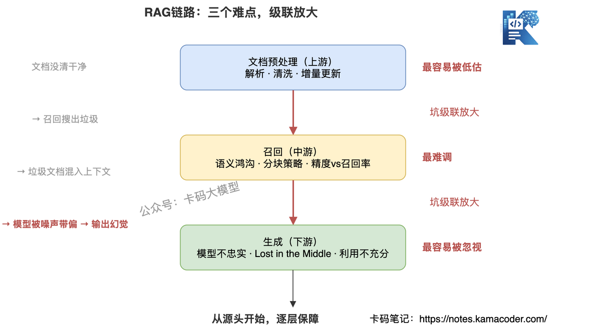
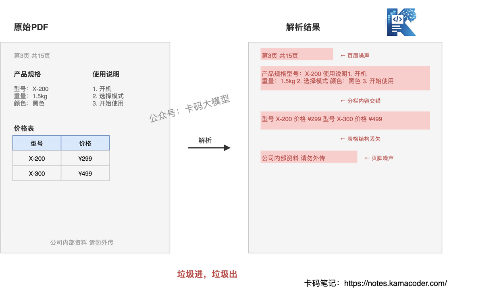
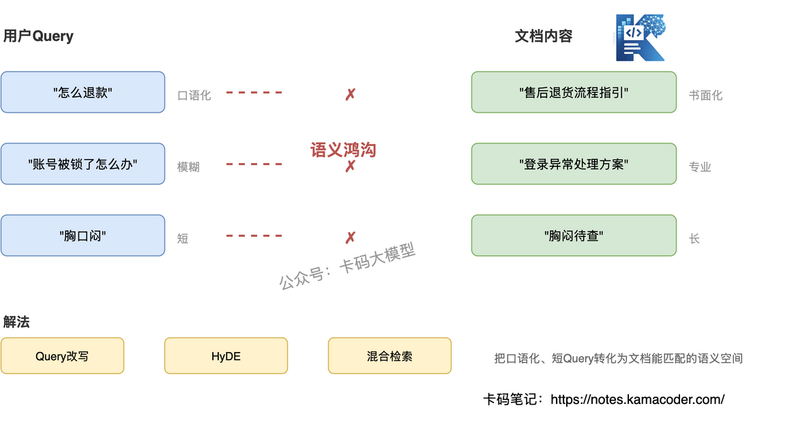
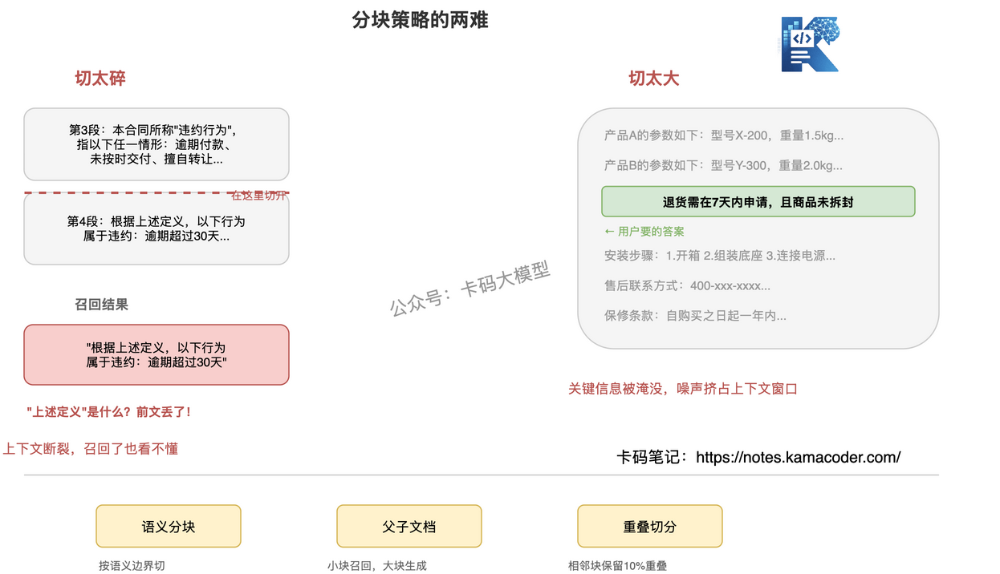
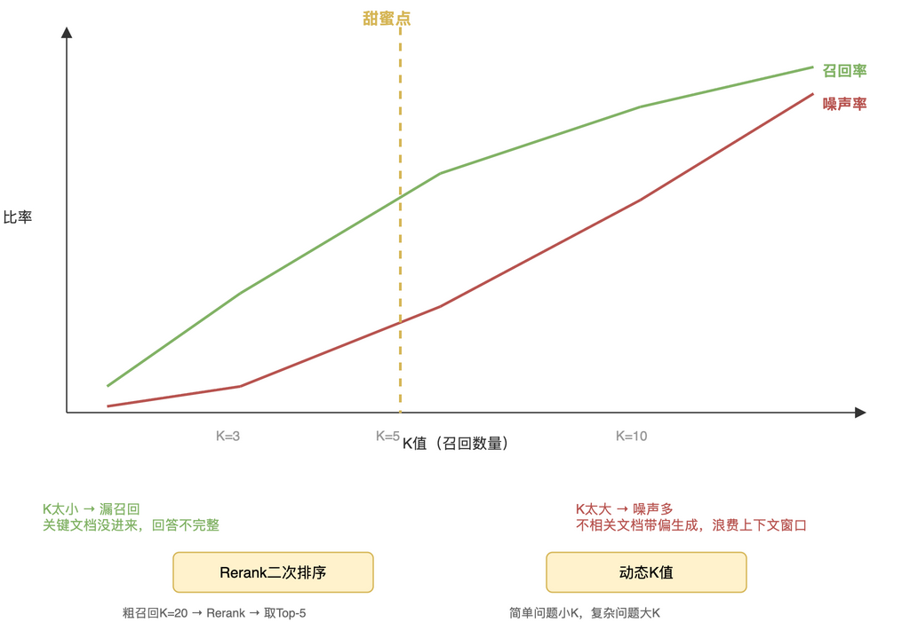

# 3.13 RAG 落地最难的地方：文档预处理、增量同步与索引一致性 【🔥 必会】

[返回本章目录](README.md) · 融合 llm-master/docs/interview/llm/rag_hardest_parts_interview.md & 20261015alibaba_qianwen_rag_interview.md + SHA-256 增量调度与防误删熔断

## 1. 🎯 本节目标与大白话例子

本节目标：掌握 RAG 生产落地三大级联难点（文档预处理、召回质量、生成忠实度），攻克高频变更知识库的增量同步与零停机版本切换难题，学会 CSV/表格等异构数据的规范解析，并在 Step 12 基础上新增 IncrementalIndexPlanner 增量索引调度器。

大白话例子： 企业知识库不是一锤子买卖，每天都在增删改。假设公司有 10 万份安全手册，今天只改了其中一份《受限空间条例》的“审批人职级”，还把浏览权限开放给了“实习安全员”：

如果采用“全量重建”，每次改动都要把 10 万份文档重新 OCR、切片、算 Embedding，不仅烧钱且几小时内服务不可用；

更可怕的是，万一某天凌晨同步爬虫网络抖动只抓到了 10% 的文档，稚拙的同步脚本会以为另外 90% 的文档全被删了，直接把整个向量库清空！ 本节的增量调度器就像一个带保险丝的智能会计：先核对“整本账单是否完整（快照握手）”，再逐条比对纯文本 SHA-256 指纹与权限版本号——正文没变只改权限？2 毫秒原地刷一下标量字段，一分钱向量算力都不花！

## 2. 🧠 核心原理与五维拆解

### 一、RAG 落地的三大难点：级联放大（原文档脉络）

实际做过 RAG 的工程师都知道：80% 的工期花在数据上，20% 花在模型和检索上。 三个难点不是孤立的，而是上游的坑会级联放大：



文档预处理（最容易被低估）：PDF 多栏交错、合并单元格表格被打散、扫描件 OCR 错字、页眉页脚噪声、以及每天更新的增量同步。



召回质量（最难调）：用户口语与专业条文之间的语义鸿沟（“胸口闷” vs “胸闷待查”）、分块粒度两难、以及 Precision vs Recall 的取舍。







生成忠实度（最容易被忽视）：召回对了但模型不忠实、Lost in the Middle、上下文信息利用不充分。

### 二、增量同步决策流与操作代价分级

比对 (doc_id, normalized_text_sha256, policy_revision)：

旧库无此 ID -> INSERT（切片 + 向量化 + 入库）

正文 Hash 改变 -> UPDATE_VECTOR（仅重算该文档切片与向量）

Hash 未变，仅权限策略改变 -> UPDATE_METADATA_ONLY（零向量计算，仅原地更新标量 Payload）

完全一致 -> NOOP

新快照缺失 -> 若快照不完整或删除比例超阈值，立即 PENDING_CHECK 熔断挂起报警；确认合法才执行 TOMBSTONE 软删除。

### 三、组件五维拆解（闭卷背诵标准）

| 维度 | 核心内容（面试闭卷复述标准） |
| --- | --- |
| ① 输入什么 | 向量库现有快照 old_records、上游最新文档快照 new_docs、快照完整性标志 is_snapshot_complete、最大删除熔断比例 max_delete_ratio。 |
| ② 做什么 | 计算规范化纯文本 SHA-256，执行五态增量分流，并对异常批量缺失触发防误删熔断。 |
| ③ 输出什么 | 幂等的增量执行计划列表 list[tuple[doc_id, action]]。 |
| ④ 关键参数影响 | max_delete_ratio（如 0.20）防爬虫抖动误删全库；规范化纯文本哈希（屏蔽 Word 样式微调误触重算）。 |
| ⑤ 工程选型 Trade-off | 向量与标量解耦更新；采用软删除（Tombstone）+ 定时 Compaction 替代物理硬删，方便审计与毫秒级回滚。 |

### 四、知识点扩展：CSV 解析与蓝绿零停机切换（阿里千问面经精华）

CSV 等表格数据怎么进 RAG？ 绝不能按逗号或物理换行粗暴 split（带引号的字段里常有逗号和跨行文本），必须用标准 csv 解析器读取；保留表头把每行转成“字段名: 值”的自然语言描述并绑定 doc_id；如果是“某主题有多少条记录”的聚合统计题，必须路由给 SQL/Pandas 精确计算，不能指望向量检索做表格聚合。

新旧版本零停机切换：采用双 Collection 蓝绿别名（Blue-Green Alias），在 Collection-B 离线构建并验收完后，原子切换读流量别名。

## 3. 💻 渐进式代码实操（Step 13：增量索引调度器与防误删熔断）

相比 Step 12 新增/修改了什么： 在离线入库环节新增 sha256_norm() 与 plan_incremental_sync() 增量规划器，实现“改权限免算向量”和“异常批量缺失自动熔断挂起”。

### 【从零手写核心链路】

```python
"""3.13 Step 13: 在 Step 2/3 基础上新增基于 SHA-256 与权限版本对比的增量索引调度器（含防误删熔断）"""
from dataclasses import dataclass
import hashlib


@dataclass(frozen=True)
class IndexRecord:
    doc_id: str
    content_hash: str
    policy_rev: str


# 归一化哈希。计算正文哈希前先归一化空白符，避免无意义换行/空格变动触发全量重算 Embedding
def sha256_norm(text: str) -> str:
    return hashlib.sha256(" ".join(text.split()).encode("utf-8")).hexdigest()


def plan_incremental_sync(
    old_records: list[IndexRecord],
    new_docs: list[tuple[str, str, str]],  # (doc_id, normalized_text, policy_rev)
    is_snapshot_complete: bool,
    max_delete_ratio: float = 0.20,
) -> list[tuple[str, str]]:
    """
    增量调度决策：
    - 正文哈希未变仅权限变 -> UPDATE_METADATA_ONLY（零 Embedding 算力开销）
    - 正文哈希变 -> UPDATE_VECTOR
    - 快照不完整或删除比例超限 -> PENDING_CHECK（熔断挂起防误删全库）
    """
    old_map = {r.doc_id: r for r in old_records}
    new_ids = {d[0] for d in new_docs}
    plan: list[tuple[str, str]] = []

    for doc_id, text, pol in new_docs:
        h = sha256_norm(text)
        if doc_id not in old_map:
            plan.append((doc_id, "INSERT"))
        # 算力分流。正文变了才 UPDATE_VECTOR；仅权限变则 UPDATE_METADATA_ONLY，零 Embedding 成本
        elif old_map[doc_id].content_hash != h:
            plan.append((doc_id, "UPDATE_VECTOR"))
        elif old_map[doc_id].policy_rev != pol:
            plan.append((doc_id, "UPDATE_METADATA_ONLY"))
        else:
            plan.append((doc_id, "NOOP"))

    missing_ids = [did for did in old_map if did not in new_ids]
    delete_ratio = len(missing_ids) / len(old_map) if old_map else 0.0
    # 防误删熔断。上游快照不完整或缺失比例超阈值(如20%)时，必须熔断挂起(PENDING_CHECK)防误删全库
    action_for_missing = "TOMBSTONE" if (is_snapshot_complete and delete_ratio <= max_delete_ratio) else "PENDING_CHECK"
    for did in missing_ids:
        plan.append((did, action_for_missing))
    return plan


if __name__ == "__main__":
    old = [
        IndexRecord("D1", sha256_norm("条款一"), "pol_v1"),
        IndexRecord("D2", sha256_norm("条款二"), "pol_v1"),
        IndexRecord("D3", sha256_norm("条款三"), "pol_v1"),
    ]
    new = [("D1", "条款一", "pol_v2"), ("D2", "条款二-修订", "pol_v1"), ("D4", "条款四", "pol_v1")]
    p = dict(plan_incremental_sync(old, new, is_snapshot_complete=True, max_delete_ratio=0.20))
    assert p["D1"] == "UPDATE_METADATA_ONLY" and p["D2"] == "UPDATE_VECTOR" and p["D4"] == "INSERT"
    assert p["D3"] == "PENDING_CHECK", "删除比例超阈值必须熔断挂起"
    print("Step 13 self-test passed!")
```

说明：工业级向量库（Qdrant / Milvus）均支持直接调用 set_payload() / upsert() 对标量元数据做毫秒级原地更新。

### 示例说明与练习范围

本例的设计选择：

正文与权限变更解耦：通过对比 content_hash 和 policy_rev，实现“改权限免重算向量”，大幅节省 Embedding 费用。

增量同步防误删熔断：上游拉取故障常导致文档列表残缺，若直接按差集删索引会清空知识库，必须校验 is_snapshot_complete 与 delete_ratio <= max_delete_ratio。

软删 Tombstone：先标逻辑墓碑（检索层立即可见隔离），确认安全后再异步物理清理。

**代码练习｜能讲清设计**。会画增量更新、撤权和回滚，不背哈希脚本。

示例辅助代码：

IndexRecord 数据类与 " ".join(text.split()) 文本归一写法。

## 4. 🗣️ 面试官视角：这段代码怎么讲

① 声明不变量：plan_incremental_sync 守住了算力零浪费（正文哈希不变只刷标量）与误删绝对熔断（快照不完整或删除占比超 20% 绝不物理下线）两大生产级不变量。

② 关键行解析：第 14 行先做 " ".join(text.split()) 空白规范化再算 SHA-256，专门屏蔽 Word 排版微调对内容哈希的误触发；第 45~46 行把完整性握手与删除比例熔断合二为一，防止上游同步器抽风把全库删光。

③ 主动点出工程细节（加分项）：我会向面试官补充**切片级哈希（Chunk-level Hashing）**的进阶优化：如果一份 100 页的手册只改了第 50 页的一句话，文档级哈希会让整整 100 页重算向量，而切片级哈希能只重算那 2 个变动的 Chunk，把增量更新成本再压低 98%。

## 5. 🔧 生产排障指南（实现 -> 排障）

| 故障现象 | 定位方法 | 修复方案 |
| --- | --- | --- |
| 1. 上游同步只改了 Word 字体，系统却重跑了全量 Embedding | 检查哈希计算输入：误把 .docx 原始二进制字节流算了哈希（压缩包时间戳每次保存都会变）。 | 改为在文档解析清洗并规范化空白字符后，对纯文本计算 SHA-256。 |
| 2. 已软删除的废止文档依然在线上被频繁召回 | 检查向量库 Delete 机制与查询 Filter：部分引擎删除只打内存 Tombstone，后台 Compaction 未触发，或查询漏加 status == 'active'。 | 查询强制加白名单过滤 is_active == True，并配置定时 Compaction 清理物理存储。 |
| 3. 某天同步后知识库文档数骤降 80% | 检查同步日志：上游接口超时返回残缺列表，同步脚本直接对差集执行了硬删除。 | 接入 is_snapshot_complete 握手协议 + max_delete_ratio=0.20 熔断挂起 + 飞书/钉钉告警。 |

## 6. ❓ 高频面试追问与参考答法 + 📝 节末费曼自检

### 高频面试追问

Q1：在实际落地中，你觉得 RAG 最难的地方是哪里？

参考答法：不是某一个单点技术，而是**“文档预处理、召回质量、生成忠实度”三个环节的级联放大**。尤其是文档预处理（占 80% 工程量）：PDF 表格错乱、扫描件噪声、增量更新脏数据，会导致上游“垃圾进、垃圾出”，下游再怎么调 Rerank 和 Prompt 都救不回来。

Q2：如果只修改了一份文档的部门归属和查看权限，有必要重新算 Embedding 吗？

参考答法：完全没必要。向量算力是昂贵的 GPU 开销，而权限属于标量元数据。我们通过纯文本 SHA-256 校验确认正文没变后，直接走 UPDATE_METADATA_ONLY 管线，调用向量库的原地更新接口 2ms 内覆盖权限字段，零模型推理开销。

Q3：如何防止增量同步任务因为网络抖动只抓到 10% 文件而误删其余 90% 的索引？

参考答法：建立两道锁：第一道是快照完整性握手，上游必须显式携带 is_snapshot_complete=True 信号才允许触发删除分支；第二道是删除配额熔断，单次下线比例一旦超过预设阈值（如 5%~20%），立即挂起任务并人工告警。

Q4：业务里既有 Markdown 手册又有 CSV 表格，怎么统一解析和检索？

参考答法：Markdown 按标题树结构切分并保留面包屑；CSV 用标准 csv 解析器读取（防字段内逗号和换行错位），把每行转成带列名的自然语言描述入库。但要明确边界：一旦用户问“一共有多少条、平均值是多少”这类聚合题，必须路由给 SQL/Pandas 精确算，不能靠向量检索。

### 📝 节末费曼自检（闭卷自测）

请闭卷说出增量同步的五种操作类型（INSERT / UPDATE_VECTOR / UPDATE_METADATA_ONLY / TOMBSTONE / PENDING_CHECK）及触发条件。

为什么文档预处理被称为 RAG 落地“最容易被低估且会级联放大”的源头？

## 面试重点｜设计、调参与排障

**面试官可能问**

规程撤销权限后，怎么保证旧索引和缓存不继续给用户？

**参考回答（现场口述）**

撤权先在权威权限层生效，查询和结果返回前执行授权检查。索引同步只改必要元数据，缓存随权限版本隔离或失效。用同一账号先命中缓存再撤权，确认旧缓存、旧索引节点和切换期间都拿不到结果。

**系统设计怎么选**

内容和编码配置未变通常可复用向量，但标量权限、关键词索引和查询缓存必须同步或失效，设置撤权生效时限与权威版本验证。

**参数或条件改变会怎样**

快照未完整时暂停批量删除。删除比例阈值按正常增删分布设，蓝绿切换还要协调写入、对账、别名和回退。

**系统出错怎么查、怎么验证**

模拟同步中途崩溃与重复事件，核对幂等键、落库版本、读缓存及恢复后的对账结果。表格聚合用结构化查询复核。
