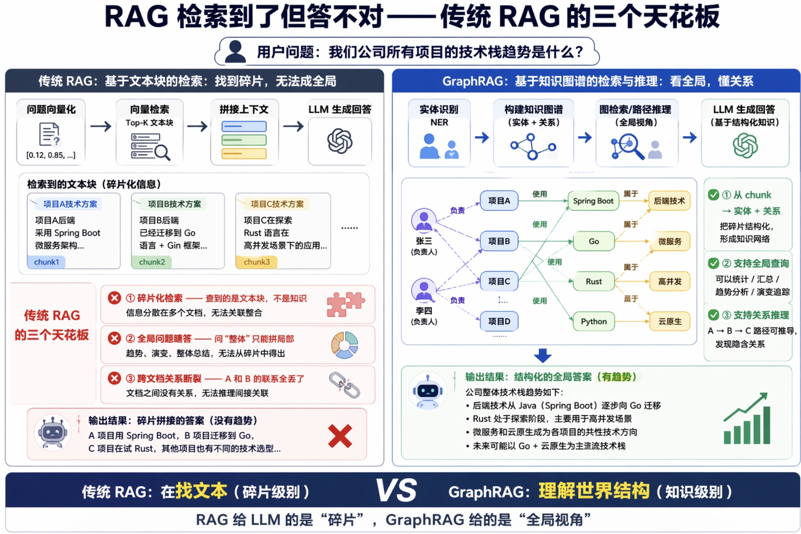
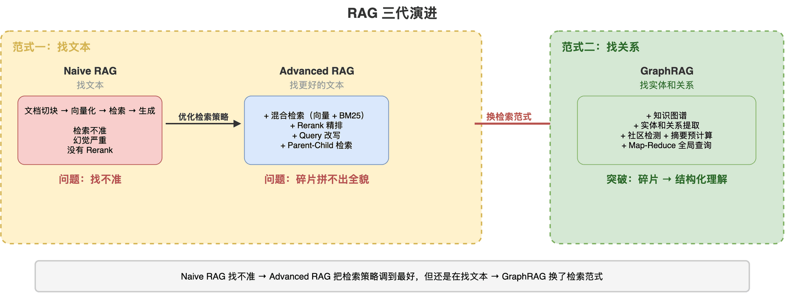
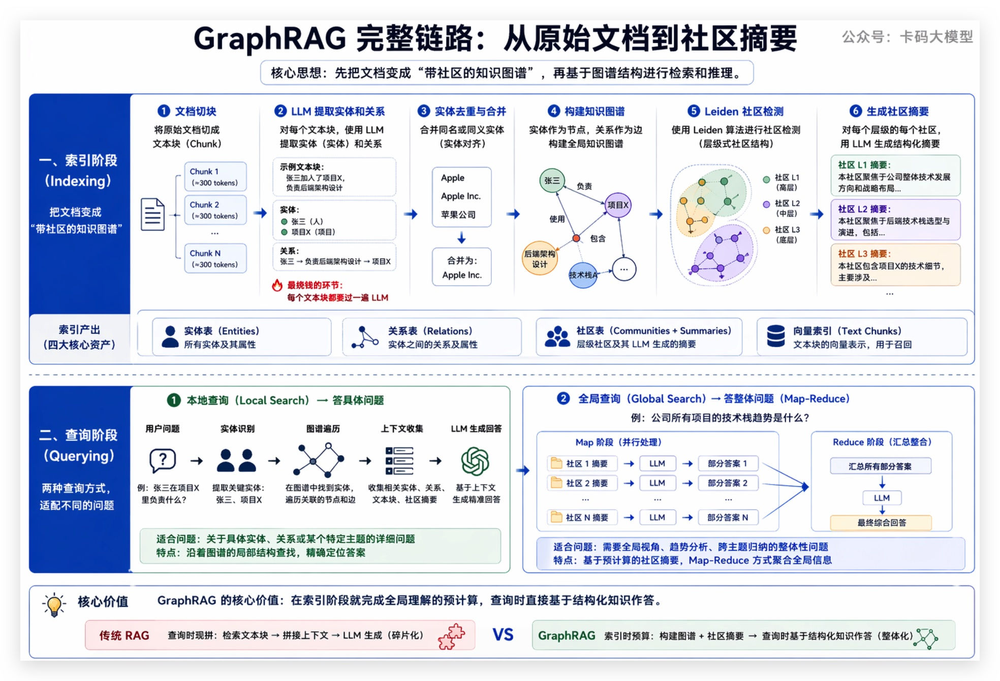
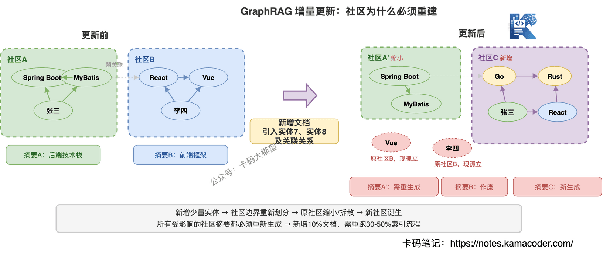
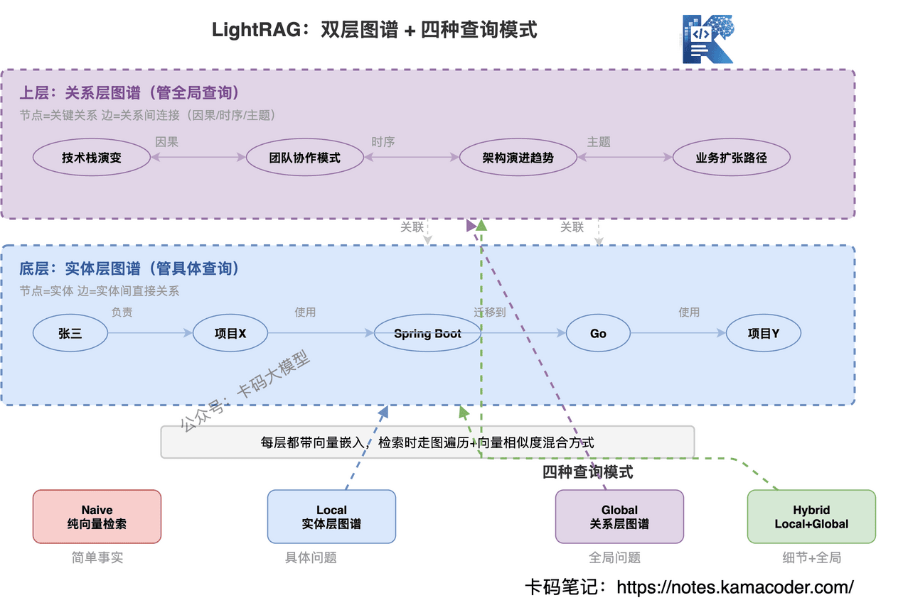
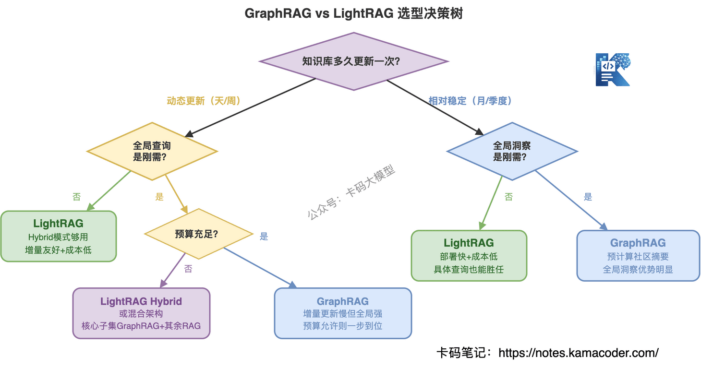

# 3.14 GraphRAG 与 LightRAG：从“找文本”到“找关系”的演进与工程选型 【◻ 按需】

[返回本章目录](README.md) · 融合 llm-master/docs/interview/llm/graphrag_interview.md 完整推理与原图 + 溯源多跳图路径探索器

## 1. 🎯 本节目标与大白话例子

本节目标：看清传统向量 RAG 在“跨文档多跳推理”和“全局宏观归纳”上的三大结构性天花板，掌握微软 GraphRAG（知识图谱 + Leiden 社区检测 + 预计算摘要 + Map-Reduce）与港大 LightRAG（双层图谱 + 增量插入）的原理与选型权衡，并在 Step 13 基础上完成全章最后一块积木——带切片溯源与防环跳数限制的多跳图路径探索器。

大白话例子： 有人问：“你们公司所有项目的整体技术栈演进趋势是什么？”或者“施工一队的作业人员需要考什么证？”（其中文档 A 写施工一队负责配电箱，文档 B 写配电箱属于带电作业，文档 C 写带电作业需高压电工证）。

传统 RAG 就像只发给你几张零散的便利贴（Top-5 文本块），它只能拼出一堆局部碎片，凑不齐 A->B->C 的因果链，更总结不出“全公司趋势”。

GraphRAG 就像提前把整本书画成了一张带目录大纲的思维导图（实体关系图 + 社区摘要）：问具体关系（Local Search）就顺着箭头走两步把 A->B->C 串起来；问全局趋势（Global Search）就直接把各章节大纲汇总起来做 Map-Reduce。

## 2. 🧠 核心原理与五维拆解

### 一、传统 RAG 的三个结构性天花板（原文档脉络）



碎片化检索：查到的是孤立文本块，跨文档信息难以关联。

全局问题瞎答：问“核心主题/整体趋势”需要全库俯瞰视角，Top-K 只能拼局部碎片。

跨文档关系断裂：A 收购 B 在文档 1，B 合作 C 在文档 2，向量空间里没有“关系边”的概念。



### 二、微软 GraphRAG 的完整链路与三大落地坑



索引六步：切块 -> LLM 提取实体与关系 -> 实体去重合并 -> 建图 -> Leiden 算法做层级社区划分（保证社区内部连通，优于 Louvain） -> LLM 预计算每层社区摘要。

查询双模式：Local Search（以实体为锚点沿边局部深挖） vs Global Search（把各级社区摘要做 Map-Reduce 回答全局问题）。

落地三大坑：① 建图极烧钱（索引 Token 是原文 2~5 倍，成本为传统 RAG 的 10 倍+）；② 增量更新极难（新增文档可能打乱全局社区边界，需局部重聚类）；③ 社区层级粒度难定。



### 三、LightRAG：更轻、更快、增量友好



港大 HKUDS 推出的 LightRAG 放弃了昂贵的全局社区聚类，改建**实体层（具体关系）+ 关系层（高层主题模式）**双层图谱，提供 Naive / Local / Global / Hybrid 四种查询模式。最大杀手锏是增量插入复杂度仅为 $O(\text{局部变更})$——新文档只需抽取实体/关系并去重合并进图，无需重跑全图聚类。

### 四、GraphRAG vs LightRAG 选型决策树



一句话选型：要极致全局深度且库稳定（法律档案/文献库），选 GraphRAG；要天天增量更新且预算敏感（新闻/客服/个人库），选 LightRAG；95% 的普通局部事实问答，传统混合检索 RAG 就够了！

### 五、组件五维拆解（闭卷背诵标准）

| 维度 | 核心内容（面试闭卷复述标准） |
| --- | --- |
| ① 输入什么 | 起始实体 start、目标实体 target、最大跳数 max_hops、带 chunk_id 溯源的有向图邻接表。 |
| ② 做什么 | 执行带 visited 集合防环与 max_hops 截断的广度优先搜索（BFS），寻找多跳因果证据链。 |
| ③ 输出什么 | 完整推理路径 list[list[GraphEdge]] 及沿途绑定的原始切片 chunk_id 列表。 |
| ④ 关键参数影响 | max_hops（生产严格限制在 2~3 跳以内，防止度爆炸导致组合爆炸超时）。 |
| ⑤ 工程选型 Trade-off | 建图成本极高，切忌一上来无脑上 GraphRAG；先用 3.7/3.8 节混合检索+结构切片解决 90% 需求，确有强多跳/全局需求再按需引入。 |

## 3. 💻 渐进式代码实操（Step 14：带原文溯源的有向图多跳探索器）

相比 Step 13 新增/修改了什么： 作为全章最后一块拼图，新增 GraphEdge（强制绑定 chunk_id）与 LightGraphRetriever.local_multi_hop()，用纯标准库 deque 实现防环死循环的多跳 BFS 路径检索。

### 【从零手写核心链路】

```python
"""3.14 Step 14: 在 Step 8/10 基础上新增带原始切片溯源的有向图多跳路径探索器（GraphRAG/LightRAG 原理）"""
from collections import deque
from dataclasses import dataclass


@dataclass(frozen=True)
class GraphEdge:
    src: str
    rel: str
    dst: str
    # [必记设计决策-图谱溯源] 图谱边必须强制绑定原文 chunk_id，防止三元组抽取失真导致脱离原文胡编
    chunk_id: str  # 强制绑定原始文本切片 ID，防图谱幻觉


class LightGraphRetriever:
    """支持 Local Search 多跳路径探索（防环 + 跳数硬截断）与全局社区摘要汇总。"""
    def __init__(self) -> None:
        self.adj: dict[str, list[GraphEdge]] = {}

    def add_edge(self, edge: GraphEdge) -> None:
        self.adj.setdefault(edge.src, []).append(edge)

    def local_multi_hop(self, start: str, target: str, max_hops: int = 3) -> list[list[GraphEdge]]:
        if max_hops <= 0:
            raise ValueError("max_hops 必须为正整数")
        results: list[list[GraphEdge]] = []
        # [无需死背-脚手架] Python 标准库 deque 队列初始化写法无需死背
        queue: deque[tuple[str, list[GraphEdge], set[str]]] = deque([(start, [], {start})])
        while queue:
            curr, path, visited = queue.popleft()
            # [必记设计决策-跳数截断] 知识图谱多跳必须设 max_hops 硬上限，防止度数爆炸拖垮延迟
            if len(path) >= max_hops:
                continue
            for edge in self.adj.get(curr, []):
                # [必背手撕-防环BFS] 多跳路径检索必须维护路径级 visited 集合，严防图中有环导致无限死循环
                if edge.dst in visited:
                    continue  # 严格防环死循环
                new_path = path + [edge]
                if edge.dst == target:
                    results.append(new_path)
                else:
                    queue.append((edge.dst, new_path, visited | {edge.dst}))
        return results


if __name__ == "__main__":
    g = LightGraphRetriever()
    g.add_edge(GraphEdge("施工一队", "负责", "配电箱维护", "C_01"))
    g.add_edge(GraphEdge("配电箱维护", "属于", "特种带电作业", "C_02"))
    g.add_edge(GraphEdge("特种带电作业", "要求", "高压电工证", "C_03"))
    g.add_edge(GraphEdge("特种带电作业", "回环测试", "施工一队", "C_LOOP"))

    paths = g.local_multi_hop("施工一队", "高压电工证", max_hops=3)
    assert len(paths) == 1 and len(paths[0]) == 3
    assert [e.chunk_id for e in paths[0]] == ["C_01", "C_02", "C_03"]
    print("Step 14 self-test passed!")
```

### 【工业级调库对照】

```python
# HKUDS LightRAG 标准调用模式（支持 naive / local / global / hybrid 四种模式）
# from lightrag import LightRAG, QueryParam
# rag = LightRAG(working_dir="./rag_storage")
# rag.insert("施工一队负责现场配电箱维护...")
# answer = rag.query("施工一队需要什么证书？", param=QueryParam(mode="hybrid"))
```

何时手写 vs 何时调库：企业级完整建图（LLM 三元组抽取 + 实体消歧 + 社区摘要）直接用 microsoft/graphrag 或 HKUDS/LightRAG；局部轻量关系跳查可用上面的邻接表 BFS 实现。

### 🧠 代码区记忆清单：背什么 vs 不背什么

🔒 不可替代的系统设计决策（必须记住，面试直接讲思路）：

边绑定原文切片：GraphRAG 最怕抽错关系后“二次幻觉”，每条 GraphEdge 必须携带 chunk_id 回溯原文核对。

局部多跳双约束：有向图检索必须同时具备 visited 防环与 max_hops 跳数上限，避免环路和关系爆炸。

适用场景边界：局部实体关系跳查用 Local Search（BFS）；跨全库宏观主题汇总才用 Global Search（社区摘要）。

✍️ 面试手撕/默写范围：

local_multi_hop 的带路径 visited 防环 + max_hops 截断 BFS 模板。

🗑️ 无需死背的脚手架代码：

self.adj.setdefault(...) 邻接表构建与 deque 导入语法。

## 4. 🗣️ 面试官视角：这段代码怎么讲

① 声明不变量：我的多跳图探索器守住了两个核心不变量——全链路原文可溯源（每条边必须携带抽取时的 chunk_id，图推理不能脱离原文）与无环有界终止（visited 防环 + max_hops 防组合爆炸）。

② 关键行解析：第 31~32 行通过 edge.dst in visited 彻底杜绝有向图环路引发的无限 BFS；第 47 行演示了即使图里存在“特种带电作业 -> 施工一队”的回环边，算法依然能精准搜出 3 跳因果链并带回 [C_01, C_02, C_03] 原始切片。

③ 主动点出工程细节（加分项）：我会主动向面试官说明，生产图谱最大的坑是超级节点度数爆炸（如“安全规范”节点连着 1000 条边），必须对度数超过阈值的中心节点做边权重截断（只留 Top-10 高置信度边），并在建图前做实体词典标准化防同名混淆。

## 5. 🔧 生产排障指南（实现 -> 排障）

| 故障现象 | 定位方法 | 修复方案 |
| --- | --- | --- |
| 1. 图检索给出了头头是道的因果链，但核对原文发现是瞎编的 | 排查离线抽取阶段：LLM 抽取三元组时产生了幻觉边，或把两个不同项目的“项目经理”未做消歧强行合并成同一个节点。 | 每条边强制绑定 chunk_id 原文依据；引入领域实体标准化词典；抽取后加二次校验或 NER 初筛。 |
| 2. 图遍历 3 跳就内存爆满超时 | 检查遍历是否命中了超级中心节点（Degree > 500），引发组合爆炸。 | 强限制 max_hops <= 2 或 3，并对超级节点限制最大出度（Top-10 高置信边）。 |
| 3. 增量插入新文档后 LightRAG 图谱越来越冗余 | 长期动态插入导致部分近义实体未成功合并，图谱变得稀疏杂乱。 | 制定周期性后台图谱清洗任务（合并冗余节点、修剪低权重边、清理孤立点）。 |

## 6. ❓ 高频面试追问与参考答法 + 📝 节末费曼自检

### 高频面试追问

Q1：微软 GraphRAG 的 Local Search 和 Global Search 有什么本质区别？

参考答法：Local Search 是“点状深挖”，从 Query 提取实体后在图上沿边遍历邻居实体、关系和原始文本块，适合具体细节推理；Global Search 是“面状全景归纳”，不找具体实体，而是并发把所有预计算好的社区摘要送给 LLM 做 Map-Reduce 汇总，专门攻克传统 RAG 答不了的全局趋势总结题。

Q2：为什么 GraphRAG 用 Leiden 算法做社区检测，而不用传统的 Louvain？

参考答法：Louvain 算法有个已知缺陷——可能划分出“内部不连通”的社区（社区里的节点彼此不可达）。而 Leiden 是改进版，从算法上保证每个划分出来的社区内部一定是连通的，这对连接不均匀的知识图谱摘要质量至关重要。

Q3：GraphRAG 和 LightRAG 核心区别是什么？项目中怎么选？

参考答法：GraphRAG 走的是“社区摘要预计算 + Map-Reduce”，全局答案最完整，但建图极贵且增量更新需要重跑聚类；LightRAG 走“实体层 + 关系层双层图谱”，无需社区聚类，增量插入是 $O(\text{局部变更})$ 且成本低一半。知识库静态稳定、全局深度是刚需选 GraphRAG；知识库天天更新、成本敏感选 LightRAG。

Q4：传统 RAG 加上一个知识图谱，就等于 GraphRAG 了吗？

参考答法：不完全是。只建图谱做实体跳查，能解决多跳问题，但依然答不好“全库核心趋势是什么”这类全局问题。微软 GraphRAG 真正的创新在于 “知识图谱 + 层级社区 + 预计算社区摘要 + Map-Reduce 查询” 四者结合。

### 📝 节末费曼自检（闭卷自测）

请闭卷说出传统向量 RAG 的三个结构性天花板，以及 GraphRAG 索引阶段的六步流程。

为什么绝大多数企业级 RAG 项目不建议一上来就无脑上 GraphRAG？
