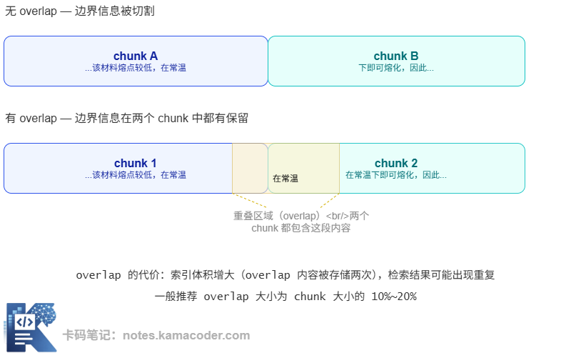

# 3.3 RAG 切片策略：固定长度、递归字符、语义切分、结构感知四种方式对比 【🔥 必会】

[返回本章目录](README.md) · 融合 llm-master/docs/llm/app/how_to_chunking.md 完整推理与原图 + 标点吸附与字符偏移溯源实战

## 1. 🎯 本节目标与大白话例子

本节目标：掌握四大主流切片策略的底层机制与选型边界，理解 chunk_size、chunk_overlap 及字符数与 Token 数的换算陷阱，并在 Step 2 基础上将 ingest() 升级为带自然标点吸附与可逆字符偏移校验的 SlidingWindowChunker。

大白话例子： 假设你在准备一场闭卷考试，手里有一本 500 页的教材。你的复习策略是把书撕成很多小卡片，每张卡片写一个知识点，考试时根据题目去抽卡片：

如果卡片切得太细（每张只写半句话，比如“违者予以停职处分”），抽出来根本不知道“违什么者”被处分；

如果卡片切得太粗（每张抄一整章 2000 字），抽出来虽然信息全，但真正要找的那 1 句话被埋在一堆无关文字里，信噪比极低。 而更致命的是，Step 2 里我们写的 range(0, len(text), chunk_size) 会生硬地从一句话中间劈开。本节引入重叠（Overlap）和标点吸附，就像撕卡片时特意在两张卡片交界处多抄半句，并且尽量顺着句号、换行符下剪刀，保证每一张卡片都是语义完整的独立证据。

## 2. 🧠 核心原理与五维拆解

### 一、为什么 Chunking 这么重要？（原文档脉络）

RAG 里的 Chunking，面对的就是这个核心矛盾：chunk 太小，单个片段语义不完整；chunk 太大，检索出来的内容里信噪比太低。

### 二、四种主流切分策略对比

固定长度切分（Fixed-size Chunking）：按字符数或 token 数硬性等步长切分（如 Step 2 的原型）。实现极简、吞吐高，但完全无视语义边界，极易腰斩句子和专有名词，仅适合原型验证。

递归字符切分（Recursive Character Splitting）：目前普通文本的工业默认首选（如 LangChain 的 RecursiveCharacterTextSplitter）。核心思路是按分隔符优先级分层递归切分：先按段落 \n\n 切 -> 若仍超限则按换行 \n 切 -> 再超限按句号 。 / 空格切，直到满足长度上限。

语义切分（Semantic Chunking）：把文档拆成单句后逐句算 Embedding，计算相邻句子的余弦相似度，在相似度出现明显“断崖下跌”（话题切换）的地方切开。语义内聚度最高，但离线需全篇跑推理，算力开销大且切片长度极不均匀。

结构感知切分（Structure-aware Chunking）：当文档有明确结构（Markdown #/##/### 标题树、法律条款“第X条”、HTML DOM、代码 AST）时，按天然结构边界切分，并把标题路径作为面包屑（Breadcrumbs）拼在片段头部，精准度最高。

下面这张图展示了同一段文本用不同策略切出来的结果差异：


### 三、Overlap：被低估的关键参数

设想一段文字，某句话恰好落在两个 chunk 的边界：前半句在 chunk 1，后半句在 chunk 2。Overlap 的思路是让相邻 chunk 之间保留一段重叠区（比如 size=512，overlap=64），这样边界附近的信息在两侧都有备份，不管命中哪一块都能拿到完整上下文。



### 四、Chunk 过大、过小各有什么问题？

Chunk 过小：孤立片段缺乏主语或前置条件（如只剩“是的，这种做法符合规范”），导致向量表达语义残缺；同时切片总数剧增，索引膨胀、检索变慢。

Chunk 过大：单块混入多个不相关话题，Embedding 向量变成多主题的“平均向量”，语义被稀释、与精准 Query 的相似度反而下降；且塞入 Prompt 后挤占窗口并推高 TTFT。

经验参考值：对话问答/条款型知识库通常 256512 token；通用技术文档 5121024 token；overlap 通常设为 chunk_size 的 10%~20%。

### 五、组件五维拆解（闭卷背诵标准）

| 维度 | 核心内容（面试闭卷复述标准） |
| --- | --- |
| ① 输入什么 | 清洗后的文档正文 doc.content、doc_id、窗口上限 chunk_size、重叠长度 chunk_overlap。 |
| ② 做什么 | 1. 校验 0 <= chunk_overlap < chunk_size 防死循环；<br>2. 滑窗步进并在尾部窗口做标点自然吸附（Punctuation Snapping）；<br>3. 记录原文档半开区间 [start_char, end_char) 字符偏移。 |
| ③ 输出什么 | 带精确字符坐标与继承元数据的 list[Chunk]。 |
| ④ 关键参数影响 | chunk_size 决定语义粒度与信噪比；chunk_overlap 缓解边界截断，但过大（如 50%）会导致索引翻倍且相邻重复块挤占 Top-K 名额。 |
| ⑤ 工程选型 Trade-off | 有标题/条款结构优先用结构感知；无结构普通文本用递归字符；极端追求主题内聚且离线算力充足再用语义切分。 |

### 六、知识点扩展：面试高频盲区补全

字符数（Characters）绝对不能等同于 Token 数！ 不同模型 Tokenizer 分词效率差异巨大：英文按子词（BPE）切分，1 个单词约 12 个 Token；而部分早期词表对中文一个汉字会拆成 23 个 Byte Token。如果下游 BGE 模型上限是 512 Token，你按 500 字符 切混合中英文/代码文档，极可能超出 512 Token 而被静默截断。工程上应统一用 tiktoken 或目标模型自带的 tokenizer 计算长度。

清洗前后字符偏移错位（Highlight Offset Drift）： 前端需要点击引用高亮原文时，如果先用正则删掉了连续空格再切分，记录的 start_char 就会和原始 PDF 坐标对不上。生产中要么在切片后再做空白规范化，要么维护清洗前后的字符映射表。

## 3. 💻 渐进式代码实操（Step 3：升级为 SlidingWindowChunker）

相比 Step 2 新增/修改了什么： 在 Step 2 的 Chunk 基础上，新增 start_char 和 end_char 坐标字段，并将 Step 2 中简陋的定长切片替换为 SlidingWindowChunker 类，新增三大工程机制：① chunk_overlap 步长控制与防死循环兜底；② 窗口尾部 40% 区间内的标点自然吸附；③ assert doc.content[start:end] == piece 可逆偏移断言。

### 【从零手写核心链路】

```python
"""3.3 Step 3: 在 Step 2 基础上升级 ingest()，新增带重叠、标点吸附与字符偏移校验的滑窗切片器"""
from dataclasses import dataclass
from datetime import date


@dataclass(frozen=True)
class Document:
    doc_id: str
    title: str
    content: str
    version: str
    effective_date: date
    expire_date: date
    roles: tuple[str, ...] = ("employee",)


@dataclass(frozen=True)
class Chunk:
    """【Step 3 升级】新增 start_char / end_char，支持前端高亮精准溯源。"""
    chunk_id: str
    doc_id: str
    version: str
    content: str
    # [必记设计决策-偏移溯源] 必须记录 start_char / end_char 字符坐标，支撑前端原文高亮与可逆校验
    start_char: int
    end_char: int
    effective_date: date
    expire_date: date
    roles: tuple[str, ...]


class SlidingWindowChunker:
    """【Step 3 新增】支持重叠、标点自然吸附与可逆偏移断言的切分器。"""
    def __init__(self, chunk_size: int = 40, chunk_overlap: int = 10, snap_punct: bool = True) -> None:
        if chunk_size <= 0 or not (0 <= chunk_overlap < chunk_size):
            raise ValueError("必须满足 chunk_size > 0 且 0 <= chunk_overlap < chunk_size")
        self.chunk_size = chunk_size
        self.chunk_overlap = chunk_overlap
        self.snap_punct = snap_punct
        self._puncts = ("。", "！", "？", "；", "\n")

    def split_document(self, doc: Document) -> list[Chunk]:
        text = doc.content
        n = len(text)
        if n == 0:
            return []
        chunks: list[Chunk] = []
        start, idx = 0, 0
        while start < n:
            end = min(start + self.chunk_size, n)
            # [必背手撕-标点吸附] 在窗口尾部 40% 区间 rfind 自然标点，避免硬切截断完整语义句
            if self.snap_punct and end < n:
                # 在窗口尾部 40% 范围内寻找最后一个自然标点，防止切断完整句子
                search_left = max(start + int(self.chunk_size * 0.6), start + 1)
                snapped = max((text.rfind(p, search_left, end) for p in self._puncts), default=-1)
                if snapped != -1:
                    end = snapped + 1
            piece = text[start:end]
            # [必记设计决策-可逆不变量] 切片与原文档区间必须严格恒等，禁止因提前清洗破坏字符坐标
            assert doc.content[start:end] == piece, "偏移切片必须与原文档区间严格恒等"
            chunks.append(Chunk(
                chunk_id=f"{doc.doc_id}_c{idx:02d}",
                doc_id=doc.doc_id,
                version=doc.version,
                content=piece,
                start_char=start,
                end_char=end,
                effective_date=doc.effective_date,
                expire_date=doc.expire_date,
                roles=doc.roles,
            ))
            if end == n:
                break
            # [必背手撕-防死循环] 重叠回退时若 next_start <= start 必须强制推进到 end，防止步长退化死循环
            next_start = end - self.chunk_overlap
            start = next_start if next_start > start else end  # 防止步长退化引发死循环
            idx += 1
        return chunks


if __name__ == "__main__":
    raw = "未经通风检测合格，严禁进入有限空间作业。违者予以停职处分。进入前必须佩戴气体检测仪。"
    doc = Document("DOC_SPACE", "受限空间", raw, "v1", date(2026, 1, 1), date(2027, 12, 31))
    chunker = SlidingWindowChunker(chunk_size=28, chunk_overlap=8, snap_punct=True)
    res = chunker.split_document(doc)
    assert len(res) >= 2
    assert res[0].content.endswith("。"), f"标点吸附应使首块在句号处收尾，实际: {res[0].content}"
    assert res[1].start_char == res[0].end_char - 8, "第二块起点必须保留 overlap 重叠"
    assert all(doc.content[c.start_char:c.end_char] == c.content for c in res)
    print("Step 3 self-test passed!")
```

### 【工业级调库对照】

生产中针对 Markdown 和普通长文本，通常组合使用 MarkdownHeaderTextSplitter（先按标题树保留面包屑）+ RecursiveCharacterTextSplitter（兜底控制最大 Token 数）：

```python
from langchain_text_splitters import MarkdownHeaderTextSplitter, RecursiveCharacterTextSplitter

headers_to_split_on = [("#", "H1"), ("##", "H2"), ("###", "H3")]
md_splitter = MarkdownHeaderTextSplitter(headers_to_split_on=headers_to_split_on)
# 先按标题拆，再按 Token 递归切分兜底
text_splitter = RecursiveCharacterTextSplitter.from_tiktoken_encoder(
    chunk_size=400, chunk_overlap=60, separators=["\n\n", "\n", "。", "！", "？", "；", " "]
)
```

何时手写 vs 何时调库：普通文本直接调 RecursiveCharacterTextSplitter（记得切中文时把 "。" 加入 separators，默认只有英文标点！）；遇到需要精确前端字符高亮坐标 [start_char, end_char)、或特殊规章条款编号切分时，手写可控性更高。

### 🧠 代码区记忆清单：背什么 vs 不背什么

🔒 不可替代的系统设计决策（必须记住，面试直接讲思路）：

坐标可逆不变量：doc.content[start_char:end_char] == piece，清洗文本不能破坏原始字符偏移，否则前端无法精准高亮溯源。

尾部标点吸附区间：只在窗口后 40%（0.6 * chunk_size 之后）找句号等自然边界，防止前面刚好没标点导致切片过短。

步长退化防死循环：当标点吸附导致 end 提前、end - chunk_overlap <= start 时，必须兜底 start = end。

✍️ 面试手撕/默写范围：

SlidingWindowChunker.split_document 的主循环（算 end -> 尾部 40% rfind 吸附 -> 算 next_start 并防倒退）是高频手撕题。

🗑️ 无需死背的脚手架代码：

Document / Chunk 的 @dataclass 样板字段、__init__ 参数校验与 if __name__ == "__main__" 断言。

## 4. 🗣️ 面试官视角：这段代码怎么讲

① 声明不变量：SlidingWindowChunker 维护了三个核心不变量——前置约束 0 <= chunk_overlap < chunk_size、偏移恒等 doc.content[start:end] == chunk.content，以及单调前进 next_start > start（杜绝死循环）。

② 关键行解析：第 48~52 行的标点吸附只在窗口后 40% 区间向后找句号/换行符，既避免了在句中腰斩，又防止因回退过多导致切片过小；第 67 行当 end - overlap <= start 时强制步进到 end，这是防止标点吸附后回退步长小于 overlap 引发无限循环的关键防御。

③ 主动点出工程细节（加分项）：我会主动提醒面试官，中文场景如果直接用 LangChain 默认的 RecursiveCharacterTextSplitter 会踩大坑——因为它的默认分隔符只有英文 ["\n\n", "\n", " ", ""]，没有中文句号 "。"，遇到整段无换行的中文制度会直接硬截断，必须在初始化时显式传入中文标点列表。

## 5. 🔧 生产排障指南（实现 -> 排障）

| 故障现象 | 定位方法 | 修复方案 |
| --- | --- | --- |
| 1. 检索命中了条款，但回答遗漏“前提条件”（如“必须在断电前提下”） | 根据 chunk_id 和 start_char/end_char 回溯原文，查看前提条件是否恰好落在上一块的末尾且未被 overlap 覆盖。 | 增大 chunk_overlap 至 15%~20%；或将纯文本切分升级为“保留标题路径的结构感知切分”或“父子块扩展”。 |
| 2. Top-3 返回的全是同一段话的“复读机”相邻切片 | 检查 chunk_overlap 是否设得过大（如超过 40%），导致相邻切片高度同质化，挤占了其他异构证据的名额。 | 将 chunk_overlap 回调至 10%~15%，并在检索融合后增加基于 doc_id 或内容相似度的去重限制。 |
| 3. 切片程序在特定短段落上 CPU 100% 卡死（OOM） | 检查 while start < n: 循环步进逻辑，当标点吸附把 end 拉回得比 start + chunk_overlap 还小时，end - overlap <= start 导致死循环。 | 强制加入步长单调递增守卫：start = max(end - overlap, start + 1) 或 end。 |

## 6. ❓ 高频面试追问与参考答法 + 📝 节末费曼自检

### 高频面试追问

Q1：你们项目里的 chunk_size 和 overlap 是怎么定的？为什么不直接按 500 切？

参考答法：没有万能默认值，我们是按“文档结构 + Embedding 窗口 + 评测集网格搜索”定的。先看下游 Embedding 模型的最大长度（如 BGE 为 512 Token），留出标题面包屑余量；然后针对条文密集型安全规程，在 200 / 350 / 500 三组粒度下跑黄金评测集的 Recall@10 和端到端忠实度，最终选出准召与延迟最均衡的配置，overlap 取 15% 保护边界。

Q2：chunk_overlap 设得越大越好吗？有什么副作用？

参考答法：绝对不是。overlap 过大有三个副作用：第一，索引体积和 Embedding 计算成本成倍膨胀；第二，相邻切片高度重复，在线检索时很容易同时霸占 Top-1、Top-2，挤掉其他关键证据导致多样性下降；第三，塞进 Prompt 浪费 Token 预算。

Q3：为什么递归字符切分（Recursive）在工业界比固定长度切分更常用？

参考答法：固定长度切分无视语法边界，会把一个完整的条件句劈成两半；而递归切分按 \n\n -> \n -> 。 -> 空格 的优先级逐层降级尝试，在保证不超过最大长度上限的前提下，最大限度地把切口留在段落或完整句子的自然边界上。

Q4：切片时遇到 Markdown 表格或者多级标题怎么处理才不会丢上下文？

参考答法：第一，Markdown 标题树（如 第一章 / 1.2 动火审批）要作为前缀拼进每个子切片的文本和元数据里（Breadcrumbs），否则子切片只写“需三级审批”会丢失主语；第二，表格尽量不要按字符数腰斩，应整张表保留或按“表头 + 单行记录”拆成独立 KV 描述文本。

### 📝 节末费曼自检（闭卷自测）

请对比固定长度、递归字符、语义切分、结构感知四种策略的适用场景与代价。

在手写滑窗切片器时，为什么标点吸附可能会引发 while 死循环？代码上如何防御？
