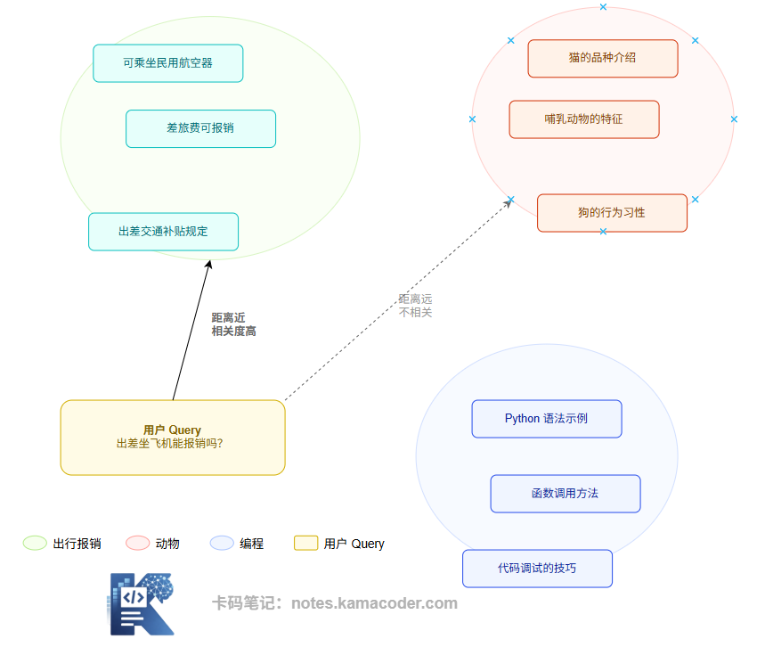
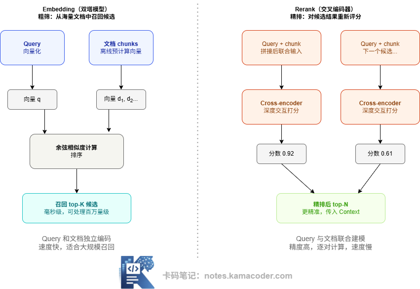

# 3.4 Embedding 是什么：语义压缩、模型选型、和 Rerank 的区别 【🔥 必会】

[返回本章目录](README.md) · 融合 llm-master/docs/llm/app/embedding.md 完整推理与原图 + 几何统一定理与抗崩溃矩阵检索

## 1. 🎯 本节目标与大白话例子

本节目标：彻底理解 Embedding“用空间距离表达语义相似度”的本质，掌握 L2 归一化下余弦相似度、内积与欧氏距离的几何统一定理，讲清 Bi-Encoder（粗筛）与 Cross-Encoder（精排）的分工，并在 Step 3 基础上为系统接入 DenseVectorRetriever 稠密向量检索引擎。

大白话例子： 在 Step 1~3 里，我们用的是“双字滑窗匹配”——本质上还是在拼字面。如果用户问“出差坐飞机能报销吗”，而制度里写的是“员工搭乘民用航空器出行的差旅标准”，字面一个字都对不上，传统关键词检索直接得 0 分。 而 Embedding 就像一个精通语义的“高维地图绘制员”：它不数汉字是否一模一样，而是把每句话压缩成一个空间坐标（比如 768 维的向量）。在这个语义地图上，“飞机”和“民用航空器”虽然长得完全不同，但它们的坐标挨得非常近；而“今天天气不错”则被扔到了地图的另一头。检索，就变成了在这个地图上“找离问题坐标最近的几个点”。

## 2. 🧠 核心原理与五维拆解

### 一、Embedding 到底是什么？（原文档脉络）

Embedding 是一种将文本（或图片、音频）映射到高维向量空间的技术。一个句子经过 Embedding 模型处理后，会变成一个由几百到几千个浮点数组成的数组（如 384、768 或 1536 维）。关键不在于这串数字本身，而在于它在空间里的位置：用空间距离来表达语义相似度。



### 二、Embedding 不是生成文本，是在压缩语义

生成式大模型（如 GPT、DeepSeek）的目标是输出文字；而 Embedding 模型的目标完全不同——它的输出是一个固定维度的向量表示，目的是把变长文本的“语义”压缩进数字数组里，保留语义核心，丢掉无关的措辞差异。

### 三、Embedding 模型怎么选？（四大考量维度）

向量维度：维度越高语义越细腻，但内存和检索耗时越大。常见 384 维（轻量）、768 维（均衡起点）、1536 维（高精度）。

最大 Token 限制：模型输入长度上限（如 bge-small-zh 为 512 Token）直接约束了前一步 Chunk 的最大尺寸，超限会被静默截断。

中文与领域支持：英文通用模型（如早期 ada-002）中文表现弱，中文场景应参考 MTEB 中文 Retrieval 榜单，优先选 BGE 系列（bge-large-zh-v1.5、bge-m3）或 M3E。

非对称检索能力：RAG 中 Query 很短、Document 较长，属于非对称检索。支持非对称指令的模型（如 BGE 要求 Query 拼接特定前缀）效果显著更好。

### 四、Embedding 和 Rerank 有什么区别？

简单说：Embedding 负责“粗筛”，Rerank 负责“精排”。



Embedding（双塔模型 / Bi-Encoder）：Query 和文档各自独立编码成向量，再算向量距离。优势是文档向量可以离线预计算存进向量库，在线检索毫秒级从百万级文档里捞出 Top-K（20~50）。缺点是 Query 和文档在编码时“互不见面”，缺乏细粒度词元交互。

Rerank（交叉编码器 / Cross-Encoder）：把 Query 和候选文档拼接在一起 [CLS] Query [SEP] Doc [SEP] 送入模型，利用全自注意力机制计算深度交互，直接输出相关性分数。精准度极高，但无法预计算，只适合对粗筛后的少量候选（Top-20 以内）做精排。

### 五、组件五维拆解（闭卷背诵标准）

| 维度 | 核心内容（面试闭卷复述标准） |
| --- | --- |
| ① 输入什么 | 离线：切片文本列表 list[str]（绝不加前缀）；在线：用户 query（按模型规范拼接非对称检索前缀）。 |
| ② 做什么 | 1. 经双塔模型 Pooling 层映射为 (N, D) 稠密矩阵；<br>2. 执行加 eps=1e-12 的 L2 行归一化；<br>3. 计算 doc_matrix @ q_vec.T 内积排序取 Top-K。 |
| ③ 输出什么 | 归一化后的单位向量矩阵 (N, D) 及降序排列的 (chunk_id, cosine_score) 列表。 |
| ④ 关键参数影响 | 维度 $D$ 决定内存与精度；max_length 决定截断风险；normalize_embeddings=True 是点积等价于余弦的前提。 |
| ⑤ 工程选型 Trade-off | 模型不是越大越好（需权衡 P95 延迟与显存）；中文多语言首选 bge-m3；换模型必须全量重建索引，否则向量空间完全不可比。 |

### 六、知识点扩展：余弦、内积与欧氏距离的几何统一定理（能推导）

给定两个向量 $\mathbf{u}, \mathbf{v} \in \mathbb{R}^D$：

余弦相似度：$\cos(\theta) = \frac{\mathbf{u} \cdot \mathbf{v}}{|\mathbf{u}|_2 |\mathbf{v}|_2}$

欧氏距离平方：$|\mathbf{u} - \mathbf{v}|_2^2 = |\mathbf{u}|_2^2 + |\mathbf{v}|_2^2 - 2\langle \mathbf{u}, \mathbf{v} \rangle$

🔥 核心等价结论：当且仅当 $\mathbf{u}$ 和 $\mathbf{v}$ 均已完成 L2 归一化（$|\mathbf{u}|_2 = |\mathbf{v}|_2 = 1$）时：

点积严格等于余弦相似度：$\langle \mathbf{u}, \mathbf{v} \rangle = \cos(\theta)$；

欧氏距离平方与余弦呈严格单调负相关：$|\mathbf{u} - \mathbf{v}|_2^2 = 2 - 2\cos(\theta)$。 在归一化前提下，用“余弦相似度从大到小排”、用“内积从大到小排”、或者用“欧氏距离从小到大排”，最终搜出来的 Top-K 文档列表顺序完全一致。工业向量库（FAISS/Milvus）之所以普遍用内积（IP）加速余弦检索，就是因为离线归一化后，在线只需跑硬件优化的矩阵点积，省去了每次实时开方求模长的开销。直接算余弦相似度 $\frac{u \cdot v}{\Vert{}u\Vert{}\Vert{}v\Vert{}}$，每次检索都要对海量向量算平方、加法、开根号、除法，非常耗时。工业界标准做法：在文档入库（离线阶段）时，先花一次性的算力把所有向量做 L2 归一化（长度变成 $1$）再存进数据库；等到用户提问（在线检索阶段）时，直接在数据库里选 Inner Product（内积/点积） 度量。此时计算机只需要做最擅长的矩阵乘法（GPU Tensor Core 极度擅长这个），算出来的点积结果在数值上就严格等于余弦相似度，既保证了精度，又把检索延迟压到了最低。

## 3. 💻 渐进式代码实操（Step 4：新增 DenseVectorRetriever 向量检索引擎）

相比 Step 3 新增/修改了什么： 在前面切片与流水线基础上，新增 l2_normalize() 抗除零稳定算子与 DenseVectorRetriever 类（引入 NumPy 矩阵运算），实现 BGE 非对称前缀区分、矩阵点积 Top-K 召回，并用 assert 在代码里直接验证“L2 平方距离严格等于 2 - 2 * cos”。

### 【从零手写核心链路】

```python
"""3.4 Step 4: 在 Step 3 基础上新增 DenseVectorRetriever（L2 归一化 + 矩阵余弦 + 非对称前缀）"""
import numpy as np


# 非对称前缀。BGE 等非对称模型仅 Query 加检索前缀，Document 入库绝不加前缀
BGE_QUERY_PREFIX = "为这个句子生成表示以用于检索相关文章："


# L2 归一化。先检查 NaN 和 Inf，再用 norm + eps 避免零向量除零。
def l2_normalize(vectors: np.ndarray, eps: float = 1e-12) -> np.ndarray:
    """对二维向量矩阵 (N, D) 执行数值稳定的 L2 行归一化，防零向量除零崩溃。"""
    if vectors.ndim != 2 or vectors.shape[0] == 0:
        raise ValueError("输入必须是形状为 (N, D) 的非空二维矩阵")
    # 【闭卷练习开始】非有限值检查、行归一化和零向量保护
    if not np.all(np.isfinite(vectors)):
        raise ValueError("向量矩阵包含 NaN 或 Inf")
    norms = np.linalg.norm(vectors, axis=1, keepdims=True) + eps
    normalized = vectors / norms
    assert normalized.shape == vectors.shape
    return normalized
    # 【闭卷练习结束】


class DenseVectorRetriever:
    """【Step 4 新增】支持非对称前缀与几何等价校验的稠密向量检索器。"""
    def __init__(self, dim: int = 16) -> None:
        self.dim = dim
        self.chunk_ids: list[str] = []
        self.doc_matrix: np.ndarray | None = None

    # 脚手架。教学用确定性字符哈希编码器，生产中直接调用 BGE / OpenAI Embedding
    def _mock_encode(self, texts: list[str], is_query: bool = False) -> np.ndarray:
        """确定性教学编码器：模拟语义映射（生产中替换为 BGE/OpenAI Embedding）。"""
        vecs = np.zeros((len(texts), self.dim), dtype=np.float32)
        for i, text in enumerate(texts):
            # Query 必须加非对称前缀，Document 绝不加前缀
            proc = f"{BGE_QUERY_PREFIX}{text}" if is_query else text
            for ch in proc:
                if ch in BGE_QUERY_PREFIX and is_query:
                    continue
                vecs[i, ord(ch) % self.dim] += 1.0
        return l2_normalize(vecs)

    def index_chunks(self, chunk_ids: list[str], texts: list[str]) -> None:
        if len(chunk_ids) != len(texts) or not chunk_ids:
            raise ValueError("chunk_ids 与 texts 必须非空且等长")
        self.chunk_ids = list(chunk_ids)
        self.doc_matrix = self._mock_encode(texts, is_query=False)
        assert self.doc_matrix.shape == (len(chunk_ids), self.dim)

    def search(self, query: str, top_k: int = 2) -> list[tuple[str, float]]:
        if self.doc_matrix is None:
            raise RuntimeError("请先调用 index_chunks 构建索引")
        q_vec = self._mock_encode([query], is_query=True)  # (1, D)
        # 归一化后，点积严格等价于余弦相似度，且与 L2 平方距离单调负相关
        # 矩阵余弦。单位向量归一化后，点积等价于余弦相似度，且 L2^2 = 2 - 2*cos
        # 【闭卷练习开始】单位向量的批量点积
        dot_scores = (self.doc_matrix @ q_vec.T).squeeze(axis=1)  # (N,)
        # 【闭卷练习结束】
        l2_sq_dists = np.sum((self.doc_matrix - q_vec) ** 2, axis=1)
        assert np.allclose(l2_sq_dists, 2.0 - 2.0 * dot_scores, atol=1e-5), "L2平方距离必须严格等于 2 - 2*cos"

        # 【闭卷练习开始】按相似度取 Top-K 并映射回 ID，argsort只能升序排序所以加负号
        top_indices = np.argsort(-dot_scores)[:top_k]
        return [(self.chunk_ids[int(idx)], float(dot_scores[int(idx)])) for idx in top_indices]
        # 【闭卷练习结束】


if __name__ == "__main__":
    retriever = DenseVectorRetriever(dim=32)
    retriever.index_chunks(
        ["C1", "C2", "C3"],
        ["高处作业必须佩戴全身式五点安全带", "动火作业须配备灭火器并设专人监护", "食堂午餐十二点开始供应"],
    )
    hits = retriever.search("高处作业安全带佩戴要求", top_k=2)
    assert hits[0][0] == "C1", f"应优先召回 C1，实际为 {hits}"
    zero_safe = l2_normalize(np.array([[0.0, 0.0, 0.0]], dtype=np.float32))
    assert np.all(np.isfinite(zero_safe)) and np.allclose(zero_safe, 0.0)
    print("Step 4 self-test passed!")
```

### 【工业级调库对照】

生产环境使用 sentence-transformers 加载 BGE 模型时，务必开启 normalize_embeddings=True，并手动区分 Query 前缀：

```python
from sentence_transformers import SentenceTransformer

model = SentenceTransformer("BAAI/bge-large-zh-v1.5")
doc_vecs = model.encode(["高处作业必须佩戴安全带"], normalize_embeddings=True)  # 文档不加前缀
query_text = "为这个句子生成表示以用于检索相关文章：高处作业怎么戴安全带？"
q_vec = model.encode([query_text], normalize_embeddings=True)                  # Query 加前缀
scores = doc_vecs @ q_vec.T  # 直接内积即余弦相似度
```

何时手写 vs 何时调库：语义编码必须调库（sentence-transformers 或 API）；而底层的 L2 归一化、批量点积矩阵运算与数值防 NaN 校验在面试手撕和离线评估脚本中极常手写。

### 示例说明与练习范围

本例的设计选择：

非对称编码铁律：短 Query 与长 Document 语义分布不同，Query 必须加模型指定前缀（如 BGE 前缀），Document 侧不能加。

几何等价关系：L2 归一化后，余弦相似度 = 点积（Inner Product），且 L2_sq = 2 - 2 * cos，向量库可直接用内积加速。

数值稳定性边界：入库与检索前必须校验 np.isfinite 并加 eps=1e-12 防零向量除零产生 NaN。

**代码练习｜闭卷写核心**。写归一化、零向量处理、批量点积和 Top-K。

示例辅助代码：

_mock_encode 的 ord(ch) % self.dim 模拟编码逻辑与 np.argsort 格式化输出。

## 4. 🗣️ 面试官视角：这段代码怎么讲

① 声明不变量：我的向量检索算子守住了两个数值不变量——单位范数不变量（所有入库和查询向量在进入计算前均经过带 eps=1e-12 的 L2 归一化，杜绝零向量产生 NaN 污染整批排序）和同构空间不变量（Query 严格按非对称规范加前缀，Document 保持原文不加）。

② 关键行解析：第 14 行 norms = np.linalg.norm(..., keepdims=True) + eps 是工程必写防线，防止全空白或 OOV 切片输出零向量引发除零崩溃；第 51~53 行通过矩阵乘法 (N, D) @ (D, 1) 一次性算出全库相似度，并用 assert np.allclose(l2_sq_dists, 2.0 - 2.0 * dot_scores) 验证了归一化后三大度量的几何等价性。

③ 主动点出工程细节（加分项）：我会主动补充，余弦相似度 0.85 并不代表“85% 概率正确”，它只是流形上的相对夹角，不同模型间不可横向比较；生产中切忌硬编码 score > 0.8，必须在业务验证集上画 PR 曲线确定截断阈值。此外，对超过 512 Token 的切片不能依赖 Tokenizer 静默截断，必须在入库前告警并触发 Step 3 切片。

## 5. 🔧 生产排障指南（实现 -> 排障）

| 故障现象 | 定位方法 | 修复方案 |
| --- | --- | --- |
| 1. 换了新 Embedding 模型后，所有 Query 的相似度全挤在 0.85~0.92 之间毫无区分度 | 检查两点：① 是否漏加了非对称 Query 前缀（如 BGE/E5）；② 模型 Pooling 方式是否配错（如该用 mean pooling 却配成了 cls pooling）导致各向异性崩塌。 | 核对模型官方文档补齐 Query 前缀与正确的 Pooling 配置，或切换经对比学习充分对齐的检索专用模型（如 bge-m3）。 |
| 2. 检索结果出现大量 NaN 分数，排序彻底错乱 | 检查入库前是否有空白字符、纯符号或解析乱码文本，导致模型输出全 0 向量，归一化时发生 0 / 0 = NaN。 | 在 l2_normalize 中强制加 + 1e-12 平滑项，并在入库清洗阶段拦截长度过短或全空白切片。 |
| 3. 长段落的后半段关键词怎么都搜不到 | 检查 Embedding Tokenizer 的 max_length（通常默认 512）及 truncation=True 参数，后半段已被静默丢弃。 | 在 Step 3 切片阶段严格按目标模型的 tokenizer 计算 Token 数，确保每个切片不超过 400~450 Token。 |

## 6. ❓ 高频面试追问与参考答法 + 📝 节末费曼自检

### 高频面试追问

Q1：为什么向量检索常用余弦相似度而不是欧氏距离？为什么向量库又常用内积（IP）来算余弦？

参考答法：欧氏距离受向量模长影响（长文本模长大），而余弦只看方向不看长度，更契合语义匹配。至于向量库用内积，是因为只要离线入库和在线查询时提前做一次 L2 归一化（模长变为 1），此时内积在数学上就严格等于余弦相似度，向量库可以直接调用硬件 SIMD/GEMM 加速点积，省去了实时开方求模的算力开销。

Q2：Embedding（Bi-Encoder）和 Rerank（Cross-Encoder）的本质区别是什么？

参考答法：核心区别在于编码是否独立。Bi-Encoder 对 Query 和 Doc 分别独立编码，最后只算一次点积，优点是文档向量可离线预计算、在线毫秒级粗筛百万文档，缺点是两者缺乏深层 Token 交互；Cross-Encoder 把 Query 和 Doc 拼在一起送入 Transformer 做全交互自注意力，精度极高但无法预计算，只能对粗筛出的 Top-20 做精排。

Q3：为什么 BGE 等模型要求 Query 加前缀，而 Document 绝对不能加？

参考答法：这是非对称检索训练决定的。模型在对比学习阶段就是按 (带指令的短 Query, 无指令的长 Document) 配对训练的，指令前缀用来告诉模型“现在是在做检索提问”；如果在 Document 入库时也加了指令，反而会把“指令语义”污染进文档向量，拉近无关文档之间的虚假相似度。

Q4：换了更好的 Embedding 模型，可以直接在线替换，不重建离线索引吗？

参考答法：绝对不行。不同模型（甚至同一模型的不同微调版本）映射出的高维向量空间坐标系完全不同，旧索引里的向量和新模型产出的 Query 向量没有任何几何可比性。生产中必须使用蓝绿双 Collection 离线全量重算重建，验证通过后再原子切换流量。

### 📝 节末费曼自检（闭卷自测）

请闭卷写出在 L2 归一化前提下，余弦相似度、内积与欧氏距离平方的数学转换关系。

如果线上出现“相似度分数全部扎堆在 0.88 附近且排序失效”，你会按哪三步排查？

池化（Pooling） 就是把 [N, 1024] 拍扁成 [1, 1024] 的降维聚合操作。
["[CLS]", "高", "处", "作", "业", ..., "[SEP]"]
在 Transformer 内部的每一层自注意力（Self-Attention）计算中，[CLS] 都会去和句子里的每一个字做注意力交互，把整句话的语义信息不断吸收汇总到自己身上。
模型算完后，[CLS] 池化的做法极其简单粗暴——直接把第 0 号位置（[CLS] 所在位置）的向量拿出来作为整句话的向量，后面所有字的向量全部扔掉。

| 池化方式 | 数学/代码做法 | 物理含义 | 代表模型 |
| --- | --- | --- | --- |
| [CLS] 池化 | "last_hidden_state[:, 0]" | 选第 0 个特殊 Token 当“课代表”，只看它的总结发言 | BAAI/bge 系列、原生 BERT |
| Mean 平均池化 | 所有有效 Token 向量按位求平均值（需排除 [PAD]）| “全员民主投票”，把句子里每个字的向量平均到一起 | E5 系列、Sentence-BERT、M3E
| Last-Token 末位池化 | 取最后一个有效 Token 的向量 | 专用于大模型底座（Decoder-only），因为单向注意力只有最后一个字能“看到”前面所有字 | Qwen-Embedding、E5-Mistral

## 面试重点｜设计、调参与排障

**面试官可能问**

向量库为什么能用点积做余弦检索？零向量怎么办？

**参考回答（现场口述）**

单位向量的点积等于余弦，相同条件下平方欧氏距离等于二减两倍点积，所以排序等价。零向量没有定义良好的余弦，我会按策略跳过入库或让该查询降级。上线前还要确认文档和查询的编码方式、距离度量一致。

**系统设计怎么选**

非零向量做 L2 归一化后，点积等于余弦，平方 L2 距离为 2−2cos，精确排名等价。ANN 与量化可能改变结果。零向量单独处理，不能直接宣称加 epsilon 后还是精确单位向量。

**参数或条件改变会怎样**

调 Top-K 时比较候选召回和精排成本。Bi-Encoder 能离线编码文档，查询复杂度取决于索引；Cross-Encoder 在候选内联合打分。

**系统出错怎么查、怎么验证**

已知近义条款却排低时核对模型版本、维度、Query/Doc 编码配置和向量范数，再用精确 Top-K 对照。
