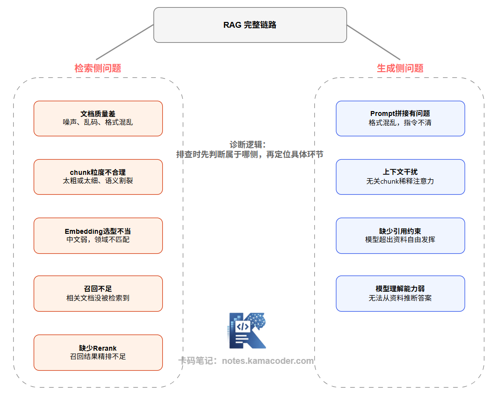
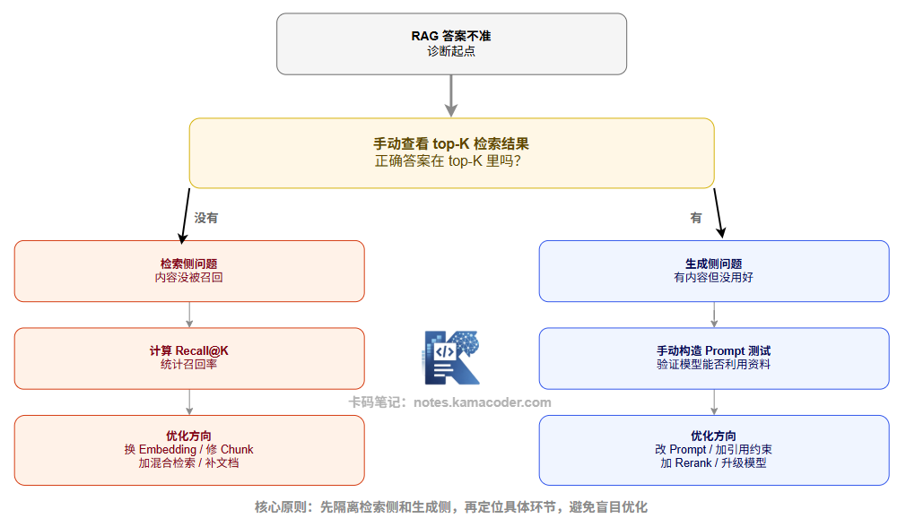

# 3.6 RAG 答不准的常见问题：检索侧五类、生成侧四类问题逐一排查 【🔥 必会】

[返回本章目录](README.md) · 融合 llm-master/docs/llm/app/rag_problems.md 完整推理与原图 + 六层因果穿透排障状态机

## 1. 🎯 本节目标与大白话例子

本节目标：建立“先定位阶段、再单变量修复”的工程排障方法论，彻底掌握检索侧五类与生成侧四类常见故障的定位手法，区分内在幻觉与外在幻觉，并在 Step 5 基础上新增 PipelineDiagnostics 自动化因果链排障状态机。

大白话例子： 查 RAG 答错，就像查家里自来水龙头流出浑水。 你绝不能水一浑就立刻花钱换个更贵的进口水龙头（盲目换更强的大模型或改 Prompt）。正确的排查顺序是顺着水流从上游往下游查：

先看水库里有没有水、水清不清（源头文档是否存在且没过期）；

再看管道滤网有没有破（解析与切片有没有把 PDF 表格弄错行）；

再看水泵有没有把水抽上来（初筛检索 Top-20 里有没有金标切片）；

再看净水器有没有把好水滤掉（重排与上下文截断有没有把金标踢出去）；

最后才看水龙头本身（大模型生成有没有乱改数字或胡说八道）。

## 2. 🧠 核心原理与五维拆解

### 一、所有常见问题一览（原文档脉络）

RAG 就两段关键链路：离线构建索引、在线检索生成。答案不好，要么是检索崩了（没找到、找错了），要么是生成崩了（找到了但没用好）。不先定位是检索还是生成的问题，所有优化都是治标不治本。



### 二、检索侧：五类常见问题

文档质量差：扫描件 OCR 乱码、PDF 多栏错位、表格被打散、充满“第 3 页/版权所有”噪声。这是最根本却最容易被忽略的源头问题。

Chunk 粒度不合理：太小导致语义残缺（缺前提条件），太大导致多主题混杂、向量被平均化。

Embedding 选型不当：中文或垂直领域支持弱，换个同义问法相似度就暴跌；或漏加 Query 前缀。

召回不足：文档更新后索引没重建、元数据过滤误杀、top_k 太小把答案挤在 K 之外、缺少关键词精确匹配。

缺少 Rerank：初筛 Top-K 里有相关话题但没精确回答问题的干扰项，缺乏 Cross-Encoder 精排筛掉低质片段。

### 三、生成侧：四类常见问题

Prompt 拼接有问题：多个 Chunk 之间没有分隔符、缺少来源 ID 锚点、指令和参考资料混在一起。

上下文干扰（Context Noise）：大量低相关 Chunk 混入 Context 稀释注意力，或核心证据放在长文本正中间触发 Lost in the Middle。

缺少引用约束（模型自由发挥）：没有硬性要求“仅依据资料回答”，模型把参数记忆和检索内容混编产生外在幻觉。

模型理解与推理能力不足：需要跨多段进行否定判断、数值比较或复杂逻辑推理时，小参数模型力不从心。

### 四、系统化诊断流程



### 五、组件五维拆解（闭卷背诵标准）

| 维度 | 核心内容（面试闭卷复述标准） |
| --- | --- |
| ① 输入什么 | 失败请求 query、专家核定的金标切片 gold_chunk_id、全链路 PipelineTrace 中间快照。 |
| ② 做什么 | 严格按因果拓扑顺序向下穿透：源头存在性 -> 解析完整性 -> 初筛命中 -> 重排留存 -> 引用合法性 -> 事实忠实度。 |
| ③ 输出什么 | 首个破坏链路的故障阶段枚举 FailureStage 及对应的单变量修复工单。 |
| ④ 关键参数影响 | 日志埋点粒度（是否保留了 retrieved_top_k_ids 与 final_context_ids）决定了能否 1 分钟定位根因。 |
| ⑤ 工程选型 Trade-off | 单变量原则：每次只修定位出的那一层，绝不一边调切片、一边换 Embedding、一边改 Prompt。 |

### 六、知识点扩展：内在幻觉 vs 外在幻觉 + 埋点规范

内在幻觉（Intrinsic Hallucination）vs 外在幻觉（Extrinsic Hallucination）：

内在幻觉：上下文写“罚款 500 元”，模型答“罚款 5000 元”——篡改给定事实（多见于数值抽取、否定词误读）。对策：temperature=0、缩短噪声 Context、把核心片段放末尾。

外在幻觉：上下文压根没提法规名称，模型自己补充“依据《安全生产法》第 7 条”——无中生有。对策：强化“仅依据资料作答”+ 后置引用拦截器。

全链路 Trace ID 穿透：从网关、检索、重排到 LLM 生成，必须透传唯一 trace_id，并将每步输入输出落盘（OpenTelemetry / Langfuse），否则线上出了 Bad Case 根本无法复盘。

## 3. 💻 渐进式代码实操（Step 6：新增 PipelineTrace 与六层因果排障状态机）

相比 Step 5 新增/修改了什么： 在前面检索与流水线的基础上，新增 FailureStage 枚举、PipelineTrace 全链路快照数据结构，以及 diagnose_rag_pipeline() 自动化排障状态机，实现“上游未过关，绝不归咎下游”的因果穿透诊断。

### 【从零手写核心链路】

```python
"""3.6 Step 6: 在 Step 5 基础上新增全链路可观测 Trace 与六层因果穿透排障状态机"""
from dataclasses import dataclass
from enum import Enum


# 六层漏斗。RAG 故障归因必须按因果单向穿透：源头缺失->解析丢失->初筛漏召->精排挤出->未引->幻觉
class FailureStage(str, Enum):
    SOURCE_DEFICIT = "SOURCE_DEFICIT"
    PARSER_LOSS = "PARSER_LOSS"
    RETRIEVAL_MISS = "RETRIEVAL_MISS"
    RERANK_DROPPED = "RERANK_DROPPED"
    CITATION_UNGROUNDED = "CITATION_UNGROUNDED"
    LLM_HALLUCINATION = "LLM_HALLUCINATION"
    HEALTHY = "HEALTHY"


@dataclass(frozen=True)
# 轨迹快照保存召回、拼装与最终引用阶段的候选 ID。
class PipelineTrace:
    """【Step 6 新增】单次请求全链路中间快照（Trace ID 穿透落盘）。"""
    trace_id: str
    query: str
    gold_chunk_id: str
    source_has_fact: bool
    parsed_chunks_has_fact: bool
    retrieved_top_k_ids: tuple[str, ...]
    final_context_ids: tuple[str, ...]
    cited_ids: tuple[str, ...]
    is_factually_faithful: bool


# 因果穿透归因。严格遵守“上游未过关，绝不归咎下游”的短路判断顺序
def diagnose_rag_pipeline(trace: PipelineTrace) -> tuple[FailureStage, str]:
    """沿因果链单向向下穿透，锁定第一个破坏链路的根因阶段。"""
    if not trace.source_has_fact:
        return FailureStage.SOURCE_DEFICIT, "源头文档缺失该事实，应触发拒答并补充知识库。"
    if not trace.parsed_chunks_has_fact:
        return FailureStage.PARSER_LOSS, "原文存在但解析/切片丢失（检查 PDF 表格或增大 overlap）。"
    if trace.gold_chunk_id not in trace.retrieved_top_k_ids:
        return FailureStage.RETRIEVAL_MISS, "初筛未命中（检查前置权限误杀、切换混合检索或改写 Query）。"
    if trace.gold_chunk_id not in trace.final_context_ids:
        return FailureStage.RERANK_DROPPED, "初筛命中但被精排或窗口预算截断（调优 Reranker / 增大 Top-N）。"
    if trace.gold_chunk_id not in trace.cited_ids:
        return FailureStage.CITATION_UNGROUNDED, "上下文正确但模型未标注引用（强化 Prompt 锚点与后置校验）。"
    if not trace.is_factually_faithful:
        return FailureStage.LLM_HALLUCINATION, "证据已引用但模型发生内在幻觉（调低 temperature=0 并精简噪声）。"
    return FailureStage.HEALTHY, "全链路证据流转正常。"


if __name__ == "__main__":
    t1 = PipelineTrace("T1", "三级动火谁审批", "C_FIRE_03", True, False, (), (), (), False)
    assert diagnose_rag_pipeline(t1)[0] == FailureStage.PARSER_LOSS

    t2 = PipelineTrace("T2", "三级动火谁审批", "C_FIRE_03", True, True, ("C_FIRE_03", "C_02"), ("C_02",), (), False)
    assert diagnose_rag_pipeline(t2)[0] == FailureStage.RERANK_DROPPED

    t3 = PipelineTrace("T3", "三级动火谁审批", "C_FIRE_03", True, True, ("C_FIRE_03",), ("C_FIRE_03",), ("C_FIRE_03",), False)
    assert diagnose_rag_pipeline(t3)[0] == FailureStage.LLM_HALLUCINATION
    print("Step 6 self-test passed!")
```

### 【工业级调库对照】

生产环境使用 Langfuse 或 OpenTelemetry 对检索、重排、生成分别包裹 Span，把中间 ID 列表记录为 Span Metadata：

```python
# from langfuse.decorators import observe
# @observe(name="rag_pipeline")
# def run_rag(query: str):
#     candidates = retrieve_step(query)  # 内部 @observe 记录 retrieved_top_k_ids
#     selected = rerank_step(query, candidates)  # 记录 final_context_ids
#     return generate_step(query, selected)
```

何时手写 vs 何时调库：Trace 采集用 Langfuse / OpenTelemetry；离线批量归因分析（统计 200 个 Bad Case 中各阶段故障占比饼图）直接用上面的纯 Python 状态机，清晰高效。

### 示例说明与练习范围

本例的设计选择：

因果单向穿透铁律：排障时上游没过关绝不调下游（例如 gold_chunk_id 连初筛 retrieved_top_k_ids 都没进，调 Prompt 或换大模型毫无意义）。

可观测埋点最小集：每次请求必须按 trace_id 记录 retrieved_top_k_ids、final_context_ids、cited_ids 三个列表，才能自动化定位是召回问题还是重排/生成问题。

**代码练习｜能讲清设计**。能沿一条 trace 说明定位、修复和回归，不背诊断类。

示例辅助代码：

FailureStage 枚举定义、@dataclass(frozen=True) 样板与测试样本构造。

## 4. 🗣️ 面试官视角：这段代码怎么讲

① 声明不变量：diagnose_rag_pipeline 严格遵守单向因果穿透不变量——只要上游环节（如解析或初筛）已经丢失了金标证据，函数立即 return 定性并阻断后续判断，绝不把上游漏召回的锅甩给下游 Rerank 或大模型幻觉。

② 关键行解析：第 31~44 行用 6 个有序 if 卫语句把复杂的 RAG 排障抽象成确定性漏斗。只要拿到线上某个 Bad Case 的 PipelineTrace，就能在 $O(1)$ 时间内定位出“First Point of Failure（首个致错点）”。

③ 主动点出工程细节（加分项）：我会主动向面试官补充，这套诊断能跑起来的前提是线上必须有全链路 Trace ID 埋点；在真实团队里，我们还会把每天用户点踩的 Bad Case 聚类并自动标注 gold_chunk_id，用这个状态机跑出“故障分布饼图”（比如发现 45% 错在 PDF 表格解析，15% 错在初筛），从而用数据决定下周迭代优先级。

## 5. 🔧 生产排障指南（实现 -> 排障）

| 故障现象 | 定位方法 | 修复方案 |
| --- | --- | --- |
| 1. 用户问“三级动火谁审批”，系统答成“一级动火”的审批人 | 按漏斗查到第 2 层 PARSER_LOSS：原 PDF 是跨页合并单元格表格，普通文本提取把上下行错位拼接了。 | 换用 pdfplumber / MinerU / Docling 专攻表格结构解析，将表格转为完整 Markdown 或单行 KV 描述再切分。 |
| 2. 多段新旧或跨部门规章同时进 Context，模型答出矛盾结论 | 检查 final_context_ids：同时包含了 2020 旧版与 2026 新版片段，模型无法自行裁决时效。 | 在切片元数据强制绑定 version 和 authority_level，检索前置过滤只保留有效版本，或在重排后按版本做去重。 |
| 3. 金标进了 Top-5 却被模型无视 | 检查金标在 final_context_ids 中的位置，通常位于第 3/4 位（长上下文正中间）。 | 采用首尾倒置重组（Edge-placement）：最高分放开头，次高分放末尾紧贴用户问题，并削减无关背景片段。 |

## 6. ❓ 高频面试追问与参考答法 + 📝 节末费曼自检

### 高频面试追问

Q1：用户反馈 RAG 系统总是答不准，你作为算法负责人，标准排查 SOP 是什么？

参考答法：第一步绝对不改 Prompt 也不换大模型，而是调出失败请求的 Trace 日志，拿用户问题手动看检索返回的 Top-20 候选。如果金标不在 Top-20 里，是检索侧问题（查原文有没有、PDF 解析有没有丢、切片是否截断、Embedding/BM25 召回）；如果金标在 Top-20 但没进最终 Top-3，是重排或上下文预算截断问题；如果金标进了最终 Context 还是答错，才是生成侧问题（查 Prompt 冲突、Lost in the Middle 或模型推理能力）。

Q2：为什么说“初筛召回（Retrieval）决定了整个 RAG 系统的天花板”？

参考答法：因为下游的 Rerank 和 LLM 都无法“无中生有”。Rerank 只能对初筛捞上来的候选做重新排序，如果正确答案根本没进 Top-K 候选池，Reranker 再强也排不出来；而大模型面对缺失证据的上下文，要么拒答，要么触发外在幻觉瞎编。

Q3：如何快速验证一个 Bad Case 到底是检索的锅，还是大模型的锅？

参考答法：做一个最简单的控制变量实验：把人工找到的正确答案切片直接手动塞进 Prompt 喂给同一个大模型。如果模型立刻答对了，100% 是检索没找对或没排进前几名；如果手动喂了金标切片模型依然答错，那就是 Prompt 约束太弱、上下文噪声太大或者模型本身推理能力不够。

Q4：什么叫“内在幻觉”和“外在幻觉”？分别怎么治？

参考答法：内在幻觉是模型篡改了上下文里的事实（比如把“15米”说成“50米”），主要靠 temperature=0、精简上下文噪声和升级推理更强的模型来治；外在幻觉是模型自己脑补了上下文根本没提的知识，主要靠 Prompt 强约束“仅依据资料作答”加上代码层的后置引用真伪校验来拦截。

### 📝 节末费曼自检（闭卷自测）

请闭卷说出 RAG 故障排查五层/六层漏斗的顺序，以及每一层的判断分界线。

为什么在排障时严禁“一边改切片大小、一边换 Embedding 模型、一边改 Prompt”？

## 面试重点｜设计、调参与排障

**面试官可能问**

答案引用了规程，审批人数还是答错了，先查什么？

**参考回答（现场口述）**

我先按 trace 拿到正确条款，查它是否入库、进候选、过精排并实际送进上下文。没送进就定位在哪一步丢的。若原文已经在上下文，再核对答案是否读取了正确人数和例外条件，并用同一问题和固定文档复测。

**系统设计怎么选**

按数据、切片、召回、重排、拼装与生成逐层查。先判断模型有没有实际收到包含审批人数的正确版本，避免误把检索问题归到生成。

**参数或条件改变会怎样**

每次只改变一项，例如精排窗口或提示词。记录金标条款在哪一步掉出，并对照任务正确率和 P95。

**系统出错怎么查、怎么验证**

直接给正确证据复测。如果可答对，回查上游；如果仍错，核对字段提取，必要时用确定性规则验算。降温只能减少随机波动。
