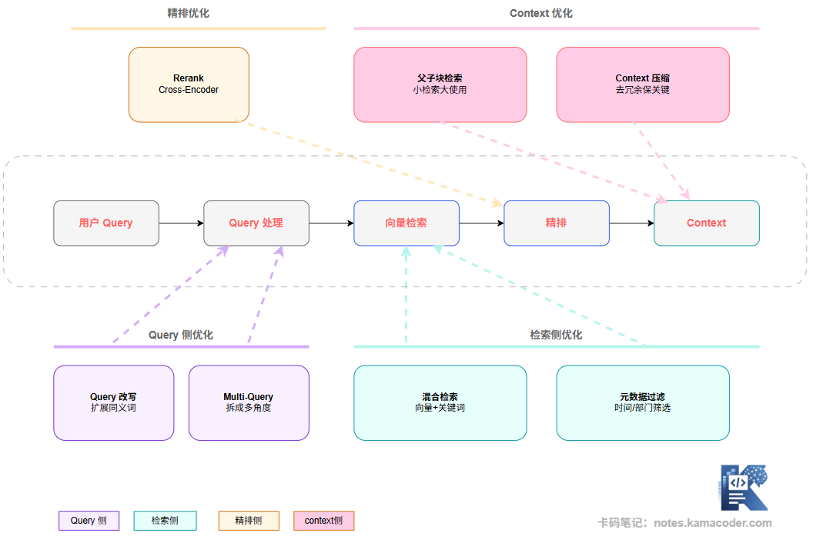
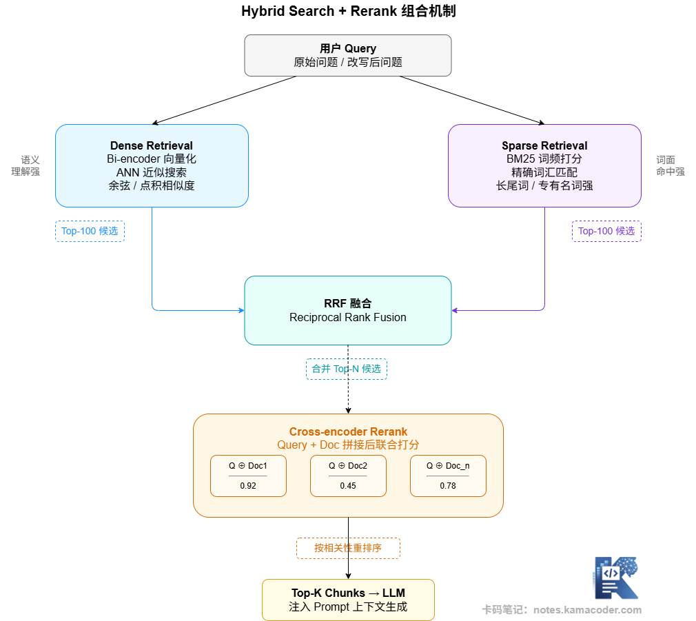

# 3.7 RAG 优化思路：Query 改写、混合检索、Rerank、父子块、Context 压缩 【🔥 必会】

[返回本章目录](README.md) · 融合 llm-master/docs/llm/app/rag_optimization.md 完整推理与原图 + 手写 BM25、加权 RRF 与 Cross-Encoder 精排

## 1. 🎯 本节目标与大白话例子

本节目标：掌握 RAG 全链路优化三大落点（Query 侧 / 检索侧 / Context 侧），理解纯向量检索对精确符号的盲区，彻底搞懂为何 BM25 与余弦相似度不能直接相加、加权 RRF 公式与常数 $k=60$ 的数学原理，并在 Step 6 基础上新增手写 BM25 + weighted_rrf + 同文档多样性去重模块。

大白话例子： 只用向量检索就像只用“望远镜”找东西：你问“高处坠落怎么防护”，它能看懂意思找到“全身式安全带”。可一旦用户问“GB/T 3608 三级高处作业是多少米”或“错误码 ERR_5021 怎么修”，向量模型往往把编号拆得稀碎，望远镜直接抓瞎；而传统关键词检索（BM25）就像“显微镜”，专盯字面一模一样的编号，但换个同义词就不认识。 混合检索 + RRF 就是同时派“望远镜”和“显微镜”各找一队人马，然后请一个只认名次不认绝对分数的裁判（RRF）把两队名单合并，最后交给专家（Cross-Encoder Rerank）逐条精读挑出最好的 3 条。

## 2. 🧠 核心原理与五维拆解

### 一、优化要对症下药（原文档脉络）

RAG 优化没有万能药。正确的姿势是先用 3.6 节的方法诊断出瓶颈，再按三大落点选型：

Query 侧优化：Query 改写（口语转书面、补全隐含条件）、Multi-Query（多角度展开并行查）。

检索侧优化：混合检索（Dense + BM25）、元数据过滤（缩小搜索空间）。

精排与 Context 侧优化：Cross-Encoder Rerank、父子块检索（小块检索大块生成）、Context 压缩（提纯去噪）。



### 二、混合检索（Hybrid Search）与 RRF 融合

纯向量检索擅长语义理解，但对专有名词、产品型号、法规编号（如 GB/T 3608）不如关键词搜索准确。生产级标配是同时跑 Dense 向量检索 和 BM25 关键词检索，再用 RRF（Reciprocal Rank Fusion，倒数排名融合） 合并。

$$
\operatorname{RRF}(d) = \sum_{m \in M} \frac{w_m}{k + r_m(d)}
$$

其中 $r_m(d)$ 是文档 $d$ 在第 $m$ 路中的名次（从 1 开始），$k$ 默认取 60，防止第 1 名（$1/1 = 1.0$）比第 2 名（$1/2 = 0.5$）分差过大，起到平滑过渡的作用。加上 60 后，第 1 名得分 $1/61 \approx 0.0164$，第 2 名得分 $1/62 \approx 0.0161$，既保证了排名靠前得分高，又不会让单一检索器的偶发第一名垄断全局。
向量检索里第 1 名相似度高达 0.99、第 2 名只有 0.31（断崖式下跌），RRF 依然只把它们当成普通的“第 1 名”和“第 2 名”对待。因此在 RRF 粗排融合出 Top 20～50 后，生产环境通常还会在后面接一个 Cross-Encoder 精排模型（Reranker） 对原文和问题做深度语义打分。

### 三、精排优化：Rerank（Cross-Encoder）



何时该加 Rerank：如果 Recall@20 已经很高，但真正能回答问题的片段经常排不进前 5，说明是排序精度不足，加 Rerank 收益极大。

何时不急着加：如果 Recall@20 本身很低（答案根本没进候选池），加 Rerank 毫无意义，应先优化切片、Embedding 或混合检索。

### 四、组件五维拆解（闭卷背诵标准）

| 维度 | 核心内容（面试闭卷复述标准） |
| --- | --- |
| ① 输入什么 | 用户 query、BM25 稀疏检索排名列表、Dense 向量检索排名列表、融合权重 $w_i$、平滑常数 $k$、单文档上限 max_per_doc。 |
| ② 做什么 | 1. 校验单路无重复 ID；<br>2. 按 $\frac{w_m}{k + r_m}$ 累加无量纲倒数排名分；<br>3. 降序排列并执行同文档多样性截断；<br>4. 送入 Cross-Encoder 精排取 Top-N。 |
| ③ 输出什么 | 融合排序且去重后的 Top-N 高质量候选列表。 |
| ④ 关键参数影响 | $k=60$ 平滑名次差异防第一名垄断；max_per_doc 防止同一篇长文档的连续切片霸占所有候选名额。 |
| ⑤ 工程选型 Trade-off | 先保召回、再提精度、控制变量：先上低成本的 BM25+RRF 拉高 Recall，确有必要再上高延迟的 Cross-Encoder。 |

### 五、知识点扩展：为什么不能直接分数相加？为何 $k=60$？

为什么 BM25 分数和余弦相似度不能直接加权相加？ 余弦相似度严格落在 $[-1, 1]$ 之间（通常集中在 $0.6\sim 0.9$）；而 BM25 得分没有上界（可能是 $2.5$，也可能是 $32.0$）。直接相加会导致 BM25 彻底吞噬余弦分数；即使用 Min-Max 归一化，跨查询的极值波动也会扭曲分布。RRF 只看名次不看原始分，天然免疫量纲差异。

为什么 RRF 常数 $k$ 业界默认取 60？ 若 $k=0$，第 1 名得分 $1/1=1.0$，第 2 名 $1/2=0.5$，第一名权重是第二名的两倍（马太效应过强），单路偶发排第一的噪声文档会碾压两路都稳居第 2、3 名的好文档。取 $k=60$ 后，第 1 名 $1/61 \approx 0.01639$，第 2 名 $1/62 \approx 0.01612$，差距极度平滑，让两路共同认可的文档轻松反超。

Bi-Encoder vs Cross-Encoder 算力复杂度对比：

Bi-Encoder（粗筛）：文档离线算完，在线仅编码 Query 一次，检索复杂度 $O(\log N)$。

Cross-Encoder（精排）：每次必须把 Query 和 $K$ 个候选拼在一起做全交互自注意力，在线前向复杂度为 $O(K \cdot L^2)$，因此候选数 $K$ 必须严格控制在 20~30 以内。

## 3. 💻 渐进式代码实操（Step 7：BM25 + 加权 RRF + 同文档多样性去重）

相比 Step 6 新增/修改了什么： 在 Step 4 稠密向量检索的基础上，新增纯标准库 MiniBM25Retriever 稀疏检索路与 weighted_rrf() 倒数排名融合算法，并加入了生产极易忽略的 max_per_doc 同文档多样性截断逻辑。

### 【从零手写核心链路】

```python
"""3.7 Step 7: 在 Step 4~6 基础上新增 BM25 稀疏检索 + 加权 RRF 融合 + 同文档多样性去重"""
from collections import Counter
from dataclasses import dataclass
import math


@dataclass(frozen=True)
class RankedItem:
    chunk_id: str
    doc_id: str
    rank: int  # 从 1 开始


# MiniBM25Retriever 用 Counter 统计词频。两个调节参数如下。
# k1（词频饱和度，防高频词刷分）和 b（文档长度归一化惩罚）
class MiniBM25Retriever:
    """【Step 7 新增】纯标准库 BM25 稀疏检索器，弥补向量对标准号/型号的漏召回。"""
    def __init__(self, chunks: dict[str, str], k1: float = 1.5, b: float = 0.75) -> None:
        self.chunks = chunks
        self.k1, self.b = k1, b
        self.tokenized = {cid: list(text.lower()) for cid, text in chunks.items()}
        self.avg_dl = sum(len(t) for t in self.tokenized.values()) / max(1, len(self.tokenized))
        self.df: Counter[str] = Counter()
        for tokens in self.tokenized.values():
            self.df.update(set(tokens))
        self.n_docs = len(self.tokenized)

    def search(self, query: str, top_k: int = 10) -> list[str]:
        q_tokens = list(query.strip().lower())
        scores: list[tuple[float, str]] = []
        for cid, doc_tokens in self.tokenized.items():
            tf_map = Counter(doc_tokens)
            dl = len(doc_tokens)
            score = 0.0
            for qt in q_tokens:
                if qt not in tf_map:
                    continue
                df_t = self.df[qt]
                idf = math.log((self.n_docs - df_t + 0.5) / (df_t + 0.5) + 1.0)
                tf = tf_map[qt]
                score += idf * (tf * (self.k1 + 1)) / (tf + self.k1 * (1 - self.b + self.b * dl / self.avg_dl))
            if score > 0:
                scores.append((score, cid))
        scores.sort(key=lambda x: (-x[0], x[1]))
        return [cid for _, cid in scores[:top_k]]


# 参数与边界。1) k=60 平滑名次差异，防单路第 1 名噪声霸榜；2) max_per_doc 限制同一文档垄断 Top-N
def weighted_rrf(
    routes: list[tuple[str, list[str], float]],
    chunk_to_doc: dict[str, str],
    k: int = 60,
    top_n: int = 5,
    max_per_doc: int = 2,
) -> list[tuple[str, float]]:
    """【Step 7 新增】加权倒数排名融合 + 同文档多样性去重（防止长文档霸榜）。"""
    if k <= 0 or top_n <= 0:
        raise ValueError("k 与 top_n 必须为正整数")

    # 校验每一路结果不含重复 ID，再按倒数排名累加。
    '''routes = [
    (名称标签"vector", 排好序的chunk["chunk_3", "chunk_1", "chunk_5"], 权重：1.0),  # 路1：向量检索
    ("bm25",   ["chunk_1", "chunk_8", "chunk_3"], 0.8),  # 路2：关键词检索
                ]'''
    # 【闭卷练习开始】按路累加加权倒数排名并排序，从第 1 名起算
    scores: dict[str, float] = {}
    for route_name, ranked_ids, weight in routes:
        if len(ranked_ids) != len(set(ranked_ids)):
            raise ValueError(f"检索路 {route_name} 存在重复 ID")
        for rank, cid in enumerate(ranked_ids, start=1):
            scores[cid] = scores.get(cid, 0.0) + weight / (k + rank)
    # x 是字典的一对键值，比如 ("chunk_1", 0.0323)，所以 x[0] 是切片 ID，x[1] 是总分。加负号是为了让分数从高到低降序排列（总分越高的，加了负号越小，排在越前面）。
    ordered = sorted(scores.items(), key=lambda x: (-x[1], x[0]))
    # 【闭卷练习结束】

    # 按 doc_id 设置配额，避免同一长文档占满结果。
    final: list[tuple[str, float]] = []
    doc_counts: Counter[str] = Counter()
    for cid, sc in ordered:
        did = chunk_to_doc.get(cid, cid)
        if doc_counts[did] >= max_per_doc:
            continue
        doc_counts[did] += 1
        final.append((cid, sc))
        if len(final) >= top_n:
            break
    return final


if __name__ == "__main__":
    # 测试用例。构造“精确标准号(GB/T 3608) + 同文档多切片(DOCA_c1/c2/c3)”验证混合召回与多样性截断
    corpus = {
        "DOCA_c1": "根据GB/T 3608规定，三级高处作业基准面高度为15至30米。",
        "DOCA_c2": "根据GB/T 3608规定，一级高处作业基准面高度为2至5米。",
        "DOCA_c3": "根据GB/T 3608规定，二级高处作业基准面高度为5至15米。",
        "DOCB_c1": "高空作业人员必须佩戴安全带。",
    }
    doc_map = {cid: cid.split("_")[0] for cid in corpus}
    bm25 = MiniBM25Retriever(corpus)
    bm25_res = bm25.search("GB/T 3608 三级高处作业", top_k=4)
    assert bm25_res[0] == "DOCA_c1", f"BM25 应精准命中标准号，实际: {bm25_res}"

    vec_res = ["DOCB_c1", "DOCA_c1", "DOCA_c2", "DOCA_c3"]
    fused = weighted_rrf([("bm25", bm25_res, 0.5), ("dense", vec_res, 0.5)], doc_map, k=60, top_n=3, max_per_doc=2)
    assert fused[0][0] == "DOCA_c1", "两路均排前列的 DOCA_c1 应在 RRF 融合后夺冠"
    assert sum(1 for cid, _ in fused if doc_map[cid] == "DOCA") <= 2, "同文档切片不得超过 max_per_doc=2"
    print("Step 7 self-test passed!")
```

### 【工业级调库对照】

生产中使用 rank_bm25 配合 sentence_transformers.CrossEncoder 做批量精排（务必用 torch.inference_mode() + batch 推理，切忌 for 循环单条预测）：

```python
import torch
from sentence_transformers import CrossEncoder

# reranker = CrossEncoder("BAAI/bge-reranker-large", max_length=512)
# pairs = [(query, text) for text in rrf_top20_texts]
# with torch.inference_mode():
#     scores = reranker.predict(pairs, batch_size=32)
```

何时手写 vs 何时调库：RRF 融合算法本身极其简洁，手写可控性远高于黑盒框架；Cross-Encoder 精排与大规模 BM25（如 Elasticsearch / Qdrant Sparse Vector）则直接调库。

### 示例说明与练习范围

本例的设计选择：

为什么不能把 BM25 分数和余弦相似度直接相加：余弦相似度在 [-1, 1]，BM25 分数无上界，量纲不同直接相加会被 BM25 吞噬；RRF 只认名次不认原始分，天然免疫量纲差异。

平滑常数 k=60 的工程意义：防止 k 太小时第 1 名权重过高导致单路噪声霸榜，让两路均靠前的文档稳定胜出。

同文档多样性去重（max_per_doc）：合并后必须限制同一 doc_id 最多入选切片数，防止超长文档垄断 Top-N。

两阶段算力边界：Bi-Encoder 可离线算好向量，在线仅 $O(\log N)$；Cross-Encoder 需在线拼接交互 $O(K \cdot L^2)$，送入精排候选数需控制在 20–30 以内。

**代码练习｜闭卷写核心**。闭卷写 weighted_rrf，rank 从 1 起。会解释文档去重和多样性，BM25 整类不背。

示例辅助代码：

MiniBM25Retriever 整类初始化、Counter 词频统计与 math.log 平滑公式细节（只需记住 k1 控词频饱和、b 控长度惩罚）。

## 4. 🗣️ 面试官视角：这段代码怎么讲

① 声明不变量：weighted_rrf 保证两个核心不变量——单路去重防作弊（同一检索路内不允许出现重复 chunk_id 叠加刷分）与同文档多样性上限（同一篇长文档最多贡献 max_per_doc 个切片）。

② 关键行解析：第 5761 行用无量纲名次倒数 weight / (k + rank) 消除 BM25 与余弦相似度的量纲鸿沟；第 6669 行限制 doc_counts[did] < max_per_doc，避免同一文档相邻切片霸占整个 Context。

③ 主动点出工程细节（加分项）：我会主动说明，RRF 在没有充分调参数据时优先用等权（0.5:0.5）作为 Baseline；另外 RRF 丢弃了绝对分数的置信度信息——如果某条记录精确命中了唯一订单号/标准号（BM25 极高分），生产中通常会设一条规则白名单强制透传，防止被另一路拉低。

## 5. 🔧 生产排障指南（实现 -> 排障）

| 故障现象 | 定位方法 | 修复方案 |
| --- | --- | --- |
| 1. 精确编号（如 GB/T 3608、DOC-001）依然搜不到 | 检查 BM25 分词器：默认中文分词（如 jieba）可能把 DOC-001 拆碎或被当成停用词过滤。 | 对编号/错误码配置正则保留分词规则（或字符级 N-gram），并在 ES 中为编号字段建 keyword 精确子索引。 |
| 2. 接入 Rerank 后延迟翻倍但准确率反而下降 | 检查两点：① Cross-Encoder max_length=512 是否截断了切片后半段关键句；② 送入的候选池本身 Recall 是否太低。 | 缩小切片长度以适配 Reranker 512 窗口；先确保初筛 Recall@20 达标，再开 Rerank，并将候选数控制在 15~25 条。 |
| 3. Context 里全是同一篇长文档的相邻片段 | 检查融合输出：长文档多个带 Overlap 的切片同时在两路得分高，霸占了 Top-5。 | 在 weighted_rrf 后加上 max_per_doc=2 多样性截断，强行把名额让给其他文档。 |

## 6. ❓ 高频面试追问与参考答法 + 📝 节末费曼自检

### 高频面试追问

Q1：为什么不能直接把 BM25 分数和向量的余弦相似度按 0.3:0.7 相加？

参考答法：因为两者的量纲、值域和分布完全不同。余弦固定在 [-1, 1]，而 BM25 是无上界的对数词频/IDF 加权分（可能高达二三十）。直接相加等于让 BM25 完全主导排序；即使做 Min-Max 归一化，不同 Query 的最高分波动极大也会扭曲分布。RRF 基于名次融合，天然免疫尺度差异，调参极其稳定。

Q2：RRF 公式里的常数 $k$ 为什么通常默认取 60？

参考答法：$k$ 是平滑常数。如果 $k=0$，第 1 名得分是第 2 名的整整两倍，马太效应太强；取 $k=60$ 后，第 1 名（1/61）和第 2 名（1/62）的相对分差被拉平，这样在两路检索中都排在前列（比如第 2 和第 3）的文档，累积分数就能反超仅在单路偶发排第 1 的文档。

Q3：在 RAG 优化里，Query 改写、混合检索、Rerank 应该按什么优先级加？

参考答法：按“先召回后精排、先低成本后高延迟、每次只改一个变量”的原则。第一步先建基线测 Recall@20；如果召回低，优先上混合检索（BM25+向量）（性价比最高、延迟增量极小）；如果召回够了但答案不准，再加 Rerank；对于口语化严重或含多条件的复杂问题，最后再加 Query 改写/拆解。

Q4：Query 改写有什么风险？如何防止改写把原意改偏？

参考答法：最大风险是“丢失原问题中的关键约束（如版本号、否定词、编号）”。工程上我们要求改写器输出结构化查询时必须保留原约束实体，并且把原始 Query 和改写 Query 一起并发召回再 RRF 融合，万一改写出错还有原 Query 兜底。

### 📝 节末费曼自检（闭卷自测）

请闭卷写出加权 RRF 公式，并解释 Bi-Encoder 与 Cross-Encoder 在时间复杂度和适用位置上的区别。

如果你的系统已经有了 Recall@20 = 90%，但 Precision@3 只有 30%，下一步应该优先加什么组件？为什么？

## 面试重点｜设计、调参与排障

**面试官可能问**

条款号能精确匹配，同义表达也要找得到，怎么融合？

**参考回答（现场口述）**

我并行跑 BM25 与向量召回。法条编号交给关键词路，同义表达交给向量路。RRF 对每路从 1 起算的名次累加权重除以平滑常数加名次，再让精排处理少量候选。回放不同类型的查询，确认金标没在融合或同文档截断时被丢掉。

**系统设计怎么选**

关键词适合编号与专有词，向量适合语义相近表达。RRF 按名次融合不同分数尺度，精排只处理候选。校准后也可以用分数融合。

**参数或条件改变会怎样**

RRF 的 k 越大，高低名次的相对差距越小。调候选窗口、来源排序权重和每文档最多保留几块。每文档截断太严可能丢同一规程的必要条款。

**系统出错怎么查、怎么验证**

先看金标有没有进入原始候选，再看融合后是否掉队。比较最终正确率、候选 Recall 和 P95，不用固定 60 替代实验。
