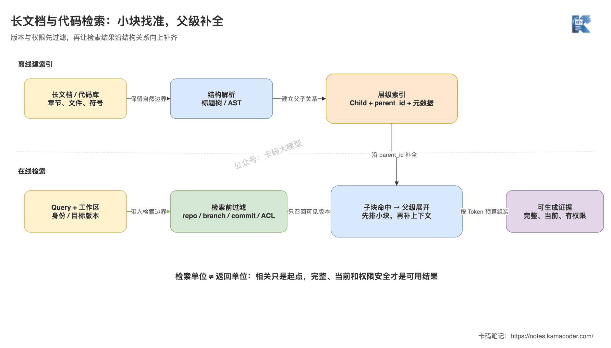

# 3.8 长文档与代码怎么检索？结构化切分、Parent-Child、AST 与版本权限过滤 【🔥 必会】

[返回本章目录](README.md) · 融合 llm-master/docs/llm/app/long_document_code_retrieval.md & claude_code_grep_rag_interview.md + AST 切片与首尾倒置摆放

## 1. 🎯 本节目标与大白话例子

本节目标：突破“512 Token + overlap”的玩具思维，掌握长文档的**父子块(Parent-Child / Small-to-Big)**层级检索、代码仓库的 AST 语法树切片与 Claude Code 为什么用 Grep + Glob + Read 而非纯向量 RAG 的架构哲学，并在 Step 7 基础上实现 AST 切片（带语法错误降级）与破除 Lost in the Middle 的首尾倒置扩展器。

大白话例子：

长文档：一份 120 页的《安全管理手册》里，某小段只写了“退款周期为 7 个工作日”，而适用前提“仅限企业版年付客户”写在三页前的二级标题里。父子块检索就像“用精准的目录小标签（Child，150字）去搜，搜到之后直接把整张完整章节卡片（Parent，800字）抽出来递给大模型”，既找得准又读得懂。

代码库：你搜 validateToken，纯向量 RAG 可能会给你返回 verifyToken、decodeToken 甚至把函数从 if-else 中间腰斩；而 AST 切片 + Grep 就像直接按“完整的函数和类”拆零件，并严格锁定当前的 git branch / commit。

## 2. 🧠 核心原理与五维拆解

### 一、固定切片为什么在长文档和代码里失效？（原文档脉络）

面对几百页的需求文档或几十万行代码仓库，多了三个硬问题：结构不能断、版本不能错、权限不能漏。

长文档层级断裂：脱离了 产品手册 / 计费规则 / 企业版 / 退款政策 这条标题树路径（Breadcrumbs），孤立的子块就会失去主语和前提条件。

> **学习注释｜标题树（Breadcrumbs，面包屑路径）**
>
> 标题树是文档的章节层级，面包屑路径是某个切片在这棵树上的完整目录路径。例如，检索只捞到了作业规程里的一段正文，就可能漏掉几页前的“第三章 停电作业”，从而漏答适用范围。退款条款也一样，“7 个工作日”得和“仅限企业版年付客户”一起读，才能答清楚谁适用。
>
> **怎么实现**。顺着文档扫描，用列表记录当前各级标题。读到新标题时，更新它所在的层级，并清掉旧的下级标题。比如在安全手册里维护 `[一级标题, 二级标题, 三级标题]`：
>
> 1. 读到第 10 页时，状态是 `[第一章 电气安全, 1.1 接线规范, 1.1.1 高压电操作]`。
> 2. 第 11 页遇到新二级标题 `1.2 灭火器使用`。如果只替换第 2 项，路径就会错误地变成 `第一章 电气安全 > 1.2 灭火器使用 > 1.1.1 高压电操作`。
> 3. 正确更新为 `[第一章 电气安全, 1.2 灭火器使用, 空]`。如果还记着四级标题，也一并清空。等读到 `1.2.1 干粉灭火器`，再填回第 3 项。
>
> 切出正文时，只拼接当前有值的标题。以退款条款为例，可以把 `【所属章节：产品手册 > 计费规则 > 企业版 > 退款政策（仅限年付）】` 放在正文开头，再一起生成向量。如果“仅限年付”写在章节正文里，可以通过取回父块补上这条前提。

代码语法树撕裂：代码的自然边界不是句号，而是模块、类、函数。按固定字符切分极易把函数签名（含关键 @login_required 装饰器）和函数体拆散。

> **学习注释｜AST（Abstract Syntax Tree，抽象语法树）**
>
> 普通递归切分按段落、换行等分隔符和长度限制选切点，可能把一个 `if-else` 从中间切开。AST 相当于代码的结构图，能告诉我们一整个函数或类从哪里开始、到哪里结束。比如 `@login_required` 在第 1 行，`def` 在第 2 行，切片要从第 1 行开始，模型才能看到登录要求。
>
> **对照下面的 Python 代码**。`ast.parse(source)` 先解析源代码，再遍历 `tree.body` 里的顶层语句，挑出普通函数 `FunctionDef`、异步函数 `AsyncFunctionDef` 和类 `ClassDef`。`decorator_list` 存着装饰器，取它们和 `def` 或 `class` 中最早的行号作为 `start`，取 `end_lineno` 作为结束行。`lines[start - 1 : end]` 把起始行号转成从 0 开始的列表下标，并保留最后一行。类里的方法会随整个类一起截取。
>
> 如果代码只写了一半，`ast.parse()` 可能抛出 `SyntaxError`。示例会改按第 1–20 行、第 21–40 行这样分块，最后不足 20 行也单独成块。这份示例的兜底窗口没有重叠。多语言代码库可用下文的 `tree-sitter` 做结构化切分。

### 二、Parent-Child（Small-to-Big）怎么兼顾找得准和读得懂？



核心是建立两级索引并用 parent_id 关联：

Child（小块）：短条款、函数体，负责 Embedding 向量检索、BM25 召回和 Rerank 精排（语义聚焦，不被稀释）。

Parent（大块）：完整章节或类定义，负责在精排确定 Top-N 后按 parent_id 取回完整上下文喂给 LLM。

顺序铁律：先在 Child 粒度做 Rerank，再向 Parent 扩展！ 如果先把所有 Child 展开成大块再 Rerank，相关信号会被大量父级文本冲淡，且重排延迟飙升。

> **学习注释｜父子块（Parent-Child / Small-to-Big）**
>
> **父块很大，会影响向量匹配吗？** 在本节这套实现里，向量召回和精排都用子块。父块的正文单独存在数据库里，示例用 `parent_texts` 字典代替。等子块排好名次，系统才按 `parent_id` 取回对应的父块。这样，召回可以聚焦于“退款周期”，大模型生成答案时又能看到适用对象和相邻条款。
>
> **离线入库**。先按小节整理父块并保存 `p1` 这样的 ID，再切出子块，为每个子块标记 `parent_id = p1` 并生成向量。150 字和 800 字是示意，实际切分先看章节和段落边界。
>
> **在线数据流**
>
> 1. **用户提问（Query）**。比如“退款要等多久？”。
> 2. **子块召回（Child Recall）**。用向量检索和 BM25 分别找语义相近、关键词匹配的子块，合并成候选，例如取 20 个。
> 3. **子块精排（Child Rerank）**。精排模型把问题与每个候选子块配对重新打分，得到 `ranked_child_ids`，例如 `[c1, c2, c3, c4]`。如果先扩成大块再交给 Cross-Encoder，输入更长，通常更耗时。背景文字也可能冲淡匹配信号，输入超限时还可能裁掉关键句。
> 4. **父块扩展与去重（Parent Expansion & Deduplication）**。顺着精排名单，用 `child_to_parent` 查父块 ID。假设 `c1 → p1`、`c2 → p1`、`c3 → p2`、`c4 → p3`，`seen` 让 `p1` 只进上下文一次，给其他证据留出位置。示例默认最多取 3 个不同的父块，得到 `[p1, p2, p3]`。
> 5. **首尾倒置（Edge-placement）**。等父块去重和预算筛选完成，再调整最终送给模型的顺序，避免后续删减挪走已经摆好的首尾证据。具体顺序见下文的首尾倒置示例。
>
> **父块太大时的影响**出现在生成阶段。几千行代码会占用大量 Token，也可能让关键证据被无关内容淹没。示例里的 `max_parents` 管的是父块数量。实际还要按 Token 预算控制长度，超长时优先保留标题路径或类定义、命中的条款或方法，以及附近的前提信息。

### 三、为什么版本（Branch/Commit）和 ACL 权限必须进入索引？

同一份文件在 main 分支和 feature/v2 分支完全不同。索引元数据必须保存 repo、branch、commit、path、acl，并在在线检索第一步就执行前置过滤。

> **学习注释｜代码检索要记住哪些元数据？**
>
> 可以把元数据理解成每个切片的身份标签。检索前靠它确定搜哪个仓库、哪个版本、哪些内容有权查看，命中后靠它回到准确的文件和行号。
>
> | 用途 | 字段 | 大白话 |
> | --- | --- | --- |
> | 仓库和版本 | `repo`、`branch`、`commit` | `repo` 是仓库标识，例如 `safety-inspection-system`。`branch` 是会随开发推进的分支，例如团队可以用 `main` 维护稳定代码，用 `feature/v2` 开发新功能。`commit` 是某次 Git 提交的哈希，像精确存档点，可以锁定当时的代码快照。编辑器里保存文件后，工作区可能已有新内容，做了 Git 提交才会产生新的 commit。 |
> | 访问权限 | `acl` | Access Control List，访问控制列表，用来记录哪些用户或组有权读这段代码。系统先按提问者身份判断权限，再让有权限的切片进入召回池。 |
> | 代码定位 | `path`、`qualified_name`、`start_line` / `end_line` | `path` 是仓库内的相对路径，例如 `src/auth/login.py`。找业务实现时可借它筛掉 `tests/` 和 `mock/` 下的同名代码。`qualified_name` 是全限定名，例如 `src/auth/service.py::AuthService::verify`，可以区分多个同名的 `verify`。起止行号方便回答引用，也方便 `Read` 按行补读。 |
> | 语言和结构 | `language`、`node_type` | `language` 记录 `python`、`java`、`go` 等语言，方便选择解析器或过滤。`node_type` 标明片段是 `class`、`function` 还是解析失败时的 `fallback_window`，可以用于筛选或加权。 |
>
> 这张表是完整索引的字段设计。Step 8 的 `CodeChunk` 专门演示如何拿到代码和行号，`qualified_name` 暂用 `node.name`。入库时再结合路径和类名生成全限定名，并补上版本和权限等字段。

### 四、组件五维拆解（闭卷背诵标准）

| 维度 | 核心内容（面试闭卷复述标准） |
| --- | --- |
| ① 输入什么 | 长文档标题树 / Python 源代码字符串、child_to_parent 映射表、精排后的 ranked_child_ids。 |
| ② 做什么 | 1. 离线按 AST（FunctionDef/ClassDef 含装饰器）或标题树切片，语法报错时优雅降级为行级滑窗；<br>2. 在线按 Child 排序去重映射为 Parent；<br>3. 执行首尾倒置摆放（Edge-placement）。 |
| ③ 输出什么 | 带全限定名与精确物理行号的 CodeChunk，以及对抗中间遗失的有序 Parent 上下文列表。 |
| ④ 关键参数影响 | max_parents（受 Token 预算约束，避免 3000 行大类直接撑爆窗口）；fallback_window（降级兜底粒度）。 |
| ⑤ 工程选型 Trade-off | 检索单位 $\neq$ 返回单位；普通静态文档用“结构切分 + Parent-Child”；高频变更的本地代码库用 Glob + Grep + AST + Read 多轮 Agent 循环优于离线向量 RAG。 |

### 五、知识点扩展：为什么 Claude Code 不用传统 RAG 检索代码？

这是大厂极爱考的架构题（融合 claude_code_grep_rag_interview.md）：

符号精确性（Symbol Lookup vs Semantic Search）：代码检索大量是在找精确符号 getUserById，不是找“意思相近的函数”，向量相似反而容易召回 deleteUser 造成误改。

实时性（Zero Index Lag）：代码每分钟都在改，刚改完下一秒跑测试就要搜最新代码，传统 RAG 离线切片建向量索引根本来不及同步。

调用链追踪：Grep + Read 配合 Agent 多轮循环，可以沿着 Controller -> Service -> DAO 边搜、边读、边修正方向，比一次性 Top-K 召回可靠得多。

> **学习注释｜Glob、Grep、AST、Read 各管哪一步？**
>
> | 工具 | 怎么用 |
> | --- | --- |
> | `Glob` | 按文件名或路径模式找文件，例如找出所有匹配 `*Service.py` 的文件。 |
> | `Grep` | 在文件内容里按关键词或正则定位行。已知要找 `getUserById` 时，可以按完整符号匹配，区分它和 `deleteUserById`。 |
> | `AST` | 解析源代码的语法结构，从中定位定义了哪些类、函数，以及它们的起止位置。 |
> | `Read` | 打开具体文件，读取需要的行范围，核对函数体及周边逻辑。 |
>
> **为什么经常这样搜？** 代码保存后，`Grep` 和 `Read` 可以直接读工作区的新内容。离线向量索引要重新切分、算向量和更新索引，在更新完成前可能仍返回旧版本。已知符号名时，精确搜索能锁定当前要查的函数。只用自然语言做一次 Top-K 向量召回，可能找到语义相近的代码，也可能只拿到调用链里零散的几段。
>
> **例子｜登录时密码校验失败，为什么没有显示明确错误？**
>
> `Controller` 接收请求，`Service` 执行业务逻辑，`DAO` 读写数据库。这三个角色通常分散在不同文件里，可以顺着调用一层层看：
>
> 1. **找入口**。用 `Glob` 搜 `*Login*`，定位 `LoginController.py`。
> 2. **读入口**。用 `Read` 看登录处理逻辑，发现它直接返回 `authService.verifyPassword(user, pwd)`，于是下一步去找 `verifyPassword` 的定义。
> 3. **跟到业务层**。用 `Grep` 搜 `def verifyPassword`，再读 `AuthService.py` 的相关行。它先调用 `userDao.getPasswordHash(user)`，拿到 `None` 时返回 `False`。
> 4. **跟到数据层**。继续搜 `getPasswordHash`，到 `UserDAO.py` 读实现。假设查询返回空值后，读取 `row["password_hash"]` 触发了异常，宽泛的 `except` 把异常转成了 `None`。回头串起三层代码，就能看清为什么调用方只拿到 `False`。
>
> 这就是“边搜、边读、边修正方向”。每次读到一个具体调用，就用它决定下一轮搜哪个符号。需要确认同名方法到底在哪个类里时，可以用 AST 核对定义位置。

## 3. 💻 渐进式代码实操（Step 8：AST 代码切片 + 父子块首尾倒置扩展）

相比 Step 7 新增/修改了什么： 在前面的切片与重排流水线基础上，新增 ast_chunk_python() 语法树结构感知切分器（含装饰器行号回溯与 SyntaxError 自动降级），以及 expand_parent_and_reorder() 父块扩展与首尾倒置摆放算子（专门破除 Lost in the Middle）。

### 【从零手写核心链路】

```python
"""3.8 Step 8: 在 Step 3/7 基础上新增父子层级扩展（Edge-placement）与 Python AST 代码切片（带语法错误降级）"""
import ast
from dataclasses import dataclass


@dataclass(frozen=True)
class CodeChunk:
    qualified_name: str
    start_line: int  # 含装饰器
    end_line: int
    content: str


def ast_chunk_python(source: str, fallback_window: int = 20) -> list[CodeChunk]:
    """【Step 8 新增】基于 AST 提取函数/类（含装饰器行号），语法错误时自动降级滑窗。"""
    if not source.strip():
        return []
    lines = source.splitlines(keepends=True)
    try:
        tree = ast.parse(source)
    # 容错降级。代码解析遇到半截代码或语法错误时必须优雅降级为滑窗，绝不能抛异常中断入库
    except SyntaxError:
        return [
            CodeChunk(f"fallback_L{i+1}", i + 1, min(i + fallback_window, len(lines)), "".join(lines[i : i + fallback_window]))
            for i in range(0, len(lines), fallback_window)
        ]

    chunks: list[CodeChunk] = []
    for node in tree.body:
        if isinstance(node, (ast.FunctionDef, ast.AsyncFunctionDef, ast.ClassDef)):
            decs = getattr(node, "decorator_list", [])
            # 装饰器归属。AST 提取函数必须回溯 decorator_list 最小行号，防止 @login_required 等装饰器被切丢
            start = min([d.lineno for d in decs] + [node.lineno])
            end = node.end_lineno or node.lineno
            chunks.append(CodeChunk(node.name, start, end, "".join(lines[start - 1 : end])))
    return chunks


# 父子扩展与U型重排。小块(Child)精排去重映射到完整父块(Parent)，再首尾倒置摆放破除 Lost in the Middle
def expand_parent_and_reorder(
    ranked_child_ids: list[str],
    child_to_parent: dict[str, str],
    parent_texts: dict[str, str],
    max_parents: int = 3,
) -> list[str]:
    """先按 Child 精排顺序去重映射为 Parent，再做首尾倒置摆放（破除 Lost in the Middle）。"""
    parents: list[str] = []
    seen: set[str] = set()
    for cid in ranked_child_ids:
        pid = child_to_parent[cid]
        if pid not in seen:
            seen.add(pid)
            parents.append(parent_texts[pid])
        if len(parents) >= max_parents:
            break
    # Edge-placement: 最相关放最前，第二相关放最后（紧贴 Question），其余放中间
    # 首尾倒置。Edge-placement：最相关放索引 0，次相关放末尾(-1)紧贴 Question，其余放中间
    if len(parents) >= 3:
        return [parents[0]] + parents[2:] + [parents[1]]
    return parents


if __name__ == "__main__":
    code = "@login_required\ndef verify_token(tok: str) -> bool:\n    return bool(tok)\n"
    res = ast_chunk_python(code)
    assert len(res) == 1 and res[0].start_line == 1 and "@login_required" in res[0].content
    assert len(ast_chunk_python("def broken(:\n  pass")) == 1, "语法错误必须优雅降级而非崩溃"

    ordered = expand_parent_and_reorder(["c1", "c2", "c3"], {"c1": "p1", "c2": "p2", "c3": "p3"}, {"p1": "P1", "p2": "P2", "p3": "P3"})
    assert ordered == ["P1", "P3", "P2"], f"首尾倒置摆放应为 [P1, P3, P2]，实际: {ordered}"
    print("Step 8 self-test passed!")
```

### 【工业级调库对照】

多语言代码库解析生产首选 tree-sitter（支持增量解析且容错率高），文档父子块可用 LlamaIndex 的 HierarchicalNodeParser + AutoMergingRetriever：

```python
# from tree_sitter import Language, Parser
# parser = Parser(PY_LANGUAGE)
# tree = parser.parse(bytes(source_code, "utf8"))
# 遍历 tree.root_node 提取 function_definition / class_definition 节点起止字节偏移
```

何时手写 vs 何时调库：纯 Python 项目用内置 ast 零依赖即可搞定；多语言（Java/Go/TS/C++）或需要部分语法容错必须上 tree-sitter。

### 示例说明与练习范围

本例的设计选择：

Small-to-Big（父子块检索）：用小粒度的 Child Chunk 做向量匹配（提高检索信噪比），命中后映射到完整的 Parent Block 喂给 LLM（保证上下文完整）。

Edge-placement（首尾倒置重排）：针对 Transformer 的 Lost in the Middle 特性，把第 1 相关放最前、第 2 相关放最后、次要放中间。

> **学习注释｜首尾倒置（Edge-placement）**
>
> 假设去重后，父块按相关度排成 `P1、P2、P3`，用户问题放在上下文之后。实际拼接顺序是 `P1 → P3 → P2 → 用户问题`。长上下文里，模型有时容易忽略中间的证据（Lost in the Middle），所以把最相关的 `P1` 放开头，把第二相关的 `P2` 放末尾，贴着提问。
>
> 代码里的 `[parents[0]] + parents[2:] + [parents[1]]` 就是在拼这三段。`parents[2:]` 从第 3 个父块开始取，在三个父块的例子里只有 `P3`。少于三个父块时，示例沿用原顺序。

AST 代码切片三大细节：保留装饰器行号、提取函数/类完整边界、语法报错时降级滑窗。

> **学习注释｜为什么要保留装饰器和类上下文？**
>
> 装饰器是写在 `def` 或 `class` 上方的 `@...`。比如 `@dataclass` 默认给类生成 `__init__` 和按字段判断相等的 `__eq__`，`@login_required` 常用来在调用前检查登录状态，`@app.post("/api/pay")` 可以把函数注册为处理 `POST /api/pay` 请求的接口。从 `def` 或 `class` 那一行才开始截，就可能漏掉模型判断权限、路由或自动生成方法时需要的信息。
>
> 类签名可以先看 `class` 那一行的类名和继承关系。读单个方法时，还要补上相关字段和 `__init__` 里的初始化逻辑。例如：
>
> ```python
> class OrderService(BaseService):  # 类名与继承关系
>     def __init__(self, db_client):
>         self.db = db_client       # 实例属性从构造参数传进来
> ```
>
> 如果只召回第 800 行的 `self.db.save()`，补读这些定义可以查明 `self.db` 从哪里来，还能知道要去哪个父类核对继承的方法。要确定 `db_client` 的具体类型，可以继续看类型标注或创建 `OrderService` 的地方。
>
> 纯 Python 可以用内置 `ast`，多语言切分可以用 `tree-sitter`。练习时能讲清两件事就够了。切片时把装饰器和相关类上下文留下，解析到残缺代码时按行降级，让索引任务继续跑。

**代码练习｜能讲清设计**。会画 Child 到 Parent 的数据流，AST 解析类不背。

示例辅助代码：

ast.parse 的具体节点属性名（decorator_list、end_lineno）与 splitlines(keepends=True)。

## 4. 🗣️ 面试官视角：这段代码怎么讲

① 声明不变量：这套结构化切片与扩展代码守住了两个核心不变量——装饰器与函数体原子性绑定（start = min([d.lineno for d in decs] + [node.lineno])）以及语法异常零崩溃降级（遇到新语法或破损代码自动退回行级滑窗，不阻断整库建索引）。

② 关键行解析：第 34~56 行的 expand_parent_and_reorder 体现了“小块精排、大块去重、首尾倒置”三个动作：用 seen 防止多个命中的子块重复塞入同一个父块浪费 Token，最后一行 [parents[0]] + parents[2:] + [parents[1]] 把第二重要的证据挪到最末尾紧贴用户问题，对抗大模型中间注意力衰减。

③ 主动点出工程细节（加分项）：我会主动指出，如果一个父块本身特别大（比如一个 3000 行的 God Class），不能无脑返回整个父块，必须设 Token 上限预算，超限时只返回“类签名 + 成员变量 + 目标方法 + 标题路径”。另外代码检索要默认在元数据过滤中排除 tests/ 和 mock/ 目录下的同名函数。

## 5. 🔧 生产排障指南（实现 -> 排障）

| 故障现象 | 定位方法 | 修复方案 |
| --- | --- | --- |
| 1. 批量建代码索引时因单个损坏文件导致整个任务崩溃 | 查看异常栈：遇到含 Python 3.12 新语法或未闭合括号的草稿文件时，ast.parse 抛出 SyntaxError 未捕获。 | 用 try...except SyntaxError 捕获并降级为行级滑窗切分，记录告警日志继续处理下一个文件。 |
| 2. 代码检索经常召回测试文件里的同名 mock_verify_token | 检查切片元数据：只存了函数名 verify_token，且检索未做路径过滤。 | 索引必须存全限定名 path::Class::func，在线检索默认过滤 tests/、*_test.py 或对主干目录加权。 |
| 3. 父子块检索引入后，Reranker 耗时飙升 4 倍 | 核查代码调用顺序：误把“子块扩展成父块”放在了 Rerank 之前，导致 Cross-Encoder 读 800 字大块。 | 严格调整顺序：先在 150 字 Child 上跑 Rerank，只对最终 Top-3~5 扩展为 Parent 拼进 Prompt。 |

## 6. ❓ 高频面试追问与参考答法 + 📝 节末费曼自检

### 高频面试追问

Q1：为什么 Claude Code 这类编程 Agent 不用传统 RAG 检索代码，而是直接用 Grep、Glob 和 Read？

参考答法：核心是代码检索和普通文档检索不是一类问题。代码需要精确符号匹配（找 validateToken 不要语义相近的 verifyToken）、零延迟实时性（刚改完文件下一秒就要搜到，等不及离线向量化）、完整语法上下文和多轮动态追踪（沿着调用链边搜边改方向）。所以 Grep + Glob + Read + Agent Loop 比一次性 Top-K 向量检索更契合写代码场景。

Q2：长文档的父子块检索（Parent-Child）和单纯增大 chunk_overlap 有什么区别？

参考答法：overlap 只能缓解相邻两块之间的边界断裂，但不知道章节树层级；而父子块是显式的树状从属关系（通过 parent_id 关联），哪怕命中了第 3.2.1 节的某一句，也能跨多个子块直接找回整个 3.2 节的完整前提与标题路径，检索精准度和上下文完整性兼得。

Q3：代码按 AST 切分时，为什么必须把装饰器（Decorator）和类签名保留下来？

参考答法：在 Python/Java 等语言里，权限校验（@login_required）、路由路径（@app.get）、事务控制等核心业务语义全写在装饰器里；而函数内部使用的 self.db 等依赖定义在类头部。丢掉装饰器和类签名，模型拿到的就是残缺上下文，改代码极易产生幻觉。

Q4：命中子块后，是不是每次都要把整个父块全部塞给大模型？

参考答法：不是，这是一个 Token 预算决策。如果父块只有几百字或几十行函数，全量返回最好；如果父块是一个几千行的超大类或几十页的章，全塞进去会造成上下文噪声和超限，此时应只补全“标题路径/类定义 + 邻近前后各 1 个兄弟节点”。

### 📝 节末费曼自检（闭卷自测）

请画出“先 Child 精排，再 Parent 扩展，最后首尾倒置摆放”的在线数据流顺序，并说明每一步为什么不能颠倒。

如果让你设计一个多语言企业代码库的检索系统，除了 AST 切分，索引元数据里还必须存哪几个关键字段？

## 面试重点｜设计、调参与排障

**面试官可能问**

为什么不直接把整章规程或整份代码送进精排？

**参考回答（现场口述）**

整章输入会让精排花时间处理大量无关文字，还可能截掉关键条款。我会先在子块或符号粒度召回与精排，选出少量证据后回填父块或调用链，再按上下文预算去重。比较命中率的同时，看给生成端的证据够不够。

**系统设计怎么选**

先用能代表具体证据的 Child 召回，再按需扩到 Parent。代码进一步可结合符号搜索、AST/LSP、按需读取和语义检索。方案受符号精确度与代码更新频率影响。

**参数或条件改变会怎样**

扩展范围越大，越容易找到前置条件，也越耗 token。对照不同 Parent 范围和上下文摆放，首尾优先只当待验证策略。

**系统出错怎么查、怎么验证**

证据相近却答不完整时，看关键条款是否分散在不同子块。扩展后再核对权限与版本，别把相邻无权内容带进上下文。
