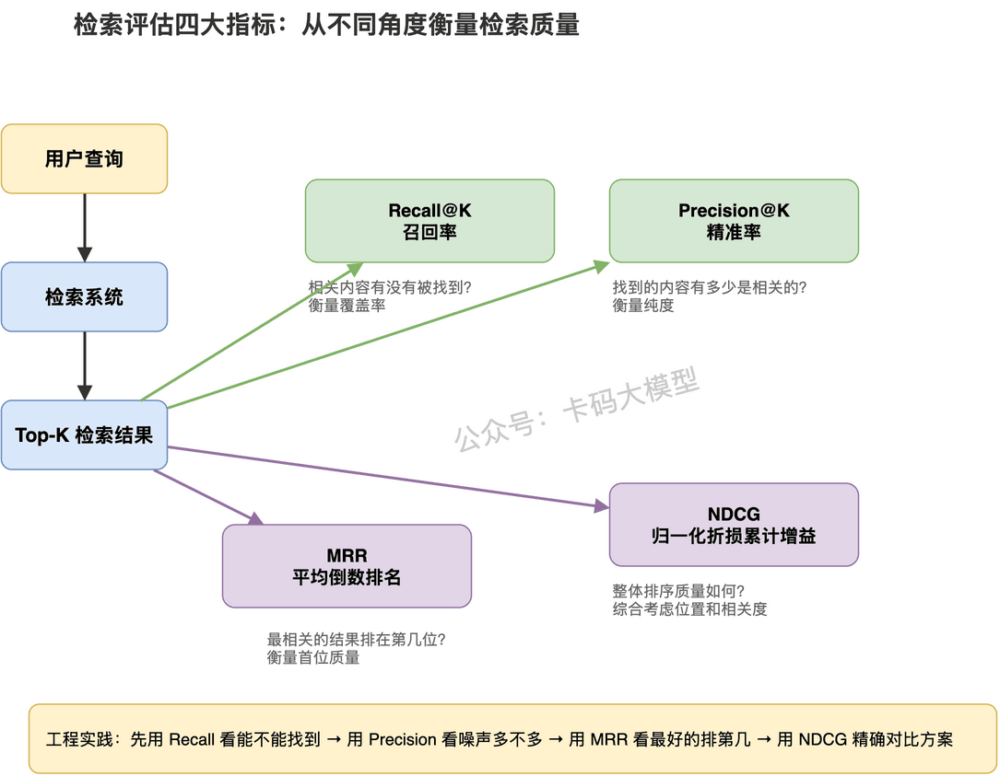
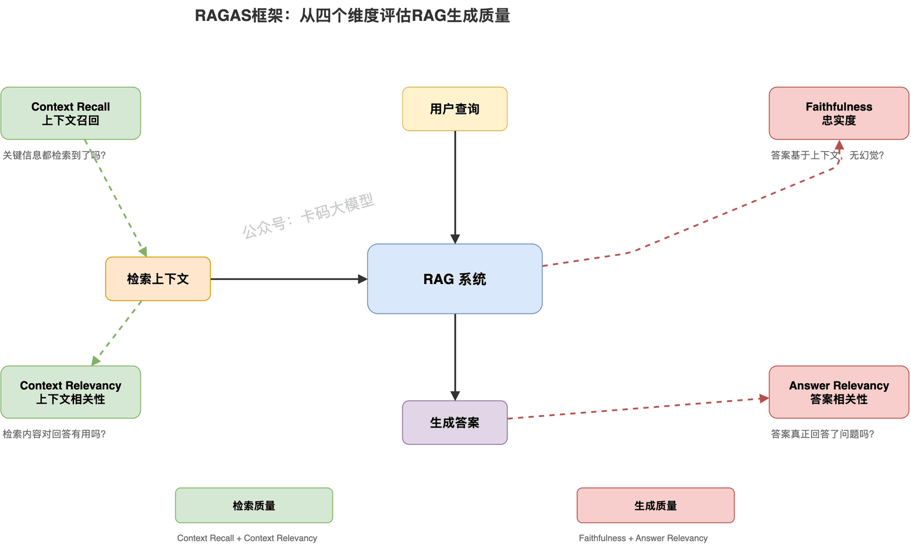
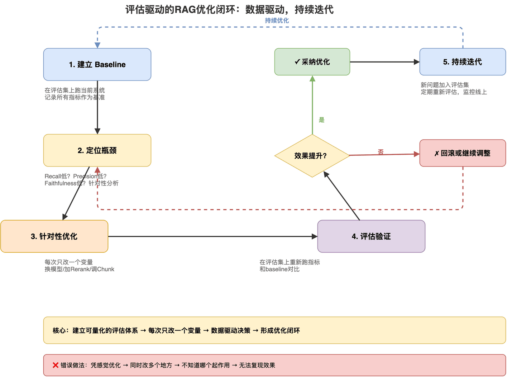

# 3.9 RAG 怎么评估？检索质量和生成质量的度量与 RAGAS 框架 【🔥 必会】

[返回本章目录](README.md) · 融合 llm-master/docs/llm/app/rag_evaluation.md 完整推理与原图 + 手写 Hit/Recall/MRR/nDCG 与防刷分忠实度套件

## 1. 🎯 本节目标与大白话例子

本节目标：建立“没有评估的优化就是盲猜”的工程意识，彻底掌握检索侧四大指标（Hit@K、Recall@K、Precision@K、MRR、NDCG）与生成侧 RAGAS 四维度的数学定义及适用场景，识破“过度拒答刷高忠实度”的评测陷阱，并在 Step 8 基础上为系统挂载可离线跑批的 RAGEvaluator 评测套件。

大白话例子： 很多同学优化 RAG 全凭感觉：“加了 Rerank 感觉好多了”。面试官一问“怎么量化好多少”，直接卡壳。 评估 RAG 就像批改学生做开卷考试的试卷，必须拆成两张成绩单：

检索侧成绩单（找书翻页能力）：标准答案分散在教材的 3 个自然段里。Hit 问“你翻出的 5 页里至少蒙中了 1 段吗”；Recall 问“3 个标准段你找全了几个”；MRR 问“第一段对的排在第几位”；NDCG 不仅看排第几，还给“核心段 3 分、辅助段 1 分”加权打分。

生成侧成绩单（抄写组织能力，RAGAS）：**Faithfulness（忠实度）**查他有没有脱离教材瞎编；Answer Relevancy 查他是不是答非所问。

## 2. 🧠 核心原理与五维拆解

### 一、检索侧评估：能不能找到？排得好不好？（原文档脉络）



| 指标 | 核心关注 | 数学定义 | 工程意义与局限 |
| --- | --- | --- | --- |
| Hit@K | 有没有命中底线 | $\mathbb{I}(\text{Gold} \cap \text{Top-K} \neq \emptyset)$ | 只要 Top-K 里有至少 1 个金标就记 1；多条件题容易虚高。 |
| Recall@K | 找得全不全 | $\frac{\|\text{Gold} \cap \text{Top-K}\|}{\|\text{Gold}\|}$ | 检索第一防线，Recall@5 < 70% 说明检索侧有硬伤，Rerank 救不回来。 |
| Precision@K | 噪声多不多 | $\frac{\|\text{Gold} \cap \text{Top-K}\|}{K}$ | 衡量纯度；工程上常先大 K（20~50）保 Recall，再 Rerank 拉回 Precision。 |
| MRR@K | 最好的排多前 | $\frac{1}{N}\sum \frac{1}{\text{rank}_{\text{first}}}$ | 只看第一个正确结果排第几，越靠前模型注意力越稳。 |
| NDCG@K | 分级排序质量 | $\frac{\text{DCG@K}}{\text{IDCG@K}}, \ \text{DCG}=\sum \frac{\text{rel}_i}{\log_2(i+1)}$ | 支持 0~3 分多级相关性标注与对数位置折损，最适合对比 Rerank 效果。 |

> **学习注释｜什么时候看 MRR，什么时候看 NDCG？**
>
> 1. **一问一答的 FAQ，优先看 MRR@K。** 比如“怎么重置密码”，一条准确的知识库记录就足以支撑回答。首条正确记录排第 1 名，单题得 1 分。排第 2 名，得 0.5 分。
> 2. **多跳推理、长规程或多项前提，结合 NDCG@K 和 Recall@K。** 比如回答“设备满足哪些条件才能开工”，可能要同时找回停电、验电和双人监护等证据。NDCG@K 看高相关切片是否排得靠前，Recall@K 看必需切片找回了多少。即使首条证据排第 1 名，只要漏掉一条必要条件，答案就可能不完整。
>
> 如果漏掉任意一条必需证据都不可接受，再单独统计 **Top-K 内必需证据全部找齐的题目比例**。

> **学习注释｜NDCG@K 怎么算？**
>
> NDCG（Normalized Discounted Cumulative Gain，归一化折损累计增益）给前 $K$ 条结果的排序打分。看结果有多相关，也看高相关的结果排得有多靠前。可以从末尾的 G 往回理解：
>
> 1. **G（增益）**。每条结果都有评测集标注的相关度，例如核心证据 3 分、辅助证据 1 分、无关内容 0 分。
> 2. **CG（累计增益）**。把前 $K$ 条的分数直接相加。`[1, 0, 3]` 和 `[3, 1, 0]` 加起来都是 4 分，结果顺序对这个和没有影响。
> 3. **DCG（折损累计增益）**。第 $i$ 名的相关度除以 $\log_2(i+1)$ 后再求和。第 1 名除以 1，第 2 名除以约 1.585，第 3 名除以 2，排得越靠后折扣越大。
> 4. **N（归一化）**。把该问题的所有已标注候选按相关度降序排好，取理想的前 $K$ 条算出 IDCG。实际 DCG 除以 IDCG，得到相对于该题理想排序的得分。有相关结果时，这个比值在 0 到 1 之间。
>
> **手算一遍（$K=3$）**。假设一次检索的前三名相关度是 `[1, 0, 3]`，核心条款排到了第 3 名。该例里标注集只有这三条。
>
> 实际顺序的折损分数为
>
> $$
> \text{DCG@3}=\frac{1}{\log_2(2)}+\frac{0}{\log_2(3)}+\frac{3}{\log_2(4)}=1+0+1.5=2.5
> $$
>
> 理想顺序 `[3, 1, 0]` 的折损分数为
>
> $$
> \text{IDCG@3}=\frac{3}{\log_2(2)}+\frac{1}{\log_2(3)}+\frac{0}{\log_2(4)}\approx3.63
> $$
>
> 两者相除，得到
>
> $$
> \text{NDCG@3}=\frac{\text{DCG@3}}{\text{IDCG@3}}\approx\frac{2.5}{3.63}\approx0.69
> $$
>
> 固定问题、标注和 $K$ 后，可以比较精排前后的得分。精排把顺序改成 `[3, 1, 0]` 就得 `1.0`。排成 `[3, 0, 1]` 时，核心条款在首位，辅助条款按第 3 名折损，因此分数约为 `0.96`。在 Step 9 的 `evaluate_retrieval()` 里，`ranked_ids` 提供实际顺序，`gold_rels` 提供相关度标注，也用来构造理想顺序。

### 二、生成侧评估：RAGAS 四大核心维度



Faithfulness（忠实度，防幻觉）：LLM 将回答拆成独立原子陈述（Claims），逐条做 NLI 推理判断是否能从 Context 推出：$\text{Faithfulness} = \frac{\text{可推导陈述数}}{\text{总陈述数}}$。

> **学习注释｜什么是无代词的原子事实陈述？**
>
> 假设大模型回答“高压开关柜在检修前必须断电，它还需要由两人共同监护，这是为了防止误操作。”先把回答拆成可以单独核对的小句子，再把“它”“这”“该设备”等依赖前文的指代换成具体对象，保留“检修前”“必须”等关键条件。
>
> 1. 高压开关柜在检修前必须断电。
> 2. 高压开关柜检修需要由两人共同监护。
> 3. 高压开关柜检修中的两人共同监护是为了防止误操作。
>
> “原子”就是说每条只表达一个可以单独核对的断言。裁判模型会拿每条陈述独立对照原文，所以句子本身要写清设备、动作和适用条件。例如原回答里的“它还需要由两人共同监护”拆成第 2 条后，单独读这一条也知道在核对哪项作业。

> **学习注释｜什么是 NLI 验证？忠实度怎么打分？**
>
> NLI（Natural Language Inference，自然语言推理）在这里就是逐条做判断题。把检索到的 Context 和一条原子陈述交给裁判，问“仅凭这段原文，能推出这条陈述吗？”能推出就记 `Yes`（`True`）。原文证据不足或与陈述矛盾，就记 `No`（`False`）。
>
> 接上面的假设例子。检索原文只写了“高压开关柜检修前必须断电，检修时需要两人共同监护”。前 2 条有依据，第 3 条说的是监护的目的，原文没有交代，因此判定为 `[True, True, False]`。总共 3 条，有 2 条受支持。
>
> $$
> \text{Faithfulness}=\frac{\text{受支持的陈述数}}{\text{总陈述数}}=\frac{2}{3}\approx0.67\quad\text{（约 67\%）}
> $$
>
> 这个分数衡量回答里的陈述有多少能得到本次检索证据的支持。这个例子传给 Step 9 的 `evaluate_faithfulness()` 的是已经判好的 `claims_supported` 布尔列表。函数把 `True` 计为 1、`False` 计为 0，然后求平均。拆句和逐条核对在进入这个函数之前完成。

Answer Relevancy（答案相关性，防跑偏）：用 LLM 根据生成答案反向生成 N 个问题，算它们与原 Query 的平均语义相似度。

Context Relevancy（上下文相关性）：检索到的 Context 中真正对回答有用的句子占比（反映切片是否过大/含噪）。

Context Recall（上下文召回）：Ground Truth 标准答案里的关键信息有多少出现在了检索 Context 中。

### 三、评估驱动的优化闭环



### 四、组件五维拆解（闭卷背诵标准）

| 维度 | 核心内容（面试闭卷复述标准） |
| --- | --- |
| ① 输入什么 | 固定黄金测试集（Query + 标注相关度 gold_rels + 标准答案）、系统产出的 ranked_ids 与原子声明判定列表。 |
| ② 做什么 | 检索侧计算 Hit/Recall/Precision/MRR/NDCG；生成侧核算声明级忠实度并校验“有证据却误拒答”惩罚。 |
| ③ 输出什么 | 标准化离线评测报表（0.0 ~ 1.0），作为版本门禁与 A/B 优化的唯一标尺。 |
| ④ 关键参数影响 | 截断深度 $K$（Recall 评估看大 K=20，最终注入评估看小 K=3~5）；宏平均 vs 微平均聚合方式。 |
| ⑤ 工程选型 Trade-off | 离线指标是方向盘，线上采用率（复制率/点赞/无追问率）是最终裁判；高风险查询实时跑 Faithfulness，中低风险离线抽样跑 RAGAS（省 5~8 倍 Token 成本）。 |

### 五、知识点扩展：评测常见大坑与漏洞防御

“过度拒答刷高忠实度”漏洞：如果模型动不动就回复“抱歉，资料不足”，它没有任何编造声明，传统 Faithfulness 会给它打 100% 满分！必须搭配 Answer Relevancy 和 误拒答率（False Refusal Rate） 联合卡点：上下文明明有金标却拒答，忠实度/总分直接计 0。

LLM-as-a-Judge 位置偏置（Position Bias）：裁判模型倾向于认为排在前面的选项更好，做 A/B 对比评测时必须正反调换顺序跑两次取一致结果。

## 3. 💻 渐进式代码实操（Step 9：手写检索与忠实度评测套件）

相比 Step 8 新增/修改了什么： 在流水线外围新增 evaluate_retrieval()（零依赖实现五大检索指标）与 evaluate_faithfulness()（带误拒答惩罚的声明级忠实度），让前 8 步搭建的检索与生成系统具备可量化的验收标准。

### 【从零手写核心链路】

```python
"""3.9 Step 9: 在 Step 7/8 基础上挂载离线评测套件（Hit/Recall/MRR/nDCG + 防空拒答漏洞的忠实度）"""
import math
from statistics import mean


# 计算 Hit@K、Recall@K、Precision@K、MRR@K 和 nDCG@K。
def evaluate_retrieval(ranked_ids: list[str], gold_rels: dict[str, int], k: int = 3) -> dict[str, float]:
    """计算单条查询的 Hit@K, Recall@K, Precision@K, MRR@K, nDCG@K。"""
    if k <= 0 or not gold_rels:
        raise ValueError("k 必须为正整数且 gold_rels 不能为空")
    # 【闭卷练习开始】Recall@K 和单题 RR。白板版需要定义无正例时的口径
    top_k = ranked_ids[:k]
    hits = [cid for cid in top_k if gold_rels.get(cid, 0) > 0]
    total_pos = sum(1 for v in gold_rels.values() if v > 0)

    hit_k = 1.0 if hits else 0.0
    recall_k = len(hits) / total_pos
    precision_k = len(hits) / k
    mrr_k = next((1.0 / idx for idx, cid in enumerate(top_k, 1) if gold_rels.get(cid, 0) > 0), 0.0)
    # 【闭卷练习结束】

    # nDCG折损。分母为 log2(rank + 1)（1-indexed），再用排序后的理想前 k 个算 IDCG 归一化
    dcg = sum(gold_rels.get(cid, 0) / math.log2(idx + 1) for idx, cid in enumerate(top_k, 1))
    ideal_rels = sorted([v for v in gold_rels.values() if v > 0], reverse=True)[:k]
    idcg = sum(rel / math.log2(idx + 1) for idx, rel in enumerate(ideal_rels, 1))
    ndcg_k = dcg / idcg if idcg > 0 else 0.0

    assert 0.0 <= recall_k <= 1.0 and 0.0 <= ndcg_k <= 1.0
    return {"hit": hit_k, "recall": recall_k, "precision": precision_k, "mrr": mrr_k, "ndcg": ndcg_k}


# 防刷分漏洞。必须校验 has_gold_in_context：上下文明明有答案却过度拒答，忠实度直接判 0 分
def evaluate_faithfulness(claims_supported: list[bool], is_refused: bool, has_gold_in_context: bool) -> float:
    """声明级忠实度核算：防备“上下文明明有答案却过度拒答刷 100% 忠实度”的评测漏洞。"""
    if is_refused:
        return 0.0 if has_gold_in_context else 1.0
    if not claims_supported:
        return 0.0
    return mean(1.0 if ok else 0.0 for ok in claims_supported)


if __name__ == "__main__":
    m = evaluate_retrieval(["C", "A", "D"], {"A": 3, "B": 2}, k=3)
    assert m["hit"] == 1.0 and m["recall"] == 0.5 and m["mrr"] == 0.5
    assert math.isclose(m["ndcg"], (3 / math.log2(3)) / (3 / math.log2(2) + 2 / math.log2(3)), abs_tol=1e-6)
    assert evaluate_faithfulness([], is_refused=True, has_gold_in_context=True) == 0.0, "有证据却拒答不能给满分"
    assert evaluate_faithfulness([True, True, False], is_refused=False, has_gold_in_context=True) == 2 / 3
    print("Step 9 self-test passed!")
```

### 【工业级调库对照】

检索指标轻量手写即可，生成侧自动化 NLI 裁判直接调用 ragas 库：

```python
# from datasets import Dataset
# from ragas import evaluate
# from ragas.metrics import faithfulness, answer_relevancy, context_recall

# data = Dataset.from_dict({
#     "question": ["高处作业安全带怎么戴？"],
#     "answer": ["必须佩戴全身式五点安全带并高挂低用。"],
#     "contexts": [["高处作业人员必须佩戴全身式五点安全带，并高挂低用。"]],
#     "ground_truth": ["佩戴全身式五点安全带，高挂低用。"],
# })
# result = evaluate(data, metrics=[faithfulness, answer_relevancy, context_recall])
```

何时手写 vs 何时调库：检索侧五大指标（Hit/Recall/MRR/NDCG）手写仅 20 行且完全透明，强烈建议自己写进 CI/CD 回归脚本；生成侧涉及原子陈述拆解与 NLI 推理，调 ragas 库或自写异步并发裁判脚本并用便宜小模型（如 gpt-4o-mini）降本。

### 示例说明与练习范围

本例的设计选择：

检索指标分工：Recall@K 看全不全，MRR 看首个正确答案排第几，nDCG@K 看分级相关性排序质量（高相关必须靠前）。

忠实度防刷分漏洞：不能只看“未幻觉比例”，否则模型对所有问题都回答“不知道”就能刷出 100% Faithfulness；必须结合上下文是否有金标证据判定误拒答。

**代码练习｜闭卷写核心**。写 Recall@K 和首命中 RR，手算 nDCG，评测框架类不背。

示例辅助代码：

ragas 库的 Dataset.from_dict 调库参数与 assert math.isclose 测试代码。

## 4. 🗣️ 面试官视角：这段代码怎么讲

① 声明不变量：我的评测套件保证了两个核心不变量——指标值域归一性（0.0 <= recall, ndcg <= 1.0）与拒答防作弊约束（当 has_gold_in_context=True 时，模型若拒绝回答直接记 0.0 分，彻底堵死“靠拒答刷高忠实度”的漏洞）。

② 关键行解析：第 19~22 行实现了标准工业界以 2 为底的折损累积增益 $\text{DCG@K} = \sum \frac{\text{rel}_i}{\log_2(i+1)}$，并通过真实排序除以理想排序 idcg 归一化；在 if name == "main": 中我用 {A: 3, B: 2} 的算例精确验证了 Hit=1.0, Recall=0.5, MRR=0.5 的差异。

③ 主动点出工程细节（加分项）：我会主动说明，构建 Golden Set（黄金评测集）一般先由 LLM 辅助生成初稿，再人工精选 50~200 条覆盖“同义问法、精确编号、无答案拒答、新旧版本冲突”四类样本；且每次改版只改一个变量，防止陷入调参黑盒。

## 5. 🔧 生产排障指南（实现 -> 排障）

| 故障现象 | 定位方法 | 修复方案 |
| --- | --- | --- |
| 1. 离线 Recall@5 提到了 88%，但上线后用户采用率反而下降 | 从线上采用率最低的日志里抽查 20 条，常见原因是“测试集分布脱离真实口语”、“加了 Rerank 导致 P95 延迟从 1.5s 涨到 4.5s”，或“过度约束导致答案变成生硬八股文”。 | 用真实线上日志定期回流更新评测集；控制端到端 P95 延迟预算；在 Prompt 中兼顾事实忠实度与自然表达。 |
| 2. 评测显示 Faithfulness 高达 99%，但业务方投诉系统经常答不出来 | 核查拒答率（Rejection Rate）：系统把大量本来有答案的问题误拒答了，空拒答被误算为无幻觉。 | 引入 has_gold_in_context 交叉校验与 Answer Relevancy 联合卡点，严惩“有证据却拒答”的样本。 |
| 3. RAGAS 跑一次全量评测 Token 账单比线上问答还贵 6 倍 | 检查评测策略：对全量日志同步跑 4 个 RAGAS 指标（每条调 5~8 次强模型 LLM）。 | 改为分级采样评估：线上仅记录日志，每日离线抽样 1%~5% 用轻量模型（如 gpt-4o-mini）跑评测；高风险场景才实时跑单项 Faithfulness。 |

## 6. ❓ 高频面试追问与参考答法 + 📝 节末费曼自检

### 高频面试追问

Q1：Hit@K、Recall@K 和 MRR@K 到底有什么区别？能用同一个例子讲清吗？

参考答法：Hit 问“有没有”，Recall 问“全不全”，MRR 问“排第几”。比如一道多条件题需要 [A, B] 两段证据，Top-3 返回了 [C, A, D]：此时 Hit@3 = 1.0（至少中了一个 A），Recall@3 = 0.5（两段只找回一半，漏了 B），MRR@3 = 0.5（第一个对的 A 排在第 2 位，倒数 1/2）。

Q2：RAGAS 里的 Faithfulness（忠实度）底层是怎么算出来的？

参考答法：分两步：第一步（Claim Decomposition），用 LLM 把模型生成的答案拆解成一个个无代词的原子事实陈述；第二步（NLI 验证），逐条核对每条陈述能否从检索到的 Context 中逻辑推导出来，最后计算 受支持的陈述数 / 总陈述数。

Q3：没有标注人力，怎么低成本从零搭建一套可信的 RAG 黄金评测集？

参考答法：三步走——先用 LLM 根据核心文档批量合成 100 对“问题-标准答案-证据切片”快速跑通评测脚本；再由业务专家人工校对清洗出 50~100 条高价值核心样本作为 Golden Set（特意加入无答案题和版本冲突题）；上线后持续从用户点踩日志里抽样补充。

Q4：离线指标和线上指标（如用户点赞/复制率）冲突了听谁的？

参考答法：离线指标是方向盘，线上采用率是最终裁判。如果离线指标涨了但线上采用率跌了，一定是因为离线测试集没覆盖真实用户的复杂问法，或者优化引入了不可接受的延迟代价和机械话术，必须立刻拉取线上 Bad Case 复盘并修正离线测试集。

### 📝 节末费曼自检（闭卷自测）

请闭卷写出 NDCG@K 的计算思路，并说明它相比 MRR@K 多考虑了哪两个维度。

为什么不能只看 Faithfulness 单一指标来衡量 RAG 生成质量？它最容易被什么行为“刷高”？

## 面试重点｜设计、调参与排障

**面试官可能问**

Recall 很高但用户报告答案不可信，还应该看什么？

**参考回答（现场口述）**

Recall 高说明相关证据进入了候选，后面还要看精排后的命中、引用是否支持结论、答案是否正确，以及可答问题有没有被过度拒答。我会联查每题的召回轨迹和回答，找到缺口出在检索、拼装还是生成。

**系统设计怎么选**

检索用 Recall、RR、nDCG 区分证据覆盖和排序，生成分别看正确率、忠实度、覆盖率和误拒答。答了但无依据，与有证据却拒答，应分别记账。

**参数或条件改变会怎样**

固定问题集和相关性标注，改变 K 比较召回与噪音。对成对 Judge 可换顺序并人工抽样校准。

**系统出错怎么查、怎么验证**

计算前约定重复结果去重和无正例口径。本节示例的这两种边界需自行补检验。抽取一条答案逐项标出结论与来源。
