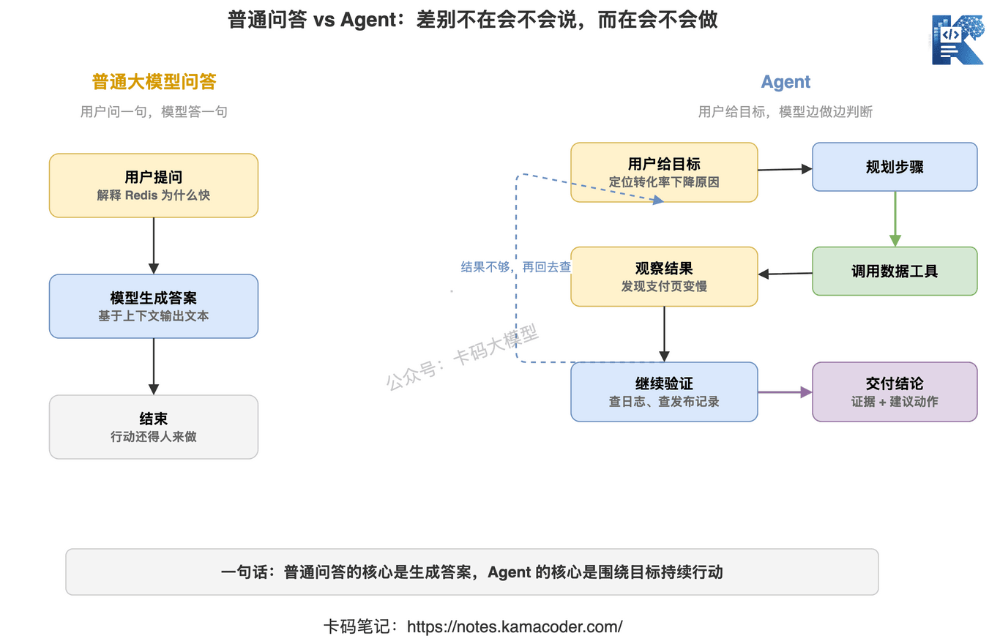
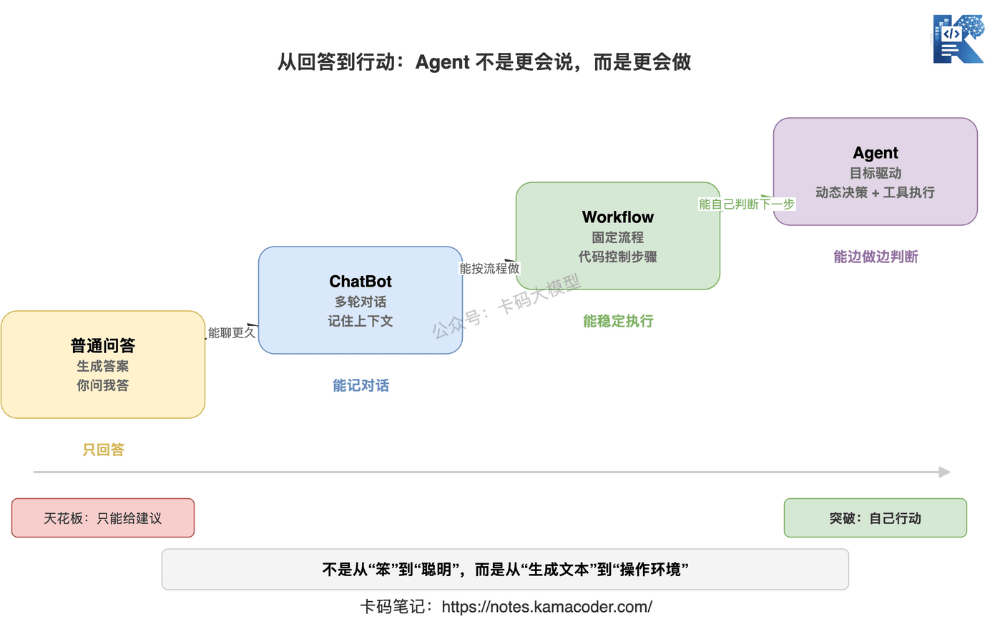
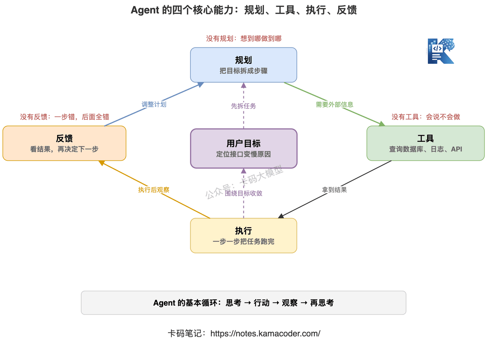

### 4.1 Agent 基本结构与 O-T-A 运行闭环 【🔥 必会】

#### 1. 🎯 本节目标与大白话例子

上一步痛点：普通大模型问答（QA）是“一问一答、一锤子买卖”——模型只能靠预训练记忆猜答案，既拿不到实时系统指标，也无法在发现信息不足时主动去查第二步。

本节解法：把单次推理升级为 Observe（观察）-> Think（思考决策）-> Act（执行动作） 的有限状态机闭环。

大白话例子：就像值班 SRE 排查“支付接口变慢”：不会一上来就拍脑袋下结论，而是先看监控面板（Observe）-> 判断可能是上游超时（Think）-> 去拉错误日志（Act）-> 看到 timeout_upstream 后才定位根因并收工；同时团队规定“最多查 4 步还没头绪就升级人工”，避免一直死查耗光预算。

#### 2. 🧠 核心原理与五维拆解



| 维度 | 核心内容（闭卷背诵标准） |
| --- | --- |
| ① 输入什么 | 用户目标 goal: str、环境观测函数 env_fn、历史观测列表 observations: list[str]、硬步数上限 max_steps: int。 |
| ② 做什么 | 在 while status == "RUNNING" 循环中维护状态转移：检查 step < max_steps -> 基于已有 observations 决策下一步 action -> 调用环境执行并追加新观测 -> 判断是否满足终局条件。 |
| ③ 输出什么 | 结构化 AgentState（包含最终 status：DONE / STOPPED_MAX_STEPS、实际消耗 step、全量证据链 observations）。 |
| ④ 关键参数 | max_steps（防失控硬上限，工业界通常设为 4~15 步，过小易提前截断，过大易导致 Token 与延迟失控）。 |
| ⑤ 工程 Trade-off | 状态机闭环换来了“动态纠偏与多步取证能力”，代价是延迟成倍增加（每步一次 LLM 推理）与不可预测性上升，因此必须配 max_steps 兜底。 |

核心能力演进与四能力闭环：





知识扩展（面试加分盲区）：

Agent 的四大核心组件公式：Agent = LLM（大脑/推理引擎） + Planning（规划与反思） + Memory（短期工作记忆 + 长期向量/实体记忆） + Tools（与外部世界交互的手脚）。

控制面 vs 模型面职责划分：模型只负责在每一步输出“下一步想做什么（Intent / Action）”，而循环终止条件（max_steps、Token 预算、超时时间）、状态持久化、异常熔断必须由确定性的宿主代码（Control Plane）强控，绝不能完全交给模型自己决定何时停止。

#### 3. 💻 渐进式代码实操（Step 1：最小 O-T-A 有限状态机原型）

演进说明：本章起点，仅使用 Python 标准库构建 50 行极简 O-T-A 状态机，建立 max_steps 硬上限不变量。

```python
"""4.1 Step 1: 最小 O-T-A (Observe-Think-Act) 有限状态机原型（纯标准库）"""
from dataclasses import dataclass, field


@dataclass
# 状态容器保存 step、max_steps、observations 和 status。
class AgentState:
    goal: str
    step: int = 0
    max_steps: int = 4
    observations: list[str] = field(default_factory=list)
    status: str = "RUNNING"  # RUNNING | DONE | STOPPED_MAX_STEPS


def run_ota_agent(goal: str, env_fn, max_steps: int = 4) -> AgentState:
    """最小 Agent 闭环：Observe -> Think -> Act，受 max_steps 硬上限约束。"""
    # 入口边界。入口强制校验空目标与 max_steps > 0，防止非法配置导致死循环
    if not goal.strip() or max_steps <= 0:
        raise ValueError("goal 不能为空且 max_steps 必须为正整数")
    state = AgentState(goal=goal, max_steps=max_steps)

    # Agent 循环依次检查预算、决策、执行、记录观测并判断终态。
    # 【闭卷练习开始】步数上限、按观察决定动作、执行和终止
    while state.status == "RUNNING":
        # 步数硬上限。任何 Agent Loop 必须把 max_steps 熔断写在每轮迭代最前面
        if state.step >= state.max_steps:
            state.status = "STOPPED_MAX_STEPS"
            break
        state.step += 1
        # Think：根据已有观察决定下一步动作
        if not state.observations:
            action = "check_metrics"
        elif "502_spike" in state.observations[-1]:
            action = "check_logs"
        else:
            state.status = "DONE"
            break
        # Act & Observe
        obs = env_fn(action)
        state.observations.append(f"{action}:{obs}")
        if "timeout_upstream" in obs:
            state.status = "DONE"
    # 【闭卷练习结束】

    assert state.step <= state.max_steps, "绝不允许突破最大步数"
    return state


if __name__ == "__main__":
    mock_env = lambda act: "502_spike" if act == "check_metrics" else "timeout_upstream"
    st = run_ota_agent("定位支付接口变慢原因", mock_env, max_steps=4)
    assert st.status == "DONE" and st.step == 2
    st_stop = run_ota_agent("无限探索", lambda act: "502_spike", max_steps=3)
    assert st_stop.status == "STOPPED_MAX_STEPS" and st_stop.step == 3
    print("Agent Step 1 self-test passed!")
```

【工业级调库对照】（LangGraph 显式状态机写法）：

```python
# 何时手写：核心逻辑简单、需极致可控延迟与零框架黑盒时，手写 while 状态机最稳。
# 何时调库：需要持久化 Checkpoint、人工中断恢复 (HITL)、流式事件推送时用 LangGraph。
from typing import TypedDict
from langgraph.graph import StateGraph, END

class GraphState(TypedDict):
    goal: str
    step: int
    observations: list[str]

def think_and_act(state: GraphState) -> GraphState:
    return {**state, "step": state["step"] + 1, "observations": state["observations"] + ["checked"]}

builder = StateGraph(GraphState)
builder.add_node("ota", think_and_act)
builder.set_entry_point("ota")
builder.add_conditional_edges("ota", lambda s: END if s["step"] >= 2 else "ota")
graph = builder.compile()
```

### 示例说明与练习范围

本例的设计选择：

O-T-A 最小闭环不变量：step <= max_steps 是 Agent 不跑飞的第一道生命线，必须在循环顶部硬拦截并置为 STOPPED_MAX_STEPS。

状态显式化：把 goal、step、observations、status 收拢进统一 AgentState，方便后续做 Checkpoint 持久化与故障回溯。

**代码练习｜闭卷写核心**。写最小观测、决策、执行、更新和停止闭环，与 2.5、4.4 合练。

示例辅助代码：

field(default_factory=list) 语法、mock lambda 环境函数与 LangGraph 调库样板。

#### 4. 🗣️ 面试官视角：这段代码怎么讲

先声明不变量：state.step <= state.max_steps 是绝对硬不变量；并且状态机只有 RUNNING、DONE、STOPPED_MAX_STEPS 三个有限枚举态，绝不允许出现无界递归或未定义状态。

讲清关键行：第 21 行在 step += 1 之前先判断 state.step >= state.max_steps 并置 STOPPED_MAX_STEPS，确保第 max_steps 步之后不会多执行一次昂贵的环境调用；第 35 行把 action 与 obs 绑定记录，保留可追溯证据链。

主动点出工程细节：真实生产中除了 max_steps，还会同时加上总耗时超时（Wall-Clock Timeout）和累计 Token 预算上限三重熔断，防止某一步工具返回 10 万字日志把上下文打爆。

#### 5. 🔧 生产排障指南（实现 -> 排障）

故障 1：Agent 在最后一步拿到了答案，却因为 max_steps 截断直接报错返回空结果

现象：用户看到“超过最大步数”，但日志里其实第 4 步已经查出根因。

定位方法：检查循环退出分支是否在 STOPPED_MAX_STEPS 时直接丢弃了 state.observations。

修复方案：触发 STOPPED_MAX_STEPS 时，追加一次强制终局汇总调用（不带工具列表，仅要求模型基于已有 observations 总结当前进展与下一步建议）。

故障 2：入参为空或 max_steps=0 导致静默返回成功

现象：上游传入空字符串 goal=""，状态机直接返回空结果且耗时 0ms。

定位方法：在入口处未做前置参数校验。

修复方案：入口强制 if not goal.strip() or max_steps <= 0: raise ValueError(...) 快速失败（Fail-Fast）。

#### 6. ❓ 高频面试追问与参考答法 + 📝 节末费曼自检

Q1：Agent 和传统脚本 / RPA 的本质区别是什么？

参考答法：传统脚本和 RPA 依赖预设的确定性分支，一旦页面改版或遇到未定义异常就会立刻挂掉；Agent 的核心是用 LLM 替代硬编码的路由判断，能在路径不确定、需要动态试错与根据中间观测调整策略的场景下完成目标。

Q2：为什么说 Agent 的终止条件不能完全交给 LLM 自己判断？

参考答法：LLM 本质是概率采样，面对工具报错、模棱两可的返回值或自身幻觉时，很容易陷入“再试一次就能成”的死循环。工程上必须由宿主代码（Control Plane）强控 max_steps、Token 预算和重复调用熔断器。

Q3：单步 O-T-A 循环中，LLM 一次推理只能输出一个动作吗？

参考答法：不一定。早期 ReAct 是单步单动作，但现代模型（如 OpenAI / Claude / Gemini）普遍支持 Parallel Tool Calling（并行工具调用）——在一次 Think 中同时下发多个互不依赖的只读查询动作，由执行层并发执行后打包返回，显著降低端到端延迟。

Q4：如果把一个普通 RAG 问答系统改造成 Agent，最核心的架构变化是什么？

参考答法：从“固定一次检索 -> 生成”的 DAG 流水线，变成“把检索器封装成一个 Tool，让模型自主决定要不要查、用什么重写词查、查完够不够、要不要换个库再查一次”的闭环状态机。

📝 节末费曼自检：

闭卷画出 O-T-A 状态机的流转图，并说出至少 3 个必须由宿主代码强控的终止熔断条件。

为什么在 step += 1 之前先检查 step >= max_steps？如果不这么做会有什么边界 Bug？

## 面试重点｜设计、调参与排障

**面试官可能问**

怎样写一个能自己停下来的 Agent？

**参考回答（现场口述）**

我会让宿主维护状态和预算，每轮读取观测、向模型请求动作、校验后执行，并把结果和更新后的状态交给下一轮。完成、失败、无进展或预算耗尽都要有明确终态。白板先写这条循环，再用重复调用和超时的例子验收。

**系统设计怎么选**

模型产出动作建议，宿主负责执行、更新状态并检查成功、失败、取消或超预算。循环保存动作与结果，方便复现。

**参数或条件改变会怎样**

步数上限之外加总时限与 token 预算。上限太小可能中断复杂任务，太大则会放大无效循环。

**系统出错怎么查、怎么验证**

遇到无限执行时先看是否重复做同一动作、状态有没有推进、终止判断是否来自可验证结果。
