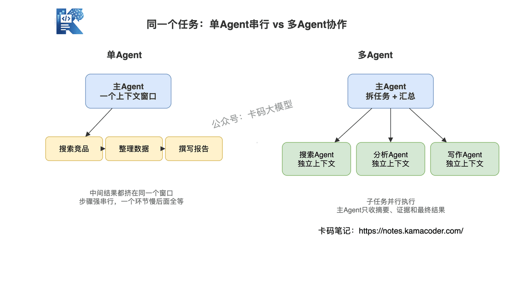
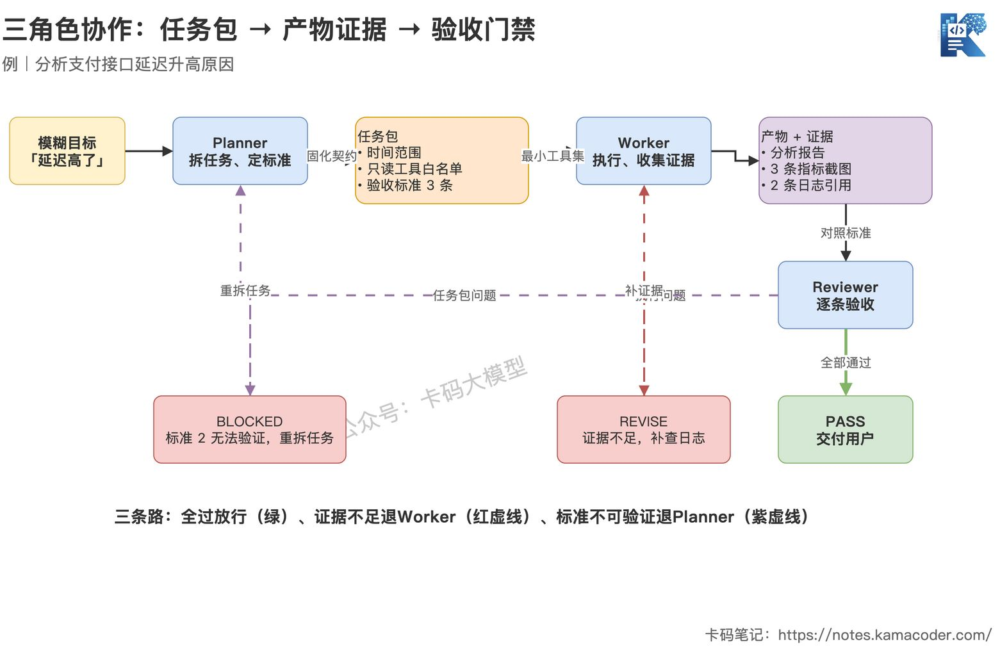

### 4.10 多智能体角色分工与权限隔离 【🔥 必会】

#### 1. 🎯 本节目标与大白话例子

上一步痛点：当任务既要“读日志写修复方案”，又要“自己检查方案有没有漏洞”时，如果全塞给同一个单 Agent，很容易出现“既当运动员又当裁判员”的自我原谅现象——模型刚生成的方案，自己审自己几乎 100% 放行；同时单个 Prompt 塞满所有角色指令，注意力严重分散。

本节解法：引入 Planner-Worker-Reviewer 多角色状态机：① Planner 负责拆解；② Worker 负责执行与产出（唯一拥有写权限）；③ Reviewer 独立审校且强制只读权限（READ_ONLY），不通过则带结构化缺陷报告打回返工，并配 max_reworks 硬熔断防无限踢皮球。

大白话例子：就像软件工程的研发流程：架构师（Planner）拆任务 -> 程序员（Worker）写代码改配置 -> 代码审查员（Reviewer）只看不改，发现“缺少回滚方案”就打回修改；但如果来回打回超过 2 次还过不了，直接升级技术总监（Human Escalation）拍板，绝不在群里吵一晚上！

#### 2. 🧠 核心原理与五维拆解





| 维度 | 核心内容（闭卷背诵标准） |
| --- | --- |
| ① 输入什么 | 任务目标 goal、三角色回调函数（planner_fn / worker_fn / reviewer_fn）、最大返工熔断次数 max_reworks。 |
| ② 做什么 | Planner 拆解计划 -> 进入 Worker <-> Reviewer 迭代闭环：Worker 基于上轮 feedback 生成产物 -> Reviewer 在 READ_ONLY 权限守卫下审校 -> 通过则输出 APPROVED，驳回且超过 max_reworks 则熔断升级人工（ESCALATED_TO_HUMAN）。 |
| ③ 输出什么 | 终局状态（APPROVED / ESCALATED_TO_HUMAN）、实际返工次数 reworks、最终产物及全链路审计日志 audit_log。 |
| ④ 关键参数 | max_reworks（通常设为 1~2 次，防互相推诿耗尽预算）、SetPermissionGuard("READ_ONLY")（物理隔离 Reviewer 写权限）。 |
| ⑤ 工程 Trade-off | 多智能体通过“角色隔离 + 独立对抗审校”提升了复杂任务准确率，但代价是 Token 消耗与端到端延迟显著放大（2~4 倍）；如果简单任务也强行上 Multi-Agent，纯粹是画蛇添足。 |

知识扩展（面试加分盲区）：

什么时候才真需要 Multi-Agent？（单 Agent 够用原则）：只有满足以下条件之一才拆 Multi-Agent：① 上下文过载（单一上下文装不下全部领域知识与 30+ 个工具）；② 权限与职责硬隔离（执行者与审计者必须分离）；③ 存在可高度并发的独立子研究任务（如同时调研 5 家竞品）。否则优先用“单 Agent + 模块化 Skills”。

多智能体三大主流拓扑模式：

Supervisor / Orchestrator（中心化主管模式）：中央主管调度各个专职 Worker（最可控、最适合企业落地）。

Sequential / Pipeline（流水线模式）：Planner -> Worker -> Reviewer 线性接力。

Swarm / Handoff（去中心化接力）：Agent A 处理完把对话控制权直接移交给 Agent B（灵活但难以追踪全局状态）。

为什么必须限制 Reviewer 只能 READ_ONLY？：如果允许 Reviewer 也去改文件或调写接口，就会出现 Worker 和 Reviewer 互相覆盖彼此修改 的并发冲突，彻底破坏可追溯性。

#### 3. 💻 渐进式代码实操（Step 10：Planner-Worker-Reviewer 三角色状态机）

演进说明：从单 Agent 演进为带 SetPermissionGuard 只读守卫与 max_reworks 熔断的多角色协作状态机。

```python
"""Step 10: Planner-Worker-Reviewer State Machine (多角色分工与只读审校断路器).

实现工业级多角色协作状态机：
1. Planner 拆解任务 -> Worker 执行（拥有写权限）-> Reviewer 独立审校（严格只读，禁止写权限）。
2. Reviewer 不通过时带结构化缺陷报告打回 Worker 返工。
3. 设置 max_reworks 硬熔断上限，防止无限互相推诿。
"""

from __future__ import annotations

from dataclasses import dataclass
from enum import Enum
from typing import Callable, Dict, List


class Role(str, Enum):
    PLANNER = "planner"
    WORKER = "worker"
    REVIEWER = "reviewer"


@dataclass
class ReviewDecision:
    approved: bool
    feedback: str = ""


# [必记设计决策-显式状态机] 生产多智能体优先用 Planner->Worker->Reviewer 显式状态机，慎用无约束自由群聊
class MultiAgentOrchestrator:
    """Planner -> Worker -> Reviewer 三角色状态机."""

    def __init__(self, max_reworks: int = 2) -> None:
        if max_reworks < 0:
            raise ValueError("max_reworks 不能为负数")
        self.max_reworks = max_reworks
        self.audit_log: List[str] = []

    def run(
        self,
        goal: str,
        planner_fn: Callable[[str], List[str]],
        worker_fn: Callable[[List[str], str], Dict[str, str]],
        reviewer_fn: Callable[[Dict[str, str], SetPermissionGuard], ReviewDecision],
    ) -> Dict[str, object]:
        plan = planner_fn(goal)
        self.audit_log.append(f"PLANNER: generated {len(plan)} steps")

        feedback = ""
        rework_count = 0
        # [必记设计决策-审校只读隔离] Reviewer 必须强制注入 READ_ONLY 只读守卫，防止审校越权修改生产状态
        guard = SetPermissionGuard(allowed_mode="READ_ONLY")

        while True:
            artifact = worker_fn(plan, feedback)
            self.audit_log.append(f"WORKER(attempt={rework_count + 1}): produced artifact")

            decision = reviewer_fn(artifact, guard)
            self.audit_log.append(f"REVIEWER: approved={decision.approved}")

            if decision.approved:
                return {"status": "APPROVED", "reworks": rework_count, "artifact": artifact}

            rework_count += 1
            # [必背手撕-返工熔断] 设置 max_reworks 硬上限，超过后立即 ESCALATED_TO_HUMAN 转人工，防无限互相推诿
            if rework_count > self.max_reworks:
                return {
                    "status": "ESCALATED_TO_HUMAN",
                    "reworks": rework_count - 1,
                    "last_feedback": decision.feedback,
                }
            feedback = decision.feedback


@dataclass
# [无需死背-脚手架] 权限守卫类封装写法简单直观，重在记住“只读隔离”的设计原则
class SetPermissionGuard:
    """强制约束 Reviewer 只能使用只读工具."""

    allowed_mode: str = "READ_ONLY"

    def assert_tool_allowed(self, tool_mode: str) -> None:
        if self.allowed_mode == "READ_ONLY" and tool_mode != "READ":
            raise PermissionError(f"Reviewer 严禁调用写工具 (mode={tool_mode})")


if __name__ == "__main__":
    orch = MultiAgentOrchestrator(max_reworks=2)
    worker_calls = {"n": 0}

    def planner(goal: str) -> List[str]:
        return [f"定位 {goal} 根因", "生成修复建议"]

    def worker(plan: List[str], feedback: str) -> Dict[str, str]:
        worker_calls["n"] += 1
        if not feedback:
            return {"draft": "建议直接重启数据库"}
        return {"draft": "先切流再重启，附带回滚步骤", "addressed": feedback}

    def reviewer(artifact: Dict[str, str], guard: SetPermissionGuard) -> ReviewDecision:
        guard.assert_tool_allowed("READ")
        if "回滚" not in artifact["draft"]:
            return ReviewDecision(approved=False, feedback="缺少回滚步骤，请补充")
        return ReviewDecision(approved=True)

    res = orch.run("TK-101 连接池打满", planner, worker, reviewer)
    assert res["status"] == "APPROVED" and res["reworks"] == 1 and worker_calls["n"] == 2

    try:
        SetPermissionGuard("READ_ONLY").assert_tool_allowed("WRITE")
        assert False, "Reviewer 写操作必须被拒绝"
    except PermissionError:
        pass
    print("Step 10 self-test passed!")
```

【工业级调库对照】（LangGraph Supervisor / AutoGen / CrewAI 选型对比）：

```python
# 何时手写：企业生产落地最推荐用状态机（或 LangGraph）显式编排 Supervisor -> Worker -> Reviewer，可控性最高。
# 何时调库：原型验证可用 CrewAI（偏角色流水线）或 LangGraph Supervisor；慎用全自由群聊型框架（成本高且易跑飞）。
```

### 🧠 代码区记忆清单：背什么 vs 不背什么

🔒 不可替代的系统设计决策（必须记住，面试直接讲思路）：

职责分离与最小权限：Planner 拆解、Worker 执行写操作、Reviewer 独立审校且严格限制为只读（READ_ONLY），避免“既当运动员又当裁判员”。

返工次数硬熔断：Worker 与 Reviewer 之间必须设 max_reworks 上限，连续打回超限即升级人工介入（ESCALATED_TO_HUMAN）。

✍️ 面试手撕/默写范围：

MultiAgentOrchestrator.run 的 while True 返工闭环（Worker 产出 -> Reviewer 只读审校 -> 通过返回 / 超限转人工）。

🗑️ 无需死背的脚手架代码：

Role 枚举、ReviewDecision 数据类与本地模拟回调函数。

#### 4. 🗣️ 面试官视角：这段代码怎么讲

先声明不变量：① Reviewer 永远运行在 READ_ONLY 权限守卫之下，禁止任何写副作用；② rework_count > self.max_reworks 必然触发 ESCALATED_TO_HUMAN 熔断，绝不死循环。

讲清关键行：第 50 行把 guard 显式注入 reviewer_fn，在代码层（而不是仅靠 Prompt 口头叮嘱）阻断越权；第 57~64 行把 decision.feedback 传回下一轮 worker_fn，实现带具体缺陷清单的定向返工。

主动点出工程细节：为了防止 Reviewer“鸡蛋里挑骨头”导致每次都打回，Reviewer 的审校标准必须写成可核验的清单（Checklist），且只针对硬性缺陷（如缺少回滚方案）打回，禁止因为文风偏好打回。

#### 5. 🔧 生产排障指南（实现 -> 排障）

故障 1：Worker 和 Reviewer 在“语气太生硬 vs 改完又太啰嗦”之间来回拉扯 10 轮，烧光 Token

现象：任务迟迟不结束，返工日志全是主观润色意见。

定位方法：Reviewer 缺少硬性通过标准，且未配置 max_reworks 上限。

修复方案：设定 max_reworks=2 硬熔断；把 Reviewer Prompt 约束为“仅检查事实一致性与必需字段是否缺失，不提风格建议”。

故障 2：拆成 5 个 Agent 串联后，简单问题也要等 25 秒

现象：哪怕用户只问一个简单概念，也要经过 Planner -> Researcher -> Writer -> Reviewer 四道关卡。

定位方法：所有流量无差别进入 Multi-Agent 流水线。

修复方案：回到 4.2 节 HybridRouter，简单请求直接走单次 LLM 或 Workflow，只有高复杂/高风险写任务才拉起 Multi-Agent 流水线。

#### 6. ❓ 高频面试追问与参考答法 + 📝 节末费曼自检

Q1：什么时候该用单 Agent，什么时候才该拆成 Multi-Agent？

参考答法：能单 Agent 搞定绝不拆 Multi-Agent，因为每多一次 Agent 交接就会多一次序列化延迟和上下文损耗。只有当工具数量过多（>15 个）导致上下文稀释、需要执行与审计职责隔离（防自我原谅）、或多个独立子任务需要隔离上下文并发调研时，才拆 Multi-Agent。

Q2：在 Multi-Agent 系统中，为什么 Reviewer 一定要禁止写权限？

参考答法：如果 Reviewer 也能直接改产物或调写接口，一旦 Worker 和 Reviewer 对同一份状态做并发修改，就会产生状态覆盖和审计归因混乱；保持“Worker 单点写入 + Reviewer 只读打回”才能保证状态单向演进、问题可追溯。

Q3：Multi-Agent 最常见的三大失控风险是什么？

参考答法：① 无界互相踢皮球（靠 max_reworks 熔断）；② 上下文透传爆炸（靠 4.11 节白名单投影解决）；③ 并发子 Agent 超支（靠全局 Token 预算池解决）。

📝 节末费曼自检：

为什么不能只靠在 Prompt 里写“你是一个只读审校员”来限制 Reviewer 的权限？

如果 max_reworks=2 触发了 ESCALATED_TO_HUMAN，系统应该向人工工单透传哪些关键字段？
