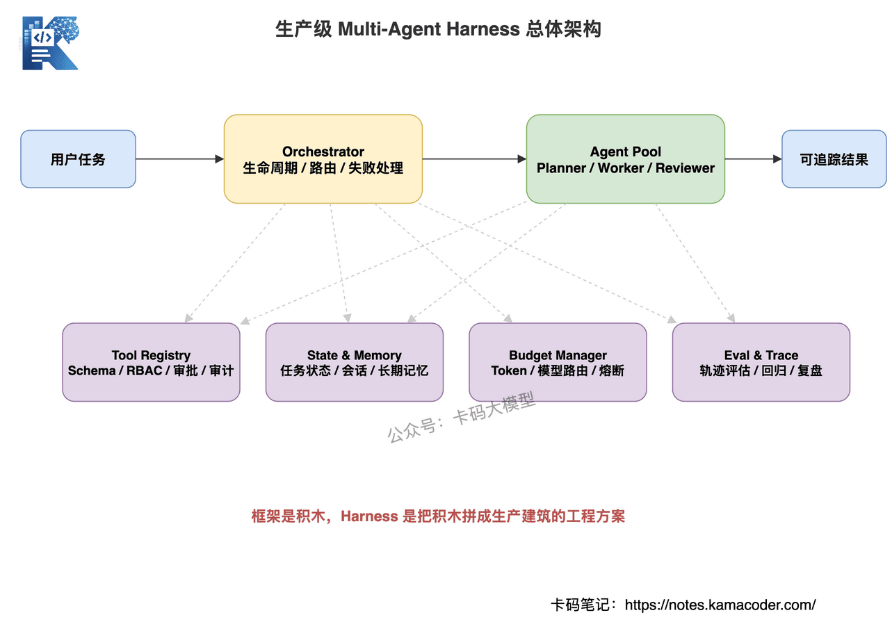

### 4.11 多角色交接、上下文投影与全局预算治理 【🔥 必会】

#### 1. 🎯 本节目标与大白话例子

上一步痛点：在 Step 10 把任务拆成 Planner-Worker-Reviewer 后，如果每次交接都把上游完整的 messages、十万字堆栈日志和内心碎碎念全量透传给下游（Pass-Through），下游的上下文窗口瞬间爆炸，而且并发跑 3 个子 Agent 时，大家各自狂烧 Token，总账单直接超支 10 倍！

本节解法：引入 HandoffProjector（白名单上下文投影器） 与 TokenBudgetAllocator（原子全局预算池）：① 交接时只投影下游必需的白名单字段并截断超长文本；② 子 Agent 启动前向全局预算池原子预扣配额，结束后退还未使用余量。

大白话例子：就像急诊科转重症监护室（ICU）的交班单：值班护士不会把病人住院 7 天所有的点滴瓶照片和闲聊录音全塞给主刀医生，而是只递一张一页纸的结构化交班卡（血型、过敏史、核心体征）；同时医院血库有总量限制，每台手术先预领 400cc，用剩 150cc 立刻退回总库给下一台手术用！

#### 2. 🧠 核心原理与五维拆解

图片待恢复：多智能体上下文治理与白名单投影



| 维度 | 核心内容（闭卷背诵标准） |
| --- | --- |
| ① 输入什么 | 上游完整状态字典 raw_state、白名单字段列表 allowed_fields、全局预算总额 total_budget 与子 Agent 申请额 amount。 |
| ② 做什么 | HandoffProjector 仅提取白名单字段并截断超长字符串；TokenBudgetAllocator 在 Lock 保护下校验可用余额并原子预扣，结算时强制校验 actual_used <= reserved 并释放余量。 |
| ③ 输出什么 | 精简无噪音的 handoff 载荷字典与实时更新的 remaining_available() 全局剩余预算。 |
| ④ 关键参数 | allowed_fields（最小必要信息集）、max_field_chars（单字段防爆截断上限）、total_budget（全局成本防线）。 |
| ⑤ 工程 Trade-off | 白名单投影会主动丢弃上游中间推理过程，换来下游高信噪比、低延迟、低 Token 账单；如果下游确实需要追溯完整原始堆栈，应传一个只读的 artifact_id（指针引用）按需拉取，而不是直接把正文塞进消息体。 |

知识扩展（面试加分盲区）：

Context Isolation（上下文隔离）与 Pass-by-Reference（传引用不传值）：多智能体交接的最高境界是“大产物落盘、消息传引用”——Worker 生成的 5000 行日志分析报告存到对象存储/本地文件，交接时只传 report_uri 和 100 字摘要；Reviewer 需要核查细节时再按需读取对应片段。

什么是“Agent Harness（智能体脚手架/外骨骼）”？：2025~2026 年外企高频新词！模型能力再强，裸奔也会翻车；Harness 就是包裹在 LLM 外面的确定性工程外壳——包含状态机、工具沙箱、上下文投影、Token 预算池、熔断器与审计回执。生产稳定性 70% 靠 Harness，30% 靠模型本身。

#### 3. 💻 渐进式代码实操（Step 11：在 Step 10 基础上新增 HandoffProjector 与 TokenBudgetAllocator）

演进说明：为 Step 10 的多角色交接加上“白名单字段投影”与“线程安全的原子预算池”。

```python
"""Step 11: Handoff Projector & Token Budget Allocator (多角色交接白名单投影与全局预算池).

解决多智能体交接中的“Context 爆炸”与“无界并发超支”问题：
1. HandoffProjector：用白名单字段投影替代全量聊天历史透传，剔除中间推理废话与冗余日志。
2. TokenBudgetAllocator：线程安全/原子化的全局 Token 预算池，子 Agent 预扣配额、用完退还余量。
"""

from __future__ import annotations

from dataclasses import dataclass, field
from threading import Lock
from typing import Any, Dict, List


@dataclass
# [必记设计决策-白名单投影] 多角色交接严禁透传全量聊天历史，必须按 allowed_fields 白名单投影并截断超长字段
class HandoffProjector:
    """只保留下游角色必需的白名单字段，截断超长正文."""

    allowed_fields: List[str]
    max_field_chars: int = 300

    def project(self, raw_state: Dict[str, Any]) -> Dict[str, Any]:
        """将上游完整状态投影为精简的交接载荷."""
        projected: Dict[str, Any] = {}
        for key in self.allowed_fields:
            if key not in raw_state:
                continue
            val = raw_state[key]
            # [必记设计决策-交接截断] 防止单字段超长堆栈或日志撑爆下游角色上下文窗口
            if isinstance(val, str) and len(val) > self.max_field_chars:
                val = val[: self.max_field_chars] + "...[TRUNCATED]"
            projected[key] = val
        return projected


@dataclass
class TokenBudgetAllocator:
    """多 Agent 全局 Token 预算池（支持预扣与余量回收）."""

    total_budget: int
    used_tokens: int = 0
    _reservations: Dict[str, int] = field(default_factory=dict)
    _lock: Lock = field(default_factory=Lock)

    # [必背手撕-原子预扣] 多子 Agent 并发时用锁(或 Redis Lua)先预扣配额，防各自超支突破总预算
    def reserve(self, agent_id: str, amount: int) -> bool:
        """原子预扣配额，余额不足时拒绝分配."""
        if amount <= 0:
            raise ValueError("预扣 Token 必须为正整数")
        with self._lock:
            reserved_sum = sum(self._reservations.values())
            available = self.total_budget - self.used_tokens - reserved_sum
            if amount > available:
                return False
            self._reservations[agent_id] = self._reservations.get(agent_id, 0) + amount
            return True

    # [必背手撕-结算退还] 执行完毕按 actual_used 结算并释放剩余预扣额度，确保账目守恒
    def settle(self, agent_id: str, actual_used: int) -> int:
        """结算实际消耗，退还未使用的预扣额度，返回当前剩余可用预算."""
        if actual_used < 0:
            raise ValueError("actual_used 不能为负")
        with self._lock:
            reserved = self._reservations.pop(agent_id, 0)
            assert actual_used <= reserved, f"{agent_id} 超额消耗: actual={actual_used} > reserved={reserved}"
            self.used_tokens += actual_used
            return self.remaining_available()

    def remaining_available(self) -> int:
        return self.total_budget - self.used_tokens - sum(self._reservations.values())


if __name__ == "__main__":
    raw_worker_state = {
        "ticket_id": "TK-101",
        "root_cause": "db-02 连接池耗尽",
        "raw_stack_trace": "Traceback..." * 100,
        "scratchpad": "我觉得可能是内存泄露，不对，再看看...",
    }
    projector = HandoffProjector(allowed_fields=["ticket_id", "root_cause"])
    handoff = projector.project(raw_worker_state)
    assert set(handoff.keys()) == {"ticket_id", "root_cause"}
    assert "raw_stack_trace" not in handoff and "scratchpad" not in handoff

    pool = TokenBudgetAllocator(total_budget=1000)
    assert pool.reserve("worker_1", 600) is True
    assert pool.reserve("worker_2", 500) is False, "超额并发预扣必须被拒绝"
    assert pool.reserve("worker_2", 400) is True
    rem = pool.settle("worker_1", actual_used=250)
    assert rem == 350 and pool.remaining_available() == 350
    print("Step 11 self-test passed!")
```

【工业级调库对照】（LangGraph Private State Schema + Redis DECRBY 分布式预算）：

```python
# 何时手写：单机多线程并发调度子 Agent 时，用 Lock + 预扣结算模型最直观可控。
# 何时调库：跨进程/分布式多智能体用 Redis Lua 脚本做原子预扣，并在 LangGraph 中为每个 Subgraph 定义独立的 Input/Output State Schema（天然实现白名单投影）。
```

### 🧠 代码区记忆清单：背什么 vs 不背什么

🔒 不可替代的系统设计决策（必须记住，面试直接讲思路）：

防 Context 爆炸（白名单投影）：上游的中间思考（scratchpad）和原始堆栈不能全量喂给下游，只投影下游必需的结构化字段。

防并发超支（预扣-结算模型）：多个子 Agent 并行运行如果只事后记账必然超预算，必须采用 Lock + reserve 预扣配额，结束后 settle 退还余量。

✍️ 面试手撕/默写范围：

TokenBudgetAllocator 的 reserve() 与 settle() 加锁账本公式（available = total - used - sum(reservations)）。

🗑️ 无需死背的脚手架代码：

threading.Lock 与 dataclass field(default_factory=...) 语法。

#### 4. 🗣️ 面试官视角：这段代码怎么讲

先声明不变量：① used_tokens + sum(_reservations.values()) <= total_budget 是全局资金守恒不变量，并发场景下靠 threading.Lock 保证不超卖；② 上游内部 scratchpad 和原始堆栈绝不裸透传给下游。

讲清关键行：reserve() 先算 available = total - used - reserved_sum，防止并发子 Agent 同时通过检查导致超支；settle() 用 pop 释放预扣并加回 actual_used，自动把省下来的额度还给全局池。

主动点出工程细节：如果某个子 Agent 崩溃没调 settle()，预扣额度会被永久锁死（内存泄漏）；生产中要给 reservation 加 TTL 超时自动回收 或放在 try...finally 块中结算。

#### 5. 🔧 生产排障指南（实现 -> 排障）

故障 1：多智能体越聊越傻，Reviewer 总是被 Worker 之前的错误尝试带偏

现象：Worker 第 1 次猜错了方向，后来自己改对了，但交接时把全量聊天历史传给了 Reviewer，Reviewer 盯着第 1 次的错误猜想打回。

定位方法：检查交接载荷是否直接透传了完整的 messages 历史。

修复方案：用 HandoffProjector 只传终局产物字段（如 ticket_id、final_proposal、evidence_refs），彻底隔离过程噪音。

故障 2：并发派发 5 个调研子 Agent，总账单突破单次请求上限 3 倍

现象：每个子 Agent 各自检查“总花费 < 1000”都通过了，结果 5 个各花 800，总共花掉 4000。

定位方法：并发扣费采用“事后记账”而非“事前原子预扣”。

修复方案：引入 TokenBudgetAllocator 事前原子预扣（Reserve-then-Settle）机制。

#### 6. ❓ 高频面试追问与参考答法 + 📝 节末费曼自检

Q1：为什么多智能体交接时，不能直接把上一个 Agent 的 messages 原封不动传给下一个？

参考答法：三个原因：① Token 爆炸，中间大量工具原始返回和试错过程极占篇幅；② 注意力污染（Context Poisoning），上游失败的推理碎碎念会误导下游模型；③ 角色边界模糊，下游只需知道“结论和证据指针”，不需要知道上游怎么纠结的。

Q2：并发跑多个子 Agent 时，怎么严格控制总 Token 不超支？

参考答法：不能用事后累加，必须用**中心化预算池的预扣结算（Reserve & Settle）**模型：子 Agent 启动前按最坏预算原子预扣，预算不足直接拒绝并发或降级为串行/轻量模型，执行完毕在 finally 里按实际消耗结算并退还余量。

📝 节末费曼自检：

对比“事后记账”与“Reserve-and-Settle 原子预扣”在并发子 Agent 场景下的差异。

什么是“传引用不传值（Pass-by-Reference）”的上下文交接模式？
