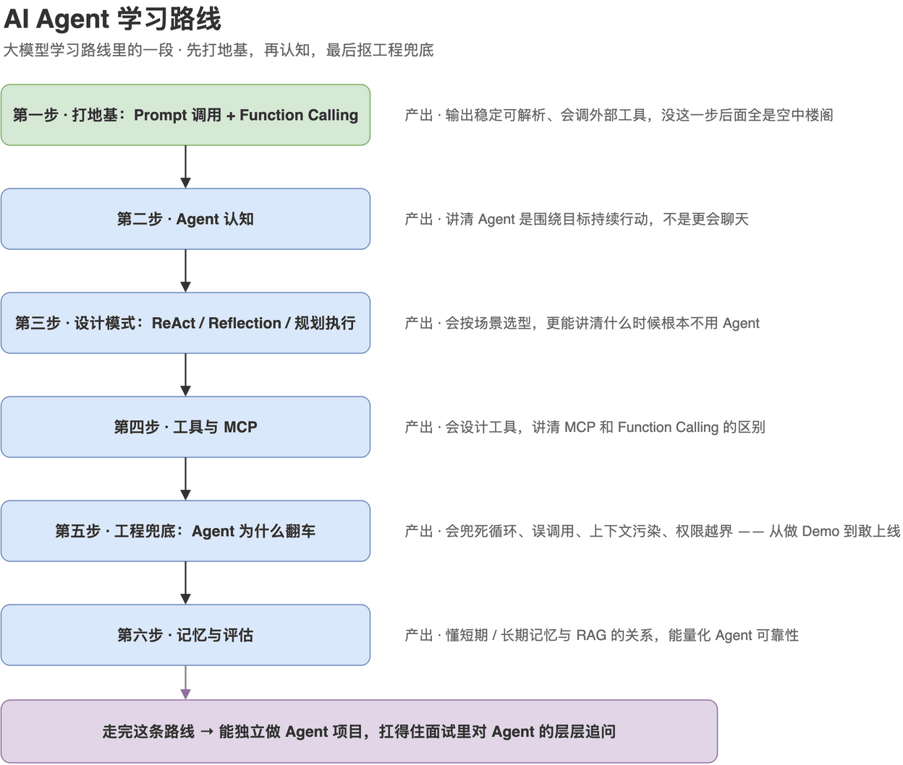

### 4.13 Agent 能力图谱与上线就绪度审计 【◻ 按需】

#### 1. 🎯 本节目标与大白话例子

上一步痛点：很多团队做 Agent 喜欢“一上来就搞多智能体并发 + 自主联网”，结果连最基础的 O-T-A 步数熔断、Tool Schema 校验和原子记忆窗口都没建好，上线后天天救火；个人备考也容易东一榔头西一棒槌，不知道前置能力缺哪块。

本节解法：引入 SkillReadinessAuditor（前置依赖图与就绪度审计器）：把 Agent 的工程能力或个人技能模块建模为有向依赖图（Prerequisite Graph），自动识别“已掌握项、当前可解锁项、被前置依赖阻塞项”。

大白话例子：就像打游戏的“科技树 / 技能树”：你还没点亮“前置护盾（Tool 沙箱 + 记忆窗口）”，系统就直接锁住“多智能体并发”按钮，告诉你先补齐 memory_window 再解锁下一阶，防止根基不稳强行上高阶特性。

#### 2. 🧠 核心原理与五维拆解



图片待恢复：Agent 生产落地成熟度模型

| 维度 | 核心内容（闭卷背诵标准） |
| --- | --- |
| ① 输入什么 | 能力节点列表 skills: List[SkillNode]（含 skill_id、title、prerequisites、mastered）。 |
| ② 做什么 | 初始化时校验所有前置依赖节点是否存在；audit() 时扫描未掌握节点，若其所有 prerequisites 均已掌握则归入 ready_next，否则列出缺失前置项归入 blocked。 |
| ③ 输出什么 | 就绪度报告（readiness_score、mastered、ready_next、blocked）。 |
| ④ 关键参数 | prerequisites（能力演进的硬依赖拓扑）。 |
| ⑤ 工程 Trade-off | 用程序化依赖审计替代拍脑袋上线，确保团队按“单步可控 -> 工具安全 -> 评测闭环 -> 多智能体编排”的稳健路径演进。 |

知识扩展（面试加分盲区）：

企业 Agent 落地的四个成熟度台阶：

L1（可用原型）：跑通 ReAct + Tool Calling，能演示 Happy Path。

L2（生产可控）：补齐 max_steps、RBAC 沙箱、原子记忆窗口、幂等键与退避重试。

L3（可观测与可回归）：接入 Trace 监控、四分类归因与离线 Pass^k CI 门禁。

L4（规模化协同）：引入 MCP 标准化生态、DAG 并行调度、Multi-Agent 隔离与预算池。

#### 3. 💻 渐进式代码实操（Step 13：SkillReadinessAuditor 能力就绪度审计）

演进说明：把整章渐进式模块抽象为前置依赖图，自动输出当前系统上线就绪度与下一步缺口。

```python
"""Step 13: Skill Readiness Auditor (能力前置条件图与就绪度审计).

将技能掌握度与系统能力模块建模为有向依赖图 (Prerequisite Graph)：
1. 校验技能依赖闭环与前置条件满足情况。
2. 输出可执行的学习/上线就绪度报告（已就绪、阻塞项、下一步推荐）。
"""

from __future__ import annotations

from dataclasses import dataclass
from typing import Dict, List, Set


@dataclass
class SkillNode:
    skill_id: str
    title: str
    prerequisites: List[str]
    mastered: bool = False


class SkillReadinessAuditor:
    """校验前置依赖并计算技能/系统就绪度."""

    def __init__(self, skills: List[SkillNode]) -> None:
        self.skills: Dict[str, SkillNode] = {s.skill_id: s for s in skills}
        # 依赖完整性。初始化时校验所有前置依赖节点存在，防止悬空引用导致审计误判
        for s in skills:
            for pre in s.prerequisites:
                if pre not in self.skills:
                    raise ValueError(f"技能 {s.skill_id} 引用了未知前置项 {pre}")

    def audit(self) -> Dict[str, object]:
        mastered_set: Set[str] = {sid for sid, s in self.skills.items() if s.mastered}
        ready_to_learn: List[str] = []
        blocked: Dict[str, List[str]] = {}

        for sid, node in self.skills.items():
            if node.mastered:
                continue
            # 就绪度归类。未掌握节点按前置条件是否全部满足，自动划分为 ready_next 与 blocked
            missing = [p for p in node.prerequisites if p not in mastered_set]
            if not missing:
                ready_to_learn.append(sid)
            else:
                blocked[sid] = missing

        # 计算上线就绪度百分比并排序展示。
        readiness_score = round(len(mastered_set) / max(1, len(self.skills)), 4)
        return {
            "readiness_score": readiness_score,
            "mastered": sorted(mastered_set),
            "ready_next": sorted(ready_to_learn),
            "blocked": blocked,
        }


if __name__ == "__main__":
    nodes = [
        SkillNode("ota_loop", "O-T-A 闭环", [], mastered=True),
        SkillNode("tool_schema", "Tool Schema 与沙箱", ["ota_loop"], mastered=True),
        SkillNode("memory_window", "原子记忆窗口", ["ota_loop"], mastered=False),
        SkillNode("multi_agent", "多智能体交接", ["tool_schema", "memory_window"], mastered=False),
    ]
    report = SkillReadinessAuditor(nodes).audit()
    assert report["readiness_score"] == 0.5
    assert report["ready_next"] == ["memory_window"]
    assert report["blocked"] == {"multi_agent": ["memory_window"]}
    print(f"Step 13 self-test passed! report={report}")
```

### 示例说明与练习范围

本例的设计选择：

能力依赖图建模：把 Agent 工程能力（O-T-A -> 沙箱/记忆 -> 多智能体）建模为有向依赖图，上线前可自动识别阻塞项与下一步补齐顺序。

引用完整性前置校验：构图时先检查前置节点 ID 是否有效，避免配置错误悄悄失效。

**代码练习｜能讲清设计**。准备上线清单与回滚条件，不背审计器。

示例辅助代码：

SkillNode 数据类与 if __name__ == "__main__" 测试数据。

#### 4. 🗣️ 面试官视角：这段代码怎么讲

先声明不变量：所有节点引用的前置依赖必须在图内有定义（初始化即校验）；只有前置全部满足的未完成节点才会进入 ready_next。

讲清关键行：missing = [p for p in node.prerequisites if p not in mastered_set] 用集合差快速判定阻塞原因，直接给出可执行的下一步清单。

主动点出工程细节：在实际生产发布门禁（Launch Readiness Review）中，可以把“单测通过率、Pass^3 达标率、PII 脱敏、HITL 门禁开关”都做成 SkillNode，在 CI/CD 阶段自动拦截不达标的发布。

#### 5. 🔧 生产排障指南（实现 -> 排障）

故障 1：团队跳过评测基建直接上线 Multi-Agent，出问题后完全无法定位是哪个环节坏了

现象：线上准确率波动，每次改 Prompt 像抽盲盒。

定位方法：对照成熟度清单，发现缺失 L3 评测轨迹归因与离线回归集。

修复方案：先冻结多智能体扩展，优先补齐轨迹日志与 Pass^k 回归门禁。

#### 6. ❓ 高频面试追问与参考答法 + 📝 节末费曼自检

Q1：从 0 到 1 做一个企业级 Agent 项目，你的落地优先级顺序是什么？

参考答法：① 先用 Workflow/Hybrid 定边界，绝不盲目全 Agent 化；② 搭好单 Agent O-T-A 内核 + 工具沙箱 + 原子记忆窗口；③ 建离线沙箱评测集盯紧 Pass^k；④ 最后才按需引入 MCP 或 Multi-Agent 拆分。

📝 节末费曼自检：

为什么在上线 Multi-Agent 之前，必须先具备原子记忆窗口与 Pass^k 评测基线？

## 面试重点｜设计、调参与排障

**面试官可能问**

演示已经能跑，怎样决定 Agent 可以灰度上线？

**参考回答（现场口述）**

先做影子运行，让 Agent 给建议但不影响真实业务。上线门槛包括越权、重复写入、失败恢复、任务成功率、P95 和成本，每一项都有阈值。先开放低风险流量，出现高严重度错误或预算异常时能够切回原流程。

**系统设计怎么选**

先有验收集、权限、限流、熔断和人工入口，再考虑扩任务范围。给每种写动作定义权限、成功口径和事故处置。

**参数或条件改变会怎样**

灰度比例和并发上限按风险逐步提高。监控成功、错误写入、人工量和尾延迟，提前定回滚条件。

**系统出错怎么查、怎么验证**

把一次工具不可用或错误写入当演练，检查是否告警、是否止损、是否能恢复到可知状态。
