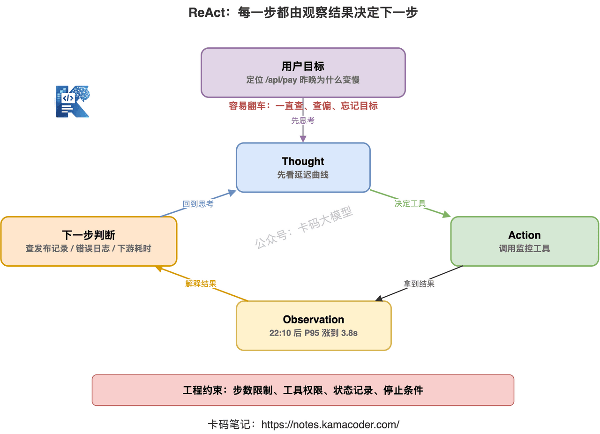

### 4.4 ReAct 推理循环与反思规划 【🔥 必会】

#### 1. 🎯 本节目标与大白话例子

上一步痛点：在 Step 3 之前，我们的循环还没用上工业界标准的 messages 协议栈（assistant 发起 tool_calls，tool 携带 tool_call_id 回传），也没有防单次重复调用的守卫，模型一旦卡壳就会对着同一个参数疯狂空转。

本节解法：把 Step 1~3 升级为工业级 ReActEngine，严格维护 tool_call_id 配对不变量与单次运行指纹防重，并理解 ReAct、Reflection（反思）与 Planning（规划）的协同关系。

大白话例子：就像侦探破案做笔录：每派出去一个调查指令（call_id = tc_1），档案里必须对应贴上一份带同编号的回执单（tool_call_id = tc_1），少一张档案就作废；同时如果侦探发现自己刚查过“订单 O100”，下一秒又想用完全一样的参数再查一遍“订单 O100”，系统直接敲警钟叫停。

#### 2. 🧠 核心原理与五维拆解



| 维度 | 核心内容（闭卷背诵标准） |
| --- | --- |
| ① 输入什么 | 用户目标 goal、注册好工具的 ToolSandboxRegistry、策略决策函数 llm_policy_fn、调用角色 role 与 max_steps。 |
| ② 做什么 | 维护标准对话消息栈 messages：每步调用模型产出决策（TOOL 或 FINAL）；若为 TOOL，先做指纹去重检测，再把 assistant(tool_calls) 压栈、调沙箱执行、并用完全相同的 tool_call_id 将 tool 结果压栈。 |
| ③ 输出什么 | 终局状态（COMPLETED / STOPPED_DUPLICATE / STOPPED_MAX_STEPS）、消耗步数、最终回答及完整 messages 轨迹。 |
| ④ 关键参数 | max_steps（循环步数上限）、seen_calls 指纹集合（防止同参死循环）。 |
| ⑤ 工程 Trade-off | ReAct（边想边做）适应动态环境极强，但每次观测都可能改变后续路径，导致总步数不可预测、长链路上下文膨胀；因此简单长链路适合结合 Plan-and-Execute（见 4.9 节）。 |

知识扩展（面试加分盲区）：

ReAct vs Reflexion（自我反思）vs Chain-of-Thought（CoT）：

CoT：纯内部推理，不与外部环境交互，容易“一本正经地胡说八道”（幻觉无从纠正）。

ReAct：Thought -> Action -> Observation 交织，用外部真实观测打断幻觉。

Reflexion：在任务失败或拿到 Critic 反馈后，生成一段**文字版的自我反思总结（Episodic Reflection）**存入记忆，供下一轮重试避坑（适合代码生成、SQL 纠错等有明确验证器的场景）。

为什么 OpenAI / Anthropic API 对 tool_call_id 校验极其严格？：模型在底层对话模板（Chat Template）中把 assistant(tool_calls) 和 tool(tool_call_id) 视为成对的 XML/特殊 Token 块。一旦有 tool_call 没配对 tool 响应（或顺序错乱），API 会直接返回 400 Bad Request，这是 Agent 线上的高频低级崩溃点。

#### 3. 💻 渐进式代码实操（Step 4：在 Step 1~3 基础上升级标准 ReActEngine）

演进说明：把 Step 1 的简单 while 循环和 Step 3 的 ToolSandboxRegistry 缝合，新增 messages 标准消息栈、tool_call_id 强配对以及 seen_calls 指纹防重。

```python
"""4.4 Step 4: 在 Step 1~3 基础上升级标准 ReActEngine（强制 tool_call_id 配对 + 单步防重）"""
from step_03 import ToolSandboxRegistry, ToolSpec


class ReActEngine:
    """标准 ReAct 循环内核：严格维护 assistant(tool_call) 与 tool(tool_call_id) 配对消息栈。"""
    def __init__(self, registry: ToolSandboxRegistry, max_steps: int = 5) -> None:
        self.registry = registry
        self.max_steps = max_steps

    def run(self, goal: str, llm_policy_fn, role: str = "viewer") -> dict[str, object]:
        messages: list[dict[str, object]] = [{"role": "user", "content": goal}]
        # [无需死背-脚手架] 局部指纹集合用于演示单步防重，生产中建议升级为规范化 JSON 哈希
        seen_calls: set[str] = set()

        for step in range(1, self.max_steps + 1):
            decision = llm_policy_fn(messages, step)
            if decision["type"] == "FINAL":
                messages.append({"role": "assistant", "content": decision["answer"]})
                return {"status": "COMPLETED", "steps": step, "answer": decision["answer"], "messages": messages}

            call_id = str(decision["call_id"])
            tname = str(decision["tool_name"])
            targs = dict(decision["args"])
            # [必记设计决策-单步防重] 调用前对 tool_name + 排序后的参数做指纹去重，及时阻断重复无效调用
            fp = f"{tname}:{sorted(targs.items())}"
            if fp in seen_calls:
                return {"status": "STOPPED_DUPLICATE", "steps": step, "answer": "检测到重复无效调用，终止循环。", "messages": messages}
            seen_calls.add(fp)

            # [必背手撕-消息栈配对] 必须先追加带 id 的 assistant(tool_calls)，再回传同 tool_call_id 的 tool 消息
            messages.append({"role": "assistant", "tool_calls": [{"id": call_id, "name": tname, "args": targs}]})
            res = self.registry.execute(tname, targs, role=role)
            # 强制使用相同 tool_call_id 回传 tool 结果，防止接口报 400
            # [必记设计决策-协议强对齐] tool_call_id 缺失或未配对会导致大模型 API 直接报 400 错误
            messages.append({"role": "tool", "tool_call_id": call_id, "content": str(res)})

        return {"status": "STOPPED_MAX_STEPS", "steps": self.max_steps, "answer": "达到最大步数限制。", "messages": messages}


if __name__ == "__main__":
    reg = ToolSandboxRegistry()
    reg.register(ToolSpec("query_order", "READ", ("order_id",), lambda a: "paid_not_shipped"))

    def policy(msgs, step):
        if step == 1:
            return {"type": "TOOL", "call_id": "tc_1", "tool_name": "query_order", "args": {"order_id": "O100"}}
        return {"type": "FINAL", "answer": "订单已支付待发货。"}

    out = ReActEngine(reg, max_steps=4).run("查订单 O100", policy)
    assert out["status"] == "COMPLETED" and out["messages"][1]["tool_calls"][0]["id"] == out["messages"][2]["tool_call_id"]
    print("Agent Step 4 self-test passed!")
```

【工业级调库对照】（OpenAI SDK 标准 ReAct 工具调用循环）：

```python
# 何时手写：面试手撕、轻量服务或需要深度定制熔断/上下文裁剪逻辑时，手写 50 行内核最清晰。
# 何时调库：生产直接用官方 SDK 的 messages 协议 + Parallel Tool Calls 循环即可，不必套厚重框架。
# 关键对齐点：如果模型一次返回了 3 个 tool_calls，必须把 3 个对应的 role="tool" 消息全部 append 完，才能发起下一次 chat.completions.create()！
for tc in assistant_msg.tool_calls:
    result = registry.execute(tc.function.name, json.loads(tc.function.arguments), role=user_role)
    messages.append({"role": "tool", "tool_call_id": tc.id, "content": json.dumps(result, ensure_ascii=False)})
```

### 🧠 代码区记忆清单：背什么 vs 不背什么

🔒 不可替代的系统设计决策（必须记住，面试直接讲思路）：

tool_call_id 强配对不变量：每条 assistant 发起的 tool_calls 中的每个 id，都必须有且仅有一条对应的 role="tool" 消息回传，否则接口直接 400 崩溃。

并行调用处理铁律：若单轮返回多个 tool_calls，必须全部执行并全部 append 完毕后才能发起下一次模型请求。

指纹防重熔断：通过 (tool_name, sorted_args) 检测无效重复调用，避免无意义消耗步数。

✍️ 面试手撕/默写范围：

ReActEngine.run 的核心 for 循环（推理决策 -> FINAL 返回 / 指纹判重 -> append assistant -> 执行工具 -> append tool）。

🗑️ 无需死背的脚手架代码：

policy mock 回调构造与 json.dumps(..., ensure_ascii=False) 调库细节。

#### 4. 🗣️ 面试官视角：这段代码怎么讲

先声明不变量：messages 中每一条带 tool_calls 的 assistant 消息，后面必须紧跟所有对应 tool_call_id 的 tool 消息，不能漏也不能孤立存在。

讲清关键行：第 24~27 行通过 sorted(targs.items()) 生成规范化指纹做单次循环防重；第 32 行强制复用 call_id 写入 tool_call_id 保证协议栈合法。

主动点出工程细节：如果工具执行抛出未捕获异常，绝不能跳过 messages.append({"role": "tool", ...})，而应该把异常包装成错误字符串作为 tool 响应塞回消息栈，保证对话状态机不断裂。

#### 5. 🔧 生产排障指南（实现 -> 排障）

故障 1：OpenAI / 兼容接口频繁报 400: An assistant message with 'tool_calls' must be followed by tool messages responding to each 'tool_call_id'

现象：运行到第 3 轮或并发工具调用时突然崩溃。

定位方法：检查两个地方：① 工具执行报错时是否 continue 跳过了 tool 消息追加；② 历史消息截断时是否只删掉了 assistant 或只删掉了 tool（见 4.5 节原子窗口）。

修复方案：使用 try...except 包裹工具执行并始终回传 tool 响应；上下文淘汰必须以 (assistant + tools) 为原子单位。

故障 2：开启“反思（Reflection）”后，模型反而陷入自我否定，把原本做对的答案改错

现象：无外部验证器时，模型自己反思自己，越改越偏。

定位方法：缺少客观 Grounding 信号（如单元测试报错、SQL 语法报错），纯靠 LLM 自己挑刺（Self-Correction without External Feedback）。

修复方案：学术界与工业界已证实无外部反馈的纯自我反思效果极差甚至退化；Reflection 必须绑定客观验证信号（代码编译/单测结果、Schema 校验报错、数据库执行结果）。

#### 6. ❓ 高频面试追问与参考答法 + 📝 节末费曼自检

Q1：ReAct 为什么能显著降低大模型的幻觉？

参考答法：因为它强迫模型把“推理过程（Thought）”和“外部动作（Action）”显式交替输出，每一步的猜想都会立刻接受外部环境返回（Observation）的校验，从而把事实依据从“参数记忆”转移到“上下文实时证据”上。

Q2：如果一个工具本身就需要修改参数重试（比如第一次查 limit=10 不够，第二次查 limit=20），seen_calls 会误杀吗？

参考答法：不会，因为我们的指纹把 args 也序列化进去了，参数变化指纹就不同；只有工具名和参数完全一模一样的无效空转才会被拦截。当然如果允许“状态会随时间变化”的轮询工具（如 check_job_status），可以单独给该工具豁免或改用 4.14 节的连续次数熔断。

Q3：在推理模型（如 o1 / DeepSeek-R1）普及后，Prompt 里的 Thought: 还有必要手写吗？

参考答法：对于原生推理模型（自带 隐式思维链），不再需要在 Prompt 里硬规定 Thought: / Action: 文本格式，直接走原生 Tool Calling 即可，强行规定文本格式反而可能干扰其原生推理链；但“观察 -> 决策 -> 执行”的状态机架构依然完全适用。

Q4：Parallel Tool Calling（并行工具调用）在 ReAct 中有什么坑？

参考答法：主要两个坑：① 多个并行工具里只要有一个超时或异常，必须用 asyncio.gather(..., return_exceptions=True) 捕获并按各自的 tool_call_id 全部回填，不能因为一个挂了导致另外几个的 tool_call_id 丢失；② 写操作严禁随意并行，避免竞态条件。

📝 节末费曼自检：

为什么“无外部验证器的纯自我反思”在工业界通常不建议使用？

当工具执行抛出异常时，ReAct 循环应该直接 raise 终止，还是包装成 tool 消息回传？为什么？
