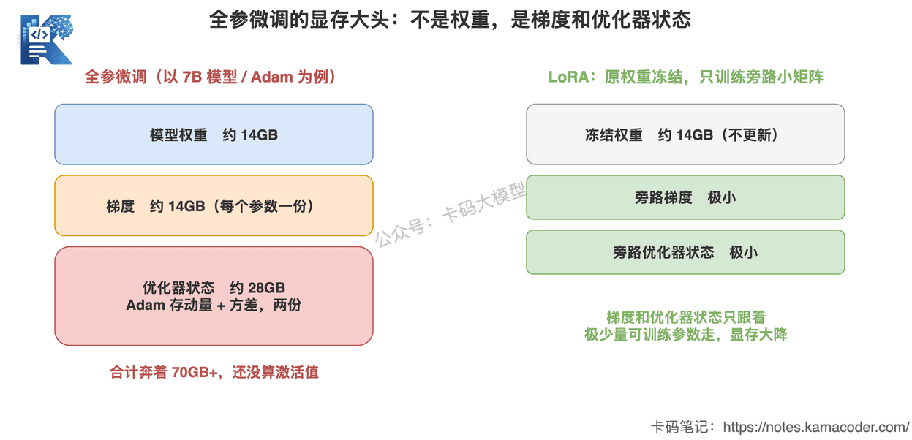
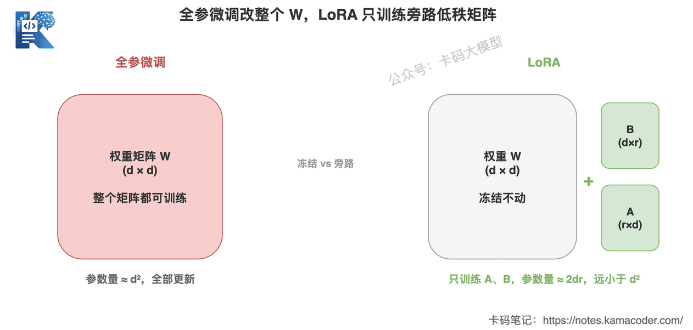
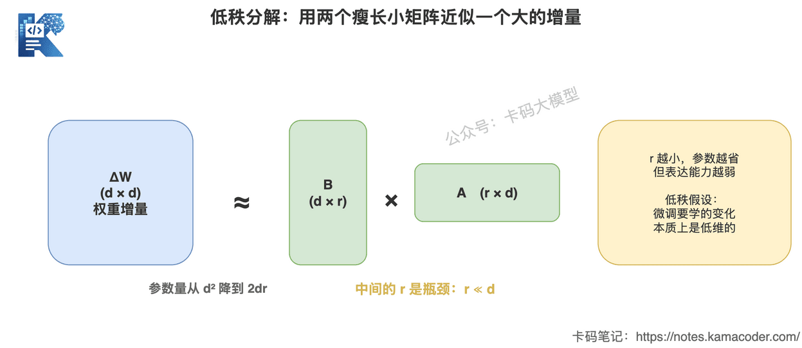
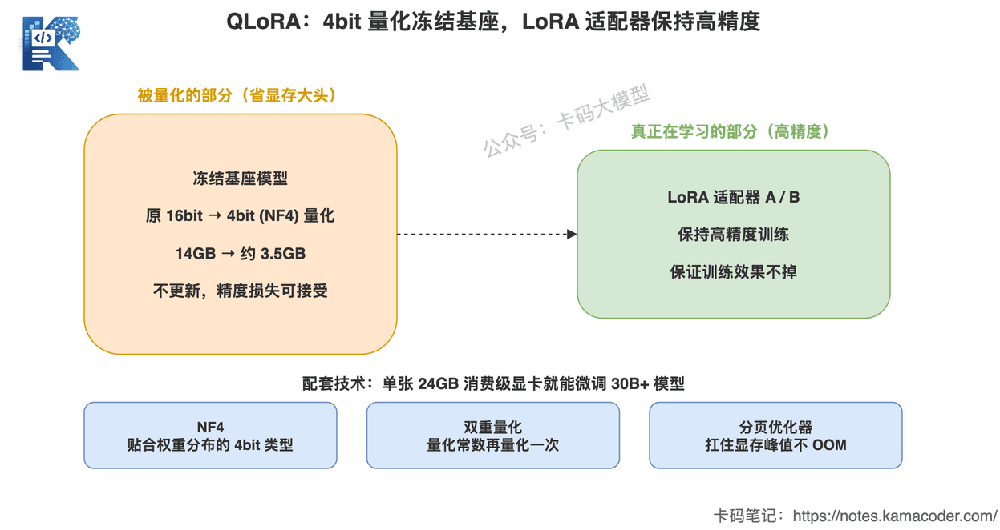
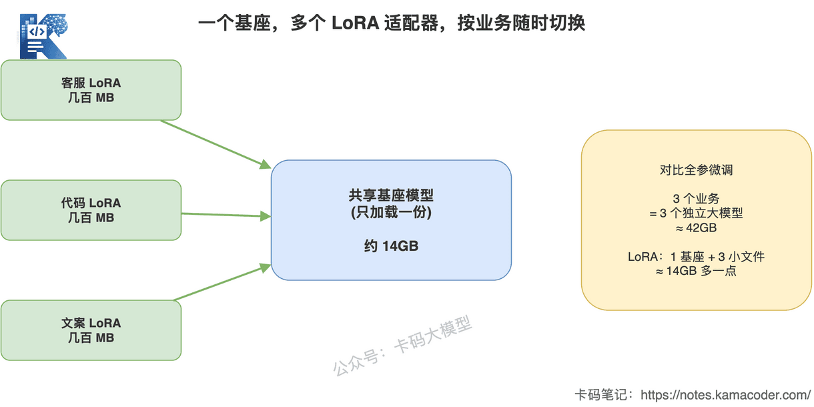

### 5.3 手写 LoRA 低秩注入与 QLoRA 原理 【🔥 必会】

#### 1. 🎯 本节目标与大白话例子

上一步痛点：7B 模型按 FP16 全参微调，光权重（14GB）+ 梯度（14GB）+ Adam 优化器状态（28GB+）就要吃掉 70GB+ 显存，单张消费级显卡根本跑不动，而且每个业务都得存一份独立的 14GB 权重文件！

本节解法：手写 LoRALinear（低秩适配层）：冻结原始权重 $W$，只在旁路加两个瘦长小矩阵 $A \in \mathbb{R}^{r \times d_{\text{in}}}$（高斯初始化）和 $B \in \mathbb{R}^{d_{\text{out}} \times r}$（全零初始化），用 $W_{\text{new}} = W + \frac{\alpha}{r} B A$ 近似微调增量；推理时还可 merge_and_unload() 无损合并，实现推理零额外延迟与一基座多适配器切换。

大白话例子：就像给一本精装百科全书（冻结基座 $W$）做定制补充：你不需要把整本 1000 页的书重新印刷一遍（全参微调），只需要在旁边夹一张薄薄的便利贴（低秩旁路 $B \times A$），上面只写改动的内容；最后定稿出版时（merge），直接把便利贴的内容抄回原书页里，翻书速度一点不变慢！

#### 2. 🧠 核心原理与五维拆解







| 维度 | 核心内容（闭卷背诵标准） |
| --- | --- |
| ① 输入什么 | 激活张量 x: (B, in_features)、冻结基座权重 W: (in_features, out_features)、低秩矩阵 A: (r, in) 与 B: (out, r)。 |
| ② 做什么 | 主路计算 x @ W；旁路先降维 x @ A.T 再升维 @ B.T 并乘缩放因子 alpha / r 相加；推理部署前可 W += (alpha/r) * (A.T @ B.T) 合并。 |
| ③ 输出什么 | (B, out_features)，第 0 步因 $B=0$ 与原模型输出 100% 相等；合并前后输出数值 $10^{-10}$ 等价。 |
| ④ 关键参数 | r（rank 瓶颈宽度，常用 8/16/32）、lora_alpha（缩放因子，常设 2 * r，使调节 r 时旁路步幅保持稳定）、target_modules（建议覆盖 q/k/v/o + FFN 投影层）。 |
| ⑤ 工程 Trade-off | LoRA 用“低秩假设”把可训练参数与优化器显存砍掉 99%，且支持“一基座多适配器”热切换；代价是在与预训练分布差异极大或海量全新知识注入场景下上限略低于全参微调。 |

QLoRA 与多适配器部署原理：





知识扩展（面试加分盲区）：

为什么 A 用高斯初始化而 B 必须全零初始化？：如果 A 和 B 都全零初始化，反向传播时梯度全为 0（对称死锁，学不动）；如果 A 和 B 都随机初始化，第 0 步时 $\Delta W = BA \neq 0$，会直接给预训练模型注入随机噪音破坏初始分布。一零一随机完美保证了“第 0 步严格等价于原模型，且第 1 步梯度非零可顺利更新”。

QLoRA 的三大核心组件：① NF4（4-bit NormalFloat）（贴合正态分布权重的信息论最优 4bit 分位数编码）；② Double Quantization（双重量化）（连量化常数也再量化一次省显存）；③ Paged Optimizer（显存峰值时自动借用 CPU 内存防 OOM）。代价是前向需反量化，训练速度慢约 20%~30%。

#### 3. 💻 渐进式代码实操（Step 3：纯手写 LoRALinear 与无损合并断言）

演进说明：从零手写核心 LoRA 旁路、初始化规则与 merge_and_unload 无损合并验证。

```python
"""5.3 Step 3: 从零手写 LoRA 低秩注入层 (W_new = W + (alpha/r) * B @ A) 与权重合并."""

from __future__ import annotations

import numpy as np


class LoRALinear:
    """纯 NumPy 手写 LoRA 线性层（冻结主干 + 低秩旁路 + 无损合并）."""

    def __init__(self, in_features: int, out_features: int, r: int = 4, lora_alpha: int = 8) -> None:
        if r <= 0 or r >= min(in_features, out_features):
            raise ValueError(f"rank={r} 必须为正整数且远小于矩阵维度 ({in_features}, {out_features})")
        self.in_features = in_features
        self.out_features = out_features
        self.r = r
        # 【按岗位加练开始】微调岗练 alpha/r 和 A 随机、B 全零的初始化
        self.scaling = lora_alpha / r  # LoRA核心缩放系数 alpha/r

        rng = np.random.default_rng(42)
        self.weight = rng.normal(0.0, 0.05, size=(in_features, out_features)).astype(np.float64)
        self.lora_A = rng.normal(0.0, 0.02, size=(r, in_features)).astype(np.float64)  # A矩阵高斯随机初始化
        self.lora_B = np.zeros((out_features, r), dtype=np.float64)  # B矩阵全零初始化保证初始ΔW=0
        # 【按岗位加练结束】
        self.merged = False

    def forward(self, x: np.ndarray) -> np.ndarray:
        if x.ndim != 2 or x.shape[1] != self.in_features:
            raise ValueError(f"输入形状必须为 (B, {self.in_features})，当前为 {x.shape}")
        # 【按岗位加练开始】微调岗练底座输出加低秩旁路
        base_out = x @ self.weight  # 主干冻结前向路径
        if self.merged:  # 合并态直通零额外推理延迟
            return base_out
        lora_out = (x @ self.lora_A.T) @ self.lora_B.T  # 低秩旁路分解先降维再升维
        return base_out + self.scaling * lora_out  # LoRA核心前向公式 Wx + (alpha/r)BAx
        # 【按岗位加练结束】

    def merge_and_unload(self) -> None:
        """将 ΔW = (alpha/r) * (A.T @ B.T) 永久合并进冻结权重 W，消除推理旁路延迟."""
        if self.merged:
            return
        # 【按岗位加练开始】微调岗练按当前矩阵布局合并权重
        delta_w = self.scaling * (self.lora_A.T @ self.lora_B.T)  # LoRA核心合并公式 ΔW=(alpha/r)BA
        assert delta_w.shape == self.weight.shape
        self.weight = self.weight + delta_w  # 无损合并进主干权重
        self.merged = True
        # 【按岗位加练结束】

    def param_savings_ratio(self) -> float:
        base_params = self.in_features * self.out_features
        lora_params = self.lora_A.size + self.lora_B.size
        return round(lora_params / base_params, 4)


if __name__ == "__main__":  # 脚手架
    layer = LoRALinear(in_features=64, out_features=64, r=4, lora_alpha=8)
    x = np.random.default_rng(0).normal(size=(3, 64))
    assert np.allclose(layer.forward(x), x @ layer.weight, atol=1e-12)

    layer.lora_B = np.random.default_rng(1).normal(0.0, 0.03, size=(64, 4))
    out_before_merge = layer.forward(x)
    layer.merge_and_unload()
    out_after_merge = layer.forward(x)
    assert np.allclose(out_before_merge, out_after_merge, atol=1e-10)
    print(f"Ch5 Step 3 self-test passed! param_ratio={layer.param_savings_ratio()}")

```

【工业级调库对照】（Hugging Face peft + bitsandbytes）：

```python
# 教学实现展示 LoRA 旁路、初始化与权重合并。
# 何时调库：生产微调直接用 `peft` 库注入所有 Linear 层并配置 QLoRA。
from peft import LoraConfig, get_peft_model  # 脚手架
config = LoraConfig(r=16, lora_alpha=32, target_modules=["q_proj", "k_proj", "v_proj", "o_proj", "gate_proj", "up_proj", "down_proj"], lora_dropout=0.05, task_type="CAUSAL_LM")
# model = get_peft_model(base_model, config); model.print_trainable_parameters()

```

### 示例说明与练习范围

- **本例的设计选择**：`lora_B` 必须全零初始化以保证训练起点 $\Delta W = 0$ 与原模型完全等价；推理上线前通过 `merge_and_unload()` 合并权重以消除旁路额外延迟。
- **代码练习｜按岗位加练**。微调岗闭卷写 base(x) 加 (x @ A.T) @ B.T 乘 alpha/r，整类不背。
- **示例辅助代码**：输入二维形状防御校验、`param_savings_ratio` 统计辅助方法、`__main__` 数值断言及 `peft.LoraConfig` 的 `target_modules` 列表细节。

#### 4. 🗣️ 面试官视角：这段代码怎么讲

先声明不变量：第 0 步因 lora_B == 0，输出与原基座 100% 一致；merge_and_unload() 前后输出在 $10^{-10}$ 误差内数值等价。

讲清关键行：第 31 行必须写成 (x @ self.lora_A.T) @ self.lora_B.T（先降维到 r 再升维），绝对不能先算 A.T @ B.T 再乘 x，否则会平白无故在显存里构造出巨大满秩矩阵，失去低秩计算优势！

主动点出工程细节：线上单业务场景合并（merge_and_unload）后推理零延迟；多租户场景则不合并，利用 vLLM 的 Multi-LoRA 动态批处理挂载多个几百 MB 的适配器，共用一份基座显存。

#### 5. 🔧 生产排障指南（实现 -> 排障）

故障 1：把 r 从 8 调大到 32 后，发现 Loss 震荡不收敛

现象：调大 Rank 反而训炸了。

定位方法：忘了同步按比例调整 lora_alpha（或学习率），导致旁路缩放幅度剧变。

修复方案：保持 lora_alpha = 2 * r（或开启 rsLoRA 使用 $\alpha / \sqrt{r}$ 缩放）。

#### 6. ❓ 高频面试追问与参考答法 + 📝 节末费曼自检

Q1：全参微调显存到底贵在哪？LoRA 为什么能省这么多？

参考答法：7B 模型 FP16 权重只占 14GB，大头是梯度（14GB）+ Adam 优化器动量和方差（28GB+）。LoRA 冻结原权重，可训练参数降到 1% 以下，梯度和优化器状态跟着骤降百倍。

Q2：为什么 LoRA 的 A 用随机初始化、B 用全零初始化？

参考答法：保证训练第 0 步 $\Delta W = BA = 0$，不破坏预训练模型初始输出；同时 A 非零确保第 1 步反向传播能给 B 算出有效非零梯度打破对称性。

Q3：QLoRA 量化的是哪部分？为什么不把 LoRA 旁路也一起量化？

参考答法：量化的是冻结的基座权重（NF4 4bit）；LoRA 旁路必须保持 BF16/FP16 高精度以承接精细的梯度更新。

📝 节末费曼自检：

为什么前向计算必须写 (x @ A.T) @ B.T 而不是 x @ (A.T @ B.T)？

解释 alpha / r 在调大 r 时起到的稳定作用。

## 面试重点｜设计、调参与排障

**面试官可能问**

为什么 LoRA 初始不应改变原模型输出，r 调大又有什么代价？

**参考回答（现场口述）**

底座冻结，令 LoRA 一边随机、另一边为零，初始增量就是零，所以起步输出与底座一致。r 更大能表达更复杂的更新，也会增加训练参数、显存和过拟合风险。比较 r 时固定数据、按任务看收益，并验证合并前后输出接近。

**系统设计怎么选**

以常见线性层布局定义 A 为 r×in、B 为 out×r。常见 A 随机、B 为零，初始 BA 为零；前向在基座上加缩放旁路。浮点权重可对照合并前后输出，量化合并看实现。

**参数或条件改变会怎样**

随着 r 增大可训练参数和开销上升。控制目标层、数据和训练步数，比较不同 r 的目标质量与过拟合。QLoRA 先理解冻结低比特基座和适配器。

**系统出错怎么查、怎么验证**

用初始输出等价、非零旁路与合并等价三个小例子定位转置、缩放和权重布局问题。
