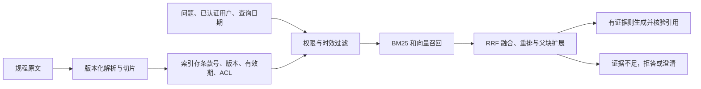
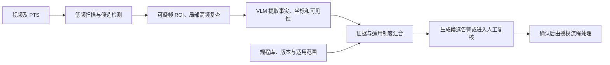

# 综合项目面试案例

这里的三个案例是白板练习。样本数量、门槛和结果都是为了说明如何做决策。面试里换成自己实际参与的环节、测过的数据和遇到的坏例子。

## 面试怎样展开

1. **先确认约束。** 谁在用，什么算成功，哪里允许转人工，哪些错误会阻止上线？
2. **画主链路。** 写出输入、输出、状态、数据来源和失败出口。指出哪一步需要模型判断，哪一步用确定性规则。
3. **讲一项取舍。** 给出基线、改动及预期影响，再说参数变更会牺牲什么。
4. **设计评测系统。** 定义样本和金标，给候选方案同一份测试集，记录节点评测与端到端结果，按风险或流量切片，设灰度和回滚门槛。
5. **讲一个坏例子。** 用可回放证据找到第一个失败节点，然后说如何修、如何验证。面试官追问实现时，把该节点写成少量伪代码。

**白板上的两张图各回答一个问题。** 业务图回答请求怎样走、什么时候停、由谁兜底。评测图回答谁标答案、新旧版本怎么公平比较、结果如何影响发布。

### 评测系统的通用架构


白板上写清四类记录即可。样本包含问题、输入条件和金标。运行记录绑定数据集、模型、系统配置和版本。结果记录用样本 ID 串起答案、引用或回执，以及错误、延迟和成本。评测报告保留分组分母、逐样本对照与发布决策。调参数用开发集，最终决策再跑冻结的黄金集。

## 案例 A · 有权限和版本管理的企业规程问答

**面试问法**　同一个问题为什么员工与管理员看到的答案不同？制度每周更新，怎么确保引用的是适用版本？如何证明 RAG 改版真的有效？

### System Design 怎么画



- **先交代权限和数据。** 用户身份取自认证系统。默认回答当前适用版本，历史查询按明确的日期取证。同一条款号可能对应多个版本，索引和缓存都带版本，撤权后用当前授权兜住旧副本。
- **再交代为什么分两阶段。** 法条编号靠 BM25，同义问法靠向量，两路用 RRF 融合。重排控制在少量候选，先对子块排序再扩父块，补回例外条件。上游找错条款时，增大生成模型通常解决不了。
- **保留排障证据。** 每条请求记录文档快照、各阶段候选 ID、最终上下文、引用和各段耗时。记录与访问这些轨迹时也要有权限边界。

### Evaluation System 怎么搭

| 层级 | 测试输入和金标 | 怎么决定 |
| --- | --- | --- |
| 权限与时效 | 同题切换角色或日期，标注允许的条款版本、正确拒答与撤权行为 | 测试中出现越权或引用失效版本就拦截发布 |
| 检索与生成 | 可答题标金标条款和关键答案；无证据题标正确拒答 | 分别报候选命中、重排后命中、回答正确且引文支持、误拒答。字段和权限用规则，开放回答结合关键事实与人工抽检 |
| 性能和成本 | 用相同流量分布重放，同一输入与 timeout 规则，失败也计费 | 对照端到端 P95、每个成功任务成本与高风险切片。保留逐题结果，便于解释退化 |

**白板算例。** 200 题里有 150 道可答题，另有 50 道无答案或因权限应拒答。基线和新版都跑同一份快照。新版让候选条款命中从 120/150 到 138/150，答案正确且引用支持从 108/150 到 125/150。端到端 P95 却从 1.4 秒升到 1.9 秒，超过约定的 1.8 秒。我的决定是先保留基线，分别拆测融合和重排的增量，并尝试让高置信度、单条款的查询跳过精排。重复测权限、误拒答和 P95 再决定灰度。

**追问怎么答。** 正确条款从未出现，就查原文是否入库、版本和权限是否匹配、切片与召回是否漏掉。进候选却未到 Prompt，就查重排、同文档上限与截断。Prompt 里证据已经齐全，就查结论是否支持、是否忽略了例外。这样能说清为什么调 Top-K、权重或上下文预算，以及参数会影响哪一步。

**把章节串起来。** [第 3 章 · RAG 检索增强](03-RAG%E6%A3%80%E7%B4%A2%E5%A2%9E%E5%BC%BA/README.md#本章总结项目设计与评测系统) 负责证据链，[第 2 章 · Prompt 与模型调用](02-Prompt%E4%B8%8E%E6%A8%A1%E5%9E%8B%E8%B0%83%E7%94%A8/README.md#本章总结项目设计与评测系统) 负责输出结构与调用错误，[第 1 章 · 大模型入门](01-%E5%A4%A7%E6%A8%A1%E5%9E%8B%E5%85%A5%E9%97%A8/README.md#本章总结项目设计与评测系统) 核算每成功任务成本，[第 6 章 · 部署推理与压测](06-%E9%83%A8%E7%BD%B2%E6%8E%A8%E7%90%86%E4%B8%8E%E5%8E%8B%E6%B5%8B/README.md#本章总结项目设计与评测系统) 验证 P95 和容量，[第 10 章 · 模型家族](10-%E6%A8%A1%E5%9E%8B%E5%AE%B6%E6%97%8F/README.md#本章总结项目设计与评测系统) 用同一黄金集决定模型是否更换。

## 案例 B · 矿山视频巡检，从视觉证据到人工复核

**面试问法**　现场摄像头光线差、目标小，模型有时看不清。你怎样设计低成本、高可回溯的复核链路？怎样证明夜间不退化？

### System Design 怎么画



- **先说明输入与产物。** 一条证据保存视频、PTS 区间、候选区域、视角、可见性、模型版本。制度链路独立保留规则 ID、有效期与适用范围。被遮挡的样本标为不确定，留给高清或人工复核。
- **讲清速度与漏报。** YOLO 或低清初筛减少高成本调用；可疑、小目标或高风险片段使用高清 ROI，必要时同时保留全图。低频节省视觉 token，短事件可能完全没被抽到。按时长分布校验最小采样密度。
- **需要微调时再接数据闭环。** 先证明图里确有证据，输入尺度与抽帧已经合适。如果同类视觉错误仍重复出现，才收集该类事件训练 projector 或 LoRA。标清训练目标，按事件分组，保持黄金集独立。

### Evaluation System 怎么搭

| 层级 | 怎么标注、怎么测 | 直接用于什么决策 |
| --- | --- | --- |
| 检测与视频 | 以事件拆训练和测试，同一连拍和裁图归同组；标原始框、开始／结束时间以及能否看清 | 测事件召回、候选框召回和时间边界误差，拆“没抽到帧”和“抽到却没识别” |
| 视觉复核 | 标客观事实和可见性，分别看夜间、小目标、遮挡、密集目标；明确哪些事件证据不足 | 真实隐患判未知仍计入严格召回的分母，另报转人工率、误报率和自动覆盖率 |
| 端到端 | 同一套事件对照 YOLO 单路、整画面 VLM、检测加 ROI。若做 LoRA，先固定输入和 Prompt 再比较 | 发布看关键切片、回放证据、人工积压、P95 与每成功事件成本。先影子运行观察再开放自动流程 |

**怎么回答失败。** 假设夜间隐患 40 个，旧版命中 34，候选只命中 30，即使白天正确率上涨，也要先查 4 个净损失背后的新退化。拿一个遮挡错例回放。先找原视频时间段是否有帧被抽到，再看检测是否给候选、ROI 是否裁掉安全带、VLM 是否说未知、人工是否收到。若截帧漏掉，调采样；若裁剪漏掉，扩大 ROI 或附带全图；若看得到仍误判，再比较输入和模型。改善后复测人工量与每事件成本。

**怎么现场讲出主线。** “我把能看见的视觉事实、适用规则、最终处置拆成三段。评测按事件和困难条件分组。上线门槛先看真实隐患的漏报与复核能力，再看成本，避免总体平均分掩盖夜间问题。”

**把章节串起来。** [第 7 章 · 多模态大模型](07-%E5%A4%9A%E6%A8%A1%E6%80%81%E5%A4%A7%E6%A8%A1%E5%9E%8B/README.md#本章总结项目设计与评测系统) 选抽帧、ROI 和评测切片，[第 3 章 · RAG 检索增强](03-RAG%E6%A3%80%E7%B4%A2%E5%A2%9E%E5%BC%BA/README.md#本章总结项目设计与评测系统) 提供规则证据，[第 5 章 · 微调与 LoRA](05-%E5%BE%AE%E8%B0%83%E4%B8%8ELoRA/README.md#本章总结项目设计与评测系统) 做输入固定下的微调消融，[第 6 章 · 部署推理与压测](06-%E9%83%A8%E7%BD%B2%E6%8E%A8%E7%90%86%E4%B8%8E%E5%8E%8B%E6%B5%8B/README.md#本章总结项目设计与评测系统) 验证高低清级联在真实流量下的成本与尾延迟，[第 10 章 · 模型家族](10-%E6%A8%A1%E5%9E%8B%E5%AE%B6%E6%97%8F/README.md#本章总结项目设计与评测系统) 用同题比较视觉模型。

## 案例 C · 带写入工具的设备维修 Agent

**面试问法**　助手能查日志与历史件，还能建维修工单。模型说“已处理”，怎么验证？系统变慢时应该改 Agent、推理服务，还是换模型？

### System Design 怎么画


- **Agent 和 Workflow 的取舍。** 动态诊断有多个证据源时可以让 Agent 决定先查哪个。身份、权限、审批、创建工单和确认结果固定在宿主层。限定步数、截止时间和可执行工具。
- **副作用与状态。** 每次业务意图持有稳定的幂等键。写入成功而客户端超时，先查状态，再决定是否用原键重试。最终回复根据回执区分草稿、已受理和已完成。SSE 有输出也可能只是进度。
- **部署追问。** 先把排队、模型 Prefill、Decode、工具调用分开看，再到真实负载下压测。若瓶颈在模型，GQA 的 KV 头数和 KV Cache 的显存随上下文增长会影响并发；连续批处理会改变排队与吞吐。若加了缓存实现，用全量前向逐 token 对照 logits、位置与掩码，再测延迟。工具慢时先优化或降级工具。

### Evaluation System 怎么搭

| 要评的事 | 样本和方法 | 结果怎么读 |
| --- | --- | --- |
| 有没有完成任务 | 将可回放的告警、工具响应与期望状态放进隔离环境，对照固定 Workflow 和 Agent，读取工单存储验收 | 看任务成功率、同题重复执行均成功的比例、错误写入、重复工单和越权 |
| 能否恢复 | 注入工具失败、回执丢失、审批拒绝、并行工具部分失败、断流和预算耗尽 | 检查是否继续、停止、退回人工或查询已有工单。核对每个调用 ID 与结果是否匹配 |
| 部署是否撑得住 | 用同一流量重放长短请求和工具耗时分布，按步骤保存 trace | 端到端 P95、模型 TTFT/TPOT、超时、每成功任务成本。分别比较推理变更与 Agent 流程变更 |

**现场追问。** 假设工具返回丢失，旧 Agent 又建一张工单。我的回归会让测试工具先写成功再超时。系统先查同一幂等键的权威状态，确认已有就返回同一单号。验收直接查工单库里只多一条记录，并验证回复与这条记录的状态一致。模型说“完成”只是一个待审核输出。

**把章节串起来。** [第 4 章 · Agent 智能体](04-Agent%E6%99%BA%E8%83%BD%E4%BD%93/README.md#本章总结项目设计与评测系统) 管状态和工具执行，[第 2 章 · Prompt 与模型调用](02-Prompt%E4%B8%8E%E6%A8%A1%E5%9E%8B%E8%B0%83%E7%94%A8/README.md#本章总结项目设计与评测系统) 管消息、回执与流式恢复，[第 1 章 · 大模型入门](01-%E5%A4%A7%E6%A8%A1%E5%9E%8B%E5%85%A5%E9%97%A8/README.md#本章总结项目设计与评测系统) 对账，[第 6 章 · 部署推理与压测](06-%E9%83%A8%E7%BD%B2%E6%8E%A8%E7%90%86%E4%B8%8E%E5%8E%8B%E6%B5%8B/README.md#本章总结项目设计与评测系统) 做负载验证，[第 8 章 · Transformer 原理](08-Transformer%E5%8E%9F%E7%90%86/README.md#本章总结项目设计与评测系统) 解释注意力和 KV 的限制，[第 9 章 · 手写 Transformer](09-%E6%89%8B%E5%86%99Transformer/README.md#本章总结项目设计与评测系统) 提供数值等价的验证思路，[第 10 章 · 模型家族](10-%E6%A8%A1%E5%9E%8B%E5%AE%B6%E6%97%8F/README.md#本章总结项目设计与评测系统) 负责模型或模型路由的切换门槛。

## 白板伪代码怎样落

当面试官追问「设计一个评测系统，写一下执行流程」，可以从下面展开。先说明金标数据和通过条件，再写循环。

```text
for case in 固定测试集:
    for version in [基线, 候选]:
        重置到同一个测试快照(case)
        result, trace = 带超时运行并保留失败记录(version, case)
        scores = 规则与金标评分(case, result, trace)
        保存(case.id, version, scores, trace, 耗时, 全部尝试成本)

按 case.id 对照改善和退化
按困难场景聚合成功率、错误类型和 P95，并保留样本量
用越权、误写、关键切片、时延和成本门槛决定是否灰度
```

现场只需要选一个难点写细。规程问答可以写“授权过滤后获取候选并验证引用”。多模态可以写“低置信样本升级到高清或人工”。Agent 可以写“用原幂等键查回执并恢复”。如果需要评开放答案，用事实级标准或经抽样校准的评审模型，边界难例交人工。离线、影子和灰度的产物分别保留，发布判断能回到具体错例。

## 十章在项目里分别负责什么

| 章 | 面试时要拿出来的能力 | 综合案例 |
| --- | --- | --- |
| [第 1 章 · 大模型入门](01-%E5%A4%A7%E6%A8%A1%E5%9E%8B%E5%85%A5%E9%97%A8/README.md#本章总结项目设计与评测系统) | 输入、输出、采样与每成功任务成本 | A、C |
| [第 2 章 · Prompt 与模型调用](02-Prompt%E4%B8%8E%E6%A8%A1%E5%9E%8B%E8%B0%83%E7%94%A8/README.md#本章总结项目设计与评测系统) | 接口验收、工具配对、流式完成与恢复 | A、C |
| [第 3 章 · RAG 检索增强](03-RAG%E6%A3%80%E7%B4%A2%E5%A2%9E%E5%BC%BA/README.md#本章总结项目设计与评测系统) | 权限、时效、召回和原文证据 | A、B |
| [第 4 章 · Agent 智能体](04-Agent%E6%99%BA%E8%83%BD%E4%BD%93/README.md#本章总结项目设计与评测系统) | 受控决策、幂等、回执与稳定性 | C |
| [第 5 章 · 微调与 LoRA](05-%E5%BE%AE%E8%B0%83%E4%B8%8ELoRA/README.md#本章总结项目设计与评测系统) | 判断何时训练、如何做独立消融 | B |
| [第 6 章 · 部署推理与压测](06-%E9%83%A8%E7%BD%B2%E6%8E%A8%E7%90%86%E4%B8%8E%E5%8E%8B%E6%B5%8B/README.md#本章总结项目设计与评测系统) | 排队、批处理、显存、容量及负载验证 | A、B、C |
| [第 7 章 · 多模态大模型](07-%E5%A4%9A%E6%A8%A1%E6%80%81%E5%A4%A7%E6%A8%A1%E5%9E%8B/README.md#本章总结项目设计与评测系统) | 视频证据与困难切片，低成本升级 | B |
| [第 8 章 · Transformer 原理](08-Transformer%E5%8E%9F%E7%90%86/README.md#本章总结项目设计与评测系统) | KV 容量、长上下文和注意力的部署取舍 | C |
| [第 9 章 · 手写 Transformer](09-%E6%89%8B%E5%86%99Transformer/README.md#本章总结项目设计与评测系统) | 以全量实现为参考，验证增量解码和掩码 | C |
| [第 10 章 · 模型家族](10-%E6%A8%A1%E5%9E%8B%E5%AE%B6%E6%97%8F/README.md#本章总结项目设计与评测系统) | 基于约束和同集证据做选型及可逆切换 | A、B、C |

[返回总目录](README.md)
